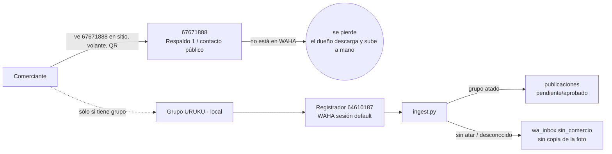
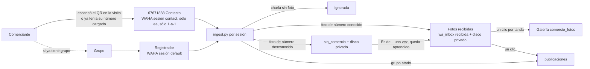

# Fotos que mandan los comercios por WhatsApp: análisis (19/10/2026)

> **Estado:** análisis para decidir. No es una spec aprobada.
> Base: el código en `main` (`4102f74`) y los docs de `docs/`. Cada afirmación
> sobre el sistema lleva su `archivo:línea`. Lo que depende de WAHA (el
> producto de terceros) está marcado como **a verificar** con la fuente.

---

## 0. En una pantalla

**Qué pasa de verdad.** El comerciante manda las fotos al **67671888** porque
**es el único número de URUKU que tiene a la vista**: desde el 7/10 es el
WhatsApp público del sitio (`frontend/lib/contacto.ts:2-7`, commit `2072980`),
el que figura en el pie, en `/contacto` con su QR y en el volante («Dudas:
WhatsApp…», `frontend/app/volante/[slug]/page.tsx:107`). Ese mismo volante le
dice «Mande la foto al grupo de WhatsApp URUKU · {nombre}»
(`volante/[slug]/page.tsx:95-96`) **tenga grupo o no**. Si el grupo no existe,
el único destino posible es el número impreso abajo.

**Por qué no llega solo.** WAHA tiene **una sola sesión**, vinculada al
Registrador (64610187). El 67671888 **no está conectado a WAHA**: figura en
`WA_NUMEROS_PROPIOS` (`docs/deploy-10-09.md:131`), pero esa lista es una guarda
de lectura y no lo vincula a nada (`docs/numeros-whatsapp-uruku.md:319-323,
532-535`). Lo que entra al 67671888 no existe para el sistema.

**Y aunque llegara, hoy no termina donde lo pone el dueño.** La ingesta
convierte toda foto en una **publicación** (oferta o novedad del feed),
nunca en una foto de la **galería** del comercio (`comercio_fotos`). No hay
ningún camino de WhatsApp a la galería. Además, una foto de un número
desconocido no se copia al disco propio, así que no se puede asignar después.

**Lo que recomiendo**, en este orden:

1. **Entrega 1 (M): A + C.** Conectar el 67671888 a WAHA como **segunda sesión
   de sólo lectura, sólo chats 1-a-1** (A). Las fotos de números conocidos
   llegan a una bandeja **«Fotos recibidas»** con su comercio ya puesto. En esa
   bandeja se elige el destino (galería / oferta / descartar) de a varias por
   clic. A un número desconocido se le asigna el comercio **una vez** y queda
   aprendido (C). Con esto ya no hay que descargar ni subir a mano.
2. **Entrega 2 (S-M): B.** Al terminar el alta, la app del agente muestra un QR.
   El comerciante lo escanea y toca «Enviar», y su número queda vinculado al
   comercio con prueba de que es suyo. Desde ese momento ese chat es «donde se
   mandan las fotos». Así se resuelve «no sé qué grupo darle»: no hace falta
   grupo.
3. **Grupos:** quedan funcionando para los que ya tienen. Para los comercios
   nuevos, el pool de grupos (D) es **opcional** y lo decide el dueño (§4, D7).

Ninguna opción recomendada hace que WAHA escriba.

---

## 1. Cómo funciona hoy (verificado en el código)

### 1.1 Qué número de URUKU conoce el comerciante

| Dónde lo ve | Qué número | Referencia |
|---|---|---|
| Pie del sitio, «Escribile a URUKU», `/contacto` (QR + vCard), autoregistro, planes, pago de Mi comercio | **67671888** (`WA_URUKU`) | `frontend/lib/contacto.ts:7`; `components/uruku-shell.tsx:161`; `components/contacto-uruku.tsx:18-40`; `app/autoregistro/page.tsx:127`; `app/planes/page.tsx:55`; `app/mi-comercio/page.tsx:1056` |
| Volante impreso / PDF | «Mande la foto al grupo URUKU · {nombre}» + «Dudas: WhatsApp **67671888**» | `app/volante/[slug]/page.tsx:93-98, 107` |
| «Mandarle su ficha por WhatsApp» (app del agente) | Sale del **celular del agente** y lo invita a completar «horario, fotos» y a «responder este mensaje» | `lib/ficha-whatsapp.ts:19-30`; `components/ofrecer-comercio.tsx:202-246` |
| Login por WhatsApp (`CONFIRMAR-…`) | 64610187 (Registrador, `BOT_WHATSAPP_NUMERO`) | `backend/app/core/config.py` (`wa_link_confirmar`); `docs/numeros-whatsapp-uruku.md:82-83` |

El comentario de `contacto.ts:2-6` dice que el 67671888 es «la cara de URUKU con
comerciantes y compradores» desde el 7/10. Los docs operativos siguen diciendo
otra cosa (§1.9).

### 1.2 Qué número lee el sistema

- WAHA corre **una sola sesión**, `default`, vinculada al Registrador 64610187
  (`docs/numeros-whatsapp-uruku.md:15, 532-535`; `docs/manual-operativo-whatsapp.md:16`).
- El backend sólo vigila y consulta la sesión `default`:
  `services/wa_sesion.py:37` (`estado(sesion="default")`), `:71` (`vigilar`),
  `main.py:139-151` (el loop la llama sin argumentos), y el reprocesado arma el
  evento con `"session": "default"` (`api/moderacion.py:3254-3256`).
- El webhook no distingue sesiones: `event.session` sólo se usa para marcar
  `via='cloud'` (`services/ingest.py:420, 483`; `api/webhook.py:99-145`).
- La imagen es `devlikeapro/waha:latest` con NOWEB, y el webhook se configura
  por variables de entorno globales (`docker-compose.prod.yml:56-86`).

**Conclusión: el 67671888 no está conectado a WAHA.** Para confirmarlo en prod:
`GET /api/sessions` tiene que listar sólo `default` con `me.id = 59164610187`
(comando en `docs/manual-operativo-whatsapp.md:224-226`).

### 1.3 El recorrido de un mensaje en la ingesta (`backend/app/services/ingest.py`)

| # | Paso | Línea |
|---|---|---|
| 1 | Evento que no es `message`/`message.any` → se descarta antes de la bandeja | 437-445 |
| 2 | `fromMe` (lo que manda el número vinculado) → se descarta antes de la bandeja | 450-457 |
| 3 | `CONFIRMAR-XXXXXX` → login/recuperación, no publica | 459-461, 298-312 |
| 4 | La clave del comercio mandada por WhatsApp → se tapa y se anula | 466-468, 404-430 |
| 5 | Se guarda el crudo en `wa_inbox`, idempotente por `wa_message_id` | 471-497 |
| 6 | Explorador → publica por código, siempre a moderación | 510-511, 327-401 |
| 7 | Número propio **en un grupo** → sólo puede atar el grupo por código; nunca publica | 513-529, 45-66 |
| 8a | Grupo → `_identificar_por_grupo`: grupo atado, o código adentro | 537-546, 69-108 |
| 8b | 1-a-1 → `_identificar_comercio`: JID/número conocido, o código | 547-560, 115-165 |
| 9 | Ubicación compartida → actualiza el comercio | 567-575 |
| 10 | Gate por plan (apagado por default) | 583-587, 190-195 |
| 11 | Mensaje que es sólo el código → no publica | 596-600 |
| 12 | Cuota del plan | 611-626 |
| 13 | `confiable` (y remitente ajeno en grupo → moderación) | 635-646 |
| 14 | Foto → se copia al disco propio (`wa_media`) | 662-666 |
| 15 | Fusión foto + precio en dos mensajes | 700-705 |
| 16 | `insert_publicacion` | 707 |

El número se identifica con `repository.get_comercio_por_numero`
(`backend/app/db/repository.py:409-443`). Primero busca en `comercio_numeros`
(números autorizados) y después en `comercios.whatsapp` (el número público,
normalizado o con los 8 dígitos locales). Sólo considera comercios activos. El
`@lid` de WhatsApp ya está resuelto (`backend/app/models/whatsapp.py:7-29, 54-64`).

### 1.4 Qué pasa HOY si un comerciante con número cargado manda una foto 1-a-1 a un número leído

El único número leído es el Registrador. En ese caso:

1. Se identifica **por número** (`ingest.py:134-138`), con `identidad_origen='numero'`.
2. Una foto sin texto se clasifica como **oferta** (`ingest.py:269-271`).
3. Un comercio cargado en la calle nace con `confiable=False`
   (`api/campo.py:327`), así que entra **pendiente** en Admin › Publicaciones.
4. La foto se baja a `fotos/{slug}/ofertas/…` (`services/wa_media.py:97-115`).

**No va a la galería.** Para la galería sólo existen las subidas por formulario:
admin (`api/moderacion.py:1731-1756`), agente (`api/campo.py:1040`) y comercio
(`api/comercio.py:1209`). Lo que el dueño hace hoy a mano es justamente usar la
primera.

Hay tres efectos colaterales que importan para cualquier opción que lea un
número **conversacional**:

- **Un texto sin foto también publica.** «Hola, ¿cuánto sale el plan?» desde un
  número conocido crea una **novedad pendiente**. El único texto que no publica
  es el que trae sólo el código (`ingest.py:596-600`).
- **Lo que llega de un número desconocido no conserva la foto.** Queda en
  `wa_inbox` como `sin_comercio` (`ingest.py:547-560`), pero la foto sólo se
  copia en el camino que publica (`ingest.py:662-666`) y en el del explorador
  (`:361-365`). Queda nada más la `media_url` interna de WAHA. Según la
  documentación de WAHA, WAHA borra sus archivos a los **180 s**
  (`WHATSAPP_FILES_LIFETIME`, que el compose no fija:
  `docker-compose.prod.yml:59-79`). **A verificar en prod.** Además, el
  navegador no alcanza esa URL (`wa_media.py:7-10, 37-61`), así que la miniatura
  de la bandeja (`components/bandeja-whatsapp.tsx:215-218`) probablemente no se
  ve nunca.
- **Bug latente.** Un número propio que escribe **1-a-1** con `URUKU-XXXX` queda
  autorizado para ese comercio. La guarda de números propios sólo mira los
  grupos (`ingest.py:513`), y `_identificar_comercio` agrega el número sin
  preguntar si es nuestro (`ingest.py:140-157`). Desde ahí, todo lo que ese
  número de URUKU mande 1-a-1 se atribuye a ese comercio.

**El circuito de imágenes nunca se probó en producción:** «WAHA nunca recibió
una imagen» (`docs/handoff-2026-10-03.md:68-71`).

### 1.5 Cómo se ata un grupo hoy

- **A mano, desde el Samsung (Anfitrión 75314737).** Se crea el grupo, se agrega
  al comerciante y al Registrador, y se manda `URUKU-XXXX` adentro
  (`docs/manual-operativo-whatsapp.md:97-110`). Lo ata
  `_atar_grupo_por_codigo_propio` (`ingest.py:45-66, 513-525`).
- **A mano desde el admin**, pegando el JID `…@g.us`
  (`api/moderacion.py:1278-1311`; UI en `frontend/app/admin/page.tsx:3522-3600`,
  que también muestra los 3 pasos manuales).
- **Crear el grupo por API está apagado** con `WA_SOLO_LECTURA`
  (`core/config.py:187`; `api/moderacion.py:1264-1275, 1434-1486`).
- La tabla es `comercio_wa_grupos` (`supabase/migrations/0065_comercio_wa_grupos.sql`).
  Soltar un grupo hace un `DELETE` físico (`repository.py:496-499`), contra
  `lesson-nunca-delete-fisico-siempre-soft`.

### 1.6 Qué captura el agente en el alta (`backend/app/api/campo.py`)

- **WhatsApp:** es opcional (`:182`) y se guarda normalizado en
  `comercios.whatsapp` (`:309`). También se puede completar después del alta
  con `CapturaWhatsapp` (`frontend/components/captura-whatsapp.tsx`). El agente
  completa un número vacío pero no lo cambia (`campo.py:757-774`). El manual le
  pide «el número que atiende ventas» (`docs/manual-agente-de-campo.md:104-111`).
- **No se verifica** que ese número sea de quien está enfrente, y no entra en
  `comercio_numeros`. El backfill de esa tabla fue único, en la `0043`. Igual
  identifica, porque `get_comercio_por_numero` cae a `comercios.whatsapp`.
- **Consentimiento:** `consentimiento_dueno` + hora (`:199, :339-342`; migración `0155`).
- **Clave:** `PREFIJO-AZAR`, se muestra una vez (`:384`). **El código URUKU-XXXX
  no vuelve** (`:405`), por decisión (`docs/clave-automatica.md:12, 44-51`).

### 1.7 Qué pantallas existen para lo que no se identificó

- **Admin › Recepción** (`GET /admin/whatsapp/entrantes`,
  `api/moderacion.py:2518-2567`). Filtra por «problemas», busca por comercio o
  teléfono (`repository.py:669-728`) y agrupa por comercio o por JID
  (`bandeja-whatsapp.tsx:285-334`).
- **Reprocesar** sólo sirve para filas **sin resultado** (`api/moderacion.py:3228-3260`;
  `bandeja-whatsapp.tsx:243-254`). Una fila `sin_comercio` no tiene ninguna
  acción.
- **Números autorizados por comercio**: existen en la ficha del admin
  (`api/moderacion.py:1223-1251`; `frontend/app/admin/page.tsx:3372, 3447`). No
  se pueden cargar desde la bandeja.
- Las apps del agente (`ficha-agente.tsx`, «Qué hay acá», `/publicar`) no tienen
  nada de WhatsApp entrante.

### 1.8 Dónde se rompe en este caso

| # | Rotura | Evidencia |
|---|---|---|
| R1 | El número que el comerciante conoce (67671888) no lo lee nadie | §1.1, §1.2 |
| R2 | Al comercio sin grupo, el volante lo manda a un grupo que no existe | `volante/[slug]/page.tsx:95-96` |
| R3 | Crear el grupo depende de un humano con el Samsung, que no está en la visita | §1.5 |
| R4 | Aunque se leyera, la foto iría a **ofertas**, no a la **galería** | §1.4 |
| R5 | Leer un número conversacional convertiría charlas en novedades pendientes | `ingest.py:596-600` |
| R6 | La foto de un número desconocido se pierde (no se copia; WAHA la borra) y no hay «asignar» | §1.4, §1.7 |



### 1.9 Inconsistencias en los docs (para el tech-writer, no bloquean)

- `docs/numeros-whatsapp-uruku.md:18` y `docs/manual-operativo-whatsapp.md:19`
  dicen que el 67671888 es **Respaldo 1, callado en los grupos**. Desde el 7/10
  es el **número público** (`contacto.ts:2-7`). Un respaldo que conversa todos
  los días con el público ya no es el «número sano en el cajón» que pide
  `numeros-whatsapp-uruku.md:445-447`.
- `manual-operativo-whatsapp.md:266-268` (5.4) toma como reemplazo del
  Registrador al **68727584**, que **no tiene WhatsApp** (`:87-88`).
  **Hoy no hay respaldo real.**
- El comentario del volante dice que el contacto es «el Anfitrión»
  (`volante/[slug]/page.tsx:104-106`), pero imprime `WA_URUKU` (67671888).

---

## 2. Opciones

Escala de esfuerzo: **S** ≤ 1 día · **M** 2-4 días · **L** más de una semana.
Todas suponen el **Paso 0** de §3 (probar el circuito de imágenes en prod).

### Opción A: leer el 67671888 con WAHA (segunda sesión, sólo lectura, sólo 1-a-1)

**Cómo funciona.** Se crea en WAHA la sesión `contact` y se vincula al 67671888
con código de emparejamiento, igual que el Registrador
(`numeros-whatsapp-uruku.md:242-265`). El webhook es el mismo. La ingesta mira
`event.session`:

- **Grupos que llegan por `contact` se descartan antes de la bandeja.** Los lee
  `default`. Si la copia de `contact` entrara primero y quedara «ignorada», la
  de `default` se rechazaría por duplicada (`ingest.py:486-497`), suponiendo que
  el `wa_message_id` coincida en las dos sesiones (**a verificar**).
- **Texto sin foto y sin precio = conversación:** no publica nunca (cierra R5).
- **Foto de un número conocido:** se copia a disco **privado** y entra a
  «Fotos recibidas» con su comercio (resultado `recibida`). No se publica sola
  (cierra R4, junto con C).
- **Foto de un número desconocido:** también se copia a disco privado y queda
  `sin_comercio`, lista para C (cierra R6).
- Lo que responde el dueño desde el teléfono llega con `fromMe` y ya se
  descarta (`ingest.py:450-457`).

**Qué toca.**
- *Infra:* que la versión de WAHA soporte varias sesiones gratis (desde la
  **2026.6.1**, según el blog de WAHA; **a verificar** la que corre). Crear la
  sesión. Un volumen nuevo para las fotos recibidas, fuera de `/data/fotos`, que
  es público (`main.py:369`).
- *Backend:* la rama por sesión en `ingest.py`, la vigilancia de las dos
  sesiones (`wa_sesion.py`, `main.py:139-151`), config nueva y la guarda de
  números propios también en 1-a-1 (arregla el bug latente de §1.4).
- *Migración:* `wa_inbox.session`, `wa_inbox.media_path` y el valor `recibida` (§3).
- *Frontend:* Recepción con dos luces (Registrador y Contacto).
- *Operación:* el dueño vincula el 67671888 una vez (minutos). Ocupa uno de los
  4 dispositivos vinculados.

**Riesgo de baneo.** **Probabilidad baja**: sólo lee, es la misma exposición
que el Registrador, vinculado desde el 11/9, y su caída del 10/9 fue
`device_removed`, no un baneo (`numeros-whatsapp-uruku.md:230-240`). **Impacto
alto**: es el número público impreso (prensa, volantes, QR de `/contacto`). Si
lo banean, el sitio cambia en un deploy (`contacto.ts:7`); lo impreso no. Es el
riesgo que el dueño tiene que aceptar explícitamente (§4, D2). WAHA **no
escribe** en esta opción.

**Esfuerzo:** M. **Qué hace el comerciante:** nada nuevo. Manda al número que
ya conoce.

**Sola no alcanza.** Sin C, lo de números desconocidos se acumula sin salida.

### Opción B: vincular el WhatsApp del comerciante en la visita (QR → «Enviar»)

**Cómo funciona.** Al terminar el alta (`/publicar`, `CompletarTrasAlta`,
`frontend/app/publicar/page.tsx:514`) y en la ficha del agente
(`ficha-agente.tsx`, junto a `OfrecerComercio`), aparece «Vincular su
WhatsApp». La app genera un **token de un solo uso** que vence en 72 h. **No es
el código URUKU-XXXX.** Muestra un QR que abre `wa.me/<número de contacto>` con
el texto ya escrito: «Hola URUKU, soy de {nombre}. Vincular V-K7M2P9». El
comerciante lo escanea con su celular y toca **Enviar**.

La ingesta lo intercepta antes que todo, como el `CONFIRMAR`
(`ingest.py:459-461`):

- Agrega `comercio_numeros(numero, comercio_id, created_by='link:<agente>')`.
  Lo autorizó una persona presente, así que cuenta como `identidad_origen='numero'`.
- Rechaza números propios, como `_handle_confirmacion` (`ingest.py:302-306`).
- **No le roba** un número a otro comercio activo: queda `sin_permiso` con el
  motivo.
- La app del agente consulta cada pocos segundos hasta mostrar «Listo, +591 7…
  vinculado».

**Qué gana.** Prueba que el número es de quien está enfrente
(`pattern-identidad-celular-progresiva`: pasa de «identificado» a
«verificado»). Captura **el teléfono con el que va a mandar fotos**, que puede no
ser el de ventas. Y deja abierto en el celular del comerciante **el chat
correcto**: «mandá tus fotos a este chat». Así se resuelve R3 sin grupo.

**Qué toca.**
- *Migración:* tabla `wa_link_tokens`.
- *Backend:* dos endpoints de campo y la rama `_RE_LINK` en la ingesta.
- *Frontend:* el componente `LinkWhatsapp` con el QR. El sitio ya genera QR en
  `contacto-qr.tsx`.
- *Operación:* ninguna fuera de la visita.

**Riesgo de baneo:** ninguno. El mensaje es entrante y lo inicia el usuario.

**Esfuerzo:** S-M. **Qué hace el comerciante:** escanea un QR y toca «Enviar»,
una sola vez.

**Destino del token.** Si se hace A, va al 67671888, y el comerciante queda con
un solo número de URUKU. **Sin A**, sólo puede ir al Registrador, que funciona
hoy pero no contesta nunca: el comerciante tendría dos números de URUKU, uno
para hablar y otro para fotos. Ésa es justamente la confusión de hoy.

### Opción C: bandeja «¿De quién es esto?» y «Fotos recibidas» en Recepción

**Cómo funciona.**

- **Asignar un número desconocido:** en Recepción, lo `sin_comercio` en 1-a-1
  se agrupa por teléfono, con miniaturas que sirve un endpoint del admin desde
  el disco privado. «Es de…» abre el buscador de comercios. Al confirmar:
  - Se crea `comercio_numeros` con `created_by` = email del admin. Eso es
    **aprender**: lo próximo de ese número se identifica solo.
  - Se reprocesan **todas** las filas `sin_comercio` de ese teléfono de los
    últimos 30 días. Es seguro: esas filas no crearon nada.
  - Si el número ya es de otro comercio activo, contesta **409**, igual que con
    los grupos (`api/moderacion.py:1302-1307`). Hay que hacerlo explícito porque
    `agregar_numero_comercio` hace upsert por `numero` y **lo movería en
    silencio** (`repository.py:566-577`).
- **Elegir destino de lo recibido:** marcar varias fotos de un comercio y elegir
  «A la galería», «Es una oferta» o «Descartar».
  - *Galería:* pasa por `fotos_galeria.preparar/registrar` con
    `puede_pagar=False`, igual que la subida del admin
    (`api/moderacion.py:1742-1754`). Respeta el tope por plan; en el tope se
    reusa `tope-fotos-dialogo.tsx`.
  - *Oferta:* arma la publicación con las mismas reglas de la ingesta
    (pendiente, o aprobada si es confiable).
- **Grupo sin atar:** desde la misma fila, «Atar este grupo a…». Usa el endpoint
  que ya existe (`api/moderacion.py:1278-1311`) con el JID ya cargado.
- **Retención:** un worker borra las fotos que nadie asignó a los N días (§4, D6).

**Qué toca.**
- *Backend:* copiar la foto a disco privado también en `sin_comercio`, tres
  endpoints y el worker de retención.
- *Migración:* la misma de A.
- *Frontend:* las acciones en `bandeja-whatsapp.tsx` y el selector de comercio.
- *Operación:* el moderador asigna **una vez por número** y elige destino por tanda.

**Riesgo de baneo:** ninguno. **Esfuerzo:** M. **Qué hace el comerciante:** nada.

Ésta es la red de seguridad de todas las demás opciones: siempre va a haber un
empleado, un hijo o un celular nuevo que nadie cargó. La recomendación (c) de
`docs/grupos-whatsapp-uruku.md:108-126` ya iba en esta dirección.

### Opción D: grupos «listos para dar» (pool armado por el Anfitrión, con link de invitación)

**Cómo funciona.**

1. El Anfitrión crea **sin apuro** grupos vacíos, sólo con números propios: él,
   el Registrador y el respaldo. Les pone un nombre genérico («URUKU · tus fotos
   y ofertas») y activa «Aprobar nuevos participantes».
2. Pega **el link de invitación adentro del mismo grupo**. La ingesta ve un
   mensaje de un número propio, en un grupo sin atar, con
   `chat.whatsapp.com/…`, y lo registra como **grupo libre** con su link. No
   llama a ninguna API ni hay que tipear nada en el admin.
3. En el alta, «Darle su grupo» toma un grupo libre, lo ata al comercio y
   muestra el QR del link. El comerciante se une solo; el Anfitrión lo aprueba
   con un toque.

**Qué toca.**
- *Migración:* tabla `wa_group_pool` con soft-delete.
- *Backend:* la rama en la ingesta y el endpoint de campo.
- *Frontend:* el QR en la app del agente y el stock de grupos libres en el admin.
- *Operación:* el Anfitrión mantiene el stock (≤ 5 grupos por día), aprueba
  ingresos y renombra si quiere.

**Riesgo de baneo.** Más bajo que el flujo actual: hoy el Anfitrión **agrega**
al comerciante, y eso es el disparador número uno
(`numeros-whatsapp-uruku.md:738-742`); acá el comerciante entra solo. Crear
muchos grupos seguidos sigue siendo un patrón vigilado, de ahí el ritmo. El
link puede reenviarse: lo mitigan la aprobación de participantes y la regla de
remitente ajeno → moderación (`ingest.py:642-646`).

**Esfuerzo:** M-L más operación continua. **Qué hace el comerciante:** escanea
un QR, toca «Unirme» y después manda al grupo.

**En contra, de fondo.** Los grupos **no migran a la API oficial**
(`docs/whatsapp-arquitectura-y-escala.md:82-99`). Además, con cientos de grupos
la sesión se vuelve pesada (`:59-69`), y el propio plan por etapas dice «chat
directo en vez de grupo» al crecer (`:73-78`). Bermejo ya tiene más de 1.000
comercios cargados.

### Descartadas

| Opción | Por qué no |
|---|---|
| **WAHA crea los grupos y agrega gente** (el botón que ya existe, `api/moderacion.py:1434-1486`) | Es escribir. Viola la restricción del dueño y es la operación que más dispara baneos. **Riesgo explícito**: si algún día se reconsidera, sería sobre el número que lee todos los grupos |
| **WAHA contesta («recibí tu foto»)** | Es escribir. Hoy `_avisar` no sale nunca en sólo lectura (`ingest.py:168-187`). Va al asistente futuro (§5) |
| **Publicar el Registrador (64610187) como «el número para fotos»** | Funciona hoy sin código, porque identifica por número. Pero son dos números de URUKU para el comerciante (la confusión de hoy), nadie contesta en ese chat y `contacto.ts:5-6` decidió no publicarlo. Tampoco recupera lo que ya va al 67671888 por la prensa y el QR |
| **El dueño reenvía desde el 67671888 al Registrador con `URUKU-XXXX`** («un comando») | Hoy **ata el 67671888 a ese comercio** (bug de §1.4). Como explorador (`WA_NUMEROS_EXPLORADOR`) no ataría, pero crea **ofertas** con `origen='explorador'`, no fotos de galería. Sigue siendo manual (buscar el código por foto). A lo sumo es un parche de días |
| **API oficial de Meta ya, en el 67671888** | Para pasarlo a la API hay que dar de baja su WhatsApp común: pierde grupos e historial (`manual-operativo-whatsapp.md:78-81`). Además pide verificación del negocio (`:415-417`). Es el destino a largo plazo (§5), no el arreglo de este mes |

### Comparación

| | A: 67671888 en WAHA | B: QR de vinculación | C: bandeja asignar/destino | D: pool de grupos |
|---|---|---|---|---|
| Saca la descarga/subida manual | Sí, con C | Reduce los desconocidos | Sí | Sólo para comercios nuevos |
| Qué hace el comerciante | Nada | Escanea y envía, una vez | Nada | Escanea, se une, manda al grupo |
| WAHA escribe | No | No | No | No |
| Riesgo de baneo | Bajo, con impacto alto (número público) | Ninguno | Ninguno | Bajo (Anfitrión crea grupos) |
| Esfuerzo | M | S-M | M | M-L + operación |
| Migra a la API oficial | Sí: la lógica está en la ingesta | Sí | Sí | No |
| Depende de | Versión de WAHA; decisión D1/D2 | A (o Registrador) | Nada | Anfitrión con tiempo |

### Path dependence

La recomendación **sigue apoyada en WAHA**, que es lo que el equipo usa siempre
(`2026-06-04-stack-bermejo`, que ya registró el riesgo de que sea no oficial).
La contrasté con dos alternativas reales:

1. **API oficial de Meta en un número de contacto.** No hay baneo, lo entrante
   es gratis (`whatsapp-arquitectura-y-escala.md:133-145`) y habilita
   respuestas automáticas. Pero exige un número sin WhatsApp común y la
   verificación del negocio, y no tiene grupos. **Gana a largo plazo.** No gana
   este mes, porque el 67671888 ya está impreso y tiene app.
2. **Proceso humano mejorado** (reenviar con código, o publicar el Registrador).
   No hay que construir nada, pero no saca el trabajo manual ni la ambigüedad
   del número (tabla de descartadas).

Elijo WAHA porque se opera hoy con lo que ya existe. Y porque **todo lo que se
construye (enrutar por sesión, identificar por número, bandeja, vinculación)
vive después de `mensajeria.normalizar_entrante`** (`api/webhook.py:122-124`).
Cambiar el transporte a la API oficial no tira ese trabajo.

---

## 3. Recomendación y orden de implementación

### Paso 0: validar antes de escribir código (operación, horas)

1. **Probar una foto real**, desde un teléfono que no sea de URUKU, a un grupo
   atado y en 1-a-1 al Registrador desde un número cargado. Es el pendiente de
   `handoff-2026-10-03.md:68-71`: sin esto, todo lo demás se apoya en un
   circuito que nunca funcionó en producción.
2. **Ver la versión de WAHA** (`GET /api/version` o el dashboard). Tiene que ser
   ≥ 2026.6.1 para tener sesiones múltiples gratis. Si no, `docker compose pull
   waha` (`manual-operativo-whatsapp.md:246-255`).
3. **Medir cuántos comercios tienen WhatsApp cargado** (consulta interna, nunca
   al público). Es lo que A identifica sin C desde el primer día.
4. Que el dueño conteste **D1, D2 y D3** (§4).

### Entrega 1: A + C (lo mínimo que saca el trabajo manual) · M+M

**Config nueva (`backend/.env`):**

```
WA_CONTACT_SESSION=contact          # vacío = la sesión no existe (comportamiento de hoy)
WA_CONTACT_NUMBER=59167671888
WA_RECEIVED_DIR=/data/wa_received   # volumen propio, NO bajo /data/fotos (que es público)
WA_RECEIVED_RETENTION_DAYS=30
WA_CONTACT_STORE_CHAT=false         # D5: guardar o no el texto de las charlas
```

**Ingesta (pseudocódigo; los cambios sobre `handle_message`):**

```
after fromMe filter (ingest.py:450):
    if session == WA_CONTACT_SESSION and payload.es_grupo:
        return ignored("los grupos los lee la sesión default")   # ANTES de wa_inbox
intercept CONFIRMAR (as today) ; intercept LINK token (Entrega 2)
clave filtrada (as today)
if session == WA_CONTACT_SESSION and not has_media and not parece_oferta(body):
    comercio = get_comercio_por_numero(phone)
    if not comercio: return ignored("conversación")              # no se guarda nada
    insert wa_inbox(resultado='ignorada', motivo='conversación',
                    body = body if WA_CONTACT_STORE_CHAT else None)
    return
insert wa_inbox(..., session=session)                            # como hoy + columna nueva
explorador (as today)
if es_numero_propio(phone):  -> ignorada                         # grupos Y 1-a-1 (arregla el bug)
identify (as today)
if comercio is None:
    if has_media: media_path = copy_to_received_dir(media_url)  # dentro de los 180 s
    resultado = sin_comercio
elif session == WA_CONTACT_SESSION:
    media_path = copy_to_received_dir(media_url)
    if D4 and comercio.confiable and origin == 'numero': add to gallery directly
    else: resultado = 'recibida' (espera destino)
else:
    as today -> publicaciones
```

**Migración `0159_wa_contact_session.sql`** (en `supabase/migrations/` y en
`selfhost/postgres-init/`, idempotente, con `notify pgrst`):

```sql
alter table wa_inbox add column if not exists session text;      -- 'default' | 'contact' | 'cloud'
alter table wa_inbox add column if not exists media_path text;   -- ruta en WA_RECEIVED_DIR, privada
create index if not exists idx_wa_inbox_phone_pend
  on wa_inbox (phone, created_at desc) where resultado in ('sin_comercio', 'recibida');
comment on column wa_inbox.resultado is
  'publicada | ignorada | sin_comercio | sin_permiso | error | recibida (espera destino) | descartada';
-- wa_inbox sigue sin grants para anon/authenticated (0002_rls_grants.sql:63).
```

**Endpoints (Admin, `require_permiso("whatsapp")`):**

| Método y ruta | Cuerpo | Respuesta |
|---|---|---|
| `GET /admin/whatsapp/entrantes/{wa_message_id}/media` | — | La imagen desde `media_path` (404 si se purgó) |
| `POST /admin/whatsapp/numbers/{phone}/assign` | `{comercio_id, label?}` | `{numero, reprocesados: n}`; 409 `{comercio_actual}` si es de otro activo |
| `POST /admin/whatsapp/entrantes/route` | `{wa_message_ids: [...], target: "gallery"\|"offer"\|"discard", comercio_id?}` | `{ok: [...], tope: {...}?}`. Idempotente: sólo pasa filas `recibida` (o `sin_comercio` con `comercio_id`) |

**UI:** en Recepción, la luz de la sesión Contacto, la pestaña «Fotos recibidas»
(agrupada por comercio, con «Todas a la galería») y, en `sin_comercio`, «Es
de…». El volante (`volante/[slug]/page.tsx:93-98`) dice «mandá tus fotos al
WhatsApp de URUKU» cuando el comercio **no tiene grupo atado** (cierra R2).

**Terminado cuando:**

1. Una foto de un número cargado mandada al 67671888 aparece en «Fotos
   recibidas» con su comercio en menos de un minuto.
2. Un clic la pasa a la galería y se ve en la ficha.
3. Un «hola» desde ese número no crea ninguna publicación.
4. Una foto de un número desconocido se ve en miniatura en Recepción. Al
   asignarla, entran también las anteriores de ese número y la siguiente llega
   sola.
5. Un mensaje de grupo no se duplica.
6. Recepción muestra las dos sesiones y el log grita si `contact` no está
   `WORKING`.

### Entrega 2: B (vinculación en la visita) · S-M

```sql
create table if not exists wa_link_tokens (
  id uuid primary key default gen_random_uuid(),
  comercio_id uuid not null references comercios(id),
  token_hash text not null unique,          -- sha256 del token; el token no se guarda
  created_by text not null,                 -- email del agente o admin
  expires_at timestamptz not null,
  used_at timestamptz,
  used_by_phone text,
  activo boolean not null default true,     -- soft-delete (pattern-soft-delete-activo-flag)
  created_at timestamptz not null default now()
);
alter table wa_link_tokens enable row level security;
grant all on public.wa_link_tokens to service_role;   -- sin grants a anon/authenticated
```

| Método y ruta | Respuesta |
|---|---|
| `POST /campo/mis-comercios/{comercio_id}/wa-link` (agente, sólo los suyos; también admin) | `{text, wa_url, expires_at}` + `Cache-Control: no-store` |
| `GET /campo/mis-comercios/{comercio_id}/wa-link` | `{linked: bool, phone_masked: "+591 7•••• 456"}` |

En la ingesta va `_RE_LINK` (texto acotado, como `_RE_CONFIRMAR`,
`ingest.py:34-35`). Se intercepta antes de la bandeja y deja una fila
`ignorada` con el motivo «vinculó su WhatsApp con {comercio}». Destino:
`WA_CONTACT_NUMBER` si existe, si no `BOT_WHATSAPP_NUMERO`.

**Terminado cuando:** el agente da de alta, el comerciante escanea y envía, y a
los segundos la app dice «vinculado». La primera foto que manda ese celular cae
en su comercio, aunque el número de ventas cargado sea otro. Un token usado o
vencido no vincula, y un número propio tampoco.

### Entrega 3 (opcional): D, o congelar los grupos

Según D7. Si no se hace D, los grupos existentes siguen andando igual y el
manual deja de pedir grupos para los comercios nuevos.

### Después (sin fecha)

- La IA sugiere el destino. `vision.analizar_oferta` ya existe
  (`services/vision.py:315`) y la propuesta llegaría preseleccionada.
- Directo a la galería para los confiables (D4).
- `comercio_wa_grupos` pasa a soft-delete (`repository.py:496-499`).

### Qué invalidaría esta recomendación

- La versión de WAHA no soporta dos sesiones, o el `wa_message_id` de un grupo
  difiere entre sesiones y la guarda no alcanza. Entonces A sólo lee 1-a-1 con
  WAHA aparte, o se pospone y se usa el Registrador como destino de B.
- El dueño no acepta el riesgo sobre el número público (D2 = no). Entonces
  quedan B y C apuntando al Registrador. Funciona, con el costo de dos números.
- La API oficial se conecta antes de lo previsto, en un número de contacto. A se
  reemplaza por ese transporte; B y C quedan iguales.
- El Paso 0 muestra que las imágenes no entran ni por el Registrador: primero
  se arregla eso.



---

## 4. Decisiones del dueño (preguntas cerradas)

| # | Pregunta | Opciones | Recomendado |
|---|---|---|---|
| D1 | ¿El 67671888 pasa a ser oficialmente **«Contacto»** (cara pública, leída por WAHA) y deja de ser Respaldo? | Sí / No | **Sí**, y activar el 68727584 como respaldo callado de verdad |
| D2 | ¿Aceptás vincular el 67671888 a WAHA **sólo para leer**, sabiendo que un baneo (poco probable) se llevaría el número impreso en volantes y prensa? | Sí / No | **Sí** |
| D3 | Una foto que llega 1-a-1 al Contacto, ¿a dónde va por defecto? | (a) Galería directo · (b) Ofertas · (c) «Fotos recibidas», y el moderador elige por tanda | **(c)** |
| D4 | ¿Las fotos de un comercio **confiable** desde un número verificado entran a la galería sin revisión? | Sí / No | **No** al principio; sí después de un mes sin problemas |
| D5 | ¿Se guarda el **texto** de las charlas con comerciantes en la bandeja? | Sí / Sólo lo que trae foto o precio | **Sólo lo que trae foto o precio** (lo de compradores no se guarda nunca) |
| D6 | ¿Cuánto se guardan las fotos de números desconocidos sin asignar? | 7 / 30 / 90 días | **30 días** |
| D7 | ¿Los comercios **nuevos** reciben grupo? | (a) No: chat con el Contacto · (b) Sí, con pool de grupos (D) · (c) Sólo si lo piden | **(a)** |
| D8 | ¿El QR de vinculación (B) apunta al 67671888? | Sí / No (al Registrador) | **Sí**, si D2 = sí |
| D9 | ¿Arreglamos ya el bug latente (un número propio 1-a-1 con código queda atado a un comercio)? | Sí / No | **Sí**, va en la Entrega 1 |

---

## 5. Cómo encaja con un asistente de WhatsApp

Sin diseñarlo, esto es lo que la propuesta le deja hecho:

- **La puerta de entrada.** La sesión `contact` es el canal por el que un
  asistente recibiría. El enrutado de la Entrega 1 (charla / foto / vinculación
  / desconocido) es su primera capa: decidir qué es cada mensaje antes de
  contestar.
- **Saber con quién habla.** `comercio_numeros` (aprendido en C, verificado en
  B) le dice si quien escribe es un comerciante, de qué local y con qué plan, o
  si es un comprador. Sin eso, un asistente no puede contestar «tu foto ya está
  en tu ficha».
- **Lo que no resuelve: contestar es escribir.**
  - Contestar por **WAHA (WhatsApp Web)** desde el 67671888 contradice «WAHA
    sólo lee» y pone en riesgo el número público. Si el dueño lo quiere, va en
    un ADR propio con el riesgo aceptado por escrito. Como mínimo: sólo
    responder dentro de una charla que inició el usuario, nunca a grupos,
    nunca primer contacto, con pausas humanas y tope por hora.
  - Por la **API oficial**, contestar dentro de las 24 h de un mensaje del
    usuario es gratis (`whatsapp-arquitectura-y-escala.md:133-145`), y el
    código ya habla con los dos proveedores (`api/webhook.py:3-7, 122-124`;
    `WHATSAPP_PROVIDER`). El QR de B hace que **el comerciante escriba
    primero**, que es justo lo que abre esa ventana.
- **El orden importa.** Si el asistente va a vivir en la API oficial, conviene
  decidir pronto qué número de contacto se migra. El 67671888, al tener
  WhatsApp común, sólo pasa a la API dándolo de baja.

---

## 6. KB aplicada

- `pattern-identidad-celular-progresiva`: número como identidad, verificación diferida (B la completa en la visita).
- `pattern-wa-me-link-sin-api`: QR → `wa.me` con texto precargado (B).
- `pattern-soft-delete-activo-flag` y `lesson-nunca-delete-fisico-siempre-soft`: `wa_link_tokens.activo`; anotado el `DELETE` de `comercio_wa_grupos`.
- `lesson-supabase-cloud-grants-explicitos-en-migration` y `pattern-supabase-rls-policy`: RLS activa y grants sólo a `service_role` en lo nuevo.
- `2026-06-04-stack-bermejo`: WAHA no oficial, riesgo ya registrado. Esta propuesta no lo amplía a escritura.
- `2026-06-10-modelo-producto-bermejo`: «número central sólo saliente», superado el 6/10 (`docs/limpieza-circuitos.md:19-21`). El Contacto **sólo recibe** por sistema; contesta una persona.
