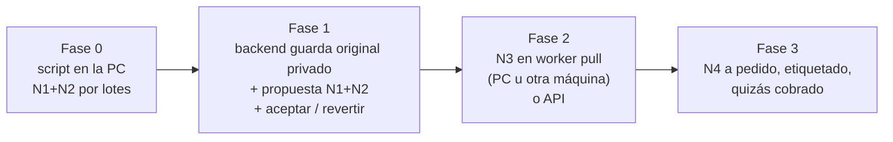
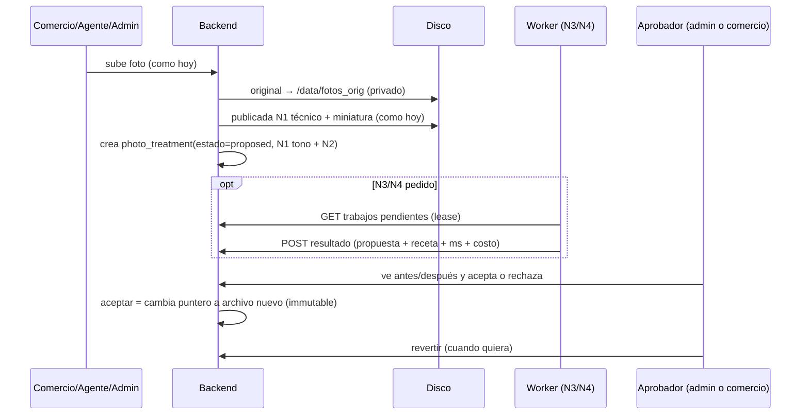

# Análisis: tratamiento de fotos (retoques, marca URUKU, fondo común, IA)

> **Estado:** propuesta para que decida el dueño. 19/10/2026. Rol: architect.
> **No hay código de producción en este documento.** El prototipo (N1 + N2) es un
> script suelto en la carpeta temporal de la sesión (§6).
> Los precios de las API los junta el researcher: donde dice **«costo: ver
> investigación»** falta ese número. Está en
> [investigacion-costos-automatizacion.md](investigacion-costos-automatizacion.md),
> que se escribe en paralelo a este documento.

## 0. En seis líneas

1. Hoy toda foto se reorienta (EXIF), se achica a 1280 px y se recomprime. **El original no se guarda**: sin original no se puede «proponer y deshacer».
2. **N1** (retoques fijos) y **N2** (marca URUKU) se resuelven con Pillow, que ya está instalado. Medido en esta PC: **60–250 ms por foto**. Costo en plata: 0.
3. **N3** (sacar el fondo) sirve para un producto suelto, no para un local ni una vidriera. Choca con el manual de marca («producto en contexto»).
4. **N4** (IA generativa) puede cambiar el producto, y entonces la foto deja de ser la oferta. Si entra, que sea a pedido, con etiqueta y nunca sobre una oferta con precio.
5. Flujo: **original guardado en privado → propuesta → la acepta el admin (o el comercio) → se puede revertir**. Arranca en esta PC (Fase 0) y después pasa al backend.
6. Antes de construir hacen falta **12 respuestas cerradas del dueño** (§9). La primera es qué quiere decir «fondo común».

---

## 1. Cómo entran y se guardan las fotos hoy

### 1.1 Un solo procesador para todo

| Pieza | Dónde | Qué hace |
|---|---|---|
| `procesar_imagen(data, max_side=1600, quality=82)` | `backend/app/services/imagenes.py:68-80` | Valida que sea una imagen (`verify`) y corta si pasa de 40 MP (`MAX_PIXELES`, `:36`, contra bombas de descompresión, `:41-65`). Reorienta por EXIF (`exif_transpose`), convierte a RGB, `thumbnail` (nunca agranda) y guarda JPEG `optimize=True`. **No escribe EXIF**: el GPS del celular se pierde, y eso está bien. |
| `subir_foto_galeria(slug, data)` | `imagenes.py:117-133` | Guarda dos archivos: la **grande de 1280 px a q80** y la **miniatura de 400 px a q74** (`THUMB_LADO`/`THUMB_CALIDAD`/`_t3`, `:28-30`), las dos **sacadas de los bytes que llegaron**. Nombre: `<slug>/<token>.jpg`. |
| `subir_foto_comercio(slug, data)` | `imagenes.py:106-114` | Una sola versión, a 1600 px y q82. |
| `guardar_foto_local(subpath, data)` | `imagenes.py:83-103` | Escribe en `settings.fotos_dir` (`/data/fotos`, `core/config.py:308-312`) y arma la URL pública. |
| Servido | `backend/app/main.py:369` (`StaticFiles` en `/fotos`) y `main.py:304-318` | **Todo** lo que está en `fotos_dir` es público, con `Cache-Control: public, max-age=31536000, immutable`. |
| Compresión en el navegador | `frontend/lib/imagen.ts:27` `comprimirImagen(file, 1600, 0.72)` | Pasa a JPEG de 1600 px y q72 **antes de subir**. La usan 7 pantallas: `autoregistro/page.tsx:203`, `mi-comercio/page.tsx:783`, `publicar/page.tsx:590` y `:888`, `recuperar-negocio/page.tsx:104`, `completar-comercio.tsx:317` y `galeria-uploader.tsx:186`. |

### 1.2 Por dónde entra cada foto

| Canal | Endpoint / servicio (archivo:línea) | Procesado | Carpeta en disco |
|---|---|---|---|
| Galería, desde el comercio | `POST /comercio/fotos`, `api/comercio.py:1209-1235` (tope por plan en `fotos_galeria.preparar`, `services/fotos_galeria.py:150-185`) | `subir_foto_galeria` | `<slug>/` |
| Galería, desde el agente | `POST /campo/mis-comercios/{id}/fotos`, `api/campo.py:1039-1060` | ídem | `<slug>/` |
| Galería, desde el admin | `POST /admin/comercio/{id}/fotos`, `api/moderacion.py:1731-1749` | ídem | `<slug>/` |
| Portada (los tres perfiles) | `PUT /comercio/perfil/foto`, `comercio.py:726-739`. `POST /campo/mis-comercios/{id}/foto`, `campo.py:836-858` (vía `_subir_foto`, `:119-124`). `POST /admin/comercio/{id}/foto`, `moderacion.py:1788-1803`. Reglas de intercambio y borrado: `services/portada.py:44-150` | ídem | `<slug>/` |
| Alta del comercio | Autoregistro `comercio.py:94-123`. Alta de campo `campo.py:217` | ídem | `<slug>/` |
| **Oferta por WhatsApp** (canales A, B y D) | `services/ingest.py:363-365` y `:664-666` → `wa_media.guardar_imagen_publicacion`, `services/wa_media.py:97-116` (descarga con tope de 12 MB, `:34`) | `procesar_imagen(data, 1280, 80)`, **sin miniatura** | `<slug>/ofertas/` |
| Productos (Reservalo, hoy escondido) | `POST /comercio/productos`, `comercio.py:980-1016` | `procesar_imagen` (1600/82) | `productos/<slug>/` |
| Lugares, novedades, póster de video | `campo.py:479-491`; `api/contenido.py:311`, `:413-427` | galería o 1280/80 | `lugares/…`, novedades |
| **Privadas** (comprobante de pago, cambio de número) | `comercio.py:1117-1123` y `:232-248` | `procesar_imagen` | `comprobantes/…`, `cambio-numero-…` |
| Mantenimiento | `GET /admin/fotos/peso` y `POST /admin/fotos/optimizar`, `moderacion.py:2104-2126` → `services/peso_fotos.py:75-133` | Recomprime **en el mismo archivo**: es irreversible | — |
| Miniaturas | `backend/scripts/regenerar_miniaturas.py` | Rehace la miniatura **a partir de la grande** y le pone un nombre nuevo (por el `immutable`) | — |

Cómo se ve en la ficha: `FotoEntera` (`frontend/components/galeria-tienda.tsx:222-231`) muestra la foto **entera** en un cuadro 4:5, con la misma miniatura difuminada de fondo (`frontend/app/uruku.css:1425-1428`: `blur(16px) brightness(.55)`). Se pasó a eso porque el recorte se comía el texto de los flyers.

Base de datos: `comercio_fotos(url, thumb_url, orden)` (`supabase/migrations/0030_galeria_comercio.sql:7-14`, sin `activo`, con lectura anónima). Además están `comercios.portada_url`/`portada_thumb_url`/`portada_pos` (0098) y `publicaciones.imagen_url` (0001).

### 1.3 Lo que importa para este análisis

1. **El original no existe en ningún lado.** Lo único que queda es la versión de 1280/q80 y la miniatura. Ofrecer una versión mejorada y poder volver atrás exige guardar lo que llegó. Hoy no se hace.
2. **Cada foto ya pasa por dos compresiones JPEG**: el navegador la deja en 1600/q72 y el backend la vuelve a comprimir a 1280/q80. Afilar la imagen después de eso **resalta los bloques del JPEG**. Por eso el N1 del prototipo afila con un umbral (`threshold=3`), y siempre se trabaja desde el archivo más fiel que haya.
3. **No se puede pisar un archivo publicado.** Por el `immutable`, el navegador y nginx seguirían mostrando la foto vieja. Toda versión nueva necesita un nombre nuevo. Lo mismo pasa con `peso_fotos.optimizar`, que ya pisa en el lugar: es una inconsistencia que existe hoy, fuera del alcance de esto.
4. **La miniatura se saca de los bytes que llegaron.** Si la marca se «hornea» en la grande y después alguien corre `regenerar_miniaturas.py`, la marca **aparece también en la miniatura**. La regla de diseño es que **las variantes salen siempre del original o del N1, nunca de una versión ya marcada**.
5. **`/fotos` es público.** Un original que conserve el EXIF (con el GPS) no puede ir ahí. Los comprobantes de pago hoy también quedan servidos en `/fotos`, protegidos sólo por una URL que no se puede adivinar. Eso no es de este análisis: queda anotado para `security-reviewer`.
6. La foto de una oferta **es** la oferta (`wa_media.py:12-16`). Cualquier nivel que cambie el producto choca con eso.

---

## 2. Lo que el manual de marca condiciona

Fuente: `docs/Uruku-KIT-COMPLETO/1-Manual-de-marca/Uruku-Manual-de-identidad.pdf`.

| Página | Regla | Consecuencia |
|---|---|---|
| 20 | Hay una versión **«Blanco: sobre verde o foto»** y una **«Verde: una tinta»** | Sobre una foto va el logo **blanco**. Si la zona es clara, el verde. El prototipo elige solo entre los dos. |
| 21 | Tamaño mínimo en pantalla: **horizontal 100 px**, **símbolo 32 px**. Margen libre de 1x | En el visor a pantalla completa de un celular (unos 390 px CSS), el horizontal tendría que ocupar **alrededor del 26 % del ancho** para cumplir. Eso ya no es sutil. Por eso **el símbolo** es la opción que cumple el manual y además es discreta. |
| 22 | «No cambiar los colores», «no agregar sombras ni efectos», «no usar sobre fondos que le quiten contraste» | Una opacidad menor al 100 % **queda en el borde** de la regla. Lo decide el dueño (pregunta 5). Nada de sombra paralela ni de franja oscura atrás del logo. |
| 31 | Fotografía: «Negocios reales… **luz natural y colores vivos**. **Producto en contexto**, con el precio a la vista». No: «fotos de banco… **filtros fuertes**» | Esto respalda un N1 **suave**. Va en contra de N3 como regla general (saca el contexto) y de N4 (la foto queda con cara de banco de imágenes). |

---

## 3. Niveles de tratamiento, del más barato al más caro

Tiempos: lo **medido** salió de esta PC (i5-7200U, 2 núcleos y 4 hilos, 8 GB, sin GPU) con el prototipo. Lo **estimado** está marcado así y hay que medirlo antes de comprometerse. El VPS (15 GB de RAM, sin GPU, CPU compartida) debería andar entre 0,5x y 1,5x lo de esta PC en tareas de un hilo. Eso también es un **estimado**.

### N0: fondo común sin tocar la foto (presentación)

Antes de los cuatro niveles conviene descartar una lectura posible del pedido. Si «fondo común» quiere decir **que todas las fotos se vean parejas en la ficha**, eso se logra **en la pantalla** y no en el archivo. `FotoEntera` ya mete cada foto en un cuadro 4:5 igual para todas. Alcanza con cambiar el fondo difuminado por un **color de marca** (crema `#F9F6ED` o celeste `#E3EDFA`, manual p. 24), con un borde redondeado.
- Calidad: uniforme, la foto queda intacta y no hay ningún riesgo de engaño.
- Tiempo y costo: 0. Es un cambio de CSS en `uruku.css:1425-1428`. Se revierte al instante.
- Límite: no viaja con la foto. Si alguien la descarga o la comparte, sale sin el fondo.

### N1: retoques fijos y deterministas

| Paso | Detalle | ¿Ya se hace? |
|---|---|---|
| Enderezar por EXIF | `exif_transpose` | Sí (`imagenes.py:76`) |
| Sacar bandas lisas | Las bandas negras o blancas de una captura o un reenvío. Como mucho el 30 % por lado, y no recorta si quedaría menos del 40 % del área | No |
| Tamaño y peso | 1280 px y q80 (KB `lesson-fotos-resize-1600px-jpeg-70-antes-de-subir`, ajustada en `imagenes.py:3-5`) | Sí |
| Contraste | `autocontrast(cutoff=0.5, preserve_tone=True)`: estira **la luminancia** sin correr el color (en ropa y telas **el color es lo que se compra**), mezclado al 70 % | No |
| Luz | Sólo si la foto está oscura (media < 95): gamma hacia 115, con un tope de 0,70 | No |
| Saturación | +5 % («colores vivos» sin llegar a «filtro fuerte») | No |
| Nitidez | `UnsharpMask(radius=1.2, percent=60, threshold=3)`, **después** del resize | No |
| Encuadre o recorte a 4:5 | **No se hace.** Se decidió no recortar (flyers, `FotoEntera`), y enderezar el horizonte pide visión por computadora | — |

- **Calidad esperada:** en una foto buena casi no se nota, y eso está bien. En una foto oscura o lavada la recupera bien (ver la comparación `bazar_oscura` en §6).
- **Riesgos:** son bajos. Lo que puede pasar es un corrimiento leve del color si alguien sube la saturación por encima de +5–8 %. Una foto oscura recuperada pesa más (en la prueba, de 94 a 137 KB) porque aparece detalle y ruido. Afilar de más resalta los bloques del JPEG.
- **Tiempo:** **medido 30–150 ms** para fotos de hasta 1,6 MP (lo que manda el navegador) y **unos 0,5–0,8 s** para una de 10 MP. VPS: estimado del mismo orden.
- **Dependencias nuevas:** ninguna. Pillow ya está en `backend/pyproject.toml:15`.
- **Costo:** 0.

### N2: marca URUKU sutil

| Tema | Propuesta |
|---|---|
| Qué logo | **El símbolo blanco** (`uruku-simbolo-blanco.svg`). Si la zona es clara (luminancia > 150), el **verde una tinta** (`#10623E`). El horizontal queda como alternativa (pregunta 4). |
| Tamaño | **Alto del símbolo = 10 % del lado mayor**. En una de 1280 px son unos 128 px, que en el visor a pantalla completa del celular quedan en unos 32 px CSS, el mínimo del manual. El horizontal iría al 22 % del ancho, apenas por debajo del mínimo. |
| Dónde | En una esquina, con margen del 3 % del lado menor (respeta el área de seguridad). Se elige **la esquina con menos detalle** (menos bordes) para no tapar un precio, un texto o la cara de alguien. Si empatan, abajo a la derecha. En la prueba esquivó el cartel «Bs 170». |
| Opacidad | 85 % en el prototipo. Si se respeta el manual al pie de la letra, 100 % (pregunta 5). |
| ¿En el original o en la publicada? | **Sólo en la grande publicada.** Nunca en el original, que queda guardado limpio, ni en la **miniatura**: en la tarjeta de 116 px el logo mediría unos 12 px, sería ruido y además se vería dos veces porque `FotoEntera` usa la miniatura para el fondo difuminado. Si se cambia la regla, se regenera desde el original. |
| Cuándo NO va | (a) **Flyers o arte del comercio con su propia marca**: el prototipo los detecta con una heurística (§6) y en producción sería una sugerencia para el humano, o un campo más del análisis de Gemini que ya existe. (b) **Comprobantes y fotos de cambio de número.** (c) Novedades de URUKU (ya son de la marca). (d) Fotos con menos de unos 480 px de lado menor. (e) Fotos que el comercio marcó como «con mi marca». (f) Si se decide así, los planes pagos que pidan «sin marca» (pregunta 10). |

- **Alternativa sin tocar píxeles:** poner el logo **encima, con CSS**, en el visor. Sale en las capturas de pantalla (que es como circulan las fotos por los grupos de WhatsApp) pero **no** en una descarga ni para un sitio que copie el archivo. Si el objetivo es sólo que «se vea URUKU cuando circula», alcanza con esto y cuesta 0.
- **Lectura del pedido:** el dueño dijo «a las fotos **que editemos**». La marca funciona entonces como **sello de servicio** («esta foto la trabajó URUKU»). Si el comercio después la usa en sus estados o redes, la marca viaja con ella. Ése es el mejor argumento para hornearla en el archivo.
- **Riesgos:** tapar información (se mitiga con la elección de esquina y la revisión humana). Molestar al comercio que tiene marca propia (se mitiga con la regla (a) y el opt-out). **No protege contra copias**: una esquina se recorta en dos segundos.
- **Tiempo:** **medido 10–50 ms**. El logo se rasteriza **una sola vez** (unos 1 s) y en producción iría como PNG ya hecho.
- **Dependencias nuevas:** ninguna. El SVG del kit es sólo de polígonos (M/L/Z) y Pillow lo dibuja.
- **Costo:** 0.

### N3: fondo común de verdad (sacar el fondo y poner uno de marca)

- **Para qué sirve:** un **producto suelto** (una zapatilla, una botella, una cartera) sobre un fondo crema o celeste de marca, con una sombra suave sacada del recorte. **No sirve** para el local, la vidriera, la góndola ni el flyer: ahí el fondo es el contenido y el manual pide «producto en contexto».
- **Calidad esperada:** con objetos sólidos y bien separados del fondo, buena. Falla con objetos **transparentes** (botellas, vidrio), **pelo o tela con flecos**, correas finas, varios productos superpuestos o un producto del mismo color que el fondo. Un recorte malo **cambia la forma del producto** (le corta una correa o una manija). Para el comprador, eso también es una foto que no representa lo que compra.
- **Opciones locales** (sólo nombradas, no se instala nada):
  - `rembg` (MIT) con sus modelos `u2net`/`u2netp` (Apache-2.0; 176 MB y 4,7 MB) e `isnet-general-use` (unos 180 MB). Trae opencv-headless, scikit-image, pymatting y scipy (cientos de MB).
  - **BiRefNet** (MIT): la mejor calidad abierta, pero pesada (unos 1 GB en fp32, 3–5 GB de RAM a 1024 px).
  - **BRIA RMBG-1.4 / 2.0**: muy buena, pero con **licencia no comercial**. Descartada salvo que se compre la licencia.
  - **Dato útil:** el backend **ya trae `onnxruntime` y `numpy`** como dependencias de `faster-whisper` (requirements de faster-whisper: `onnxruntime>=1.14,<2`; hay que verificarlo en el contenedor con `pip show onnxruntime numpy`). Un modelo ONNX de recorte se puede correr **sin sumar `rembg`**: sólo hace falta el archivo del modelo.
- **Opciones por API:** remove.bg, Photoroom (pensada para fotos de producto: recorte, fondos y sombras), Clipdrop, Cloudinary (background removal), y Gemini u OpenAI con edición por instrucción. **Costo: ver investigación.**
- **Tiempo por foto (estimado, no medido):**

  | Motor | Esta PC | VPS |
  |---|---|---|
  | u2net (entrada de 320 px) | 1–3 s, unos 1 GB de RAM | 1–3 s |
  | isnet (1024 px) | 4–10 s | 3–10 s |
  | BiRefNet (1024 px) | 30–90 s, 3–5 GB de RAM: **riesgoso con 8 GB** | 20–60 s, se puede pero hay que dedicarle CPU |
  | API | 2–10 s, casi todo red | ídem |

- **Riesgos:** engaño por recorte malo. Que la foto quede con cara de banco de imágenes (contra el manual p. 31). Con API, **la foto sale de URUKU**: puede tener caras de clientes o de chicos, y hay que ver qué hace el proveedor con lo que recibe (retención y entrenamiento: **ver investigación**). En el VPS, la carga de CPU **compite con el sitio** (corren 2 stacks) si no se limita a un worker con concurrencia 1.
- **Dependencias nuevas:** un modelo ONNX (sin paquete nuevo si se usa el `onnxruntime` que ya está) **o** una API key nueva (`httpx` ya está).

### N4: mejora generativa con IA (el modelo edita la imagen)

- **Qué hace:** reilumina, cambia el fondo por una escena, «arregla» reflejos, sube la resolución inventando detalle, saca objetos.
- **Hoy no está disponible en URUKU.** La key `GEMINI_API_KEY` y el modelo configurado `gemini-flash-latest` (`core/config.py:291-297`) **leen** imágenes y devuelven texto (`services/vision.py:315-345`). No las editan. Para editar hace falta **otro modelo** (los de imagen de Gemini, `gpt-image` de OpenAI, Photoroom AI, Adobe Firefly…), una variable aparte (`GEMINI_IMAGE_MODEL` o la que corresponda) y quizás facturación activa. **Disponibilidad, plan gratis y costo: ver investigación.**
- **Calidad esperada:** muy vistosa y **no confiable en lo que importa**. Puede cambiar el texto del envase, el logo de la marca, el color, la cantidad de unidades o el cartel del precio, o agregar cosas que no existen.
- **Riesgos:** **engaño al comprador**, que es el más grave de todo el documento. La foto de una oferta es una promesa que se cobra en el mostrador. Un precio o un modelo inventado lo paga el comercio con un cliente enojado, y URUKU queda como el que lo publicó. Las normas de defensa del consumidor de BO y AR sobre publicidad engañosa: **a verificar por researcher o asesoría legal**. Además, varias de estas API agregan marcas de procedencia (SynthID, C2PA). Está bien que estén, y es un motivo más para **etiquetar la foto** («Mejorada con IA»).
- **Tiempo:** por API, 10–40 s por foto (estimado). En local (modelos de difusión): **no es viable** ni en esta PC ni en el VPS sin GPU (minutos por foto y RAM insuficiente). Subir la resolución con Real-ESRGAN en CPU tarda 10–60 s (estimado) y aporta poco, porque la foto se muestra a 1280 px o menos.
- **Dependencias nuevas:** una API key y el cliente HTTP, que ya está.
- **Costo: ver investigación.** Hay que medir el costo por foto y por comercio desde el primer día (`docs/uruku-ai-plan.md:35`).

### Resumen

| Nivel | Calidad | Riesgo de engaño | Esta PC | VPS | Dependencias nuevas | Costo |
|---|---|---|---|---|---|---|
| N0 (CSS) | Pareja | Ninguno | 0 | 0 | Ninguna | 0 |
| N1 | Buena y suave | Bajo | **0,03–0,15 s (medido)** | Similar (est.) | Ninguna | 0 |
| N2 | Buena | Bajo (tapar info) | **0,01–0,05 s (medido)** | Similar (est.) | Ninguna | 0 |
| N3 local | Media a buena | Medio (recorte malo) | 1–10 s (est.) | 1–10 s (est.) | Modelo ONNX | 0 en plata, CPU |
| N3 API | Buena | Medio | 2–10 s (est.) | ídem | API key | Ver investigación |
| N4 API | Vistosa | **Alto** | 10–40 s (est.) | ídem | API key | Ver investigación |

### Qué nivel se permite según la foto

| Tipo de foto | N0 | N1 | N2 | N3 | N4 |
|---|---|---|---|---|---|
| **Oferta con precio** (`publicaciones`) | sí | sí | sí | sólo producto suelto, con propuesta y aceptación | **no** |
| Producto suelto de la galería | sí | sí | sí | sí, como propuesta | sólo fondo/escena y nunca el producto (pregunta 9) |
| Local, vidriera, góndola, portada | sí | sí | sí | **no** | **no** |
| Flyer o arte del comercio | sí | sólo bandas y peso | **no** (sugerido) | no | no |
| Comprobante, cambio de número | — | sólo lo técnico (como hoy) | **no** | no | no |

---

## 4. Dónde corre y cómo se aprueba

### 4.1 Tres lugares posibles

| Dónde | Para qué nivel | A favor | En contra |
|---|---|---|---|
| **En el backend, al subir** (`run_in_threadpool`, igual que hoy) | N1 y N2 | Ya existe el lugar (`imagenes.py`). Tarda menos de 0,3 s. Sin infraestructura nueva | Si pasa de unos 0,5 s por foto, enlentece la subida |
| **En esta PC, por lotes** (Fase 0) | N1 y N2 ya. N3 local si algún día se instala | Cero cambios en producción. El dueño ve y decide con sus propios ojos | Es manual. La marca queda «horneada» en lo que se sube y el original queda en la PC, no en el VPS |
| **En otra máquina (worker que pide trabajo)** | N3 local y N4 por API | No le quita CPU al sitio. Es la puerta para el futuro asistente de automatización. **Pull**: la máquina pide trabajo, no necesita puertos abiertos | Otra máquina para operar y un token de servicio para cuidar |

### 4.2 Fases recomendadas



- **Fase 0 (sin tocar producción).** El script del prototipo, ya pulido, pasa a `scripts/fotos/tratar.py`. El admin baja las fotos que un comercio pidió, corre el script, mira la carpeta de comparación y **sube la que aprueba** por Admin › comercio › Fotos (`moderacion.py:1731`). El original queda en una carpeta de la PC. Sirve para validar el gusto del dueño y **medir cuántos comercios lo piden** antes de construir nada.
- **Fase 1 (backend, sólo con Pillow).**
  1. **Guardar el original** tal como llegó (ya validado, hasta 15 MB) en `fotos_originals_dir` (por ejemplo `/data/fotos_orig`), **fuera** del `StaticFiles` de `/fotos`.
  2. **N1 técnico automático**: lo de hoy más el recorte de bandas.
  3. **N1 de tono y N2 como propuesta**: se generan y quedan en estado `proposed`. La foto publicada sigue siendo la de siempre hasta que alguien acepta.
  4. **Aceptar** cambia el puntero (`comercio_fotos.url`, `portada_url` o `publicaciones.imagen_url`) a un **archivo con nombre nuevo**. **Revertir** lo devuelve. No se pisa ningún archivo.
  5. Criterio para que N1 de tono pase a automático: si en 2 a 4 semanas el admin rechaza **menos del 5 %** de las propuestas (pregunta 7).
- **Fase 2.** N3 en el worker (PC u otra máquina) o por API, sólo a pedido y siempre como propuesta.
- **Fase 3.** N4, si el dueño lo aprueba: a pedido del comercio, con **etiqueta visible** y costo medido por foto.

### 4.3 Flujo de aprobación (Fase 1 en adelante)



¿Quién aprueba? Recomiendo el **admin** al principio. **El comercio no se entera por WhatsApp**: WAHA sólo lee (memoria «Canales con compradores»). Por eso la propuesta para el comercio aparece en **Mi comercio** como «URUKU te propone esta versión: ¿la usamos?».

### 4.4 Borrador del modelo de datos (Fase 1)

Es un borrador: los nombres van en inglés (AGENTS §6). El repo en la práctica usa castellano (`comercio_fotos`, `/admin/fotos/peso`). Si el equipo prefiere seguir ese uso, el renombre es mecánico.

```sql
-- Originales: privados, nunca expuestos a anon. Soft-delete (KB pattern-soft-delete-activo-flag).
create table photo_originals (
  id           uuid primary key default gen_random_uuid(),
  comercio_id  uuid references comercios(id),
  path         text not null,          -- relativo a fotos_originals_dir (NO servido por /fotos)
  sha256       text not null,          -- detecta duplicados y reintentos
  bytes        int, width int, height int, mime text,
  source       text not null check (source in ('gallery','cover','offer','news','place','product')),
  created_at   timestamptz not null default now(),
  activo       boolean not null default true
);

create table photo_treatments (
  id              uuid primary key default gen_random_uuid(),
  original_id     uuid not null references photo_originals(id),
  target_type     text not null check (target_type in ('gallery_photo','cover','offer')),
  target_id       uuid not null,       -- comercio_fotos.id | comercios.id | publicaciones.id
  levels          text[] not null,     -- {'n1','n2'} | {'n1','n3'} | {'n4'}
  recipe          jsonb not null,      -- parámetros exactos + versión del pipeline (reproducible)
  engine          text not null,       -- 'pillow@1' | 'onnx:isnet@<hash>' | 'api:<proveedor>/<modelo>'
  status          text not null check (status in
                    ('queued','processing','proposed','accepted','rejected','reverted','failed')),
  proposed_url    text, proposed_thumb_url text,
  previous_url    text, previous_thumb_url text,   -- para revertir sin buscar nada
  requested_by    text, decided_by text, decided_at timestamptz, reason text,
  leased_by       text, leased_at timestamptz,     -- worker pull
  elapsed_ms      int,  cost_usd numeric(10,5),    -- medir costo desde el día uno
  created_at      timestamptz not null default now(),
  updated_at      timestamptz not null default now(),
  activo          boolean not null default true
);

-- Etiqueta pública ("Fondo editado por URUKU" / "Mejorada con IA"):
alter table comercio_fotos add column treatment text;        -- null | 'n1' | 'n2' | 'n3' | 'n4'
alter table publicaciones  add column image_treatment text;
alter table comercios      add column cover_treatment text;  -- regla 11: grant select (cover_treatment) to anon

-- RLS activo en las dos tablas nuevas; grant all a service_role; SIN grant a anon/authenticated
-- (KB lesson-supabase-cloud-grants-explicitos-en-migration, pattern-supabase-rls-policy).
```

Al archivar una publicación (que borra su foto del disco, `services/planes.py:248`) y en `fotos_galeria.borrar_archivos` (`:268-302`), **también hay que soltar el original y las variantes**. Si no, el disco vuelve a crecer, que es justo lo que esas reglas evitan.

### 4.5 Borrador del contrato (Fase 1–2)

```yaml
# Admin (JWT, permiso nuevo "fotos.tratar")
POST /admin/photos/treatments            # {target_type, target_id, levels[], options:{mark:'symbol'|'horizontal'|null}}
                                         # N1/N2: síncrono → 201 {id, status:'proposed', proposed_url}
                                         # N3/N4: → 202 {id, status:'queued'}
GET  /admin/photos/treatments?status=proposed&comercio_id=&limit=   # grilla antes/después
GET  /admin/photos/originals/{id}        # stream autenticado (el original NO está en /fotos)
POST /admin/photos/treatments/{id}/accept
POST /admin/photos/treatments/{id}/reject   # {reason}
POST /admin/photos/treatments/{id}/revert

# Comercio (JWT rol=comercio): sólo sus fotos
GET  /comercio/photos/proposals
POST /comercio/photos/proposals/{id}/accept | /reject

# Worker pull (token de servicio, rol 'procesador', sin acceso a nada más)
GET  /worker/photos/jobs?levels=n3&limit=5     # toma lease (leased_by/leased_at, vence a los 10 min)
GET  /worker/photos/jobs/{id}/original         # bytes del original
POST /worker/photos/jobs/{id}/result           # multipart: proposed.jpg + recipe + elapsed_ms + cost_usd
POST /worker/photos/jobs/{id}/fail             # {error}
```

---

## 5. Path dependence, explícito

La recomendación (**Pillow dentro del FastAPI que ya existe y disco propio**) coincide con lo que el equipo ya usa. Es path dependence y lo digo. Lo contrasté con dos alternativas reales:

| Opción | Cómo resolvería N1 y N2 | Por qué no ahora |
|---|---|---|
| **imgproxy o thumbor self-hosted** (un contenedor) | Transforma al vuelo por URL firmada: tamaño, nitidez y **marca como overlay configurable**. Se guarda sólo el original y prender o apagar la marca en miles de fotos no exige regenerar nada | Es un servicio más para operar y cachear. Cambian todas las URLs. Con el volumen de hoy y «sólo a las fotos que editemos», no compensa |
| **Cloudinary u otro SaaS de imágenes** | Mejora automática, quitar el fondo y overlays por URL, todo resuelto | Las fotos salen del disco propio (el proyecto acaba de salir de Supabase Storage). Costo recurrente (**ver investigación**). Dependencia de un proveedor |

**Qué invalidaría la elección:** si el dueño quiere la marca en **todas** las fotos y poder cambiarla o sacarla en forma retroactiva, imgproxy pasa a ser mejor. Lo mismo si el volumen llega a decenas de miles de fotos por mes.

---

## 6. Prototipo N1 + N2 (hecho)

**Script:** `C:\Users\User\AppData\Local\Temp\claude\c--repos-proyectosClaude-Bermejo\f2203ffc-f661-4d0a-a599-e64fe3345ac0\scratchpad\fotos-prueba\tratar.py`. Usa sólo Pillow 12.2. El logo sale de rasterizar el SVG del kit (`2-Logos-y-Dax/uruku-simbolo-blanco.svg` y `uruku-horizontal-blanco.svg`).

**Entradas:** sólo fotos de **demo** (`scripts/demo/.run/fotos/`, datos ficticios), en `...\fotos-prueba\entradas\`:
- `bazar.jpg` (de `bazar-la-economia/portada.jpg`), `toti.jpg` (de `ropa-americana-toti/portada.jpg`), `boutique_producto.jpg` (de `boutique-ejemplo/producto-1.jpg`).
- Tres **simuladas a partir de ésas**: `bazar_oscura_simulada.jpg` (oscurecida y con dominante de color), `toti_con_bandas_simulada.jpg` (con bandas negras, como una captura) y `bazar_12mp_simulada.jpg` (de 4000×2667, sólo para medir tiempos).

**Salidas** (antes y después): `C:\Users\User\AppData\Local\Temp\claude\c--repos-proyectosClaude-Bermejo\f2203ffc-f661-4d0a-a599-e64fe3345ac0\scratchpad\fotos-prueba\salida\`. Por cada foto: `*_0_original.jpg`, `*_1_n1.jpg`, `*_2_n1_simbolo.jpg`, `*_3_n1_horizontal.jpg` y `*_comparacion.jpg` (antes y después lado a lado). En `...\fotos-prueba\salida_forzada\` está el producto de la boutique con la marca **forzada**, para ver cómo esquiva el cartel del precio.

**Medido en esta PC:**

| Foto | Entrada → salida | N1 | N2 | Total con abrir y guardar | Qué pasó |
|---|---|---|---|---|---|
| bazar | 1012×675 → igual | 77 ms | 25 ms | unos 145 ms | Cambio mínimo (la foto ya estaba bien). Símbolo blanco abajo a la izquierda (zona oscura con poco detalle) |
| bazar_oscura | 1600×1067 → 1280×854 | 148 ms | 46 ms | unos 240 ms | Gamma 0,72: la recupera bien. Pesa más (94 → 137 KB) |
| toti | 636×424 → igual | 30 ms | 11 ms | unos 60 ms | No agranda. Símbolo con el ancho mínimo |
| toti_con_bandas | 636×760 → **636×424** | 50 ms | 16 ms | unos 90 ms | Sacó las bandas completas |
| boutique_producto | 1000×1000 → igual | 129 ms | — | unos 165 ms | **Detectado como arte, sin marca** (regla «flyer»). Forzada: logo **verde** abajo a la izquierda, **esquivando** el cartel «Bs 170» |
| bazar_12mp | 4000×2667 → 1280×853 | 522–839 ms | 71–138 ms | unos 0,7–1,1 s | El peor caso: igual sirve dentro del request |

Rasterizar los dos logos tarda **unos 1 s una sola vez**. En producción iría como PNG ya generado.

**Heurística «flyer o arte»:** cuenta la proporción de píxeles sin bordes en una versión de 256 px. Las fotos reales de demo dieron 0,50–0,56 y el arte sintético 0,80–0,82. El corte quedó en 0,75. Es barata y **frágil**: en producción tiene que ser una sugerencia, o un campo más del análisis de Gemini que ya se hace (sin llamada extra).

**Qué falta probar** antes de la Fase 1: correrlo sobre **30–50 fotos reales** de distintos rubros (ropa, almacén, celulares, comida). Lo hace el dueño o el admin en la PC, no un agente. La decisión de dejar N1 de tono en automático depende de esa prueba.

---

## 7. Decisiones

| Decisión | Alternativas descartadas | Por qué | Qué la invalidaría |
|---|---|---|---|
| **Guardar el original, privado, fuera de `/fotos`** | Seguir sin original. Guardarlo en `/fotos` | Sin original no hay propuesta ni reversión, y cada edición encima de otra degrada la foto. En `/fotos` sería público y con EXIF y GPS | El dueño acepta que todo tratamiento sea irreversible (no recomendado) |
| **Una edición es una propuesta. Aceptar cambia un puntero a un archivo con nombre nuevo** | Pisar el archivo publicado | `Cache-Control: immutable` (`main.py:318`): pisar no se vería y no se podría deshacer | Que se saque el `immutable` (empeoraría la velocidad) |
| **N1 y N2 con Pillow en el backend** (path dependence declarado, §5) | imgproxy. Cloudinary. pyvips (más rápido, pero suma una dependencia nativa) | Ya está, se midió por debajo de 0,3 s y cuesta 0. Un servicio menos para operar | Marca en todas las fotos con cambios retroactivos, o un volumen 10 veces mayor |
| **Marca sólo en la grande publicada, nunca en la miniatura ni en el original** | Marca en todas las variantes. Marca por CSS | En la miniatura es ruido y se duplica en el fondo difuminado. En el original impide volver atrás | Que el objetivo sea sólo «se ve en capturas»: entonces CSS, a costo 0 |
| **Símbolo (no el horizontal) con alto del 10 % del lado mayor** | Horizontal al 22 %. Horizontal al 26 % para cumplir el mínimo | Es el único que cumple el mínimo del manual (32 px) y sigue siendo sutil | El dueño prefiere que se lea «URUKU» aunque tape más (pregunta 4) |
| **N3 sólo para producto suelto, a pedido y como propuesta** | N3 para todas las fotos | El manual pide «producto en contexto». El local y la vidriera **son** el fondo | Que el catálogo de productos vuelva a ser central (Reservalo) y el dueño quiera una estética de ecommerce |
| **N3 local con el `onnxruntime` que ya está, en el worker y no en el VPS del sitio** | `rembg` en el backend. API desde el día uno | No suma paquetes, cuesta 0 en plata y no le quita CPU al sitio | Que el costo por foto de una API sea despreciable y la calidad mucho mejor (**ver investigación**) |
| **N4 fuera de las ofertas con precio. Si entra, a pedido, etiquetado y con costo medido** | N4 automático para «mejorar todo» | Riesgo de engaño alto. La foto es la oferta | Ninguna, en el caso de las ofertas con precio |
| **Worker por pull (la máquina pide trabajo)** | El backend empuja trabajo a la máquina | La PC u otra máquina no necesita puertos abiertos ni IP fija. Encaja con el futuro asistente | Que el procesamiento se haga entero en el VPS |
| **Fase 0 en la PC antes de escribir código de producción** | Construir la Fase 1 de entrada | Valida el gusto del dueño y la demanda real a costo cero | Que el dueño ya tenga claro qué quiere y la demanda esté probada |

KB aplicada: `lesson-fotos-resize-1600px-jpeg-70-antes-de-subir` (ajustada a 1280/80 en el repo), `pattern-soft-delete-activo-flag`, `lesson-nunca-delete-fisico-siempre-soft`, `lesson-supabase-cloud-grants-explicitos-en-migration`, `pattern-supabase-rls-policy` y `lesson-supabase-service-role-key-nunca-en-frontend` (el worker usa token de servicio propio, nunca service_role). Del repo: AGENTS §7 reglas 2, 3, 6 y 11.

---

## 8. Riesgos abiertos

| Riesgo | Qué validación humana necesita |
|---|---|
| Que N1 corra el color de productos donde **el color es lo que se compra** (ropa, telas, pintura) | Que el dueño o el admin miren 30–50 fotos reales tratadas, sobre todo de esos rubros |
| Que la marca moleste a comercios con marca propia, o que tape información | Probarla con 3–5 comercios de confianza antes de generalizar |
| Que una opacidad < 100 % choque con «no cambiar colores ni agregar efectos» (manual p. 22) | Decisión del dueño (es el autor del manual) |
| N3 y N4 **mandan fotos a terceros** (caras de clientes o chicos). Retención y entrenamiento de cada proveedor, incluido el **plan gratis de Gemini que ya se usa para visión** | researcher: términos de uso de datos de cada API. Dueño: si se acepta |
| Publicidad engañosa (BO/AR) con N3 o N4 | Asesoría legal o researcher. La etiqueta visible es la mitigación mínima |
| Disco: los originales suman espacio (estimado: +1 a 3 GB con el volumen actual de unos 1300 comercios). Se tienen que borrar junto con la foto | backend-dev: que borrar o archivar una foto suelte también el original y las variantes |
| Los comprobantes de pago y las fotos de cambio de número quedan en `/fotos`, que es público (protegidos sólo por un nombre que no se adivina) | `security-reviewer` (está fuera del alcance de esto) |
| Los tiempos de N3 y N4 son **estimados** | Medirlos con 10 fotos en la máquina real antes de comprometer un plazo |

---

## 9. Preguntas cerradas para el dueño

1. **«Fondo común» quiere decir:** (a) que todas las fotos se vean parejas en la web, con un marco de color de marca y sin tocar la foto (N0), o (b) sacar el fondo real del producto y poner uno de marca (N3).
2. **La marca va:** (a) sólo en las fotos que URUKU trató (sello de servicio), o (b) en todas las fotos publicadas.
3. **Para qué es la marca:** (a) que se vea URUKU cuando la foto circula (capturas, estados), o (b) que otros sitios no la copien. Con (b) no hay solución real: una esquina se recorta.
4. **Qué logo:** (a) el símbolo solo (sutil y dentro del manual), o (b) el horizontal con el nombre (se lee mejor y tapa más). Comparar `*_2_n1_simbolo.jpg` con `*_3_n1_horizontal.jpg`.
5. **Opacidad:** (a) 100 %, como manda el manual, o (b) 85 %, más sutil.
6. **Quién acepta la versión mejorada:** (a) sólo el admin, (b) sólo el comercio en Mi comercio, o (c) cualquiera de los dos.
7. **¿N1 (luz y contraste) pasa a automático** si en 2 a 4 semanas el admin rechaza menos del 5 % de las propuestas? Sí o no.
8. **¿Se permite sacar el fondo en fotos de ofertas** (sólo producto suelto, con aceptación)? Sí o no.
9. **¿N4 (IA generativa) entra en el plan?** (a) no, (b) sí, a pedido del comercio, con la etiqueta «Mejorada con IA» y nunca en ofertas con precio, o (c) sí y además se cobra como extra (como los Bs 5 de la foto extra).
10. **¿Un plan pago puede pedir «sin marca URUKU»?** Sí o no.
11. **¿Arrancamos ya con la Fase 0** (script en esta PC, a mano, sin tocar producción)? Sí o no.
12. **¿Se acepta guardar los originales** (unos 1–3 GB más) en una carpeta privada del VPS? Sí o no.

---

## 10. Qué necesita el siguiente rol

**backend-dev, Fase 0** (si la pregunta 11 es sí):
- Pasar `tratar.py` (§6) a `scripts/fotos/tratar.py` con los logos como **PNG ya hechos** (`scripts/fotos/assets/`). Entrada: una carpeta. Salida: otra carpeta con la comparación.
- Agregar `--sin-marca` y `--logo simbolo|horizontal` y la opacidad como parámetro.
- No toca el backend. Terminado = corre sobre una carpeta de 50 fotos en menos de 30 s en esta PC y deja `*_comparacion.jpg` por cada una.

**backend-dev, Fase 1** (si las preguntas 2, 6 y 12 tienen respuesta):
- Entrada: §4.4 (SQL) y §4.5 (contrato).
- Puntos de enganche: `imagenes.subir_foto_galeria` (`imagenes.py:117-133`) y `wa_media.guardar_imagen_publicacion` (`wa_media.py:97-116`) guardan además el original. Agregar `fotos_originals_dir` en `core/config.py` (sin montarlo en `main.py:369`).
- Un módulo nuevo `app/services/photo_treatment.py` con la receta N1/N2 versionada (`recipe` + `engine='pillow@1'`).
- Migración con RLS y GRANT explícitos, más `grant select (cover_treatment)` para anon (regla 11).
- Tests: que la miniatura nunca lleve marca, que aceptar y revertir no pisen archivos, que borrar o archivar suelte el original, y que un flyer marcado como tal no reciba marca.

**frontend-dev, Fase 1:**
- Grilla antes/después en el admin, con aceptar, rechazar, revertir y «aceptar todas».
- En Mi comercio, la tarjeta «URUKU te propone esta versión».
- Etiqueta pública cuando `treatment` sea `n3` («Fondo editado por URUKU») o `n4` («Mejorada con IA»). Íconos de `components/ic.tsx`, nunca un emoji.
- N0, si la pregunta 1 es (a): cambiar el fondo de `.uk-tienda-marco` en `uruku.css:1425-1428`.

**researcher** (en paralelo y sin depender de esto): precio por foto, plan gratis, latencia y **política de datos** de: Gemini (modelos de imagen y también el de visión que ya se usa), OpenAI `gpt-image`, Photoroom, remove.bg, Clipdrop y Cloudinary. También la licencia de BiRefNet, u2net, IS-Net y BRIA RMBG.
