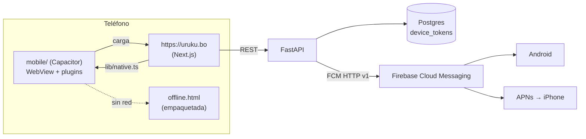

# App de URUKU en Google Play y App Store

> Diseño del arquitecto · 19/10/2026 · **Propuesta para aprobar** (no hay código todavía).
> Entrada: pedido del dueño (D6 en `grupos-por-comercio.md` §2.4: la app no da el número del comprador; **igual se hace** por presencia, captación y avisos), `frontend/app/manifest.ts`, `frontend/public/sw.js`, `backend/app/api/usuario.py`.
> KB aplicada: `lesson-supabase-service-role-key-nunca-en-frontend`, `lesson-nunca-delete-fisico-siempre-soft` (con la excepción de D7), `lesson-supabase-cloud-grants-explicitos-en-migration`, `lesson-api-health-endpoint-para-debug-remoto`, `pattern-identidad-celular-progresiva`, `pattern-wa-me-link-sin-api`, ADR `2026-05-11-stack-apops` (PWA + Web Push) y ADR `2026-05-11-stack-gestion-ordenes` (Expo).
> **«No confirmado»** = no se pudo verificar hoy en una fuente primaria. Fuentes en §12 (todas consultadas el 19/10/2026).

## 0. En una pantalla

**Recomendación:** una sola app **Capacitor 8** en `mobile/` (este repo) que abre `https://uruku.bo` y le suma lo que la web no puede dar: **avisos nativos** (Firebase Cloud Messaging, que en iPhone pasa por APNs), **compartir** nativo, **ubicación** nativa para «cerca de mí», **cámara** para el comercio, **enlaces que abren la app** y una **pantalla sin conexión** con los comercios guardados. iOS se compila en la nube con **Codemagic** (gratis hasta 500 min/mes) y se prueba con **TestFlight**: no hace falta Mac.

| | |
|---|---|
| Cambios de la web | Llegan a la app **al instante, sin publicar versión** (la app carga el sitio) |
| Piden versión nueva | Plugins, permisos, ícono, rutas de enlaces, y subir el SDK una vez por año (Android: 31/8; iOS: abril) |
| Costo | **USD 124 el primer año** (+ iPhone de prueba si no se consigue prestado) y **USD 99/año** después |
| Calendario | **~5 semanas** hasta estar en las dos tiendas: lo marcan la prueba cerrada de Google (12 testers × 14 días) y la revisión de Apple |
| Bloquea al dueño | Política de privacidad publicada (`docs/legal/`), cuentas de Apple y Google, 12 testers con Android, un iPhone 11 o posterior |
| Riesgo mayor | Apple rechaza por la guía 4.2 («sitio reempaquetado»). Mitigación: avisos + guardados sin conexión + compartir + ubicación + cámara, y **el iPhone se manda a revisión recién con E3 (avisos) adentro** |

**Descartado:** TWA en Android + PWABuilder en iOS (dos herramientas; PWABuilder iOS pide Mac y su push no es confiable) y React Native/Expo (rehacer toda la interfaz). Ver §2.

## 1. Path dependence (declarada)

La recomendación **mantiene la web Next.js como la única interfaz**: es el camino de siempre (Next + FastAPI + Postgres). Además el equipo ya usó Expo en GestionOrdenes, así que React Native no es ajeno. Se contrastó con dos alternativas reales:

1. **Expo / React Native** (lo que usó GestionOrdenes): interfaz nativa de verdad y riesgo 4.2 bajo, pero duplica las ~40 pantallas, el mapa y el design system. Para un solo humano, cada feature pasaría a costar el doble para siempre. **Descartada.**
2. **TWA + PWABuilder**: cero código nativo en Android, pero iOS igual necesita compilar (PWABuilder pide Mac) y no trae push confiable. Son dos herramientas para mantener. **Queda como plan B sólo para Android.**

También **se aparta** del ADR `stack-apops`, que eligió Web Push en vez de FCM. Acá la app de iPhone necesita APNs igual, y FCM lo resuelve con un solo token para las dos plataformas. El Web Push de la web queda para después y entra en la misma tabla (§6).

## 2. Comparación de opciones

| | (a) TWA + PWABuilder iOS | **(b) Capacitor (las dos)** | (c) Expo / React Native |
|---|---|---|---|
| Qué es | Android: Chrome abre el sitio sin barra, verificado con Digital Asset Links. iOS: proyecto Xcode con WKWebView | Un proyecto nativo por plataforma: un WebView carga uruku.bo y la web llama a plugins nativos | App nativa nueva; la web queda aparte |
| Esfuerzo inicial | Android: horas. iOS: días, y PWABuilder pide Mac | ~1 semana las dos (E1 + E2) + avisos (E3) | Meses (rehacer la interfaz) |
| ¿La web llega sin publicar? | Sí | Sí | No: la interfaz está duplicada (expo-updates sólo actualiza el JS de la app) |
| Avisos | Android: Web Push (hoy no existe: `sw.js` no tiene manejador `push`). iOS: «early preview» en PWABuilder, y dentro de WKWebView no anda bien (fuentes secundarias) | FCM nativo en las dos | expo-notifications |
| Riesgo Apple 4.2 | Alto (envoltorio casi pelado) | Medio (con funciones nativas) | Bajo |
| Sin Mac | Android sí; iOS no | Codemagic | EAS Build (gratis: 15 builds iOS/mes) |
| Mantenimiento | Dos herramientas distintas | Una; una versión mayor de Capacitor por año | Dos interfaces para siempre |
| Veredicto | Plan B para Android | **Elegida** | Descartada |

## 3. Decisiones

| # | Decisión | Alternativas descartadas | Por qué | Qué la invalidaría |
|---|---|---|---|---|
| D1 | **Capacitor 8** para Android e iOS | TWA+PWABuilder; Expo/RN; shell Expo con WebView | Una sola base, los mismos plugins y el mismo push en las dos. iOS necesita funciones nativas igual | Dos rechazos por 4.2 con push y offline adentro → evaluar un shell Expo con pestañas nativas |
| D2 | **Modo «hosted»**: `server.url = https://uruku.bo` + `server.errorPath` con una pantalla sin conexión empaquetada | Empaquetar la web (`output: 'export'`) + live updates (Capgo/Capawesome) | La web usa ISR, componentes de servidor, `middleware.ts` y cookies de ciudad: exportarla estática es reescribirla. Hosted = cada deploy llega solo. La doc de Capacitor advierte que `server.url` «no es para producción»: se mitiga en R4 | Apple deja de aceptar apps hosted, o la web pasa a ser una SPA exportable |
| D3 | **`mobile/` dentro de este repo** | Repo aparte (como Reservalo) | La app no es marca blanca: depende de `.well-known`, de `lib/native.ts` y de endpoints de este repo. Un mismo PR toca las tres capas (`arquitectura-repos.md`: Reservalo va aparte sólo por ser white-label) | La app pasa a ser white-label o la mantiene otra persona |
| D4 | **Codemagic** compila iOS y Android | GitHub Actions macOS (USD 0.062/min; el doc no aclara cuánto descuenta macOS de los 2.000 min gratis en repos privados: no confirmado); EAS Build (dice «cualquier proyecto nativo», no menciona Capacitor: no confirmado); Ionic Appflow (no acepta clientes nuevos desde 11/2/2025 y cierra el 31/12/2027); Mac propio | Plan personal gratis con 500 min/mes en Mac mini M2. Genera o trae los certificados con la clave API de App Store Connect (todo desde Windows) y publica en TestFlight y Google Play. Tiene guía oficial para Capacitor | Pasar de 500 min/mes en forma sostenida (excedente: USD 0.095/min) → GitHub Actions |
| D5 | **FCM para las dos plataformas** con `@capacitor-firebase/messaging` (devuelve token FCM en iOS y Android); envío desde FastAPI con la API HTTP v1, **un envío por token** (sin topics) | `@capacitor/push-notifications` (en iOS da token APNs, no FCM) + APNs directo; OneSignal; Web Push dentro de la app | Un proveedor y un tipo de token. FCM no cuesta. Sin topics porque el consentimiento y la ciudad se filtran por token y cada envío queda auditado | >10.000 tokens por envío → cola de trabajos; >50.000 → evaluar topics |
| D6 | **Cuentas personales** (Google) e **individual** (Apple) | Organización (D-U-N-S + persona jurídica) | No hay persona jurídica URUKU confirmada. Apple no acepta nombres de fantasía ni DBA para organización. La personal sale en días; la organización sólo se ahorra la prueba de 14 días de Google | Se constituye una SRL → convertir la cuenta de Apple (soporte) y transferir la app en Google |
| D7 | **«Eliminar mi cuenta» = anonimizar**: la fila queda con `activo=false` y se borran los datos personales | DELETE físico; desactivar la cuenta | Apple: «sólo desactivar es insuficiente». La KB prohíbe el DELETE físico; anonimizar cumple las dos cosas sin romper FKs | Si `docs/legal/` exige borrado físico → job de purga a los 30 días |
| D8 | **Sin «Sign in with Apple»** | Agregarlo | La guía 4.8 exime a la app que «usa exclusivamente el alta y el ingreso propios de la empresa». El login es celular + clave propio; WhatsApp es el canal de verificación, no un login de terceros | Se agrega login con Google o Facebook |
| D9 | **Una sola app para todas las ciudades** | Una app por ciudad | La 4.3(a) lo prohíbe con este mismo ejemplo («una app de mapa por ciudad»). La ciudad ya se elige dentro del sitio | — |
| D10 | **La app no registra `sw.js`** | App-Bound Domains en iOS para tener service worker | En WKWebView el SW sólo corre con App-Bound Domains. La caché del SW ya sirvió bundles viejos (historia en `sw.js`). El offline lo da la pantalla nativa | El mapa sin conexión pasa a ser requisito |
| D11 | **La app no vende planes ni muestra precios ni botones para pagarlos** | IAP / Google Play Billing | 3.1.1(a): fuera de EE. UU. no se puede mandar a pagar por otro medio. 3.1.3(g): la publicidad que se ve en la misma app se cobra con IAP. Google Play: lo mismo con su billing. Los precios ya están ocultos al público (4/10) | Se quiere cobrar planes desde la app → IAP + comisión de la tienda |
| D12 | Identificador **`bo.uruku.app`** (bundle id de iOS y applicationId de Android) | `com.uruku.app` | Dominio invertido real. **No se puede cambiar después de publicar** | — |
| D13 | **Sólo iPhone** (sin iPad) | Universal | Menos capturas y menos superficie de revisión | Aparecen usuarios de iPad |

## 4. Cómo funciona



**Contrato web ↔ app** (`frontend/lib/native.ts`, pseudocódigo):

```
isNativeApp(): boolean                         // Capacitor.isNativePlatform()
appInfo(): {version, build, platform}          // para habilitar funciones según la versión instalada
share({title, text, url})                      // hoja nativa; en web: navigator.share o copiar
currentPosition(): Ubicacion                   // plugin Geolocation; en web: lib/ubicacion.ts
pickPhoto(source: "camera" | "gallery"): File  // sólo pantallas del comercio
push.status(): "granted" | "denied" | "prompt" | "unsupported"
push.enable({city_slug, notify_favorites, notify_offers})   // permiso del sistema + PUT /devices
push.disable()                                 // POST /devices/remove
offline.saveFavorites(FavoriteSnapshot[])      // Preferences; lo lee offline.html
session.persist(token) / session.restore()     // copia del JWT en Preferences por si el WebView pierde su almacenamiento
```

Reglas:

1. **Nunca suponer que el plugin existe**: todo pasa por `Capacitor.isPluginAvailable()`. La web se actualiza antes que la app, y una app vieja sin el plugin tiene que caer al comportamiento web.
2. Los paquetes JS de los plugins se importan **dinámicamente y sólo dentro de la app**: al que entra por el navegador no le suman peso.
3. En modo app: sin `sw-register`, sin `install-prompt`, sin atajos del manifest.
4. Enlaces externos (`wa.me`, TikTok, Facebook, mapas) **abren fuera** (WhatsApp o el navegador), nunca dentro del WebView. `allowNavigation` sólo incluye `uruku.bo`.
5. Las herramientas internas (`/admin`, `/publicar`, `/contenido`, `/campo`) no se enlazan en modo app. Los agentes siguen con la PWA.
6. `/tienda` (Reservalo) es el mismo origen y se ve dentro de la app tal cual. Si una pantalla de Reservalo quiere un plugin, también usa `window.Capacitor` con la regla 1.

## 5. Requisitos por tienda (checklist)

### 5.1 Apple App Store

- [ ] **Apple Developer Program individual**: USD 99/año. Apple Account con verificación en dos pasos y **nombre legal** (un apodo o un nombre de empresa demora el alta). Domicilio sin casilla postal. Como vendedor se ve **el nombre del dueño** (fuente secundaria). El alta se puede hacer por la web. Bolivia tiene App Store.
- [ ] App ID `bo.uruku.app` con las capacidades **Push Notifications** y **Associated Domains**. Clave APNs (`.p8`) subida a Firebase. Clave API de App Store Connect (rol App Manager) cargada en Codemagic.
- [ ] Compilar con **Xcode 26 / SDK iOS 26** (obligatorio desde el 28/4/2026; Codemagic lo trae). Capacitor 8 pide iOS 15 como mínimo.
- [ ] **4.2**: funciones que el sitio no da: avisos, guardados sin conexión, hoja de compartir, ubicación nativa, cámara del comercio y enlaces que abren la app. Barra inferior de pestañas en modo app.
- [ ] **4.2.3(i)** («tiene que andar sin instalar otra app»): ver, buscar, mapa, guardar en el teléfono y avisos andan **sin WhatsApp**. WhatsApp sólo hace falta para escribirle al comercio (si tiene teléfono, ofrecer también «Llamar») y para crear la cuenta.
- [ ] **4.5.4**: avisos de ofertas sólo con **tilde explícito en la app** y forma de apagarlos en la app. Nunca datos personales en un aviso.
- [ ] **4.8**: no aplica (D8).
- [ ] **5.1.1(v)**: **borrar la cuenta desde la app**, fácil de encontrar en Perfil (comprador y comercio). Se puede pedir un código para confirmar; no se puede mandar a soporte, mail ni llamada.
- [ ] **5.1.1(i)**: enlace a la **Política de privacidad** en App Store Connect **y** dentro de la app.
- [ ] **5.1.1(ii)/(iv)**: textos de permiso claros en español (ubicación, cámara, fotos). Si niega la ubicación, ofrecer elegir zona a mano.
- [ ] **App Privacy (etiquetas)**: teléfono (cuenta), ID de dispositivo (token push), fotos (comercio), interacciones (eventos propios). La ubicación **sólo si sale del teléfono**: hoy `lib/ubicacion.ts` la usa en el teléfono para ordenar (confirmar en E2). **Lo que junta la web dentro de la app también se declara.**
- [ ] **Privacy manifest** (`PrivacyInfo.xcprivacy`): el de la app y los que traen Capacitor y Firebase. Plugins como `preferences` lo necesitan.
- [ ] **1.2 (contenido de usuarios)**: filtro (la moderación que ya existe), **«Reportar»** en publicación y ficha, **«Ocultar este comercio»** (bloqueo) y contacto publicado (`lib/contacto.ts`).
- [ ] **2.1**: **cuenta demo** (comprador con celular + clave, y un comercio demo) y notas para el revisor que expliquen la verificación por `CONFIRMAR`.
- [ ] **3.1.1(a)/3.1.3(g)**: nada de venta de planes (D11).
- [ ] Sólo iPhone (D13). Cuestionario de clasificación por edad. Capturas de iPhone.

### 5.2 Google Play

- [ ] **Cuenta personal**: USD 25 una sola vez. Tarjeta a nombre del dueño (**no se aceptan prepagas**). Verificación de identidad. Verificar un **Android físico** (Android 10+, sin root) con la app Play Console.
- [ ] **Prueba cerrada**: por ser cuenta personal posterior al 13/11/2023, hacen falta **12 testers con opt-in continuo durante 14 días**. Después se pide acceso a producción en el Panel (la revisión suele tardar 7 días o menos). La página de Google habla sólo de cuentas personales: que las de organización estén exentas lo dicen fuentes secundarias.
- [ ] **targetSdk 36 (Android 16)**: obligatorio para apps nuevas y actualizaciones desde el 31/8/2026 (se podía pedir prórroga hasta el 1/11/2026). Capacitor 8 ya compila con 36.
- [ ] **Play App Signing** + clave de subida generada por el dueño y guardada en dos lugares.
- [ ] **Data safety**: los mismos datos que en Apple. El token FCM va en «ID de dispositivo u otros IDs», con fines de funcionamiento de la app. **URL de borrado** obligatoria.
- [ ] **Borrado de cuenta**: dentro de la app **y** con un enlace web (`uruku.bo/cuenta/eliminar`) que no obligue a reinstalar la app.
- [ ] **Pagos**: nada de venta de planes en la app (D11).
- [ ] **Contenido de usuarios**: reportar desde la app (el mismo «Reportar»).
- [ ] `assetlinks.json` con la huella SHA-256 de la **clave de firma de Play** (está en Play Console) y la de subida.
- [ ] Permiso `POST_NOTIFICATIONS` (Android 13+): se pide dentro del mismo flujo de alta de avisos.

## 6. Avisos (E3), a alto nivel

**Qué se avisa:**

- Automático: «*{comercio} que guardaste publicó: {título}*» cuando una publicación pasa a `aprobado`. Llega a los usuarios que guardaron ese comercio y aceptaron esos avisos.
- Manual: Admin › Avisos manda un aviso a una ciudad, sólo a quien aceptó «ofertas de tu ciudad».
- **Topes (los confirma el dueño):** 1 aviso por comercio, por usuario y por día. Nada entre las 21 y las 8 (hora de Bolivia): lo que cae en ese horario sale a las 8.

```sql
-- 0167_device_tokens.sql (número: el siguiente libre al implementar; 0156-0158 rama de marketing, 0159-0164 grupos-por-comercio, 0165-0166 cobro-mensual)
create table device_tokens (
  id               uuid primary key default gen_random_uuid(),
  token            text not null unique,          -- token FCM (app) o endpoint Web Push (futuro)
  provider         text not null check (provider in ('fcm','webpush')),
  platform         text not null check (platform in ('android','ios','web')),
  usuario_id       uuid references usuarios(id),  -- null = sin cuenta (los avisos no exigen cuenta)
  comercio_id      uuid references comercios(id), -- token del dueño de un comercio (avisos de moderación, futuro)
  ciudad_id        uuid references ciudades(id),
  notify_favorites boolean not null default false, -- 4.5.4: es promocional → tilde explícito
  notify_offers    boolean not null default false,
  consent_at       timestamptz,
  app_version      text,
  fail_count       int not null default 0,
  last_seen_at     timestamptz not null default now(),
  activo           boolean not null default true,
  created_at       timestamptz not null default now(),
  updated_at       timestamptz not null default now()
);
create index idx_device_tokens_ciudad  on device_tokens(ciudad_id)  where activo;
create index idx_device_tokens_usuario on device_tokens(usuario_id) where activo;
alter table device_tokens enable row level security;  -- sin policies para anon: sólo el backend
grant all on public.device_tokens to service_role;    -- lesson grants explícitos

create table push_sends (                             -- auditoría de cada envío
  id uuid primary key default gen_random_uuid(),
  kind text not null check (kind in ('broadcast','favorite_post')),
  ciudad_id uuid references ciudades(id), publicacion_id uuid references publicaciones(id),
  title text not null, body text not null, url text not null,
  target_count int not null default 0, sent_count int not null default 0, failed_count int not null default 0,
  sent_by uuid references usuarios_panel(id), created_at timestamptz not null default now()
);
alter table push_sends enable row level security;
grant all on public.push_sends to service_role;
```

| Método | Ruta | Auth | Cuerpo → respuesta |
|---|---|---|---|
| PUT | `/devices` | opcional (JWT de usuario o de comercio) | `{token, provider:"fcm", platform, city_slug, notify_favorites, notify_offers, app_version}` → `{ok:true}`. Upsert por `token`; si viene JWT, ata `usuario_id`/`comercio_id`. Límite por IP |
| POST | `/devices/remove` | ninguna (el token es el secreto) | `{token}` → `{ok:true}` (`activo=false`) |
| POST | `/admin/push/broadcast` | admin (permiso nuevo `push`) | `{ciudad_id, title, body, url}` → `{push_send_id, target_count}` (se envía en segundo plano) |
| GET | `/admin/push/sends` | admin | lista con los conteos |

**Envío** (`backend/app/services/push.py`): FCM HTTP v1, un POST por token con `httpx` (ya está) y concurrencia limitada, en `BackgroundTasks`. Un `404 UNREGISTERED` o `400 INVALID_ARGUMENT` → `activo=false`; otros errores → `fail_count+1`. El payload lleva `data.url` (`/comercios/<slug>?ref=push`) y la app navega ahí al tocar el aviso. La credencial de la cuenta de servicio de Firebase vive **sólo en `backend/.env`** (como `service_role`). Dependencia nueva: **`google-auth`**, para obtener el token OAuth2 de la cuenta de servicio sin firmar JWT RS256 a mano.

**Web Push** (la «spec siguiente» de `grupos-por-comercio.md` §2.3) entra después en la misma tabla con `provider='webpush'`, sin migración.

## 7. Enlaces que abren la app y QR

- **Abren la app**: todo `uruku.bo` **menos** `/admin*`, `/publicar*`, `/contenido*`, `/campo*`, `/api/*`, `/version`, `/volante/*`, `/cuenta/eliminar*` (Google pide que el borrado web no mande de vuelta a la app) y **`/comunidad/*`**. El QR de la comunidad de compradores redirige a WhatsApp (302 a la comunidad con lugar, `grupos-por-comercio.md` T5): tiene que seguir yendo a WhatsApp, haya app o no.
- El `?ref=` llega entero al WebView, así que la atribución (0114) sigue andando. `ref=push` y `ref=app` sirven para medir la app.
- `uruku.bo/comercios/<slug>` (link compartido o QR de la ficha) → abre la ficha en la app si está instalada, y si no, en la web. En Safari, un **Smart App Banner** (`<meta name="apple-itunes-app">`) invita a bajar la app (captación, costo cero).

```jsonc
// frontend/public/.well-known/apple-app-site-association (sin extensión)
{ "applinks": { "details": [ { "appIDs": ["<TEAM_ID>.bo.uruku.app"], "components": [
  { "/": "/admin*", "exclude": true }, { "/": "/publicar*", "exclude": true },
  { "/": "/contenido*", "exclude": true }, { "/": "/campo*", "exclude": true },
  { "/": "/api/*", "exclude": true }, { "/": "/comunidad/*", "exclude": true },
  { "/": "/volante/*", "exclude": true }, { "/": "/cuenta/eliminar*", "exclude": true },
  { "/": "/version", "exclude": true }, { "/": "*" } ] } ] } }
```

```jsonc
// frontend/public/.well-known/assetlinks.json
[{ "relation": ["delegate_permission/common.handle_all_urls"],
   "target": { "namespace": "android_app", "package_name": "bo.uruku.app",
     "sha256_cert_fingerprints": ["<SHA256 clave de firma de Play>", "<SHA256 clave de subida>"] } }]
```

En Android las exclusiones se hacen con los `pathPattern`/`pathAdvancedPattern` del `intent-filter` (`autoVerify="true"`).

**Servirlos bien:** HTTPS, **sin redirecciones**, `Content-Type: application/json` (el AASA no tiene extensión: se fuerza en `next.config.mjs` → `headers()`). **Cloudflare no puede desafiar ni redirigir `/.well-known/*`**: Apple lo lee desde su CDN (lo pide dentro de las 24 h y los teléfonos lo revisan más o menos una vez por semana) y un WAF le puede devolver 403. En Android 15+, un cambio puede tardar hasta 7 días en propagarse.

## 8. Cambios en el repo

```
mobile/                         NUEVO
  package.json                  @capacitor/cli|core|android|ios 8.x + plugins (versiones fijas)
  capacitor.config.ts           appId bo.uruku.app · server.url https://uruku.bo · errorPath offline.html
  www/offline.html              pantalla sin conexión: guardados desde Preferences, «Reintentar»
  android/  ios/                proyectos generados (cap add), versionados; iOS con SPM, sólo iPhone
  resources/                    ícono y splash del manual de marca → @capacitor/assets (genera todos los tamaños)
  README.md                     compilar, firmar y publicar (corto)
codemagic.yaml                  NUEVO, en la raíz (Codemagic lo lee de ahí); workflows android-closed, ios-testflight
frontend/
  lib/native.ts                 NUEVO: el contrato de §4
  components/sw-register.tsx    no registra en la app
  components/install-prompt.tsx oculto en la app
  components/report-content.tsx NUEVO: «Reportar» / «Ocultar este comercio» (usa POST /reclamos)
  components/push-optin.tsx     NUEVO: los dos tildes + permiso (E3)
  app/perfil/page.tsx           «Eliminar mi cuenta», «Avisos», enlace a privacidad
  app/cuenta/eliminar/page.tsx  NUEVO: borrado web (número → CONFIRMAR por WhatsApp → anonimiza)
  app/guardados/page.tsx        guarda el snapshot sin conexión en la app
  lib/ubicacion.ts              usa native.currentPosition() en la app
  public/.well-known/           assetlinks.json + apple-app-site-association
  next.config.mjs               Content-Type del AASA
  package.json                  @capacitor/core + JS de los plugins: son el puente que llama la web (import dinámico)
backend/
  app/api/devices.py            NUEVO (PUT /devices, POST /devices/remove)
  app/api/push_admin.py         NUEVO (broadcast, sends)
  app/services/push.py          NUEVO (FCM HTTP v1)
  app/api/usuario.py            DELETE /usuario/cuenta + flujo web de borrado (reusa CONFIRMAR)
  app/api/campo.py              /reclamos acepta publicacion_id y motivo
  tests/                        devices, push (FCM simulado), borrado, columnas
supabase/migrations/            device_tokens + push_sends; usuarios.eliminado_en; reclamos.publicacion_id
```

**Borrado de cuenta (D7):** `whatsapp` → `'eliminado:<id>'`, `clave_hash`/`reset_code` → null, consentimientos en false, `eliminado_en=now()`, `activo=false`. Los favoritos pasan a inactivos y los `device_tokens` a `activo=false`. En las cuentas de comercio, se corta el acceso al instante y queda un pedido de baja del comercio con el motivo de `0147`. Como es un proceso manual, se avisa el plazo (Apple lo permite si se informa). **Ojo:** `usuarios.whatsapp` es `unique not null`, por eso va el marcador y no un null.

## 9. Qué tiene que hacer el dueño

1. **Confirmar si existe una persona jurídica URUKU.** Si no existe, cuentas personales (D6).
2. **Google Play Console**: pagar USD 25 con tarjeta de crédito o débito **no prepaga** a su nombre. Desde abril de 2026 las tarjetas bolivianas vuelven a pagar en el exterior (débito con cupo base de USD 500/mes, según la prensa; **confirmar con el banco**). Verificar la identidad y verificar un Samsung con la app Play Console.
3. **Apple**: Apple Account con verificación en dos pasos y nombre legal; enrolarse como **individual** (USD 99). Después crear la **clave APNs (.p8)** y la **clave API de App Store Connect**: se cargan en Firebase y Codemagic, **nunca en el repo**.
4. **Firebase**: proyecto «uruku» con la cuenta Google de URUKU (anotarla en `cuentas-uruku.md`), apps Android e iOS `bo.uruku.app`.
5. **Codemagic**: cuenta personal con GitHub y acceso al repo.
6. **12 testers** (mejor 15) con Android y Gmail: agentes, comerciantes confiables, familia. Que acepten la invitación y **no se salgan durante 14 días**.
7. **iPhone 11 o posterior** (los XS/XR no reciben iOS 26), prestado o usado, con TestFlight.
8. **Legal**: Política de privacidad publicada en `uruku.bo/privacidad` (sale de `docs/legal/`), mail de soporte y URL de soporte.
9. **Ficha**: nombre corto (las dos tiendas limitan el largo a ~30 caracteres: no confirmado hoy), descripción, categoría Compras, capturas, ícono 1024 px y clasificación por edad.
10. **Cuenta demo** para el revisor: un número de prueba con clave y un comercio demo.
11. Guardar la **clave de subida de Android** y las claves de Apple en un gestor de contraseñas (dos copias).

## 10. Entregas

**Orden:** E0 (dueño) → E1 → el reloj de 14 días de Google corre mientras se hacen E2 y E3 en paralelo (capas distintas). Android sale a producción con E3 adentro; **iOS se manda a revisión recién con E3**.

### E1 · Android (M)

1. `mobile/` con Capacitor 8, `bo.uruku.app`, targetSdk 36. Codemagic genera el AAB firmado y lo sube a la **prueba cerrada**.
2. Un link `https://uruku.bo/comercios/<slug>?ref=x` tocado en WhatsApp abre **la app** en esa ficha, y el `ref` queda registrado. `adb shell pm get-app-links bo.uruku.app` → `verified`.
3. `wa.me`, TikTok y Facebook abren **fuera** del WebView. `/comunidad/bermejo` termina en WhatsApp.
4. Compartir una ficha → hoja nativa. «Cerca de mí» → permiso nativo. Si se niega, la lista anda igual.
5. En modo avión → `offline.html` con los guardados, **nunca pantalla blanca**.
6. Perfil → «Eliminar mi cuenta» anonimiza según §8. `uruku.bo/cuenta/eliminar` funciona sin la app.
7. «Reportar» crea un reclamo con `comercio_id`/`publicacion_id`. «Ocultar este comercio» lo saca del feed de ese usuario.
8. La política de privacidad es accesible desde Perfil. En la app no se registra el SW ni aparece el cartel de instalar.
9. La sesión sobrevive a cerrar la app y a reiniciar el teléfono.
10. Data safety completo, 12+ testers con opt-in y el contador de 14 días corriendo.

### E2 · iOS (M)

1. Codemagic compila `ios/` con Xcode 26, firma con la clave API y sube a **TestFlight**. El dueño la instala en el iPhone (los testers internos no pasan revisión).
2. Los criterios 2 a 9 de E1, en iPhone. `https://app-site-association.cdn-apple.com/a/v1/uruku.bo` devuelve el archivo (no confirmado que esa URL siga vigente; si no, se prueba con `?mode=developer`).
3. `Info.plist`: textos de permiso en español (ubicación, cámara, fotos). `PrivacyInfo.xcprivacy` presente. Sólo iPhone.
4. App Privacy completo, cuenta demo y notas para el revisor cargadas.
5. **No se manda a revisión sin E3.**

### E3 · Avisos (M)

1. Firebase con la clave APNs subida. `@capacitor-firebase/messaging` en las dos plataformas.
2. Pantalla de avisos con **dos tildes apagados por defecto**. El permiso del sistema se pide recién al tocar «Activar».
3. `PUT /devices` guarda el token con la ciudad. Apagar en Perfil → `POST /devices/remove` → no llega nada más.
4. Se aprueba una publicación de un comercio guardado → el aviso llega a Android y a iPhone en menos de 1 minuto. Tocarlo abre esa ficha en la app con `ref=push`.
5. Admin › Avisos manda un aviso a una ciudad sólo a `notify_offers`, y queda en `push_sends` con los conteos.
6. Un token inválido queda `activo=false` después del primer `UNREGISTERED`. Se respetan los topes y el horario.
7. Hay un test que falla si la credencial de Firebase aparece en `frontend/`. pytest cubre devices, push y borrado.

## 11. Riesgos

| # | Riesgo | Mitigación / validación humana |
|---|---|---|
| R1 | **Apple rechaza por 4.2** (hay casos de apps Capacitor con plugins propios rechazadas igual, según el foro de Apple) | Funciones nativas de §5.1 + pestañas en modo app + notas al revisor. Si rechaza dos veces: E4 con un **widget nativo «Cambio del día»** (WidgetKit, código Swift) o quedarse con la PWA en iPhone y la app sólo en Android. **Decide el dueño** |
| R2 | 4.2.3(i): la cuenta depende de WhatsApp | Todo lo central anda sin cuenta. «Llamar» como alternativa. Explicarlo en las notas |
| R3 | Planes y pagos (3.1.1 / Play Billing) | D11. **El dueño confirma** que el panel del comercio en la app no muestra precios ni «pasate a…» |
| R4 | `server.url` «no es para producción» (doc de Capacitor) | Navegación limitada a `uruku.bo`, plugins con la regla 1, `errorPath` sin conexión. `/api/health` y `/version` para depurar a distancia |
| R5 | La web se adelanta a una app vieja | `isPluginAvailable` + `appInfo()`. Nunca subir de versión los paquetes de plugins en `frontend/` sin publicar antes la app |
| R6 | Sin Mac no hay inspector de Safari para el WebView | Los errores de WebKit se reproducen en **Safari del iPhone** (mismo motor) abriendo uruku.bo. En Android, `chrome://inspect` por USB. Para una emergencia, Mac en la nube por hora (precio no confirmado) |
| R7 | Un tester se sale y los 14 días se reinician (fuente secundaria) | 15 testers; el dueño los sigue en Play Console |
| R8 | Cloudflare bloquea al CDN de Apple o a la verificación de Google | Regla sin desafío para `/.well-known/*`; criterio de E1/E2 |
| R9 | Mantenimiento anual | targetSdk (31/8), Xcode (abril), Capacitor mayor (diciembre): ~1-2 días por año + revisiones. Anotarlo en `pendientes.md` |
| R10 | El nombre del dueño se ve como vendedor en el App Store | Aceptarlo, o pasar a organización cuando haya persona jurídica |
| R11 | Borrado contra soft-delete de la KB | D7 (anonimizar). **Validar con `docs/legal/`** |
| R12 | El WebView de iOS pierde el almacenamiento y la sesión (no confirmado) | `session.persist/restore` en Preferences |
| R13 | 500 min/mes de Codemagic | Un build de iOS tarda ~10-20 min (no confirmado): alcanza para ~25-50 builds. Compilar sólo al publicar |
| R14 | Las dos tiendas piden capturas, textos y respuestas legales que se desactualizan | Las etiquetas de privacidad se revisan en cada spec que junte datos nuevos (sumarlo al checklist de spec) |

## 12. Costos

| Concepto | Primer año | Recurrente |
|---|---|---|
| Apple Developer Program (individual) | USD 99 | USD 99/año |
| Google Play (personal) | USD 25 | — |
| D-U-N-S | 0 (sólo para organización; es gratis en Dun & Bradstreet) | — |
| Codemagic (personal, 500 min M2/mes) | 0 | 0 (excedente USD 0.095/min) |
| Firebase Cloud Messaging | 0 | 0 |
| iPhone de prueba (11 o posterior, usado) | 0 si es prestado; si no, precio local **no confirmado** | — |
| Android de prueba / testers | 0 (Samsungs propios, gente propia) | — |
| **Total** | **USD 124** + iPhone | **USD 99/año** |

## 13. Fuentes (consultadas el 19/10/2026)

- Apple, App Review Guidelines (1.2, 2.1, 2.5.2, 3.1.1, 3.1.3, 4.2, 4.3, 4.5.4, 4.8, 5.1.1): https://developer.apple.com/app-store/review/guidelines/
- Apple, Offering account deletion in your app: https://developer.apple.com/support/offering-account-deletion-in-your-app/
- Apple, Enrollment (individual/organización, D-U-N-S, USD 99): https://developer.apple.com/programs/enroll/
- Apple, App privacy details: https://developer.apple.com/app-store/app-privacy-details/
- Apple, Upcoming requirements (Xcode 26 desde el 28/4/2026): https://developer.apple.com/news/upcoming-requirements/
- Apple, TestFlight (100 internos, 10.000 externos con revisión): https://developer.apple.com/testflight/
- Apple, Supporting associated domains (sin extensión, sin redirecciones, CDN, 24 h, ~1 vez por semana): https://developer.apple.com/documentation/xcode/supporting-associated-domains
- Apple, disponibilidad del App Store por país (Bolivia): https://support.apple.com/en-us/118205
- Google Play, requisitos de prueba de cuentas personales nuevas (12 testers, 14 días): https://support.google.com/googleplay/android-developer/answer/14151465
- Google Play, tipos de cuenta y D-U-N-S: https://support.google.com/googleplay/android-developer/answer/13634885
- Google Play, verificación de dispositivo Android: https://support.google.com/googleplay/android-developer/answer/14316361
- Google Play, registro (USD 25, tarjetas): https://support.google.com/googleplay/android-developer/answer/6112435
- Google Play, borrado de cuenta (en la app + web): https://support.google.com/googleplay/android-developer/answer/13327111
- Google Play, target API (36 desde el 31/8/2026): https://developer.android.com/google/play/requirements/target-sdk · https://support.google.com/googleplay/android-developer/answer/11926878
- Google Play, política de pagos: https://support.google.com/googleplay/android-developer/answer/10281818
- Android, verificar App Links: https://developer.android.com/training/app-links/verify-android-applinks
- Chrome, Trusted Web Activity: https://developer.chrome.com/docs/android/trusted-web-activity/overview
- Capacitor v8, configuración (`server.url` «not intended for use in production», `errorPath`): https://capacitorjs.com/docs/config
- Ionic, anuncio de Capacitor 8 (8/12/2025; iOS 15, SPM, API 36): https://ionic.io/blog/announcing-capacitor-8
- Capacitor, Privacy Manifest: https://capacitorjs.com/docs/ios/privacy-manifest
- Capawesome, Firebase Cloud Messaging (token FCM en iOS y Android): https://capawesome.io/plugins/firebase/cloud-messaging
- Codemagic, precios (500 min M2 gratis; USD 0.095/min): https://codemagic.io/pricing/
- Codemagic, Ionic Capacitor (firma con clave API, TestFlight, Play): https://docs.codemagic.io/yaml-quick-start/building-an-ionic-app/
- GitHub Actions, facturación (2.000 min; macOS USD 0.062/min): https://docs.github.com/en/billing/concepts/product-billing/github-actions
- Expo, EAS Build: https://docs.expo.dev/build/introduction/ · planes: https://docs.expo.dev/billing/plans/
- Ionic, cierre de los productos comerciales/Appflow (11/2/2025): https://ionic.io/blog/?p=6282
- PWABuilder, publicar en el App Store de iOS (pide Mac): https://blog.pwabuilder.com/posts/publish-your-pwa-to-the-ios-app-store/
- Firebase, precios (FCM sin costo): https://firebase.google.com/pricing · Data safety: https://firebase.google.com/docs/android/play-data-disclosure
- Web Push en iOS 16.4+ sólo instalada en inicio (secundaria): https://documentation.onesignal.com/docs/web-push-for-ios
- Apple Developer Forums, app Capacitor rechazada por 4.2: https://developer.apple.com/forums/thread/812889
- Ionic Forum, `server.url` en producción: https://forum.ionicframework.com/t/capacitor-server-url/240196
- Los Tiempos, tarjetas para pagos internacionales (9/4/2026): https://www.lostiempos.com/actualidad/economia/20260409/entidades-financieras-reactivaron-pagos-internacionales-tarjetas
- 9to5Mac, iPhones compatibles con iOS 26: https://9to5mac.com/2025/09/15/ios-26-supports-these-recent-iphones-but-drops-three-models/
- Secundarias, exención de cuentas de organización y nombre del vendedor: https://www.testerscommunity.com/blog/google-play-developer-account-guide · https://www.analyticsinsight.net/tech-news/apple-developer-account-requirements-for-individual-vs-business-developers
