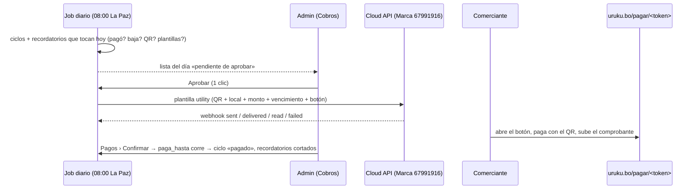

# Cobro mensual por WhatsApp: spec implementable (v1, 19/10/2026)

> **Estado:** spec para implementar. Base: `main` en `d35aa08`. Sigue a `docs/grupos-por-comercio.md` (v2), que dejó el cobro fuera (D7, §10.7). Lo que depende de Meta está marcado **a verificar**.
> **Para quién:** backend-dev y frontend-dev en paralelo dentro de cada entrega (§12), sin tocar los mismos archivos. qa-engineer verifica con los criterios. El dueño corre el **E0** (§11) mientras se programan E1 y E2.
> **Coordinación con grupos:** las dos specs tocan `main.py`, `db/repository.py`, `tests/conftest.py`, `api/webhook.py`, `admin/page.tsx`, `secciones.ts` y `middleware.ts`. Una entrega de esta spec **no** corre en paralelo con una de grupos: se intercalan.

## 0. En una pantalla

Cada comercio con **plan pago al día** tiene un **ciclo de cobro** por vencimiento (`paga_hasta`). El día antes de vencer recibe, desde el **número de la Marca (67991916) por la API oficial de WhatsApp**, una plantilla *utility* con **la imagen del QR de cobro de URUKU**, el nombre del local, el plan, el monto y el vencimiento, y un botón a **`uruku.bo/pagar/<token>`** para subir el comprobante. Si no se registra el pago, recibe recordatorios a los **3, 6, 9, 12 y 15 días** de vencido (**6 mensajes como máximo**). Un pago confirmado corta todo. El día 16 sin pago: el ciclo cierra, la cuenta **pasa al plan gratis** (sigue en el mapa, no se borra nada) y el admin lo ve en el panel.

Cada mañana (08:00, hora de Bolivia) el sistema arma **la lista del día**; un admin la **aprueba con un clic** y sale desde las 10:00. Más adelante, `BILLING_MODE=auto`. **Sin QR configurado no sale nada** y el panel lo grita. **El agente nunca cobra:** el pago entra por comprobante que aprueba un admin o por registro manual del admin.



## 1. Estado actual

| Pieza | Dónde | Qué pasa hoy |
|---|---|---|
| Vencimiento | `comercios.paga_hasta` (`0012_suscripciones.sql:9`) | Último día con plan. No hay ciclos ni recordatorios |
| Pagos | `pagos` (`0012:16-28`) + `estado`, `comprobante_url` (`0016:7-8`) | `pendiente → confirmado`; existe `rechazado` en el comentario pero **no hay endpoint** para rechazar |
| Pago manual del admin | `moderacion.py:955-978` → `repository.py:2479-2517` | Extiende `paga_hasta` desde `max(hoy, paga_hasta)` |
| Confirmar comprobante | `moderacion.py:1053-1085` → `repository.py:2616-2655` | Ídem; puede asignar `plan` |
| Comprobante del comercio | `comercio.py:1109-1158` | Métodos `transferencia/efectivo/otro`; «ya no hay un QR de pago que ofrecer» (`:1110-1113`). La foto va a `/fotos/comprobantes/…` (`:1116-1123`): **pública** por URL adivinable (`main.py:369`) |
| Mi comercio › Suscripción | `mi-comercio/page.tsx:972-1090` | «Consultá el monto y cómo pagar» por WhatsApp (`:1058`), monto a mano, moneda por defecto ARS en el backend (`comercio.py:1130`) |
| Admin | `admin/page.tsx:562-576` (Suscripciones, Pagos), `:3760` «Pago registrado» | Sin cola de avisos |
| «Al día» | `fotos_galeria.py:54-67`, `que_hay_aca.py:42-68`, `0143:70-90` (`plan_orden_de`) | `cortesía OR (paga_hasta >= hoy Bolivia AND NOT suspendido)`. El día después de vencer ya no tiene estrella, orden ni fotos del plan |
| Baja del mapa | `config.py:249,259` (`dias_vencido_baja = None`, `dias_gracia_sin_pago = None`), `main.py:59-83` | Apagadas: el gratis es para siempre |
| Fechas | `repository.py:2489,2632`, `comercio.py:759` | `date.today()` del contenedor (UTC): entre 20:00 y 24:00 de Bolivia ya es «mañana» |
| Cloud API | `whatsapp_client.py:65-95`, `mensajeria.py:40,107-133` | Usa `whatsapp_cloud_phone_id` y **Graph v20.0, dada de baja el 24/9/2026**: hoy no anda. La rama `integracion-marketing` (`6e88518`) trae `settings.graph_base()` con `GRAPH_API_VERSION=v26.0` |
| Webhook de Meta | `webhook.py:89-140` | Firma con `META_APP_SECRET`; los **estados** se descartan (`mensajeria.py:177-179`) y **todo mensaje entrante va a la ingesta** (`webhook.py:134`) |
| Envíos por WAHA | `config.py:187` (`wa_solo_lectura`), `mensajeria.py:53-63` | Bloqueados. La Marca por API oficial no pasa por esa llave |

**Lo que rompe si se conecta la Marca sin esta spec:** un comerciante le responde al aviso con la foto del comprobante → la ingesta lo identifica por su número → **se publica en el feed** (directo si es `confiable`). La separación del §6.3 va antes de cargar `META_APP_SECRET` en prod.

## 2. Decisiones

### 2.1 Del dueño (19/10/2026, no se discuten)

| # | Decisión |
|---|---|
| D1 | QR de cobro cada mes; recordatorios 1 día antes y a los 3, 6, 9, 12, 15 días de vencido (máx. 6 por ciclo); el pago los corta |
| D2 | Por **API oficial con la Marca 67991916**, plantillas *utility*. Nunca WAHA ni WhatsApp Web |
| D3 | Aprobación **por tandas** (la lista del día, un clic). Después, automático por config |
| D4 | Hoy **no hay QR**: `PAYMENT_QR_*` configurable; sin QR no sale nada y se alerta |
| D5 | **El agente nunca cobra**: comprobante + aprobación, o registro manual del admin. Se conecta con las alertas de grupos (E4) sin duplicarlas |
| D6 | Sin pago tras los recordatorios: plan gratis para siempre, sigue en el mapa, sin borrar; aviso al admin |
| D7 | Sin conteos al público; precios de planes ocultos al público |

### 2.2 Técnicas

| # | Decisión | Elegida | Descartadas | Por qué | Qué la invalidaría |
|---|---|---|---|---|---|
| T1 | Unidad de cobro | **Ciclo** por `(comercio_id, due_on)` con `due_on = paga_hasta`; 6 filas de recordatorio creadas al abrirlo, `unique (cycle_id, step)` = clave comercio + ciclo + número | Calcular «a quién le toca» cada día sin guardar nada | Idempotencia en la base, historia auditable, la pantalla muestra la línea de tiempo | Cobro por factura con varios conceptos (extras, destacados) → tabla de ítems |
| T2 | Monto | **Snapshot** al abrir el ciclo: `billing_contacts.amount_override` (acordado) o `planes.precio_mes` | Leer el precio vigente al mandar | Un precio que cambia a mitad de ciclo no le cambia lo que debe (`lesson-cuota-snapshot-al-apostar`) | — |
| T3 | Remitente | **Adaptador propio** `services/wa_brand.py` (Cloud API, número de la Marca, sólo plantillas y respuestas de servicio) | Reusar `mensajeria.py` | `mensajeria` cambia de proveedor **todo el sistema** con `WHATSAPP_PROVIDER` y la llave `wa_solo_lectura` lo bloquearía; la Marca manda siempre por Cloud API y la ingesta sigue en WAHA | Ingesta y Marca en el mismo número de Cloud API → unificar |
| T4 | Versión de Graph | `settings.graph_base()` de `integracion-marketing` (`6e88518`). **Dependencia:** si la rama no está en `main` al empezar E3, se trae ese commit solo (config + test, sin el resto de la rama) | Escribir `v26.0` a mano | v20.0 ya no existe; el test `test_ninguna_url_de_graph_esta_escrita_a_mano` lo exige | — |
| T5 | Job | Loop en proceso `_billing_loop` cada 10 min (como `_baja_loop`), **idempotente por la base**: lista única por día (`billing_batches.run_date`), envío por *claim* (`approved → sending` con `update … where status = 'approved'`) | cron del host que llama un endpoint; APScheduler | Sobrevive a reinicios y a más de un worker sin locks; no suma infraestructura | Más de una réplica con relojes distintos → igual anda; si el VPS duerme horas, la validez (§3) evita mandar tarde |
| T6 | A lo sumo una vez | Sin reintento automático de lo ambiguo: `ReadTimeout`/5xx → `unknown` y lo decide el admin. `biz_opaque_callback_data = "rem:<id>"` para reconciliar por el webhook (**a verificar** que Meta lo devuelve en estados de plantillas) | Reintentar hasta tener respuesta | Un cobro repetido molesta más que uno que falta, y lo reportan | — |
| T7 | QR de cobro | **Archivo en el VPS** (`PAYMENT_QR_IMAGE` + titular + banco + vencimiento), **no editable desde el panel**. Se publica en `/fotos/billing/qr-<sha8>.jpg`; la lista guarda la huella y **un QR distinto exige aprobación manual** aunque esté en `auto` | Subirlo desde el admin | Cambiar el QR es cambiar la cuenta donde entra la plata de todos: una cuenta de admin robada no puede redirigir los cobros | El QR vence seguido → pantalla de carga con doble aprobación |
| T8 | Dónde paga | `uruku.bo/pagar/<token>` sin login (token de 128 bits por ciclo) + Mi comercio › Suscripción con login | Sólo Mi comercio | Muchos no recuerdan la clave; el token sólo muestra local, plan, monto, vencimiento y QR, y sólo permite subir un comprobante que revisa una persona | Abuso de subidas → captcha |
| T9 | Comprobantes | Disco **privado** `PAYMENT_PROOFS_DIR`, servido sólo al admin | Seguir en `/fotos/comprobantes` | Tienen nombre, banco y monto de un tercero | — |
| T10 | Gracia | **Como hoy:** al vencer ya no está «al día». Los recordatorios lo dicen así. El día 16 el ciclo cierra y `comercios.plan = 'gratis'` (el plan anterior queda en el ciclo) | Mantener el plan 15 días (toca la regla «al día» en 6 lugares, 2 en SQL público) | No cambia ninguna regla de visibilidad; el 12/10 ya fijó que el que deja de pagar vuelve a gratis | El dueño elige gracia → Q1 |
| T11 | Último aviso | **No hay 7.º mensaje**: el del día 15 es el informativo («último aviso… pasa al plan gratis») | Plantilla extra al pasar a gratis | Costaría ~USD 0,0113 por comercio (§10) pero es un mensaje más a quien ignoró seis: bloqueos y reportes que bajan la calidad del número que después atiende compradores | — |
| T12 | Consentimiento | `billing_contacts.consent_at` obligatorio (`BILLING_REQUIRE_CONSENT=true`): lo registra el admin (verbal, con su email), Mi comercio o `/pagar`. Botón «No recibir avisos» y `BAJA` | Mandar a todo el que pagó | La política de WhatsApp Business exige opt-in; protege la calidad del número | Q2 |
| T13 | Mensajes entrantes a la Marca | Se separan por `metadata.phone_number_id` **antes** de la ingesta → `wa_brand_inbox` (nunca publican); una respuesta automática por día y número | Que entren a la ingesta | Ver «lo que rompe» (§1) | La Marca empieza a atender compradores → ese flujo vive en el mismo módulo |
| T14 | Conciliación | QR estático sin monto + comprobante + revisión humana (la pantalla pide «¿lo viste en el banco?») + `payment_ref` de 6 caracteres para la glosa | QR dinámico por cobro con aviso del banco (APIs de bancos bolivianos o agregadores: **a verificar**) | Cero integración bancaria para arrancar con decenas de comercios | Más de ~300 comercios pagos o comprobantes falsos → QR dinámico con webhook |

### 2.3 Path dependence

La recomendación usa el stack de siempre (FastAPI + Postgres/PostgREST + Next) y el loop en proceso de `_baja_loop`/`_difusion_loop`. Contraste: (1) **BSP** (360dialog, Twilio, Gupshup) con campañas programadas: onboarding asistido, pero comisión sobre Meta no relevada (`investigacion-costos-automatizacion.md:148`) y «cortar al pagar» igual vive en URUKU; (2) **QR dinámico con aviso del banco**: concilia solo, pero exige convenio bancario (**a verificar** quién ofrece API en Bolivia) y no resuelve el aviso. **Consecuencia aceptada:** todo vive en `services/billing*.py`, `services/wa_brand*.py` y tablas `billing_*`/`wa_brand_*`; cambiar de proveedor de envío toca sólo `wa_brand.py`.

## 3. Calendario de un ciclo

`due_on` = `paga_hasta` (último día con plan). Fechas en `America/La_Paz` (`cargas.hoy_bolivia()`).

| step | Cuándo (`scheduled_on`) | Válido hasta (`valid_until`) | Plantilla |
|---|---|---|---|
| 0 | `due_on − 1` | `due_on` | `uruku_cobro_aviso` |
| 1..4 | `due_on + 3·step` (3, 6, 9, 12) | `scheduled_on + 1` | `uruku_cobro_vencido` |
| 5 | `due_on + 15` | `scheduled_on + 1` | `uruku_cobro_ultimo` |
| — | `due_on + BILLING_LAPSE_DAY` (16) | — | Vuelta a gratis (sin mensaje) |

**Reglas:** un recordatorio fuera de su validez pasa a `expired` y **nunca** se manda tarde; un ciclo que nace con pasos ya pasados (puesta en marcha) los marca `expired` (`before_go_live`); con un comprobante **pendiente de revisión** los recordatorios quedan `blocked` (`proof_pending`) y la vuelta a gratis espera; un pago confirmado (`paga_hasta > due_on`) cierra el ciclo como `paid` y cancela lo pendiente.

**Población:** `comercios.activo`, `NOT suspendido`, `NOT plan_cortesia`, `paga_hasta` no nulo, `planes.precio_mes > 0`. Quien nunca pagó no tiene ciclo: eso lo cubre la alerta `unpaid_interest` de grupos (E4).

## 4. Modelo de datos

Reglas (AGENTS.md §5 y §7): archivos **idénticos** en `supabase/migrations/` y `selfhost/postgres-init/` con test de igualdad (como `test_admin_resumen_qa.py:398-409`); `begin; … commit;`, idempotentes, `do $chk$`, `notify pgrst, 'reload schema';`. RLS activo, `revoke all … from public, anon, authenticated`, `grant all … to service_role`; **nada legible por anon**. Baja lógica con `activo`. **No se agregan columnas a `comercios`** (regla 11 sin cambios). Ninguna migración nombra la columna del código del comercio, ni en comentarios (`test_ninguna_vista_ni_funcion_publica_expone_codigo`). Se arranca en **0165** (0156-0158: marketing; 0159-0164: grupos).

### 0165 · `0165_billing_cycles.sql` (E1)

```sql
begin;
-- A quién y cuánto se le cobra (uno por comercio)
create table if not exists public.billing_contacts (
  comercio_id      uuid primary key references public.comercios(id),
  phone            text check (phone ~ '^[0-9]{8,15}$'),   -- E.164 sin '+'; null = comercios.whatsapp
  consent_at       timestamptz,
  consent_source   text check (consent_source in ('admin_verbal','merchant_panel','pay_page','reply_alta')), consent_by text,
  opted_out_at     timestamptz,                           -- no null = no se le manda nada
  opted_out_source text check (opted_out_source in ('keyword','button','merchant_panel','admin')),
  amount_override  numeric(10,2) check (amount_override > 0),   -- monto acordado; null = precio del plan
  notes            text,
  activo           boolean not null default true, updated_by text, updated_at timestamptz not null default now()
);
create index if not exists idx_billing_contacts_phone on public.billing_contacts (phone) where phone is not null;

-- Un ciclo por vencimiento
create table if not exists public.billing_cycles (
  id                   uuid primary key default gen_random_uuid(),
  comercio_id          uuid not null references public.comercios(id),
  due_on               date not null,                       -- paga_hasta al abrirlo
  plan_slug            text not null references public.planes(slug),  -- plan que vence (el «anterior» si pasa a gratis)
  amount_due           numeric(10,2) not null check (amount_due > 0), -- snapshot
  currency             text not null default 'BOB',
  status               text not null default 'open' check (status in ('open','paid','lapsed','cancelled')),
  pay_token            text not null unique check (length(pay_token) >= 22),
  pay_token_expires_at timestamptz not null,                -- due_on + 45 días
  payment_ref          text not null check (payment_ref ~ '^[A-Z0-9]{6}$'),
  pago_id              uuid references public.pagos(id),
  closed_at            timestamptz, closed_by text,
  close_reason         text,     -- paid | no_payment | plan_changed | cortesia | suspended | inactive | admin
  activo               boolean not null default true,
  created_at           timestamptz not null default now(), updated_at timestamptz not null default now(),
  unique (comercio_id, due_on)
);
create unique index if not exists billing_cycles_one_open on public.billing_cycles (comercio_id) where status = 'open' and activo;

-- La lista del día
create table if not exists public.billing_batches (
  id             uuid primary key default gen_random_uuid(),
  run_date       date not null unique,
  status         text not null default 'pending_approval'
                   check (status in ('dry_run','blocked','pending_approval','approved','done','halted','expired')),
  blocked_reason text,          -- qr_missing | qr_expired | templates_not_approved | brand_not_configured
  halt_reason    text,          -- error de plantilla, límite de Meta, cuenta bloqueada…
  qr_fingerprint text,          -- sha256[:8] del QR con que se aprobó
  auto_approved  boolean not null default false, approved_by text, approved_at timestamptz,
  created_at     timestamptz not null default now(), updated_at timestamptz not null default now()
);

-- Un recordatorio = un mensaje posible
create table if not exists public.billing_reminders (
  id               uuid primary key default gen_random_uuid(),
  cycle_id         uuid not null references public.billing_cycles(id),
  comercio_id      uuid not null references public.comercios(id),
  step             smallint not null check (step between 0 and 5),
  scheduled_on     date not null,
  valid_until      date not null,
  status           text not null default 'planned' check (status in
                     ('planned','queued','blocked','approved','sending','sent','unknown','failed','skipped','expired','cancelled')),
  reason           text,        -- no_phone | own_number | opted_out | no_consent | proof_pending | not_in_allowlist | paid | before_go_live | …
  batch_id         uuid references public.billing_batches(id),
  to_phone         text,
  template_name    text, template_lang text, params jsonb,   -- lo que salió, tal cual
  attempts         smallint not null default 0,
  not_before       timestamptz,                              -- reintento por límite de ritmo
  claimed_at       timestamptz, sent_at timestamptz,
  wa_message_id    text unique,                              -- wamid
  error_code       integer, error_title text, api_response jsonb,
  delivery_status  text check (delivery_status in ('sent','delivered','read','failed')),
  delivered_at     timestamptz, read_at timestamptz, failed_at timestamptz,
  pricing_category text, billable boolean,                   -- del webhook de Meta
  approved_by      text, approved_at timestamptz, activo boolean not null default true,
  created_at       timestamptz not null default now(), updated_at timestamptz not null default now(),
  unique (cycle_id, step)                                    -- comercio + ciclo + número de recordatorio
);
create index if not exists idx_billing_reminders_work  on public.billing_reminders (status, scheduled_on) where activo;
create index if not exists idx_billing_reminders_batch on public.billing_reminders (batch_id);

-- Pagos: atados al ciclo, comprobante privado, rechazo con motivo
alter table public.pagos add column if not exists billing_cycle_id uuid references public.billing_cycles(id);
alter table public.pagos add column if not exists proof_path       text;   -- relativo a PAYMENT_PROOFS_DIR
alter table public.pagos add column if not exists reviewed_by text, add column if not exists reviewed_at timestamptz,
                         add column if not exists rejection_reason text;
create index if not exists idx_pagos_cycle on public.pagos (billing_cycle_id) where billing_cycle_id is not null;

-- updated_at con set_updated_at() (0001) en las cuatro tablas nuevas
-- RLS + revoke de public/anon/authenticated + grant all a service_role en las cuatro y en pagos
-- do $chk$: anon y authenticated sin select en billing_* ni en pagos
commit;
notify pgrst, 'reload schema';
```

### 0166 · `0166_wa_brand_inbox.sql` (E3)

```sql
begin;
-- Lo que le escriben al número de la Marca. Nunca pasa por la ingesta ni publica.
create table if not exists public.wa_brand_inbox (
  id              uuid primary key default gen_random_uuid(),
  wa_message_id   text not null unique,                  -- idempotencia de los reintentos de Meta
  phone           text not null,
  comercio_id     uuid references public.comercios(id),  -- si el número es de un contacto de cobro o de un comercio
  kind            text not null check (kind in ('text','image','button','other')),
  body            text, button_payload text,
  media_path      text, media_purged_at timestamptz,     -- disco privado (PAYMENT_PROOFS_DIR/inbox)
  detected        text not null default 'other' check (detected in ('opt_out','opt_in','image','other')),
  auto_replied_at timestamptz,
  handled_at      timestamptz, handled_by text,
  handled_action  text check (handled_action in ('proof','opt_out','opt_in','charge_reported','done')),
  note            text,
  raw             jsonb not null,
  activo          boolean not null default true, created_at timestamptz not null default now()
);
create index if not exists idx_wa_brand_inbox_phone   on public.wa_brand_inbox (phone, created_at desc);
create index if not exists idx_wa_brand_inbox_pending on public.wa_brand_inbox (created_at desc) where handled_at is null and activo;
-- RLS + revoke + grant; do $chk$
commit;
notify pgrst, 'reload schema';
```

## 5. Job diario y envío

### 5.1 Configuración (`core/config.py`, `backend/.env`)

```
BILLING_MODE=off                  # off | dry_run | manual | auto
BILLING_BUILD_AT=08:00            # hora de Bolivia: se arma la lista
BILLING_SEND_FROM=10:00           # nada sale antes…
BILLING_SEND_UNTIL=20:00          # …ni después
BILLING_LOOP_SECONDS=600
BILLING_DAILY_CAP=200             # bajo el límite de 250 destinatarios/24 h de un portafolio sin verificar
BILLING_AUTO_MAX=60               # en auto, una lista más grande espera aprobación
BILLING_LAPSE_DAY=16
BILLING_REQUIRE_CONSENT=true
BILLING_SEND_PAUSE_MS=500
BILLING_TEST_RECIPIENTS=          # con números: sólo a ellos (QA y primera prueba en prod)
PAYMENT_QR_IMAGE=/data/billing/payment_qr.jpg   # vacío o inexistente = no hay QR
PAYMENT_QR_HOLDER=
PAYMENT_QR_BANK=
PAYMENT_QR_EXPIRES_ON=            # AAAA-MM-DD si el banco le pone vencimiento
PAYMENT_PROOFS_DIR=/data/payment_proofs          # volumen propio, NUNCA bajo /data/fotos
WHATSAPP_BRAND_PHONE_ID=
WHATSAPP_BRAND_WABA_ID=
WHATSAPP_BRAND_TOKEN=             # token permanente de usuario del sistema
WHATSAPP_BRAND_TEMPLATE_LANG=es
GRAPH_API_VERSION=v26.0           # de integracion-marketing (T4)
```

`docker-compose.prod.yml` e `infra/docker-compose.yml`, servicio `backend`: volúmenes `billing:/data/billing` (sólo lectura) y `payment_proofs:/data/payment_proofs`. `.env.example` con todo lo anterior.

### 5.2 Pseudocódigo (`services/billing.py`)

```
_billing_loop (main.py, cada BILLING_LOOP_SECONDS; nunca corta el loop):
  if mode == off: continue
  now = ahora en Bolivia
  if now >= BUILD_AT: build_day(today)                      # idempotente
  if mode in (manual, auto): send_approved(now)
  mark_stale_sending()                                       # 'sending' > 30 min sin respuesta → 'unknown'

build_day(today):
  batch = get_or_create(run_date=today)                      # unique(run_date)
  for c in poblacion(paga_hasta between today-15 and today+1): ensure_cycle(c)
      # insert on conflict (comercio_id, due_on) do nothing; amount = override or plan.precio_mes;
      # 6 recordatorios 'planned' (§3); los ya pasados → expired 'before_go_live'
  for cy in ciclos 'open': reconcile(cy)
      # paga_hasta > due_on → paid (pago_id = último confirmado) y pendientes → cancelled 'paid'
      # fuera de la población → cancelled (plan_changed | cortesia | suspended | inactive)
  if mode in (manual, auto):
      for cy in 'open' con today >= due_on + LAPSE_DAY y sin comprobante pendiente: lapse(cy)
  for r in recordatorios ('planned','queued','blocked') con scheduled_on <= today:
      if today > r.valid_until: expired
      elif comprobante pendiente del ciclo: blocked 'proof_pending'
      phone = contacts.phone or normalizar_whatsapp(comercios.whatsapp)
      elif not phone: skipped 'no_phone'          elif es_numero_propio(phone): skipped 'own_number'
      elif opted_out: skipped 'opted_out'         elif REQUIRE_CONSENT and not consent: blocked 'no_consent'
      elif TEST_RECIPIENTS and phone not in TEST_RECIPIENTS: skipped 'not_in_allowlist'
      else: queued (batch_id = batch.id, to_phone, template, params, vista previa)
  tope: si queued > DAILY_CAP → los últimos (orden: step 0, step 5, resto por due_on) vuelven a 'planned'
  batch.status:
      mode dry_run                                → dry_run (no se puede aprobar)
      QR falta / vencido                           → blocked qr_missing | qr_expired  + log ERROR billing.qr_missing
      Marca sin configurar / plantillas no APPROVED → blocked
      mode auto, huella del QR = la del último lote aprobado, queued <= AUTO_MAX → approved (auto_approved)
      si no                                        → pending_approval

lapse(cy):  # sólo si comercios.plan == cy.plan_slug y paga_hasta == cy.due_on; si no, cancelled 'plan_changed'
  cy → lapsed (close_reason 'no_payment'); pendientes → cancelled; comercios.plan = 'gratis'
  log WARNING billing.lapsed; aparece en «Pasaron a gratis» (summary.alerts)

approve(batch, admin, exclude_ids):  # 409 si no está pending_approval o el QR cambió desde el armado
  queued del lote (menos excluidos) → approved; batch.qr_fingerprint = huella actual

send_approved(now):
  if not SEND_FROM <= now <= SEND_UNTIL: return
  if QR falta o su huella != batch.qr_fingerprint: halt(batch, 'qr_changed'); return
  for r in approved (not_before vencido), máx. 50 por vuelta:
      claim: update … set status='sending', claimed_at=now() where id=r.id and status='approved'  → si 0 filas, sigue
      recheck (ciclo open, no pagó, sin baja, válido hoy, sin comprobante pendiente) → si no: cancelled/expired/skipped/blocked
      res = wa_brand.send_template(to, plantilla del step, header=URL del QR, body=params, url_suffix=pay_token,
                                   quick_reply='BILLING_OPT_OUT', callback='rem:<id>')
      ok → sent (wamid, sent_at, params)        ambiguous → unknown (sin reintento)
      retryable y attempts < 2 → approved con not_before = now + 10 min
      halt → failed + halt(batch, motivo) + log ERROR (para todo el lote)
      recipient / otro → failed (error_code, error_title)
      sleep(SEND_PAUSE_MS)
  si no quedan approved del lote → done
```

Un lote del día anterior sin aprobar: sus `queued` vuelven a entrar en la lista de hoy si siguen válidos (si no, `expired`); el lote viejo queda `expired`. Lo aprobado y no enviado (p. ej. aprobado a las 21:00) sale al día siguiente desde las 10:00 si sigue válido.

## 6. API oficial: adaptador y webhook

### 6.1 `services/wa_brand.py`

```
configured() -> bool                                  # phone_id + waba_id + token
send_template(to, name, lang, header_image_url, body_params, url_suffix, quick_reply_payload, callback) -> SendResult
send_text(to, text) -> SendResult                     # sólo dentro de la ventana de 24 h (respuestas de servicio)
template_statuses(names) -> {name: {status, category}}   # GET {graph_base}/{WABA_ID}/message_templates; caché 1 h
download_media(media_id) -> bytes | None
SendResult = {ok, wamid, kind: ok|retryable|ambiguous|halt|recipient|other, error_code, error_title, raw}
```

Todas las URL salen de `settings.graph_base()`. Nunca lanza. Clasificación (**códigos a verificar** contra la tabla de errores de Meta en E3): `ConnectError`/`ConnectTimeout` → `retryable`; `ReadTimeout`, `RemoteProtocolError`, 5xx → `ambiguous`; 130429, 131056 → `retryable`; 131048, 368, 131031, 190, 10, 200, 133010, 132000-132016 → `halt`; 131026, 131021 → `recipient`.

```json
{"messaging_product": "whatsapp", "to": "59171234567", "type": "template", "biz_opaque_callback_data": "rem:6f1c…",
 "template": {"name": "uruku_cobro_vencido", "language": {"code": "es"}, "components": [
   {"type": "header", "parameters": [{"type": "image", "image": {"link": "https://api.uruku.bo/fotos/billing/qr-ab12cd34.jpg"}}]},
   {"type": "body", "parameters": [{"type": "text", "text": "Ferretería Sol"}, {"type": "text", "text": "Destacado"},
                                   {"type": "text", "text": "sábado 15/11"}, {"type": "text", "text": "140"}]},
   {"type": "button", "sub_type": "url", "index": "0", "parameters": [{"type": "text", "text": "kq3Z…22+"}]},
   {"type": "button", "sub_type": "quick_reply", "index": "1", "parameters": [{"type": "payload", "payload": "BILLING_OPT_OUT"}]}]}}
```

`services/payment_qr.py`: lee `PAYMENT_QR_*`, calcula la huella (sha256 del archivo, 8 caracteres), copia el archivo a `fotos_dir/billing/qr-<huella>.jpg` si no está y devuelve `settings.public_photo_url(...)`; `status()` → `configured | missing | expired | expiring_soon` (≤ 15 días).

### 6.2 `services/billing_texts.py` (funciones puras con tests)

`params(step, comercio, cycle, plan)` → `[nombre del local, nombre del plan, fecha, monto]`; fecha `"sábado 15/11"` con días en castellano fijos (sin depender del *locale*); monto como `planes._monto`. `preview(step, params)` arma el texto completo para la pantalla. Cada parámetro pasa por `_sin_codigo_del_comercio(texto, comercio)` (quita el código vigente y el anterior; test con un comercio cuyo nombre lo contiene). Respuestas automáticas: `AUTO_REPLY`, `OPT_OUT_OK`, `OPT_IN_OK` (§7.2).

### 6.3 Webhook (`api/webhook.py` + `services/wa_brand_webhook.py`)

Después de validar la firma y **antes** de `normalizar_entrante` (`webhook.py:124`): `rest = wa_brand_webhook.take(crudo, repo)` saca y procesa todo `entry[].changes[]` cuyo `value.metadata.phone_number_id == WHATSAPP_BRAND_PHONE_ID`; si no queda nada → `{"ok": true, "handled": "brand"}`; si queda, sigue como hoy. Con `WHATSAPP_BRAND_PHONE_ID` vacío no toca nada.

| `field` / contenido | Acción | Entrega |
|---|---|---|
| `messages` · `statuses[]` | Buscar por `id` (wamid) o por `biz_opaque_callback_data` (`rem:<id>`). Subir el estado sólo hacia adelante (`sent < delivered < read`; `failed` siempre gana): `delivered_at`, `read_at`, `failed_at` + `errors[0]`. `sending`/`unknown` con wamid → `sent`. Guardar `pricing.category` y `pricing.billable`; si la categoría no es `utility` → log ERROR `billing.recategorized` y alerta | E3 |
| `messages` · `messages[]` | Insertar en `wa_brand_inbox` (idempotente por `id`); cruzar el número con `billing_contacts.phone` o `comercios.whatsapp`. Botón `BILLING_OPT_OUT` o texto normalizado en {`baja`, `stop`, `no mas`, `no quiero mas avisos`} → `opted_out` (`keyword`/`button`) + `OPT_OUT_OK`. `alta` → vuelve a recibir (`reply_alta`, también cuenta como consentimiento) + `OPT_IN_OK`. Imagen → `wa_brand.download_media` al disco privado (`detected='image'`). Lo demás → `AUTO_REPLY` si no se le contestó en 24 h. **Nunca** llama a la ingesta | E3 |
| `message_template_status_update` | `PAUSED`/`DISABLED`/`REJECTED` → invalida la caché; si hay lote enviando → `halt` | E3 |
| `template_category_update` | Log ERROR + alerta (puede pasar a *marketing*) | E3 |

## 7. Plantillas para Meta (categoría *utility*, idioma `es`)

### 7.1 Textos a cargar en el Administrador de WhatsApp

Las tres llevan **encabezado imagen** (el QR; ejemplo: la imagen real), **pie** «Los agentes de URUKU nunca cobran» y **botones**: URL «Pagar y subir comprobante» → `https://uruku.bo/pagar/{{1}}` (ejemplo `kq3Zx8Lw2mNp4RtY6uVb1c`) y respuesta rápida «No recibir avisos». Variables del cuerpo: `{{1}}` local (ej. «Ferretería Sol»), `{{2}}` plan («Destacado»), `{{3}}` fecha («sábado 15/11»), `{{4}}` monto («140»). Sin el código del comercio, sin cifras de otros, sin promociones.

| Nombre | Cuerpo |
|---|---|
| `uruku_cobro_aviso` (step 0) | Hola, te escribimos de URUKU por {{1}}. Tu plan {{2}} vence el {{3}}. El monto es Bs {{4}}. Podés pagar con el QR de la imagen y subir el comprobante en el enlace de abajo. Si ya pagaste, no tenés que hacer nada. |
| `uruku_cobro_vencido` (1-4) | Hola, te escribimos de URUKU por {{1}}. Tu plan {{2}} venció el {{3}} y todavía no registramos el pago de Bs {{4}}. Tu local sigue en el mapa, por ahora sin lo que incluye tu plan. Podés pagar con el QR de la imagen y subir el comprobante en el enlace de abajo. |
| `uruku_cobro_ultimo` (5) | Hola, te escribimos de URUKU por {{1}}. Es el último aviso: tu plan {{2}} venció el {{3}} y no registramos el pago de Bs {{4}}. No te vamos a mandar más recordatorios y tu cuenta pasa al plan gratis; tu local sigue en el mapa. Si querés seguir con tu plan, pagá con el QR de la imagen y subí el comprobante en el enlace de abajo. |

### 7.2 Respuestas de servicio (texto libre, dentro de las 24 h)

- `AUTO_REPLY`: «Hola, este número de URUKU sólo manda avisos de cobro y no se atiende por acá. Para dudas escribí al 67 671 888 (te atiende una persona). El comprobante lo podés subir en el enlace del aviso. Si no querés recibir más avisos de cobro, respondé BAJA.»
- `OPT_OUT_OK`: «Listo, no te vamos a mandar más avisos de cobro por WhatsApp. Tu local y tu plan no cambian por esto. Si querés volver a recibirlos, respondé ALTA.» · `OPT_IN_OK`: «Listo, vas a volver a recibir los avisos de cobro de URUKU.»

## 8. Endpoints

Errores con `HTTPException` en español; cuando el front decide, `detail = {"error": "<clave>", "mensaje": "…"}`. Lo que lleva token, comprobantes o imágenes privadas: `Cache-Control: no-store`. Teléfonos enmascarados (`+591 7•••• 567`) salvo en el editor de contacto.

### 8.1 Admin (`app/api/billing.py`, permiso `pagos`)

`ReminderRow`:

```json
{"id": "uuid", "step": 1, "step_label": "3 días de vencido", "scheduled_on": "2026-11-18", "valid_until": "2026-11-19",
 "status": "queued", "reason": null, "phone_masked": "+591 7•••• 567", "template": "uruku_cobro_vencido",
 "preview": "Hola, te escribimos de URUKU por Ferretería Sol. Tu plan Destacado venció el sábado 15/11…",
 "comercio": {"id": "uuid", "nombre": "Ferretería Sol", "ciudad": "Bermejo"},
 "cycle": {"id": "uuid", "due_on": "2026-11-15", "plan": "destacado", "plan_nombre": "Destacado",
           "amount": "140.00", "currency": "BOB", "status": "open", "proof_pending": false},
 "delivery": {"status": "delivered", "sent_at": "…", "delivered_at": "…", "read_at": null, "error": null},
 "actions": ["skip", "consent"]}
```

| Método y ruta | Cuerpo | Respuesta |
|---|---|---|
| `GET /admin/billing/summary` | — | `{"mode", "brand_configured", "qr": {"status", "holder", "bank", "expires_on", "fingerprint", "image_url"}, "templates": {"uruku_cobro_aviso": "APPROVED", …}, "today": {"batch_id", "status", "blocked_reason", "queued", "blocked", "sent", "failed"}, "inbox_pending": 2, "proofs_pending": 1, "month": {"sent", "delivered", "read", "failed", "billable", "est_cost_usd"}, "alerts": [{"kind": "qr_missing"\|"lapsed_today"\|"halted"\|"recategorized"\|"unknown_sends"\|"qr_expiring", "text"}]}` |
| `GET /admin/billing/batches/{run_date\|today}` | — | `{"batch": {…}, "items": [ReminderRow], "upcoming": [{"date", "count"}]}` (próximos 7 días, calculado). Antes de responder reconcilia los ciclos abiertos |
| `POST /admin/billing/batches/{id}/approve` | `{"exclude_ids": []}` | Batch. 409 `{"error": "not_pending"\|"qr_changed"\|"mode_not_manual"}` |
| `POST /admin/billing/reminders/{id}/skip` | `{"reason"}` | ReminderRow (`skipped`, `reason='admin:<texto>'`) |
| `POST /admin/billing/reminders/{id}/resolve-unknown` | `{"sent": true\|false}` | `true` → `sent`; `false` → `failed` (no se reintenta) |
| `GET /admin/billing/cycles?status=open\|paid\|lapsed\|cancelled&ciudad=` | — | `{"items": [{"cycle", "comercio", "reminders": [{"step", "status", "scheduled_on", "delivery_status"}], "contact": {"phone_masked", "consent": bool, "opted_out": bool, "amount_override"}}]}` |
| `POST /admin/billing/cycles/{id}/close` | `{"reason"}` | Ciclo `cancelled` (`admin`); pendientes cancelados |
| `GET /admin/billing/contacts/{comercio_id}` | — | `{"comercio_id", "phone", "phone_source": "contact"\|"comercio", "consent_at", "consent_source", "opted_out_at", "amount_override", "notes"}` |
| `PATCH /admin/billing/contacts/{comercio_id}` | `{"phone"?, "consent"?: bool, "opted_out"?: bool, "amount_override"?, "notes"?}` | Contacto. `consent=true` → `admin_verbal` + email. Teléfono validado con `core/telefono` |
| `POST /admin/billing/run` | — | Corre `build_day(hoy)` ya (idempotente) |
| `GET /admin/billing/inbox?pending=true` | — | `{"items": [{"id", "phone_masked", "comercio", "kind", "body", "has_media", "detected", "created_at", "handled_action"}]}` (E3 lista; E4 acciones) |
| `GET /admin/billing/inbox/{id}/media` | — | `image/jpeg` privado |
| `POST /admin/billing/inbox/{id}/handle` | `{"action": "proof"\|"opt_out"\|"opt_in"\|"done", "note"?}` | `proof` crea un pago `pendiente` atado al ciclo abierto (copia la imagen a comprobantes). E4 |
| `GET /admin/pagos/{pago_id}/proof` | — | `image/jpeg` desde `proof_path`; si sólo hay `comprobante_url` viejo → `{"legacy_url"}` |
| `POST /admin/pagos/{pago_id}/rechazar` | `{"reason"}` (obligatorio) | `{"ok", "estado": "rechazado"}`; los recordatorios del ciclo se desbloquean |

`GET /admin/pagos/pendientes` (existe) suma por item `"cycle": {"id", "due_on", "plan_slug", "plan_nombre", "amount_due", "status"} | null` y `"has_proof"`; el confirmar existente no cambia (el plan se precarga en el front con `cycle.plan_slug`).

### 8.2 Público (`app/api/billing_public.py`, sin auth; `"/public/billing/": 20` en `_RL_RULES`, `main.py:237`)

| Método y ruta | Respuesta |
|---|---|
| `GET /public/billing/pay/{token}` | `{"local": "Ferretería Sol", "plan": "Destacado", "amount": "140.00", "currency": "BOB", "due_on": "2026-11-15", "status": "open"\|"paid"\|"lapsed"\|"closed", "payment_ref": "7K3Q9M", "qr": {"image_url", "holder", "bank"} \| null, "proof_pending": false, "contact": "67 671 888"}`. 404 igual para token inexistente o vencido. **Nunca** ids, slug, teléfono ni el código |
| `POST /public/billing/pay/{token}/proof` (multipart `file`, `reference?`, `consent?`) | `{"ok": true, "status": "pending_review"}`. Crea `pagos` `pendiente`, `metodo='qr-bolivia'`, monto y moneda del ciclo, `registrado_por='pagar'`, `proof_path`. `consent=true` registra `pay_page`. 409 `cycle_closed`; 429 si ya hay 5 en el día |

### 8.3 Comercio (`app/api/comercio_billing.py`, JWT de comercio)

| Método y ruta | Respuesta |
|---|---|
| `GET /comercio/billing` | `{"cycle": <igual que el público> \| null, "pay_url": "https://uruku.bo/pagar/<token>" \| null, "last_proof": {"estado", "rejection_reason"} \| null, "notices": {"phone_masked", "receives": bool, "consent": bool}}` |
| `POST /comercio/billing/notices` | `{"receive": bool}` → `merchant_panel` (alta o baja) |
| `POST /comercio/pago` (existe, `comercio.py:1126`) | Igual contrato; ahora guarda en `proof_path` (privado), ata `billing_cycle_id` al ciclo abierto y toma moneda `BOB` por defecto |

## 9. Pantallas

Íconos sólo de `components/ic.tsx` (`pagos`, `calendario`, `whatsapp`, `aviso`, `listo`, `reloj`); clave nueva → catálogo + `npm run iconos`. Nunca un emoji.

### 9.1 Admin › Cobros (`/admin?s=billing`, grupo «Negocio», permiso `pagos`)

```
Cobros   [Hoy] [Ciclos] [Respuestas (2)] [Ajustes]                 Modo: MANUAL
! No hay QR de cobro configurado: hoy no sale nada. Ver Ajustes                    (si falta)
Lista de hoy · mié 19/11 · 12 para mandar · 3 bloqueados · sale desde las 10:00
 ☑ Ferretería Sol · Bermejo · 3 días de vencido · Destacado Bs 140 · +591 7•••• 567  [Ver texto] [No mandar]
 Bloqueados: Librería Sur · sin consentimiento [Tiene consentimiento (verbal)] · Bazar Luz · comprobante sin revisar [Ir a Pagos]
 [Aprobar y mandar 12]   Costo estimado: USD 0,14   Próximos 7 días: jue 8 · vie 15 …
Después de aprobar, por fila: Enviado · Entregado · Leído · Falló (motivo) · ¿Salió? [Sí] [No]
```

- **Ciclos:** filtro abierto/pagado/pasó a gratis; por comercio la línea de tiempo `0 ✓ · 1 ✓ · 2 hoy · 3 · 4 · 5`; «Contacto de cobro» (teléfono completo, consentimiento, baja, monto acordado, nota); «Cerrar ciclo» con motivo.
- **Respuestas:** mensajes a la Marca (texto, miniatura por `fetch` autenticado → `blob:`). E4: [Es un comprobante] [Dar de baja] [Volver a alta] [Dice que le cobró un agente] [Listo].
- **Ajustes (sólo lectura):** modo, QR (imagen, titular, banco, vence, huella), estado de las 3 plantillas, Marca configurada, mensajes del mes y costo. «Para cambiar el QR: reemplazar el archivo en el VPS (`docs/cobro-mensual.md` §11)».
- **Inicio del admin** (`dashboard.tsx`, E4): tarjeta «Cobros» con lista por aprobar, QR faltante, «pasaron a gratis hoy», respuestas.

### 9.2 Admin › Pagos (existente, E2)

Cada pago pendiente muestra el ciclo («vence 15/11 · Destacado · Bs 140»), el comprobante privado, el recordatorio «**Antes de confirmar, fijate que la plata esté en el banco**», el plan precargado con `cycle.plan_slug` y [Rechazar…] con motivo.

### 9.3 `uruku.bo/pagar/[token]` (pública, `noindex`, `force-dynamic`, `no-store`)

```
URUKU · Pago de tu plan
Ferretería Sol · Plan Destacado · vence el sábado 15/11
Monto: Bs 140
██ QR ██   Pagá con la app de tu banco (escaneá o elegí la imagen de la galería).
████████   Titular: <PAYMENT_QR_HOLDER> · Banco: <PAYMENT_QR_BANK>
           Si tu banco te deja escribir una glosa, poné: 7K3Q9M
[Descargar QR]
Subí la foto del comprobante  [Elegir foto]  N.° de operación (opcional) [____]
☐ Quiero recibir los avisos de cobro por WhatsApp (67 991 916)
[Enviar comprobante]  → «Recibido. Lo revisa una persona y te activamos el plan.»
Los agentes de URUKU nunca cobran. Pagá sólo a este QR. Dudas: WhatsApp 67 671 888.
```

Estados: `paid` → «Este pago ya está registrado»; `lapsed` → «Tu cuenta pasó al plan gratis; si pagás, la volvemos a tu plan»; sin QR → «Escribinos al 67 671 888 para pagar». `/pagar` sin token: explica y lleva a Mi comercio. `middleware.ts`: sumar `/pagar` a `PERMITIDAS` (`:5`).

### 9.4 Mi comercio › Suscripción (`mi-comercio/page.tsx:972-1090`, E2)

Con ciclo abierto, reemplaza «Consultá el monto y cómo pagar» por el mismo bloque de `/pagar` (monto, QR, titular, banco, glosa, subir comprobante) y el estado del último comprobante (pendiente / rechazado con motivo). Sin ciclo, queda como hoy. Interruptor «Recibir avisos de cobro por WhatsApp». El componente de pago es el mismo en las dos pantallas.

## 10. Costos estimados (USD por mes)

Tarifa *utility* «Rest of Latin America» desde el 1/10/2026: **USD 0,0113 por mensaje entregado** (**probable**, `investigacion-costos-automatizacion.md:143`; la planilla oficial de Meta no se pudo abrir). Lo fallido no se cobra. Supuesto típico (a medir): 60 % paga con el primer aviso (1 mensaje), 25 % después de 1-2 recordatorios (~2,5), 15 % nunca (6) → **~2,1 mensajes por comercio pago por mes**.

| Comercios pagos | Mejor caso (1 c/u) | Típico (~2,1) | Peor (6 c/u) |
|---|---|---|---|
| 100 | 1,13 | ~2,40 | 6,78 |
| 1.000 | 11,30 | ~24 | 67,80 |

- Respuestas automáticas (servicio): las primeras **1.000 por número por mes son gratis** (`investigacion…:133-134`), después USD 0,0113.
- Un 7.º mensaje al pasar a gratis (descartado, T11): +USD 0,0113 por comercio; con 15 % de 1.000 → ~USD 1,70.
- Si Meta recategoriza una plantilla como *marketing*: USD 0,074-0,085 (**conflicto entre fuentes**, `:145`) → ×6,5-7,5 y topes de frecuencia por usuario. Por eso los textos son secos y se vigila `pricing.category`.
- Sin costo fijo de Meta ni de BSP (Cloud API directa). Al cambio de referencia (~Bs 11,5/USD, `:12`), el caso típico con 1.000 comercios es ~Bs 280/mes: menos del 2 % de lo que pagan.

## 11. Requisitos previos del dueño (E0, sin código)

| # | Qué | Quién / cuánto | Bloquea |
|---|---|---|---|
| 1 | **Verificación del negocio** en el portafolio de Meta (documentos de la empresa). Sin ella: 250 destinatarios por 24 h | Dueño; días a semanas | Pasar de `BILLING_DAILY_CAP=200` |
| 2 | App de Meta con WhatsApp en modo **Live**: pide **URL de Política de privacidad** (no existe: es la Q1 de grupos) (**a verificar** si en modo desarrollo llegan los webhooks reales) | Dueño + quien redacte | E3 en prod |
| 3 | **67991916 en la Cloud API:** confirmar que **no** tiene WhatsApp común (si tiene, borrar esa cuenta antes), registrarlo con SMS o llamada, PIN de dos pasos, nombre visible «URUKU» | Dueño + backend-dev (`POST /{phone_id}/register`) | E3 |
| 4 | Usuario del sistema con token permanente (`whatsapp_business_messaging`, `whatsapp_business_management`); **método de pago** en la cuenta de WhatsApp | Dueño | E3 |
| 5 | Webhook: `https://api.uruku.bo/webhook`, token de verificación, campos `messages`, `message_template_status_update`, `template_category_update`. **Recién con E3 desplegado** se carga `META_APP_SECRET` (§1) | Dueño + backend-dev | — |
| 6 | Cargar las **3 plantillas** del §7.1 con sus ejemplos y esperar la aprobación | Dueño | E3 |
| 7 | **QR de cobro del banco:** de uso múltiple, **sin monto fijo** y con la vigencia más larga posible; titular y banco. El archivo va a `/data/billing/payment_qr.jpg` en el VPS (`chmod 640`) | Dueño + quien tenga acceso al VPS | Todo envío |
| 8 | Elegir quién aprueba la lista y a qué hora la mira | Dueño | `manual` |

## 12. Entregas

Cada método nuevo del `Repo` va al Protocol, a `SupabaseRepo` y a `FakeRepo` (`test_repo_completo.py`). Front y back de una entrega en paralelo con los contratos del §8. Modo por defecto: `off` en prod, `dry_run` en QA.

### 12.1 E1 · Ciclos y lista del día, en seco (M)

**Backend:** `0165` (dos carpetas), `services/billing.py` (población, `ensure_cycle`, `reconcile`, `build_day`, armado del lote; `lapse` y `send_approved` como funciones que E3 conecta), `services/billing_texts.py`, `services/payment_qr.py`, `api/billing.py` (summary, batches, skip, cycles, close, contacts, run), `core/config.py` (§5.1), `main.py` (router + `_billing_loop` sólo con `build_day`), `db/repository.py` (+ `hoy_bolivia()` en lugar de `date.today()` en `registrar_pago` y `confirmar_pago`), `tests/conftest.py`, `docker-compose.prod.yml`, `infra/docker-compose.yml`, `backend/.env.example`; tests `test_billing_cycles.py`, `test_billing_texts.py`, `test_billing_api.py`, `test_billing_migraciones.py`.
**Frontend:** `components/admin/secciones.ts` (`billing` «Cobros», grupo «Negocio», `pagos`), `app/admin/page.tsx` (render), `components/billing-panel.tsx` (nuevo: Hoy en sólo lectura con «Ver texto», Ciclos, Contacto de cobro, Ajustes), `lib/billing.ts` (nuevo).

**Criterios:**
1. Un comercio con plan pago y `paga_hasta` = mañana → al correr `build_day` nace **un** ciclo con 6 recordatorios y fechas §3; correrlo dos veces no duplica nada.
2. `amount_due` = `amount_override` si existe; si no, `precio_mes`. Cambiar el precio del plan después no cambia el ciclo.
3. Cortesía, suspendido, inactivo, gratis o sin `paga_hasta` → sin ciclo; pasar a cortesía con ciclo abierto → `cancelled`.
4. `paga_hasta` corrido más allá de `due_on` → ciclo `paid` con `pago_id` y pendientes `cancelled`.
5. Puesta en marcha con un vencido de hace 7 días → pasos 0, 1 y 2 `expired` (`before_go_live`); el día 9 entra el paso 3.
6. Bloqueos: sin teléfono, número propio, sin consentimiento, con baja, con comprobante pendiente, fuera de `BILLING_TEST_RECIPIENTS` → estado y `reason` correctos.
7. Tope: con `BILLING_DAILY_CAP=2` y 3 en cola, el que queda fuera vuelve a `planned` y entra al día siguiente si sigue válido.
8. Sin archivo de QR → lote `blocked` `qr_missing`, log ERROR `billing.qr_missing` y alerta en `summary`. Con `dry_run` → lote `dry_run` y `approve` → 409.
9. La vista previa no contiene el código del comercio aunque el nombre lo incluya (test).
10. A las 23:30 de Bolivia, `registrar_pago` usa la fecha de Bolivia (test con reloj fijo).
11. Permisos: sin `pagos` → 403; sin token → 401. `0165` idéntica; anon sin `select` en `billing_*` ni `pagos`. `cd backend && pytest -q`; `cd frontend && npm run lint && npm run build`.

### 12.2 E2 · Pagar: página con token, comprobantes privados y Mi comercio (M)

**Backend:** `api/billing_public.py` (nuevo), `api/comercio_billing.py` (nuevo), `api/comercio.py` (sólo `comercio_pago` y `_subir_comprobante`: disco privado, ciclo, BOB), `services/payment_proofs.py` (nuevo: guardar y leer en `PAYMENT_PROOFS_DIR`), `api/billing.py` (`/admin/pagos/{id}/proof`, `/rechazar`), `db/repository.py` (`list_pagos_pendientes` con ciclo; `rechazar_pago`), `main.py` (routers + `_RL_RULES`), `tests/conftest.py`; tests `test_billing_pay.py`, `test_payment_proofs.py`.
**Frontend:** `app/pagar/[token]/page.tsx` y `app/pagar/page.tsx` (nuevos), `components/pay-box.tsx` (nuevo: monto, QR, titular, banco, glosa, subida, consentimiento), `app/mi-comercio/page.tsx` (`SuscripcionTab` usa `pay-box` + interruptor de avisos), `lib/billing-public.ts` (nuevo), `middleware.ts` (`/pagar`), `app/admin/page.tsx` (`TabPagos`: ciclo, comprobante privado por `blob:`, recordatorio del banco, plan precargado, [Rechazar…]).

**Criterios:**
1. `GET /public/billing/pay/{token}` → los campos del §8.2 y **ninguna** clave más (test de claves); token inválido o vencido → el mismo 404.
2. Subir comprobante → pago `pendiente` atado al ciclo; el archivo está bajo `PAYMENT_PROOFS_DIR` y `GET /fotos/…` de esa ruta da 404; el sexto del día → 429; ciclo cerrado → 409.
3. Con comprobante pendiente, el recordatorio del día queda `blocked` `proof_pending`; rechazarlo con motivo lo desbloquea; rechazar sin motivo → 400.
4. Confirmar en Pagos con el plan precargado → `paga_hasta` corre y el ciclo pasa a `paid` en la siguiente vuelta o al abrir Cobros.
5. `/comercio/pago` desde Mi comercio queda atado al ciclo, privado y en BOB.
6. `/pagar/<token>` se ve a 360 px, con `noindex` y `no-store`; en QA con `NEXT_PUBLIC_MODO_CAPTURA=1` no muestra «Próximamente». Sin QR: «Escribinos al 67 671 888».
7. Sin precios en ninguna página pública sin token (revisión de `/planes` y de la ficha: sin cambios). `pytest -q`; `npm run lint && npm run build`.

### 12.3 E3 · Envío por la API oficial, estados, entrantes y vuelta a gratis (M-L)

**Requiere:** E0 pasos 2-7 para la prueba real, y `graph_base()` en `main` (T4). **Backend:** `0166`, `services/wa_brand.py` y `services/wa_brand_webhook.py` (nuevos), `services/billing.py` (`approve`, `send_approved`, `lapse`, `mark_stale_sending`), `api/billing.py` (`approve`, `resolve-unknown`, `inbox` y su `media`), `api/webhook.py` (sólo el desvío del §6.3), `main.py` (el loop envía y pasa a gratis), `db/repository.py`, `tests/conftest.py`; tests `test_wa_brand.py` (con `httpx` simulado), `test_wa_brand_webhook.py`, `test_billing_send.py`.
**Frontend:** `components/billing-panel.tsx` (aprobar con exclusiones, estados por fila, «¿Salió?», lote detenido, pestaña Respuestas en sólo lectura, costo del mes), `lib/billing.ts`.

**Criterios:**
1. Aprobar → desde las 10:00 sale **una** llamada por recordatorio, con plantilla, imagen del QR, 4 parámetros, sufijo = `pay_token`, botón de baja y `biz_opaque_callback_data`; dos loops a la vez no mandan dos veces (test del *claim*).
2. Pagó entre la aprobación y el envío → `cancelled` `paid`, sin llamada.
3. `ReadTimeout` → `unknown`, sin reintento; 130429 → reintento con `not_before`, máximo 2; error de plantilla → lote `halted` y nada más sale ese día.
4. Webhook de estados: `delivered` después de `read` no baja el estado; `failed` guarda el error; la categoría `marketing` → alerta `recategorized`; mismo webhook dos veces → mismo resultado.
5. Un mensaje entrante al `phone_number_id` de la Marca **nunca** llega a `ingest.handle_message` (test con espía), queda en `wa_brand_inbox` una sola vez y recibe a lo sumo una respuesta automática por día; `BAJA` o el botón → `opted_out` y su confirmación; `ALTA` → vuelve. Los webhooks de otro `phone_number_id` siguen como hoy.
6. QR cambiado después de aprobar → no sale nada, lote `halted` `qr_changed`. En `auto`, un QR distinto al del último lote → `pending_approval`.
7. Día 16 sin pago y sin comprobante pendiente → ciclo `lapsed`, `comercios.plan='gratis'`, nada borrado, alerta `lapsed_today`; con comprobante pendiente no pasa. En `dry_run` no pasa nunca.
8. Ninguna URL de Graph escrita a mano (test existente de la rama de marketing). `0166` idéntica; anon sin acceso.
9. **Prueba real (manual, prod, `BILLING_TEST_RECIPIENTS` = el celular del dueño):** llegan los 3 textos con el QR, el botón abre `/pagar/<token>`, el botón de baja funciona y los estados aparecen en Cobros. Anotar en el handoff si `biz_opaque_callback_data` vuelve en los estados y qué `pricing.category` trae.

### 12.4 E4 · Respuestas con acción, alertas y comprobantes viejos (S-M)

**Backend:** `api/billing.py` (`inbox/{id}/handle`), `services/billing.py` (de la imagen al pago pendiente), `scripts/move_payment_proofs.py` (nuevo, `--dry-run` por defecto: mueve `/fotos/comprobantes/*` al disco privado, completa `proof_path`, deja `comprobante_url` en null y nunca borra filas), tests `test_billing_inbox.py`.
**Frontend:** `components/billing-panel.tsx` (acciones en Respuestas; «Dice que le cobró un agente» llama a `POST /admin/field-control/reviews/{comercio_id}` con `charge_reported` de **grupos E4**: si ese endpoint da 404, el botón no se muestra), `components/admin/dashboard.tsx` (tarjeta Cobros).

**Criterios:** «Es un comprobante» crea un pago `pendiente` atado al ciclo con la imagen y bloquea los recordatorios; «Dar de baja» y «Volver a alta» cambian el contacto con `admin` como origen; «Dice que le cobró un agente» crea la alerta `charge_reported` de grupos (con grupos E4 desplegado); la tarjeta del inicio muestra lista por aprobar, QR faltante o por vencer, pasados a gratis y respuestas sin atender, **sin** conteos públicos; el script sin `--apply` no cambia nada y con `--apply` deja los archivos fuera de `/fotos`; `pytest`, `lint`, `build`.

### 12.5 Conexión con las alertas de grupos (sin duplicar) y fuera de alcance

`grupos-por-comercio.md` §5 `0162` y §7.5 (E4 de grupos) ya generan `cash_payment`, `unpaid_interest` (se resuelve sola con un pago no efectivo) y `charge_reported`. Esta spec **no crea alertas de cobro propias**: el comprobante aprobado (`qr-bolivia`) resuelve `unpaid_interest`; un registro manual en efectivo sigue disparando `cash_payment`; «Dice que le cobró un agente» usa `charge_reported`.

**Fuera:** extras y destacados en el mismo aviso (T1); QR dinámico (T14); que la Marca atienda compradores. **tech-writer:** `circuitos.md`, `numeros-whatsapp-uruku.md` y manual del admin (aprobar la lista, revisar comprobantes, cambiar el QR en el VPS).

## 13. Riesgos

| # | Riesgo | Mitigación | Validación humana |
|---|---|---|---|
| R1 | Requisitos de Meta lentos (verificación, plantillas, política de privacidad) | E1 y E2 no dependen de Meta; `dry_run` muestra la lista real | **Dueño:** arrancar el E0 ya |
| R2 | Una plantilla pasa a *marketing* (×7 el costo, topes por usuario) | Textos sin promoción; `pricing.category` y `template_category_update` alertan | **Dueño:** leer los textos antes de cargarlos |
| R3 | Bloqueos o reportes bajan la calidad de la Marca, que después atiende compradores | Consentimiento, botón de baja, máximo 6, tope diario, sin 7.º mensaje | Mirar la calidad del número en Meta la primera semana |
| R4 | Cambiar el QR redirige la plata de todos | QR sólo en el VPS, huella en el lote, aprobación manual si cambia; `/pagar` muestra titular y banco | **Dueño:** quién tiene acceso al VPS |
| R5 | Comprobantes editados | Revisión humana con «¿lo viste en el banco?»; glosa con `payment_ref` | **Admin:** no confirmar sin ver el ingreso |
| R6 | Alguien imita el aviso para cobrar | Nombre visible «URUKU» verificado, enlace siempre a `uruku.bo`, «los agentes nunca cobran» | — |
| R7 | Comprobantes viejos públicos en `/fotos/comprobantes` | Script de E4 | **Dueño:** correrlo con `--apply` |
| R8 | El monto viaja al comerciante (los precios no se publican) | Sólo por WhatsApp al contacto con consentimiento, `/pagar` con token y Mi comercio con login | — |
| R9 | El QR del banco vence sin aviso | `PAYMENT_QR_EXPIRES_ON` + alerta 15 días antes + bloqueo al vencer | **Dueño:** cargar la fecha real |

## 14. Preguntas abiertas (sólo las que bloquean)

| # | Pregunta | Qué bloquea | Si no hay respuesta |
|---|---|---|---|
| Q1 | ¿Durante los 15 días de recordatorios el comercio **conserva** su plan (estrella, orden, fotos) o lo pierde al vencer, como hoy? | La redacción de `uruku_cobro_vencido` y `uruku_cobro_ultimo` (hay que definirla antes de mandarlas a Meta) | Como hoy (T10): los textos dicen «por ahora sin lo que incluye tu plan». Cambiarlo después es otra spec que toca la regla «al día» |
| Q2 | ¿Alcanza con que el admin registre un **consentimiento verbal** (con su email) para mandarle avisos a un comercio? | Que salga algo a los que ya pagan | Sí, registrado por persona; Mi comercio y `/pagar` lo piden por escrito |
| Q3 | ¿Quién redacta la **Política de privacidad** (compartida con grupos Q1) y cuándo se publica? | App de Meta en Live → E3 en prod | E1 y E2 se hacen igual; E3 queda en `dry_run` |
| Q4 | Mientras Meta no esté lista, ¿se cobra a mano (el admin le escribe a cada uno desde el 67 671 888 con el enlace `/pagar`)? | Cobrar antes de E3 | No: se espera a la API oficial. Si dice que sí, un botón `wa.me` por fila (`pattern-wa-me-link-sin-api`) en E2, sin automatizar nada |

## 15. KB aplicada

- `lesson-cuota-snapshot-al-apostar` (monto del ciclo, T2) · `lesson-mercadopago-webhook-validar-firma` (los estados de Meta se procesan sólo con `X-Hub-Signature-256` válida, `webhook.py:89-96`).
- `pattern-soft-delete-activo-flag`, `lesson-nunca-delete-fisico-siempre-soft` (pasar a gratis no borra nada; el script mueve archivos, no filas) · `lesson-supabase-cloud-grants-explicitos-en-migration`, `pattern-supabase-rls-policy`, `lesson-rls-sin-valvula-de-escape-escribible-por-la-app` (0165 y 0166 sin nada para anon) · `lesson-supabase-service-role-key-nunca-en-frontend` (`/pagar` y Mi comercio pasan por el backend).
- `pattern-wa-me-link-sin-api` (sólo el puente de Q4) · `pattern-identidad-celular-progresiva` (teléfono de cobro = contacto o WhatsApp ya verificado).
- `2026-06-10-modelo-producto-bermejo` («número central sólo saliente»: la Marca avisa y deriva al 67 671 888) · `2026-06-04-stack-bermejo` (WAHA sigue sin escribir).
