# Contenido para redes + cuidado de suscriptores — spec técnica del MVP

> **Estado:** spec técnica para implementar. 02/11/2026. Rol: architect.
> **Entrada:** `docs/contenido-redes-y-suscriptores.md` (spec funcional aprobada) + las decisiones del dueño del 2/11
> (render en el VPS, publicación en modo B, cobro por el QR de `uruku.bo/pagar`, textos con Gemini, D-01 = 2 piezas,
> admin publica, admin o agente sube fotos al banco).
> **Salida:** lo que necesitan `backend-dev` y `frontend-dev` para trabajar **en paralelo y en worktrees separados**,
> sin tocar los mismos archivos (§10). El contrato entre los dos es §8.
> Este documento **reemplaza** el borrador de modelo de datos de §3.6 de la spec funcional (sin `content_devices`,
> sin leases entre PC).

---

## 0. En diez líneas

1. Todo vive en el backend actual (monolito modular): módulos nuevos `content_*` y `subscriber_*`, dos routers y dos loops de fondo más en `main.py`. Nada de servicios nuevos.
2. Una sola migración, **0181**, con 8 tablas y una vista, **todas sólo de `service_role`**. `comercios` no se toca.
3. La autorización para redes es una **bitácora** (`comercio_social_consents`): cada alta o retiro queda con fecha, vía y quién.
4. Las fotos del banco y los videos van a un **disco privado nuevo** (`CONTENT_DIR=/data/content`, volumen propio). Se ven sólo con URL firmada que vence a los 15 min, o con el token de 60 días de la página `/pieza/<token>`.
5. **Render en el VPS:** un loop toma de a **una** pieza, lanza un subproceso con `nice` y tope de memoria; Pillow dibuja cada cuadro y ffmpeg sólo codifica. Timeout 300 s, 3 intentos.
6. **Selector semanal** el domingo 20:00 (Bolivia): mar, mié y vie «comercio del día» (suscriptores, consume cuota), jue «ofertas de la semana». Lun y sáb se suman sólo si la cuota lo pide.
7. **Textos:** Gemini recibe sólo un JSON de hechos; un validador determinista revisa lo que vuelve; si falla dos veces, plantilla fija. Lo que está **dentro** del video sale de la base, nunca de Gemini.
8. **Publicación modo B:** Revisión → Aprobar → una fila por red → «Paquete del día» con reclamo de 20 min y «marcar publicada» con el link.
9. **Suscriptores:** tareas diarias (bienvenida, reporte, renovación) con botón `wa.me` y plantillas M1–M6 armadas en el backend. WAHA no manda nada.
10. Fuera del MVP: modo C1, carrusel, historias, «Qué conseguís en…», música, reporte en imagen, semáforo de abandono (§12).

---

## 1. Decisiones

| # | Decisión | Alternativas descartadas | Por qué | Qué la invalidaría |
|---|---|---|---|---|
| T-01 | **Render en el backend del VPS, en un subproceso** (`python -m app.services.content_render_job`) lanzado por un loop en `main.py`, con `nice -n 19`, `ionice -c 3`, `RLIMIT_AS` 1,5 GB, de a uno, timeout 300 s | (a) Worker en las PC (lo descartó el dueño). (b) Contenedor aparte con la misma imagen y límites de Docker. (c) API de render externa (Shotstack, Creatomate). (d) Remotion (Node + Chromium headless) | Decisión del dueño. El subproceso saca el trabajo de CPU del proceso que atiende pedidos (sin pelear el GIL) y se puede matar entero al vencer el tiempo. (b) es mejor aislamiento pero suma un servicio que operar; (c) cobra por render y saca las fotos del VPS; (d) pide 1–2 GB de RAM por render en un VPS de 4 GB con dos stacks | Si en QA un render tarda más de 180 s (p95) o la latencia de la API sube más de 30 % mientras renderiza → pasar a (b), que es mover el mismo comando a otro servicio del compose |
| T-02 | **Pillow dibuja cada cuadro y se lo pasa a ffmpeg por stdin (`rawvideo rgb24`)**; ffmpeg sólo codifica H.264 + AAC mudo | `zoompan` de ffmpeg; MoviePy | El zoom de `zoompan` tiembla en imágenes fijas; con una transformación afín por cuadro el zoom es suave y la plantilla se prueba con Pillow sin ffmpeg. MoviePy suma una dependencia para hacer lo mismo | Si el costo de CPU por cuadro hace pasar el render de 180 s → `BILINEAR` en vez de `BICUBIC`, y si no alcanza, `zoompan` sobre la imagen al doble de tamaño |
| T-03 | **Bitácora de autorización** (`comercio_social_consents`) + vista `comercio_social_consent_current` | Columnas `social_consent*` en `comercios` (borrador §1.6) | Un retiro no borra la historia: queda quién autorizó, cuándo, por dónde y cuándo se retiró. Además no toca `comercios` (regla 11, `PRIVADAS_EXTRA`, test de la 0145) | Si el sitio público necesitara mostrar «autorizó redes» (no hay caso) |
| T-04 | **Disco privado nuevo** `CONTENT_DIR` (volumen `content_private`), rutas por `comercio_id`, archivos servidos por URL firmada (HMAC, 15 min) | Guardar en `/data/fotos`; servir por Bearer + blob | `/fotos` es público y cacheado un año (`main.py:362-382`). La URL firmada deja usar ``, `<video>` y la descarga nativa del celular sin cargar 10 MB en memoria como blob. Por `comercio_id` y no por slug: el slug cambia al renombrar | — |
| T-05 | **Una pieza = un video 9:16**. La segunda pieza del mes del suscriptor es otro «comercio del día» con fotos distintas | Carrusel o «detrás del mostrador» en el MVP | Un solo formato que armar, revisar y publicar. Los otros formatos son etapa 2 | Si el dueño pide variedad antes → carrusel (etapa 2) |
| T-06 | **Sin música en el MVP**: el video lleva una pista de audio muda (AAC 48 kHz estéreo) para que todas las redes y el estado de WhatsApp lo acepten; la música se elige en la app al publicar | Pista libre horneada para la versión del comerciante | Falta elegir biblioteca y licencia (§14). Una pista muda cumple el formato que piden Reels/Facebook | El dueño elige pistas → etapa 2 arma una segunda versión con música |
| T-07 | **`?ref=` en los links, no dentro del video.** El cierre dice «Buscá "{nombre}" en uruku.bo». El `?ref=` va en el texto de Facebook y del canal, en el mensaje al comerciante y en el texto para su estado (`st-<slug>`) | Escribir `?ref=` en el cierre; QR en el cierre | En un video nadie toca ni copia un `?ref=`; un QR en la pantalla del mismo celular no se escanea. Un QR suma una dependencia | El dueño quiere QR igual → etapa 2 con `segno` |
| T-08 | **Permisos existentes, sin permiso nuevo:** aprobar y publicar = `difusion` («Publicar en las redes de URUKU», `permisos.py:33`); subir al banco = `difusion` en el panel o `comercios.cargar` en la app de campo; suscriptores = `pagos` o `difusion` | Permiso `redes` nuevo; `require_admin` | `admin` tiene `*`, así que cumple el default del dueño, y el día que la hija publique se le da un rol con `difusion` sin tocar código | — |
| T-09 | **Repositorio aparte** `app/db/content_repository.py` (`ContentRepo` + `SupabaseContentRepo` + `get_content_repo`) con su propio fake en los tests | Sumar métodos a `repository.py` (4.183 líneas) y a `FakeRepo` de `conftest.py` (2.647) | Menos choques de merge con otros trabajos sobre `main`, y el módulo se prueba solo. Las lecturas de tablas viejas que este módulo necesita (leads por tipo, pagos recientes, ofertas aprobadas) van también acá | — |
| T-10 | **Plantillas de mensaje M1–M6 en código** (`services/subscriber_messages.py`, funciones puras con tests) y el texto se arma en cada GET con el nombre de quien lo pide | Tabla de plantillas editables (pattern KB `wa-me-link-sin-api` sugiere config en base) | Son 6 textos que cambian poco; quien manda puede editar el texto en WhatsApp antes de enviar. Editables en la base es etapa 2 | Si el dueño cambia los textos más de una vez por mes |
| T-11 | **Selector y tareas en loops con idempotencia en la base** (índices únicos parciales), como `_difusion_loop` | cron del host; APScheduler | Sobrevive a reinicios y a correr dos veces; no suma infraestructura (mismo razonamiento que T5 de `cobro-mensual.md`) | Más de una réplica del backend → igual anda (las escrituras son condicionales) |
| T-12 | **Fotos del banco a 2048 px / q80 desde el navegador** (se guardan a 2048 / q85) | 1600 / q70 (lesson KB) o el original de la cámara | Un cuadro 9:16 mide 1920 de alto y el zoom suma 6 %: con 1600 px la foto vertical se agranda y pierde nitidez. El original de 5–8 MB no sube con datos móviles en la calle | Si los celulares suben fotos más chicas que 1080 px de lado menor seguido → bajar el mínimo |

### 1.1 Path dependence

La recomendación coincide con lo de siempre (FastAPI + Postgres self-host + Next). **Es path dependence consciente:** la feature necesita la base, las fotos que ya están en el disco del backend, Gemini y los loops que ya existen; nada de eso pide otro stack. Contrastado con dos alternativas reales: (b) un contenedor de render aparte (mismo código, otro servicio: queda como salida si T-01 se invalida) y (c) una API de render externa (descartada por costo variable y por sacar fotos privadas del VPS). La decisión de fondo (render en el VPS) es del dueño.

### 1.2 KB aplicada

| ID | Cómo se aplica |
|---|---|
| `2026-06-04-stack-bermejo` | FastAPI hace todas las escrituras; el front no usa `service_role` y no lee estas tablas por PostgREST |
| `lesson-supabase-cloud-grants-explicitos-en-migration` | `revoke` a `public, anon, authenticated` + `grant all` a `service_role` en cada tabla y la vista, con bloque de comprobación |
| `lesson-rls-sin-valvula-de-escape-escribible-por-la-app` | RLS activo **sin** policies: sólo `service_role` (que la saltea) entra. No hay GUC ni rama `OR` |
| `lesson-supabase-service-role-key-nunca-en-frontend` | El front sólo habla con la API; las descargas son URLs firmadas por el backend |
| `pattern-soft-delete-activo-flag` / `lesson-nunca-delete-fisico-siempre-soft` | `activo` en todas las tablas; las FK a `comercios` **sin** `cascade`; los archivos se purgan pero la fila queda (`file_purged_at`, `files_purged_at`) |
| `pattern-wa-me-link-sin-api` | Mensajes a comerciantes por `wa.me` con texto armado; se marca «enviado» a mano |
| `lesson-fotos-resize-1600px-jpeg-70-antes-de-subir` | Se comprime en el navegador antes de subir; el tamaño se ajusta para video (T-12) |
| `lesson-api-health-endpoint-para-debug-remoto` | `GET /admin/content/status` dice si el render está vivo, la cola y el disco |
| `lesson-cuota-snapshot-al-apostar` | Cada pieza guarda `quota_cycle_start`: a qué ciclo de cobro se imputa, aunque el pago cambie después |
| `pattern-fastapi-pydantic-snake-case` | Schemas `NombreCreate/Update/Response`, campos snake_case |

---

## 2. Lo que ya existe y se reutiliza (verificado en el código)

| Qué | Dónde | Para qué |
|---|---|---|
| Loops de fondo y registro en el arranque | `backend/app/main.py:86` (`_difusion_loop`), `:205-233` (`lifespan`), `:416-429` (routers) | Mismo patrón para `_content_planner_loop` y `_content_render_loop` |
| Validar + reorientar + recomprimir (con tope anti bomba) | `services/imagenes.py:68` `procesar_imagen`, `:36` `MAX_PIXELES`, `:28` `THUMB_LADO` | Foto del banco (2048 / q85) y miniatura (400 / q74) |
| Copia a la galería con tope del plan | `services/fotos_galeria.py:150` `preparar`, `:188` `registrar`, `services/imagenes.py:120` `subir_foto_galeria` | «Mostrar también en la ficha» |
| «Al día» (cortesía o pago vigente y no suspendido) | `services/fotos_galeria.py:54` `al_dia` | Quién es suscriptor hoy |
| Plan del comercio y ciclo de cobro | `services/planes.py:38` `plan_de`, `:53` `inicio_del_ciclo` | Cuota de piezas por ciclo |
| Precio con moneda | `services/difusion.py:79` `_precio` | Texto de cada oferta en el compilado |
| `?ref=` por red | `services/difusion.py:92` `_REF_POR_DESTINO` | Mismos prefijos (`fb`, `ig`, `canal`) + `tt` y `st` |
| Llamada a Gemini con reintentos y sin filtrar la key | `services/vision.py:120` `_post_con_reintentos`, `:259` `_sin_secretos` | Textos de la pieza |
| Parseo de JSON de Gemini | `services/clasificador.py:97` `generar_texto_comercio` | Mismo manejo de ```` ``` ```` y `json` al principio |
| Leer una foto pública del disco sin salir a internet | `services/vision.py:35` `_leer_local` | Resolver URL `/fotos/...` de galería, portada y ofertas a ruta local (copiar la lógica en `content_storage`, sólo lectura) |
| Ruta segura dentro de un disco privado | `services/wa_received.py:53` `safe_path` | Mismo chequeo para `CONTENT_DIR` |
| Respuesta privada de un archivo | `api/reception.py:55` `admin_wa_media` (`private, no-store`, `nosniff`) | Cabeceras de las descargas |
| Medir un directorio | `services/peso_fotos.py:32` `medir` | Tope de disco del banco |
| Hoy en Bolivia | `services/cargas.py:58` `hoy_bolivia`; `services/vencimientos.py:35` `TZ_BOLIVIA` | Calendario, domingo 20:00, vencimientos |
| Guardas de permiso | `core/auth.py:203` `require_permiso`, `:213` `require_alguno`, `:246` `require_agente` | §8 |
| Escritura del comerciante (no si está dado de baja por admin) | `api/comercio.py:70` `_comercio_escribe` | `PUT /comercio/social-consent` |
| El agente sólo toca su ciudad | `api/campo.py:618` `_propio_o_404` | Subidas del agente al banco |
| Casilla de consentimiento del alta | `api/campo.py:199` y `:341`; front `app/publicar/page.tsx:695`, `:909`, `:1247` | Segunda casilla «redes» |
| Leads de un comercio y palabras con que lo encontraron | `db/repository.py:2492` `list_leads_by_comercio`, `:3922` `terminos_de_comercio` | Reporte del mes (M3) |
| Lista de suscripciones | `api/moderacion.py:824`, `db/repository.py:2799` `list_suscripciones` | Mismos estados (`por_vencer`, `vencido`, `cortesia`) |
| Edición de planes | `api/moderacion.py:3102` `PlanBody`, `:3138` `admin_editar_plan` | Campo `social_pieces_per_month` |
| Regex del código del comercio y de `CONFIRMAR-` | `core/codigo.py:30` `_RE_CON_PREFIJO`; `services/ingest.py:362` `_sin_codigo`; `core/config.py:44-51` | Validador de textos |
| Config | `core/config.py:85` `wa_contacto_publico`, `:126` `sitio_url`, `:221` `wa_received_dir`, `:265` `jwt_secret`, `:340` `gemini_api_key`, `:346` `gemini_model`, `:357` `fotos_dir` | §11 |
| `updated_at` automático | `selfhost/postgres-init/0001_init.sql:152` `set_updated_at()` | Triggers de la 0181 |
| QR de cobro | `api/pago.py:12`, `:17`; `services/pago_qr.py:149`; página `frontend/app/pagar/page.tsx` | M5 y M6 mandan a `uruku.bo/pagar` |
| `wa.me` y textos sin precio | `frontend/lib/ficha-whatsapp.ts:38` `linkWhatsapp`, `:11` `SITIO_PUBLICO`, `:49` `mensajePasarQr` | Botones de tareas |
| Fetch autenticado del panel | `frontend/lib/api.ts:28` `authFetch`, `:1621` `puedo` | `lib/content.ts`, `lib/subscribers.ts` |
| Compresión en el navegador y subida con progreso | `frontend/lib/imagen.ts:27` `comprimirImagen`, `frontend/lib/upload.ts:99` `subirConProgreso` | Banco |
| Componente con API inyectada (agente vs admin) | `frontend/components/galeria-uploader.tsx:14`, `:48` | Mismo patrón en `ContentBankUploader` |
| Página pública con token, sin indexar | `frontend/app/agentes/[token]/page.tsx:15` (`force-dynamic`), `:19` (`robots`) | `/pieza/[token]` |
| Menú del panel | `frontend/components/admin/secciones.ts:37` `MENU`; `frontend/app/admin/page.tsx:503-628` | Tres secciones nuevas |

**Lo que NO se reutiliza a propósito:** `services/difusion.py` (manda ofertas a las redes por API; esto es otra cosa y en modo manual) y `lib/offline-media.ts` (atado a los endpoints de galería del agente y a la base IndexedDB `uruku-offline` v2: el banco usa su propia base para no subirle la versión).

---

## 3. Modelo de datos — migración `0181_content_and_subscribers.sql`

Idéntica en `supabase/migrations/` y `selfhost/postgres-init/`. Número único en las dos carpetas. **El archivo no puede contener la palabra que nombra al código del comercio** (ni en comentarios: la busca `test_ninguna_vista_ni_funcion_publica_expone_codigo`, `backend/tests/test_comercios_columnas_publicas.py:396`). Como no se agrega ninguna columna a `comercios`, `PRIVADAS_EXTRA` (`:33`) no cambia.

### 3.1 Tablas

| Tabla | Qué guarda | Notas |
|---|---|---|
| `comercio_social_consents` | Cada alta o retiro de la autorización para redes | Bitácora. La vigente sale de la vista |
| `comercio_social_consent_current` (vista) | La última fila activa por comercio | `security_invoker`, sólo `service_role` |
| `content_assets` | Fotos del banco | Archivo en `CONTENT_DIR`. Sólo fotos en el MVP |
| `content_pieces` | Cada pieza planificada | Estados en §3.3 |
| `content_piece_sources` | De qué fotos sale cada pieza, en orden | Sirve para «no repetir en 60 días» |
| `content_posts` | Una fila por pieza y red | `unique (piece_id, network)`: no se publica dos veces |
| `subscriber_profiles` | Persona de contacto y arranque de la bienvenida | Una fila por comercio |
| `subscriber_reports` | Números del período («Tu mes en URUKU» en texto) | `unique (comercio_id, period_start)` |
| `subscriber_tasks` | Tareas de cuidado | `unique (comercio_id, kind, due_on)` |
| `planes.social_pieces_per_month` | Piezas propias por ciclo | Privada para anon |

### 3.2 SQL

```sql
-- 0181 · Contenido para redes y cuidado de suscriptores (MVP).
--
-- Spec técnica: docs/contenido-redes-tecnico.md. Funcional: docs/contenido-redes-y-suscriptores.md.
--
--  1. comercio_social_consents: autorización para usar el comercio y sus fotos en las redes
--     de URUKU. Es una BITÁCORA: cada alta o retiro es una fila nueva, con fecha, vía y quién
--     la registró. La vista comercio_social_consent_current da la vigente de cada comercio.
--  2. content_assets: fotos del banco de contenido. El archivo vive en el disco PRIVADO del
--     backend (CONTENT_DIR), nunca bajo /fotos.
--  3. content_pieces y content_piece_sources: cada pieza (video 9:16) y de qué fotos sale.
--  4. content_posts: una fila por pieza y red; la publica una persona (modo B).
--  5. subscriber_profiles, subscriber_reports, subscriber_tasks: cuidado de los suscriptores.
--  6. planes.social_pieces_per_month: piezas propias por ciclo de cobro que incluye el plan.
--
-- Todo es SÓLO del backend (service_role): anon y authenticated no tienen ningún permiso.
-- `comercios` no se toca. La columna nueva de `planes` no entra en el grant por columnas de
-- la 0134 y la 0144: nace privada.
-- Sin borrado físico: todo baja con `activo`. Las FK no llevan cascade a propósito.
-- Idempotente: se puede correr dos veces.

begin;

-- ───────────────────────────────────────────── 1. autorización para redes
create table if not exists public.comercio_social_consents (
  id          uuid primary key default gen_random_uuid(),
  comercio_id uuid not null references public.comercios(id),
  granted     boolean not null,                       -- true = autorizó; false = retiró
  via         text not null check (via in ('agent_signup', 'agent_visit', 'admin',
                                           'merchant_panel', 'whatsapp_reply', 'subscription')),
  recorded_by text not null,                          -- correo del panel o del agente; 'comercio:<cuenta>'
  note        text check (note is null or length(note) <= 300),
  recorded_at timestamptz not null default now(),
  activo      boolean not null default true
);
create index if not exists idx_social_consents_comercio
  on public.comercio_social_consents (comercio_id, recorded_at desc);

comment on table public.comercio_social_consents is
  'Bitácora de la autorización para mostrar el comercio y sus fotos en las redes de URUKU. Cada cambio es una fila. Sólo el backend.';

create or replace view public.comercio_social_consent_current
  with (security_invoker = true) as
select distinct on (c.comercio_id)
       c.comercio_id, c.granted, c.via, c.recorded_by, c.note, c.recorded_at
  from public.comercio_social_consents c
 where c.activo
 order by c.comercio_id, c.recorded_at desc, c.id desc;

comment on view public.comercio_social_consent_current is
  'La autorización vigente de cada comercio (la última fila activa de la bitácora). Sólo el backend.';

-- ───────────────────────────────────────────── 2. banco de fotos
create table if not exists public.content_assets (
  id                uuid primary key default gen_random_uuid(),
  comercio_id       uuid not null references public.comercios(id),
  kind              text not null default 'photo' check (kind in ('photo')),
  source            text not null check (source in ('admin_upload', 'agent_upload')),
  file_path         text not null,                    -- RELATIVA a CONTENT_DIR
  thumb_path        text not null,                    -- RELATIVA a CONTENT_DIR
  sha256            text not null check (length(sha256) = 64),
  source_sha256     text check (source_sha256 is null or length(source_sha256) = 64),
  width             int not null check (width > 0),
  height            int not null check (height > 0),
  bytes             int not null check (bytes > 0),
  taken_at          timestamptz,                      -- lo que informa el teléfono, si lo informa
  usable_for_social boolean not null default true,    -- false = «No usar en redes»
  has_people        boolean not null default false,   -- «Hay personas que se reconocen»
  people_ok         boolean,                          -- quien aparece aceptó
  gallery_photo_id  uuid,                             -- copia en comercio_fotos (sin FK: esa tabla borra físico)
  uploaded_by       text not null,
  last_used_at      timestamptz,
  use_count         int not null default 0 check (use_count >= 0),
  activo            boolean not null default true,
  deactivated_by    text,
  deactivated_at    timestamptz,
  file_purged_at    timestamptz,                      -- se borró el archivo; la fila queda
  created_at        timestamptz not null default now()
);
create unique index if not exists uq_content_assets_sha
  on public.content_assets (comercio_id, sha256) where activo;
create unique index if not exists uq_content_assets_source_sha
  on public.content_assets (comercio_id, source_sha256) where activo and source_sha256 is not null;
create index if not exists idx_content_assets_usable
  on public.content_assets (comercio_id, last_used_at nulls first) where activo and usable_for_social;
create index if not exists idx_content_assets_purge
  on public.content_assets (deactivated_at) where not activo and file_purged_at is null;

comment on table public.content_assets is
  'Fotos del banco de contenido para redes. Archivo en el disco privado CONTENT_DIR. Sólo el backend.';

-- ───────────────────────────────────────────── 3. piezas
create table if not exists public.content_pieces (
  id                uuid primary key default gen_random_uuid(),
  week_start        date not null check (extract(isodow from week_start) = 1),
  scheduled_for     date not null,
  pillar            text not null check (pillar in ('comercio_del_dia', 'ofertas')),
  format            text not null default 'video_9x16' check (format in ('video_9x16')),
  comercio_id       uuid references public.comercios(id),          -- null en compilados
  ciudad_id         uuid references public.ciudades(id),
  counts_for_quota  boolean not null default false,
  quota_cycle_start date,                                          -- ciclo de cobro al que se imputa
  status            text not null default 'queued' check (status in
                    ('queued', 'rendering', 'ready_for_review', 'approved', 'published', 'skipped', 'failed')),
  facts             jsonb not null,                                -- lo único que ve Gemini y dibuja la plantilla
  template          text not null,                                 -- 'comercio_del_dia' | 'ofertas'
  template_version  int not null default 1,
  caption_tiktok    text check (caption_tiktok is null or length(caption_tiktok) <= 300),
  caption_ig        text check (caption_ig is null or length(caption_ig) <= 600),
  caption_channel   text check (caption_channel is null or length(caption_channel) <= 400),
  hashtags          text[] not null default '{}',
  caption_engine    text not null,                                 -- 'gemini:<modelo>' | 'template'
  caption_checks    jsonb not null default '[]'::jsonb,            -- objeciones del validador; [] = en verde
  caption_edited    boolean not null default false,
  render_attempts   int not null default 0,
  render_next_at    timestamptz not null default now(),
  render_started_at timestamptz,
  render_ms         int,
  render_error      text,
  video_path        text,                                          -- RELATIVA a CONTENT_DIR
  cover_path        text,                                          -- RELATIVA a CONTENT_DIR
  video_bytes       bigint,
  duration_s        numeric(4,1),
  files_purged_at   timestamptz,
  share_token       text unique check (share_token is null or length(share_token) >= 22),
  share_expires_at  timestamptz,
  approved_by       text,
  approved_at       timestamptz,
  skip_reason       text check (skip_reason is null or skip_reason in
                    ('bad_photos', 'merchant_asked', 'consent_revoked', 'unpaid', 'other')),
  skip_note         text check (skip_note is null or length(skip_note) <= 300),
  skipped_by        text,
  skipped_at        timestamptz,
  published_at      timestamptz,
  created_by        text not null,                                 -- 'selector' o el correo de quien armó la semana
  activo            boolean not null default true,
  created_at        timestamptz not null default now(),
  updated_at        timestamptz not null default now(),
  check (scheduled_for between week_start and week_start + 6),
  check (pillar <> 'comercio_del_dia' or comercio_id is not null),
  check (not counts_for_quota or (comercio_id is not null and quota_cycle_start is not null))
);
-- Un lugar del calendario = una pieza viva. Es lo que hace idempotente al selector.
create unique index if not exists uq_content_pieces_slot
  on public.content_pieces (scheduled_for, pillar) where activo and status not in ('skipped', 'failed');
create index if not exists idx_content_pieces_queue
  on public.content_pieces (status, render_next_at) where activo;
create index if not exists idx_content_pieces_comercio
  on public.content_pieces (comercio_id, scheduled_for desc) where activo;
create index if not exists idx_content_pieces_purge
  on public.content_pieces (status, updated_at) where video_path is not null and files_purged_at is null;

comment on table public.content_pieces is
  'Piezas para las redes de URUKU (video 9:16). Las elige el selector semanal y las aprueba una persona. Sólo el backend.';

create table if not exists public.content_piece_sources (
  id           uuid primary key default gen_random_uuid(),
  piece_id     uuid not null references public.content_pieces(id),
  position     smallint not null check (position >= 0),
  source_type  text not null check (source_type in ('asset', 'gallery', 'cover', 'offer')),
  source_id    uuid,                                   -- content_assets / comercio_fotos / publicaciones; null = portada
  comercio_id  uuid not null references public.comercios(id),
  file_ref     text not null,                          -- ruta relativa (asset) o URL pública /fotos (resto)
  caption_fact text check (caption_fact is null or length(caption_fact) <= 80),  -- «Nombre · Bs 180» en compilados
  activo       boolean not null default true,
  created_at   timestamptz not null default now(),
  unique (piece_id, position)
);
create index if not exists idx_content_piece_sources_source
  on public.content_piece_sources (source_type, source_id) where activo;
create index if not exists idx_content_piece_sources_comercio
  on public.content_piece_sources (comercio_id, created_at desc) where activo;

-- ───────────────────────────────────────────── 4. publicación por red
create table if not exists public.content_posts (
  id                  uuid primary key default gen_random_uuid(),
  piece_id            uuid not null references public.content_pieces(id),
  network             text not null check (network in ('tiktok', 'instagram', 'facebook', 'wa_channel')),
  status              text not null default 'pending' check (status in ('pending', 'claimed', 'posted', 'skipped')),
  ref_tag             text not null check (length(ref_tag) between 2 and 64),   -- el ?ref= de esta pieza en esta red
  claimed_by          text,
  claimed_at          timestamptz,
  posted_by           text,
  posted_at           timestamptz,
  post_url            text check (post_url is null or post_url ~ '^https://'),
  posted_without_link boolean not null default false,
  skip_reason         text check (skip_reason is null or length(skip_reason) <= 200),
  views               int check (views is null or views >= 0),                  -- carga manual (etapa 2)
  metrics_at          timestamptz,
  activo              boolean not null default true,
  created_at          timestamptz not null default now(),
  updated_at          timestamptz not null default now(),
  unique (piece_id, network),
  check (status <> 'claimed' or (claimed_by is not null and claimed_at is not null)),
  check (status <> 'posted' or (posted_at is not null and (post_url is not null or posted_without_link)))
);
create index if not exists idx_content_posts_open
  on public.content_posts (piece_id) where activo and status in ('pending', 'claimed');

comment on table public.content_posts is
  'Una fila por pieza y red. Una persona la reclama, la publica a mano y pega el link. Sólo el backend.';

-- ───────────────────────────────────────────── 5. cuidado de suscriptores
create table if not exists public.subscriber_profiles (
  comercio_id           uuid primary key references public.comercios(id),
  contact_person        text check (contact_person is null or length(contact_person) <= 80),
  onboarding_started_at timestamptz,
  onboarding_started_by text,                          -- correo, o 'auto:pago:<id del pago>'
  notes                 text check (notes is null or length(notes) <= 1000),
  activo                boolean not null default true,
  created_at            timestamptz not null default now(),
  updated_at            timestamptz not null default now()
);

create table if not exists public.subscriber_reports (
  id           uuid primary key default gen_random_uuid(),
  comercio_id  uuid not null references public.comercios(id),
  period_start date not null,
  period_end   date not null check (period_end >= period_start),
  data         jsonb not null,                         -- visitas, whatsapp, cómo llegar, palabras, piezas, ofertas
  activo       boolean not null default true,
  created_at   timestamptz not null default now(),
  unique (comercio_id, period_start)
);

create table if not exists public.subscriber_tasks (
  id          uuid primary key default gen_random_uuid(),
  comercio_id uuid not null references public.comercios(id),
  kind        text not null check (kind in ('welcome', 'profile_check', 'first_offer', 'photo_session',
                'first_piece', 'week1_checkin', 'piece_delivery', 'photo_refresh', 'monthly_report',
                'renewal_before', 'renewal_overdue', 'churn_call')),
  due_on      date not null,
  status      text not null default 'open' check (status in ('open', 'done', 'skipped')),
  piece_id    uuid references public.content_pieces(id),
  report_id   uuid references public.subscriber_reports(id),
  sent_text   text,                                    -- lo que se mandó, guardado al marcar «enviado»
  outcome     text check (outcome is null or length(outcome) <= 500),
  done_by     text,
  done_at     timestamptz,
  auto_closed boolean not null default false,          -- la cerró el sistema (la condición se cumplió)
  note        text check (note is null or length(note) <= 300),
  activo      boolean not null default true,
  created_at  timestamptz not null default now(),
  unique (comercio_id, kind, due_on)
);
create index if not exists idx_subscriber_tasks_open
  on public.subscriber_tasks (due_on) where activo and status = 'open';
create index if not exists idx_subscriber_tasks_comercio
  on public.subscriber_tasks (comercio_id, due_on desc);

comment on table public.subscriber_tasks is
  'Tareas de cuidado de los suscriptores (bienvenida, piezas, reporte, renovación). Los mensajes salen por wa.me, a mano. Sólo el backend.';

-- ───────────────────────────────────────────── 6. piezas por plan
alter table public.planes add column if not exists social_pieces_per_month int;

do $$
begin
  if not exists (select 1 from pg_constraint
                  where conname = 'planes_social_pieces_per_month_check'
                    and conrelid = 'public.planes'::regclass) then
    alter table public.planes
      add constraint planes_social_pieces_per_month_check
      check (social_pieces_per_month is null or social_pieces_per_month between 0 and 31);
  end if;
end $$;

comment on column public.planes.social_pieces_per_month is
  'Piezas propias para redes por ciclo de cobro (D-01). NULL = 0. Editable en Admin › Planes. No es pública.';

update public.planes set social_pieces_per_month = 0 where social_pieces_per_month is null and slug = 'gratis';
update public.planes set social_pieces_per_month = 2 where social_pieces_per_month is null and slug = 'publica';
update public.planes set social_pieces_per_month = 4 where social_pieces_per_month is null
   and slug in ('destacado', 'pro', 'premium', 'empleado_ia');

-- ───────────────────────────────────────────── updated_at
drop trigger if exists trg_content_pieces_updated on public.content_pieces;
create trigger trg_content_pieces_updated before update on public.content_pieces
  for each row execute function set_updated_at();
drop trigger if exists trg_content_posts_updated on public.content_posts;
create trigger trg_content_posts_updated before update on public.content_posts
  for each row execute function set_updated_at();
drop trigger if exists trg_subscriber_profiles_updated on public.subscriber_profiles;
create trigger trg_subscriber_profiles_updated before update on public.subscriber_profiles
  for each row execute function set_updated_at();

-- ───────────────────────────────────────────── RLS y permisos
alter table public.comercio_social_consents enable row level security;
alter table public.content_assets           enable row level security;
alter table public.content_pieces           enable row level security;
alter table public.content_piece_sources    enable row level security;
alter table public.content_posts            enable row level security;
alter table public.subscriber_profiles      enable row level security;
alter table public.subscriber_reports       enable row level security;
alter table public.subscriber_tasks         enable row level security;

revoke all on public.comercio_social_consents, public.comercio_social_consent_current,
              public.content_assets, public.content_pieces, public.content_piece_sources,
              public.content_posts, public.subscriber_profiles, public.subscriber_reports,
              public.subscriber_tasks
  from public, anon, authenticated;

grant all on public.comercio_social_consents, public.content_assets, public.content_pieces,
             public.content_piece_sources, public.content_posts, public.subscriber_profiles,
             public.subscriber_reports, public.subscriber_tasks
  to service_role;
grant select on public.comercio_social_consent_current to service_role;

-- ───────────────────────────────────────────── comprobación (si algo falla, no queda nada)
do $chk$
declare
  v_rol   text;
  v_tabla text;
begin
  foreach v_rol in array array['anon', 'authenticated'] loop
    foreach v_tabla in array array['public.comercio_social_consents', 'public.comercio_social_consent_current',
                                   'public.content_assets', 'public.content_pieces',
                                   'public.content_piece_sources', 'public.content_posts',
                                   'public.subscriber_profiles', 'public.subscriber_reports',
                                   'public.subscriber_tasks'] loop
      if has_table_privilege(v_rol, v_tabla, 'select')
         or has_table_privilege(v_rol, v_tabla, 'insert')
         or has_table_privilege(v_rol, v_tabla, 'update')
         or has_table_privilege(v_rol, v_tabla, 'delete') then
        raise exception '0181: % tiene permisos sobre %', v_rol, v_tabla;
      end if;
    end loop;
    if has_column_privilege(v_rol, 'public.planes', 'social_pieces_per_month', 'select') then
      raise exception '0181: % puede leer planes.social_pieces_per_month', v_rol;
    end if;
  end loop;
  foreach v_tabla in array array['public.comercio_social_consents', 'public.content_assets',
                                 'public.content_pieces', 'public.content_piece_sources',
                                 'public.content_posts', 'public.subscriber_profiles',
                                 'public.subscriber_reports', 'public.subscriber_tasks'] loop
    if not (select relrowsecurity from pg_class where oid = v_tabla::regclass) then
      raise exception '0181: % sin RLS', v_tabla;
    end if;
    if not has_table_privilege('service_role', v_tabla, 'insert')
       or not has_table_privilege('service_role', v_tabla, 'update') then
      raise exception '0181: service_role sin permiso de escritura sobre %', v_tabla;
    end if;
  end loop;
  if not has_table_privilege('service_role', 'public.comercio_social_consent_current', 'select') then
    raise exception '0181: service_role no puede leer comercio_social_consent_current';
  end if;
end
$chk$;

commit;

-- PostgREST cachea el esquema y los permisos.
notify pgrst, 'reload schema';
```

### 3.3 Estados

```mermaid
stateDiagram-v2
  [*] --> queued: selector (textos listos)
  queued --> rendering: el loop la toma (update condicional)
  rendering --> ready_for_review: video + portada OK
  rendering --> queued: falla reintentable (intentos < 3; espera 10 min x intento)
  rendering --> failed: 3 intentos, o faltan fotos (no_sources)
  failed --> queued: «Reintentar» (intentos = 0)
  ready_for_review --> queued: «Cambiar fotos»
  ready_for_review --> approved: «Aprobar» (nacen las filas de content_posts)
  ready_for_review --> skipped: «Saltar» + motivo
  approved --> published: todas las redes en posted o skipped, al menos una posted
  queued --> skipped: autorización retirada / impago +8 días
  approved --> skipped: autorización retirada (las redes pendientes pasan a skipped)
```



- **Cuota:** consumen cuota las piezas con `counts_for_quota` en `queued`, `rendering`, `ready_for_review`, `approved` o `published` cuyo `quota_cycle_start` es el ciclo actual. `skipped` y `failed` **no** consumen: el selector de la semana siguiente las vuelve a ofrecer.
- **Post:** `pending → claimed → posted`; `claimed → pending` al soltar o a los 20 min (se resuelve al leer y en el job diario); `pending|claimed → skipped`.

---

## 4. Almacenamiento en el disco del VPS

### 4.1 Rutas

```
CONTENT_DIR=/data/content                     ← volumen `content_private`, PRIVADO
  assets/<comercio_id>/<aaaa-mm>/<asset_id>.jpg      foto de trabajo (2048 px lado mayor, q85, sin EXIF)
  assets/<comercio_id>/<aaaa-mm>/<asset_id>_t.jpg    miniatura (400 px, q74)
  renders/<aaaa-mm>/<piece_id>/video.mp4             1080x1920, H.264 + AAC mudo, faststart
  renders/<aaaa-mm>/<piece_id>/cover.jpg             la tapa, 1080x1920, q88
  tmp/<piece_id>/                                    job.json y salida parcial; se borra al terminar
```

- En la base van **rutas relativas** (como `wa_inbox.media_path`). Toda lectura pasa por `content_storage.safe_path(rel)`, que exige que la ruta resuelta quede dentro de `CONTENT_DIR` (mismo chequeo que `wa_received.py:53`).
- **Nunca bajo `FOTOS_DIR`.** Al arrancar, si `CONTENT_DIR` resuelto queda dentro de `FOTOS_DIR` (o al revés), el backend loguea `content.dir_inseguro` y **apaga** banco y render (los endpoints del banco responden 503 «El banco de contenido no está configurado»).
- Los nombres llevan el `uuid` de la fila: sin datos del comercio en la ruta.
- `docker-compose.prod.yml` e `infra/docker-compose.yml`: volumen `content_private:/data/content` en el servicio del backend y en la lista de `volumes:`.

### 4.2 Privacidad: cómo se ve un archivo

| Quién | Cómo | Vence |
|---|---|---|
| Panel (miniaturas, video de Revisión, descargas) | El backend devuelve **rutas firmadas relativas**: `/content/files/{scope}/{id}/{kind}?exp=<unix>&sig=<hmac>`. El front les antepone `NEXT_PUBLIC_API_URL` | 15 min (`CONTENT_SIGNED_URL_TTL_SEG=900`) |
| Comerciante | `/public/pieces/{share_token}/video` y `/cover` | 60 días desde la publicación (`CONTENT_SHARE_DAYS`) |
| Público | Nada | — |

- `sig = base64url(HMAC_SHA256(key, f"{scope}:{id}:{kind}:{exp}"))[:43]`, con `key = sha256(jwt_secret + ":content-files")` (`config.py:265`). `scope ∈ {piece, asset}`; `kind ∈ {video, cover}` para piezas y `{file, thumb}` para fotos. Comparación con `hmac.compare_digest`.
- Respuesta: `FileResponse` con `Cache-Control: private, no-store`, `X-Content-Type-Options: nosniff`, `X-Robots-Tag: noindex`, y `Content-Disposition: attachment; filename="uruku-<slug>-<fecha>.mp4"` sólo con `?download=1` (fuera de la firma).
- **Range:** el `<video>` de Safari de iPhone exige pedidos por rango. `FileResponse` los soporta desde Starlette 0.39 (ver [changelog](https://data.safetycli.com/packages/pypi/starlette/changelog?page=3) y [releases](https://github.com/kludex/starlette/releases)). Backend-dev verifica la versión en la imagen; si es menor, suma `starlette>=0.39` al `pyproject.toml` con esa línea de justificación.

### 4.3 Límites

| Límite | Valor | Qué pasa |
|---|---|---|
| Foto que llega al endpoint | 15 MB (`413 «La foto supera los 15 MB»`) | Igual que la galería del admin |
| Píxeles | `MAX_PIXELES` = 40 MP (`imagenes.py:36`) | `400 «El archivo no es una imagen válida»` |
| Foto guardada | 2048 px lado mayor, q85 (≈ 0,4–0,9 MB) | — |
| Foto chica | lado menor < 720 px | Se guarda, `too_small=true` en la respuesta y el selector no la usa |
| Video armado | ≤ 15 MB para 25 s (CRF 23) | Si pasa, se loguea `content.render_pesado` (no falla) |
| Carpeta del banco | `CONTENT_DIR_MAX_GB=10` (medido con `peso_fotos.medir`, cacheado 10 min) | Subidas: `507 «El banco de contenido llegó a su tope de espacio. Avisale al admin.»` |
| Disco libre | `CONTENT_MIN_FREE_GB=3` (`shutil.disk_usage`) | Subidas: el mismo 507. Render: se pausa y `GET /admin/content/status` dice `paused_disk` |

### 4.4 Limpieza (job diario, dentro de `_content_planner_loop`)

| Qué | Se borra el archivo | La fila |
|---|---|---|
| Video y portada de una pieza `published` | 90 días después de `published_at` (`CONTENT_RENDER_RETENTION_DAYS`) | Queda, con `files_purged_at` |
| Video y portada de una pieza `skipped` o `failed` | 14 días después del último cambio | Queda |
| Render anterior cuando se rearma («Cambiar fotos», «Reintentar») | Apenas el nuevo render termina bien | — |
| Foto del banco dada de baja | 30 días después de `deactivated_at` (`CONTENT_ASSET_PURGE_DAYS`) | Queda, con `file_purged_at` |
| Foto del banco activa | Nunca automático | — |
| `tmp/` | Al terminar cada render y al arrancar el backend | — |

Estimación: 50 comercios × 15 fotos ≈ 0,7 GB; renders ≈ 6 por semana × 8 MB ≈ 0,6 GB vivos con la retención de 90 días. El tope de 10 GB deja margen de años.

---

## 5. Render en el servidor

### 5.1 Plantilla `comercio_del_dia` v1 (1080×1920, 30 fps)

| Tramo | Duración | Contenido |
|---|---|---|
| Tapa | 2,0 s | Fondo: la primera foto, desenfocada (radio 30) y oscurecida 45 %. Logo URUKU blanco arriba (360 px de ancho). **Nombre** (Poppins 700, hasta 96 px, se achica para entrar en 2 líneas de 900 px), **rubro** (Poppins 500, 54 px), **calle, ciudad** (Poppins 500, 44 px) |
| Fotos | 4 a 7 × 2,5 s | Fondo: la misma foto desenfocada y oscurecida; encima, la foto **entera** (contain) en 1080 de ancho y hasta 1500 de alto. Zoom suave 1,00 → 1,06 (alterna acercar y alejar). N1 suave (`analisis-tratamiento-fotos.md` §N1: contraste al 70 %, gamma si la media < 95, saturación +5 %, `UnsharpMask(1.2, 60, 3)`) |
| Cierre | 3,0 s | Fondo verde de marca `#1D8D52`. Logo blanco. «Buscá "{nombre}" en uruku.bo» (Poppins 600, 64 px) |
| Transiciones | 0,3 s | Fundido cruzado entre tramos (los tiempos de arriba son los visibles) |

Total: 15 s (4 fotos) a 22,5 s (7 fotos). **Zona segura** para que la interfaz de TikTok y Reels no tape el texto: x entre 90 y 900, y entre 250 y 1450. El texto de la tapa y del cierre sale **de `facts`** (la base), nunca de Gemini.

### 5.2 Plantilla `ofertas` v1

Igual, con: tapa «Ofertas de la semana en {ciudad}»; 4 a 6 ofertas, una por comercio, cada una con una banda verde debajo de la foto (fuera de la foto: la foto de una oferta con precio **no se tapa**) con «{nombre del comercio}» y «{precio}» (`difusion._precio`, `difusion.py:79`) y, si hay, el título corto (≤ 40 caracteres, sin código, ver §6.3); cierre «Mirá todas las ofertas en uruku.bo».

### 5.3 Recursos de marca en el backend

`backend/app/assets/content/`: `Poppins-Medium.ttf`, `Poppins-SemiBold.ttf`, `Poppins-Bold.ttf` (Google Fonts, licencia OFL, con su `OFL.txt`) y `uruku-horizontal-blanco.png` (rasterizado a 800 px desde `docs/Uruku-KIT-COMPLETO/2-Logos-y-Dax/uruku-horizontal-blanco.svg`). El `Dockerfile` ya copia `app/`: no cambia. Sin emojis en ningún texto dibujado.

### 5.4 Cola, concurrencia y tiempos

```
_content_render_loop (main.py, cada CONTENT_RENDER_POLL_SEG=30 s, si CONTENT_RENDER_WORKER):
  si ffmpeg no está (shutil.which) → loguear content.render_no_disponible una vez y dormir
  si disco libre < CONTENT_MIN_FREE_GB → content.disk_low, dormir
  recuperar colgadas: rendering con render_started_at < ahora - (timeout + 120 s) → queued, attempts+1
  pieza = la queued más vieja con render_next_at <= ahora, ordenada por scheduled_for
  tomarla: UPDATE content_pieces SET status='rendering', render_started_at=now()
           WHERE id=:id AND status='queued'        ← si no devuelve fila, la tomó otro: siguiente vuelta
  preparar job (en el proceso padre):
     - fuentes en orden (content_piece_sources activas); resolver cada una a ruta local:
       asset → content_storage.safe_path; gallery/cover/offer → URL /fotos → ruta (lógica de vision._leer_local)
     - descartar las que no existen; si quedan menos de 4 (las dos plantillas) → failed, render_error='no_sources'
       (no reintentable). Si era de cuota, no la consume
     - escribir tmp/<piece_id>/job.json {piece_id, template, template_version, facts, slides[{path, caption_fact}],
       out_video, out_cover, width, height, fps}
  correr en un hilo (run_in_threadpool) — cross-platform, sin asyncio subprocess:
     subprocess.run([nice -n 19] [ionice -c 3] python -m app.services.content_render_job --job <job.json>,
                    timeout=CONTENT_RENDER_TIMEOUT_SEG (300), start_new_session=True en POSIX)
     al vencer: matar el grupo de procesos (os.killpg) → reintentable
  el hijo:
     - resource.setrlimit(RLIMIT_AS, CONTENT_RENDER_MEMORY_MB=1536) en POSIX (ffmpeg hereda)
     - Pillow arma cada tramo una vez (fondo + foto + textos) al 106 %; por cuadro aplica la afín del zoom (BICUBIC)
       y escribe rgb24 al stdin de:
       ffmpeg -f rawvideo -pix_fmt rgb24 -s 1080x1920 -r 30 -i -
              -f lavfi -i anullsrc=r=48000:cl=stereo -shortest
              -c:v libx264 -preset veryfast -crf 23 -profile:v high -pix_fmt yuv420p -threads 2
              -c:a aac -b:a 128k -movflags +faststart <tmp>/video.mp4
     - guarda la tapa a t = 1,0 s como cover.jpg (q88)
     - verifica con ffprobe: 1080x1920, 15–25 s (± 0,5), pista de audio, tamaño > 100 KB
     - imprime en stdout un JSON {ok, duration_s, video_bytes, render_ms} o {ok:false, error, retryable}
  el padre:
     ok → mover a renders/<aaaa-mm>/<piece_id>/, borrar el render anterior si había, status='ready_for_review',
          video_path, cover_path, video_bytes, duration_s, render_ms; sumar use_count/last_used_at a los assets
     reintentable → attempts+1; si attempts < 3: status='queued', render_next_at = ahora + 10 min × attempts,
                    render_error; si no, status='failed'
     no reintentable → status='failed'
     siempre: borrar tmp/<piece_id>/
```

- **Uno a la vez** dentro del proceso (una bandera en memoria) **y** en la base (el `UPDATE ... WHERE status='queued'`): aunque alguien levante dos workers de uvicorn, no hay dos renders de la misma pieza.
- **Presupuesto:** p95 ≤ 180 s en el VPS de producción; timeout 300 s. Lo esperable con 600 cuadros: 30–90 s.
- **En Windows (PC de desarrollo):** sin `nice`/`ionice`/`setrlimit` (se saltean si no existen). Sin ffmpeg, el loop no toma trabajos.
- **Qué ve la persona si falla:** en Revisión, la pieza aparece en «Con problemas» con el motivo y «Reintentar». Si era la pieza del mes de un suscriptor y no se arregla, no consume cuota y vuelve a salir en la semana siguiente.

---

## 6. Textos

### 6.1 Hechos (`facts`)

```json
{
  "pillar": "comercio_del_dia",
  "nombre": "Vidriería Pacheco",
  "rubro": "Vidriería",
  "subcategoria": "Vidrios y espejos",
  "calle": "Calle Barrientos",
  "ciudad": "Bermejo",
  "departamento": "Tarija",
  "horario_texto": "Lunes a sábado de 8 a 19",
  "monedas": ["bolivianos", "pesos"],
  "slug": "vidrieria-pacheco",
  "allowed_numbers": ["8", "19"],
  "hashtags_allowed": ["#URUKU", "#Bermejo", "#Tarija", "#Vidrieria", "#HogarBermejo"]
}
```

`ofertas`: `{pillar, ciudad, departamento, items: [{nombre, precio, titulo_corto}], allowed_numbers, hashtags_allowed}`. `allowed_numbers` lo arma el backend con todos los números que aparecen en los hechos (precios normalizados: «1.200», «1200» y «1200,00» valen igual). Los campos vacíos no se mandan.

### 6.2 Gemini

- Una llamada por pieza, en el selector (§7), con `services/vision.py:120` (`_post_con_reintentos`) a `settings.gemini_model` y `generationConfig.responseMimeType = "application/json"`. Errores logueados con `_sin_secretos` (`vision.py:259`).
- Respuesta esperada: `{"caption_tiktok": "...", "caption_ig": "...", "caption_channel": "...", "hashtags": ["#..."]}`.
- Prompt (en `content_captions.py`): rol «redactor de URUKU», reglas de §6.3 en lenguaje natural, el JSON de hechos y estos **6 ejemplos** de estilo (voseo, frases cortas, sin emoji, sin números que no estén en los hechos):
  1. «Vidriería Pacheco, en calle Barrientos de Bermejo. Si necesitás un vidrio o un espejo, buscala en uruku.bo y escribile directo desde su ficha.»
  2. «¿Buscás repuestos de moto en Bermejo? Repuestos Sol está en calle Ingavi. Buscá "Repuestos Sol" en uruku.bo.»
  3. «Kiosco Ana, en calle Sucre. Abre de lunes a sábado de 8 a 21. Buscalo en uruku.bo y mirá cómo llegar.»
  4. «Ofertas de esta semana en Bermejo: zapatillas en Calzados Luz a Bs 180 y mochilas en Bazar Mía a Bs 95. Todas en uruku.bo.»
  5. «Ferretería El Puente, en calle Tarija. Aceptan bolivianos y pesos. Escribile desde su ficha en uruku.bo.»
  6. «Conocé Boutique Tatiana, en calle Barrientos de Bermejo. Mirá su ficha y escribile directo por WhatsApp desde uruku.bo.»
- Si el validador objeta, **un** reintento con las objeciones agregadas al prompt. Si vuelve a objetar, o no hay `GEMINI_API_KEY`, o Gemini falla: **plantilla fija**. Nunca se frena la cola por la IA.

### 6.3 Validador (`validate_caption(text, facts, network) -> list[str]`, puro)

| Regla | Cómo | Objeción (español) |
|---|---|---|
| Largo | tiktok ≤ 300, ig ≤ 600, channel ≤ 400 | «Pasa de {n} caracteres» |
| Sin emoji | regex de rangos Unicode de emoji y pictogramas (`\U0001F000-\U0001FAFF`, `☀-➿`, `️`, `‍`) | «Tiene un emoji» |
| Números sólo de los hechos | cada número del texto (normalizado) ∈ `allowed_numbers` | «El número {x} no está en los datos» |
| Nunca el código del comercio | `core/codigo.py:30` `_RE_CON_PREFIJO` | «Tiene el código del comercio» |
| Nunca `CONFIRMAR-` ni la forma de una clave | regex de `CONFIRMAR-` (`config.py:44-51`) y `RE_FORMA_DE_CLAVE` (`core/clave_comercio.py`) | «Tiene un texto de ingreso» |
| Nunca cantidad de comercios | `\d+\s+(comercios|negocios|locales|tiendas)` | «Cuenta comercios» |
| Plata sólo con un precio de los hechos | `Bs`, `$`, `US$` seguido de un monto que no está en `allowed_numbers` | «Un precio que no está en los datos» |
| Lo que no se promete | lista: «el mejor», «la mejor», «el más barato», «más barato», «te traemos clientes», «envío», «envíos», «garantía», «garantizado», «próximamente» | «Promete algo que no se puede ({frase})» |
| Nombre del comercio | `comercio_del_dia`: el texto contiene `facts.nombre` (sin distinguir mayúsculas ni tildes) | «Falta el nombre del comercio» |
| Hashtags | sólo de `hashtags_allowed`, entre 3 y 5; `caption_channel` sin hashtags | «Hashtag fuera de la lista» |

Las mismas reglas (menos «números sólo de los hechos», que la persona puede querer) se aplican a lo que **edita una persona** en Revisión: `PATCH` responde 400 con la objeción.

### 6.4 Plantilla fija y hashtags

- `comercio_del_dia`: «{nombre} · {rubro} · {calle}, {ciudad}. Buscalo en uruku.bo» (sin los tramos vacíos). Canal: lo mismo sin hashtags.
- `ofertas`: «Ofertas de la semana en {ciudad}, con el precio a la vista. Mirá todas en uruku.bo». **Nunca** cuántos comercios.
- Hashtags fijos: `#URUKU`, `#<Ciudad>` y `#<Departamento>` (sin tildes ni espacios, de `ciudades.nombre` y `ciudades.departamento`). Del rubro: un diccionario `HASHTAGS_POR_RUBRO` en `content_captions.py` (slug de rubro → 1 o 2 etiquetas). Gemini **elige** de `hashtags_allowed`; la plantilla fija usa los tres fijos + el primero del rubro.
- `caption_engine = "gemini:<modelo>"` o `"template"`; `caption_checks` guarda las objeciones del último intento (vacío = en verde).

### 6.5 Texto por red (lo que devuelve la API para copiar)

| Red | Texto | Link |
|---|---|---|
| `tiktok` | `caption_tiktok` + hashtags | No (en TikTok no se toca; va en la bio) |
| `instagram` | `caption_ig` + hashtags | No |
| `facebook` | `caption_ig` + link + hashtags | `{sitio_url}/comercios/{slug}?ref={ref_tag}` (compilado: `/ofertas?ref=`) |
| `wa_channel` | `caption_channel` + link | Igual |

`ref_tag`: `{tt|ig|fb|canal}-{slug}-{mmdd}` (compilado: `{red}-ofertas-{mmdd}`), cortado a 64. Para el estado del comerciante: `st-{slug}`.

---

## 7. Selector semanal, cuota y tareas diarias

### 7.1 Cuándo corre

`_content_planner_loop` (cada 15 min, si `CONTENT_PLANNER_WORKER`):

```
ahora_bo = ahora en Bolivia
si es domingo y ahora_bo.hora >= 20 → planificar la semana que arranca mañana (si no está)
si no, si la semana actual no tiene piezas creadas por 'selector' → planificar los días que faltan desde hoy
una vez por día, después de las 07:00 → job de cuidado (§7.4) y limpieza (§4.4)
```

«Planificar» es idempotente (índice `uq_content_pieces_slot`): correrlo dos veces no duplica. Además `POST /admin/content/week/plan` lo corre a mano (para arrancar sin esperar al domingo).

### 7.2 Calendario del MVP

| Día | Pilar | Cuándo |
|---|---|---|
| Martes, miércoles, viernes | `comercio_del_dia` | Siempre |
| Jueves | `ofertas` | Siempre (si hay ≥ 4 ofertas que sirvan) |
| Sábado | `comercio_del_dia` | Si las piezas que se deben con ciclo que vence en ≤ 14 días son más de 3 |
| Lunes | `comercio_del_dia` | Si son más de 4 |
| Domingo | — | Descanso |

### 7.3 Algoritmo

```
plan_week(week_start, actor):
  hoy = hoy_bolivia()
  autorizados = {comercio_id de comercio_social_consent_current con granted}
  suscriptores = comercios activos, no suspendidos, con plan.social_pieces_per_month > 0
                 y (al_dia(c)  [fotos_galeria.py:54]  o  paga_hasta >= hoy - CONTENT_GRACE_DAYS)
  por cada s: ciclo = planes.inicio_del_ciclo(s, hoy) [planes.py:53]; fin = ciclo + 30 días
              debe = cuota - piezas que consumen cuota en ese ciclo
              ultima = scheduled_for de su última pieza propia viva
  candidatos = s autorizados con debe > 0
  orden = (días que le quedan al ciclo asc, debe desc, ultima asc con nulos primero)

  para cada lugar comercio_del_dia del calendario, en orden de fecha, desde hoy:
    si el lugar ya tiene pieza viva → seguir
    para cada candidato en orden:
      separación mínima con su última pieza: 14 días (5 si le quedan ≤ 10 días al ciclo)
      fotos = elegir_fotos(c, max=7)
      si fotos < 4 → tarea photo_refresh (due hoy; una por ciclo) y probar el siguiente
      crear pieza (counts_for_quota, quota_cycle_start=ciclo), fuentes, textos → status queued
      bajar su `debe`; reordenar; seguir con el próximo lugar

  lugar ofertas (jueves):
    ofertas = publicaciones tipo 'oferta', estado 'aprobado', activo, con imagen_url y precio,
              approved_at en los últimos 10 días, comercio activo y autorizado,
              cuya foto no salió en un compilado en los últimos 60 días
    ciudad = la que tiene más ofertas; una oferta por comercio (la más nueva)
    primero suscriptores, después el resto; máximo 6; no suscriptores ≤ piso(total / 3)
    si quedan < 4 → no hay pieza (se informa en slots_left_empty con motivo 'not_enough_offers')

elegir_fotos(c, max):
  candidatas, en este orden:
    portada (comercios.portada_url) · fotos del banco (activas, usable_for_social, sin personas o people_ok,
    lado menor >= 720) más nuevas primero · galería (comercio_fotos, sin las que son copia de un asset)
    más nuevas primero · ofertas aprobadas del comercio de los últimos 90 días
  descartar: las usadas en una pieza viva o publicada en los últimos 60 días (content_piece_sources)
             y las de lado menor < 720 (dimensiones leídas del encabezado con Pillow, sin decodificar)
  devolver hasta max
```

Para la galería, la portada y las ofertas, la ruta local sale de la URL `/fotos/...` con la lógica de `vision._leer_local` (`vision.py:35`), sólo lectura.

### 7.4 Job diario de cuidado (07:00 Bolivia)

| Paso | Qué hace |
|---|---|
| Bienvenida automática | Pagos (`pagos.created_at`) de los últimos 3 días de comercios **sin pago anterior** y sin `subscriber_profiles.onboarding_started_at` → crear tareas de bienvenida (tabla de abajo) y `onboarding_started_by = 'auto:pago:<id>'`. Las renovaciones no disparan bienvenida. Cortesías y suscriptores de antes: botón «Iniciar bienvenida» |
| Cierres automáticos | `profile_check` (todos los ítems automáticos en verde), `first_offer` (publicación aprobada después del arranque), `photo_session` (≥ 8 fotos del banco que sirven), `first_piece` (una pieza propia `published`) → `done`, `auto_closed=true` |
| Reporte | Suscriptor no de cortesía con `paga_hasta - 5 <= hoy` y sin reporte del ciclo → `subscriber_reports` (snapshot) + tarea `monthly_report` |
| Renovación | `paga_hasta - 1 <= hoy`: `renewal_before`. Sin pago nuevo y `paga_hasta + 3 <= hoy`: `renewal_overdue`. `paga_hasta + 7 <= hoy`: `churn_call` |
| Impago | `paga_hasta + 8 <= hoy` sin pago → piezas propias vivas no publicadas → `skipped` (`unpaid`); redes pendientes → `skipped` |
| Reclamos vencidos | `claimed` con más de `CONTENT_CLAIM_MINUTES` (20) → `pending` |
| Limpieza | §4.4 |

Las tareas se crean **el día que tocan**, no antes (salvo la bienvenida, que se crea entera con sus fechas). La unicidad `(comercio_id, kind, due_on)` hace al job idempotente.

**Bienvenida (offsets desde el arranque):** `welcome` +0 (M1) · `profile_check` +0 · `first_offer` +1 · `photo_session` +2 · `first_piece` +5 · `week1_checkin` +7.

**Checklist de `profile_check`** (se calcula en cada GET; `auto=true` se tilda solo): portada · ≥ 6 fotos de galería · horario · pin en el mapa (`lat`/`lng`) · WhatsApp válido · rubro distinto de «otros» · al menos una red cargada · **autorización de redes vigente** · cuenta de Mi comercio creada · grupo de WhatsApp atado. Los dos últimos y el WhatsApp se leen de lo que ya existe (`comercio_usuarios`, grupos atados); si una lectura no se puede hacer, el ítem queda `auto=false` para tildar a mano.

### 7.5 Datos del reporte (M3)

Período: `inicio_del_ciclo` a hoy. `visits` = leads `vista`; `whatsapp` = leads `whatsapp`; `directions` = leads `mapa`; `calls` = leads `telefono`; `from_social` = leads con `origen` que empieza con `tt-`, `ig-`, `fb-`, `canal-` o `st-`; `terms` = las 2 primeras de `terminos_de_comercio` (`repository.py:3922`) con `dias` = largo del período; `pieces_published` y `offers_approved` del período. Los conteos de leads se hacen con `count="exact"` por tipo en `ContentRepo` (no con `list_leads_by_comercio`, que corta en 500). Nunca números de otros comercios.

---

## 8. Contratos de API

Prefijos: `/admin/content/*` y `/admin/subscribers/*` (panel), `/campo/mis-comercios/{id}/content-assets*` (agente), `/comercio/social-consent` (comerciante), `/public/pieces/*` (página del comerciante), `/content/files/*` (descargas firmadas). Errores con `HTTPException(detail="…")` en español; donde la pantalla necesita distinguir, `detail = {"codigo": "...", "mensaje": "..."}` como en `reception.py` (eso es Python, no SQL: no choca con el test de migraciones).

### 8.1 Permisos

| Grupo | Guarda |
|---|---|
| Banco desde el panel, piezas, posts, semana, estado | `require_permiso("difusion")` |
| Autorización desde el panel | `require_alguno("difusion", "pagos")` |
| Suscriptores | `require_alguno("pagos", "difusion")` |
| Banco y autorización desde la app de campo | `require_agente` + `_propio_o_404` (`campo.py:618`) |
| Comerciante | `require_comercio_vigente` para leer; `_comercio_escribe` (`comercio.py:70`) para cambiar |
| `/public/pieces/*`, `/content/files/*` | Sin login: token de 22+ caracteres o firma HMAC |

### 8.2 Schemas (Pydantic, snake_case)

```text
SocialConsentResponse      { granted: bool|null, via: str|null, recorded_at: datetime|null,
                             recorded_by: str|null, note: str|null }
SocialConsentUpdate        { granted: bool, via: "admin"|"whatsapp_reply"|"subscription", note: str|null (≤300) }
SocialConsentAgentUpdate   { granted: bool, note: str|null }            # vía fija: agent_visit
SocialConsentMerchantUpdate{ granted: bool }                             # vía fija: merchant_panel
SocialConsentRevokeResponse{ consent: SocialConsentResponse, pieces_skipped: int,
                             published_posts: [{network, post_url}] }   # lo que hay que borrar a mano

ContentMerchantResponse    { id, nombre, slug, rubro: str|null, calle: str|null, ciudad_slug, ciudad_nombre,
                             is_subscriber: bool, social_consent: SocialConsentResponse,
                             bank_photos: int, bank_photos_usable: int, gallery_photos: int,
                             last_piece_on: date|null }
ContentMerchantListResponse{ items: [ContentMerchantResponse], recent: [ContentMerchantResponse] }

ContentAssetResponse       { id, comercio_id, width, height, bytes, too_small: bool, usable_for_social: bool,
                             has_people: bool, people_ok: bool|null, use_count: int, last_used_at,
                             thumb_url: str, file_url: str, created_at, uploaded_by }   # urls firmadas relativas
ContentAssetListResponse   { items: [ContentAssetResponse], usable_for_video: int, min_for_video: 4 }
ContentAssetCreate (multipart) foto: archivo; source_sha256: str|null; taken_at: datetime|null;
                             show_in_ficha: bool=false; has_people: bool=false; people_ok: bool|null
ContentAssetUploadResponse { ok: true, duplicate: bool, asset: ContentAssetResponse,
                             ficha: { requested: bool, added: bool, reason: "tope"|"error"|null },
                             warnings: [str] }
ContentAssetUpdate         { usable_for_social: bool|null, has_people: bool|null, people_ok: bool|null }

ContentPostResponse        { id, network, network_label, status, ref_tag, caption_text,
                             claimed_by, claimed_at, claim_expires_at, posted_by, posted_at,
                             post_url, posted_without_link, skip_reason }
ContentPieceSummary        { id, scheduled_for, pillar, pillar_label, status, status_label,
                             comercio: {id, nombre, slug}|null, ciudad_nombre, counts_for_quota,
                             cover_url: str|null, duration_s, skip_reason, render_error }
ContentPieceResponse       ContentPieceSummary + { facts, caption_tiktok, caption_ig, caption_channel,
                             hashtags, hashtags_allowed, caption_engine, caption_checks: [str], caption_edited,
                             sources: [{position, source_type, thumb_url, caption_fact, comercio_nombre}],
                             video_url: str|null, render: {attempts, next_at, started_at, ms},
                             posts: [ContentPostResponse], approved_by, approved_at }
ContentPieceUpdate         { caption_tiktok, caption_ig, caption_channel: str|null; hashtags: [str]|null }
ContentPieceSkip           { reason: "bad_photos"|"merchant_asked"|"other", note: str|null (≤300) }
ContentPieceSourcesUpdate  { remove_positions: [int] (1..6 elementos) }
ContentPieceBatchApprove   { ids: [uuid] (1..20) }
ContentDownloadLinksResponse { video_url, video_download_url, cover_url, expires_at }

ContentWeekResponse        { week_start, days: [{date, weekday_label, pieces: [ContentPieceSummary]}],
                             queue: {queued, rendering, ready_for_review, failed} }
ContentWeekPlanCreate      { week_start: date|null }    # null = la semana que corresponde hoy
ContentWeekPlanResponse    { week_start, created: int, slots_left_empty: [{date, pillar, reason}],
                             tasks_created: int }

ContentDayItem             { piece: ContentPieceSummary, posts: [ContentPostResponse],
                             delivery: {task_id, whatsapp: str|null, message_text}|null }
ContentDayPackageResponse  { date, items: [ContentDayItem], overdue: [ContentDayItem],
                             pending_review: [ContentPieceSummary], next: {date, pillar_label}|null }
ContentPostPublish         { post_url: str|null, without_link: bool=false }
ContentPostSkip            { reason: str (1..200) }

ContentShareResponse       { comercio_nombre, comercio_slug, pillar, published_at, expires_at,
                             video_url, video_download_url, cover_url,
                             posts: [{network, network_label, post_url}], status_text }
ContentStatusResponse      { render_worker: "disabled"|"no_ffmpeg"|"idle"|"running"|"paused_disk"|"unsafe_dir",
                             current_piece_id, queue: {queued, rendering, ready_for_review, failed},
                             last_render: {piece_id, at, ms, ok, error}|null,
                             disk: {content_bytes, free_bytes, max_bytes}, gemini_configured: bool }

SubscriberSummaryResponse  { comercio_id, nombre, slug, whatsapp, ciudad_nombre, plan, plan_nombre,
                             plan_cortesia, paga_hasta, subscription_state, in_grace: bool,
                             social_consent: SocialConsentResponse,
                             pieces: {quota, used, cycle_start, cycle_end, next_scheduled_for},
                             tasks: {due_today, overdue}, contact_person, onboarding_started_at }
SubscriberListResponse     { items: [SubscriberSummaryResponse], total }
SubscriberTaskResponse     { id, comercio_id, comercio_nombre, kind, kind_label, due_on, status, overdue: bool,
                             message_template: "M1".."M6"|null, message_text: str|null, whatsapp: str|null,
                             call_script: [str]|null, needs_outcome: bool, piece_id, report_id,
                             outcome, done_by, done_at, auto_closed }
SubscriberTaskListResponse { items: [SubscriberTaskResponse], total }
SubscriberDetailResponse   { summary: SubscriberSummaryResponse, profile_check: [{key, label, ok, auto}],
                             tasks: [SubscriberTaskResponse], pieces: [ContentPieceSummary],
                             last_report: SubscriberReportResponse|null }
SubscriberReportResponse   { id, period_start, period_end, data: {visits, whatsapp, directions, calls,
                             from_social, terms: [str], pieces_published, offers_approved} }
SubscriberTaskDone         { sent: bool=false, outcome: str|null (≤500) }
SubscriberTaskSkip         { note: str|null (≤300) }
SubscriberProfileUpdate    { contact_person: str|null (≤80), notes: str|null (≤1000) }
SubscriberOnboardingCreate { force: bool=false }
SubscriberOnboardingResponse { created: int, started_at }
```

`subscription_state` usa los mismos valores que `list_suscripciones` (`repository.py:2799`): `al_dia`, `por_vencer`, `vencido`, `cortesia`, `suspendido`, `sin_plan`.

### 8.3 Endpoints

**Banco y autorización**

| Método y ruta | Auth | Request → Response | Errores |
|---|---|---|---|
| `GET /admin/content/merchants?q=&ciudad=&limit=20` | difusion | → `ContentMerchantListResponse` (`recent` = los 5 últimos comercios donde subió quien pregunta) | 400 «Ciudad desconocida» |
| `GET /admin/content/merchants/{comercio_id}/assets` | difusion | → `ContentAssetListResponse` | 404 «Comercio no encontrado» |
| `POST /admin/content/merchants/{comercio_id}/assets` | difusion | `ContentAssetCreate` → `ContentAssetUploadResponse` (200 también si es `duplicate`) | 400 «El archivo no es una imagen válida» · 404 · 409 `{codigo: "people_not_confirmed", mensaje: "Confirmá que las personas de la foto aceptaron aparecer"}` · 413 «La foto supera los 15 MB» · 503 «El banco de contenido no está configurado» · 507 «El banco de contenido llegó a su tope de espacio. Avisale al admin.» |
| `PATCH /admin/content/assets/{asset_id}` | difusion | `ContentAssetUpdate` → `ContentAssetResponse` | 404 «Foto no encontrada» · 400 «No hay nada que cambiar» |
| `DELETE /admin/content/assets/{asset_id}` | difusion | → `{ok: true}` (baja lógica) | 404 |
| `PUT /admin/content/merchants/{comercio_id}/social-consent` | difusion o pagos | `SocialConsentUpdate` → `SocialConsentResponse` (al retirar: `SocialConsentRevokeResponse`) | 404 · 400 «Vía no válida» |
| `GET /admin/content/merchants/{comercio_id}/social-consent/history` | difusion o pagos | → `{items: [SocialConsentResponse]}` | 404 |
| `GET /campo/mis-comercios/{comercio_id}/content-assets` | agente | → `ContentAssetListResponse` | 404 (también si es de otra ciudad) |
| `POST /campo/mis-comercios/{comercio_id}/content-assets` | agente | `ContentAssetCreate` → `ContentAssetUploadResponse` (`source='agent_upload'`; con `show_in_ficha` respeta el tope y **no** reemplaza) | Los mismos |
| `PUT /campo/mis-comercios/{comercio_id}/social-consent` | agente | `SocialConsentAgentUpdate` → `SocialConsentResponse` | 404 |
| `POST /campo/comercio` (existe, `campo.py:178`) | agente | + campo de formulario `social_consent: bool = False` → si es `true`, fila con `via='agent_signup'` | Sin cambios |
| `GET /comercio/social-consent` | comercio | → `SocialConsentResponse` | 401 |
| `PUT /comercio/social-consent` | comercio (escribe) | `SocialConsentMerchantUpdate` → `SocialConsentResponse` | 403 «Tu comercio fue dado de baja por URUKU…» |

Reglas de la subida: compresión ya hecha en el navegador; el backend corre `procesar_imagen(data, 2048, 85)` y la miniatura `procesar_imagen(data, 400, 74)` en `run_in_threadpool`; calcula `sha256` de lo guardado; si `(comercio_id, sha256)` o `(comercio_id, source_sha256)` ya existe activa, devuelve esa con `duplicate=true` sin escribir (hace seguros los reintentos de la cola del teléfono). Con `show_in_ficha`: `fotos_galeria.preparar(..., puede_pagar=False)` + `subir_foto_galeria` + `registrar`; un 409 de tope **no** frena la subida al banco: `ficha.added=false, reason="tope"`.

**Piezas, semana y paquete del día**

| Método y ruta | Auth | Request → Response | Errores |
|---|---|---|---|
| `GET /admin/content/week?start=AAAA-MM-DD` | difusion | → `ContentWeekResponse` (sin `start`: la semana actual) | 400 «La fecha tiene que ser un lunes» |
| `POST /admin/content/week/plan` | difusion | `ContentWeekPlanCreate` → `ContentWeekPlanResponse` | 400 «Esa semana ya pasó» |
| `GET /admin/content/pieces?status=ready_for_review,failed,queued,rendering` | difusion | → `{items: [ContentPieceResponse]}` | 400 «Estado desconocido» |
| `GET /admin/content/pieces/{id}` | difusion | → `ContentPieceResponse` | 404 «Pieza no encontrada» |
| `PATCH /admin/content/pieces/{id}` | difusion | `ContentPieceUpdate` → `ContentPieceResponse` (`caption_edited=true`) | 400 con la objeción del validador · 409 «La pieza ya está aprobada» |
| `PUT /admin/content/pieces/{id}/sources` | difusion | `ContentPieceSourcesUpdate` → `ContentPieceResponse` (vuelve a `queued`) | 409 `{codigo: "no_more_photos", mensaje: "No hay más fotos que sirvan de este comercio. Pedile fotos: la tarea quedó creada."}` |
| `POST /admin/content/pieces/{id}/approve` | difusion | → `ContentPieceResponse` (nacen las filas de `content_posts` de `CONTENT_NETWORKS`) | 409 «Sólo se aprueba una pieza lista para revisar» · 409 «El comercio retiró la autorización para redes» |
| `POST /admin/content/pieces/approve-batch` | difusion | `ContentPieceBatchApprove` → `{approved: [id], refused: [{id, motivo}]}` (sólo `caption_checks=[]` y sin edición) | — |
| `POST /admin/content/pieces/{id}/skip` | difusion | `ContentPieceSkip` → `ContentPieceResponse` | 409 «Ya está publicada» |
| `POST /admin/content/pieces/{id}/retry` | difusion | → `ContentPieceResponse` (de `failed` a `queued`, intentos en 0) | 409 «Sólo se reintenta una pieza con problemas» |
| `GET /admin/content/pieces/{id}/download-links` | difusion | → `ContentDownloadLinksResponse` | 404 · 410 «El video ya se borró por antigüedad» |
| `GET /admin/content/today?date=` | difusion | → `ContentDayPackageResponse` | — |
| `POST /admin/content/posts/{id}/claim` | difusion | → `ContentPostResponse` | 409 `{codigo: "claimed", mensaje: "La está publicando {nombre} desde hace {n} min"}` · 409 «Esta red ya está publicada» |
| `POST /admin/content/posts/{id}/release` | difusion | → `ContentPostResponse` (vuelve a `pending`) | 409 «No la tenías reclamada vos» |
| `POST /admin/content/posts/{id}/posted` | difusion | `ContentPostPublish` → `ContentPostResponse` | 400 «Ese link no es de {red}» · 400 «Pegá el link o marcá que salió sin link» |
| `POST /admin/content/posts/{id}/skip` | difusion | `ContentPostSkip` → `ContentPostResponse` | 409 «Ya está publicada» |
| `GET /admin/content/status` | difusion | → `ContentStatusResponse` | — |

Hosts válidos para `post_url`: tiktok → `tiktok.com`, `vm.tiktok.com`; instagram → `instagram.com`; facebook → `facebook.com`, `fb.watch`, `m.facebook.com`; wa_channel → `whatsapp.com` (`/channel/`). Cuando la última red de una pieza queda `posted` o `skipped` (con al menos una `posted`): la pieza pasa a `published`, se genera `share_token = secrets.token_urlsafe(16)` con `share_expires_at = published_at + 60 días`, se crea la tarea `piece_delivery` (sólo piezas propias) y se cierra `first_piece` si estaba abierta.

**Público y descargas**

| Método y ruta | Auth | Response | Errores |
|---|---|---|---|
| `GET /public/pieces/{token}` | token | `ContentShareResponse`. `status_text` = «Mirá {nombre} en URUKU: {sitio_url}/comercios/{slug}?ref=st-{slug}» | 404 «Esta pieza no existe» · 410 «Este enlace venció. Pedile uno nuevo a URUKU.» |
| `GET /public/pieces/{token}/video[?download=1]`, `/cover` | token | archivo | 404 · 410 |
| `GET /content/files/{scope}/{id}/{kind}?exp=&sig=[&download=1]` | firma | archivo | 403 «El enlace venció. Volvé a abrir la pantalla.» · 404 · 410 |

**Suscriptores**

| Método y ruta | Auth | Request → Response | Errores |
|---|---|---|---|
| `GET /admin/subscribers?ciudad=&filtro=tareas|todos|por_vencer` | pagos o difusion | → `SubscriberListResponse` | 400 «Ciudad desconocida» |
| `GET /admin/subscribers/tasks?cuando=hoy|atrasadas|semana` | pagos o difusion | → `SubscriberTaskListResponse` | — |
| `GET /admin/subscribers/{comercio_id}` | pagos o difusion | → `SubscriberDetailResponse` | 404 «No es un suscriptor» |
| `PATCH /admin/subscribers/{comercio_id}/profile` | pagos o difusion | `SubscriberProfileUpdate` → `{ok, contact_person, notes}` | 400 |
| `POST /admin/subscribers/{comercio_id}/onboarding` | pagos o difusion | `SubscriberOnboardingCreate` → `SubscriberOnboardingResponse` | 409 «La bienvenida ya arrancó el {fecha}» (salvo `force`) |
| `POST /admin/subscribers/tasks/{task_id}/done` | pagos o difusion | `SubscriberTaskDone` → `SubscriberTaskResponse` (con `sent`, guarda `sent_text`) | 409 «La tarea ya está cerrada» · 400 «Contá qué te dijo» (si `needs_outcome` y no hay `outcome`) |
| `POST /admin/subscribers/tasks/{task_id}/skip` | pagos o difusion | `SubscriberTaskSkip` → `SubscriberTaskResponse` | 409 |
| `PUT /admin/planes/{slug}` (existe) | planes | + `social_pieces_per_month: int|null (0..31)` en `PlanBody` (`moderacion.py:3102`) | Sin cambios |

### 8.4 Mensajes (`services/subscriber_messages.py`)

Variables: `{persona}` = `subscriber_profiles.contact_person` o, si no hay, el nombre del comercio; `{firmante}` = `claims["nombre"]` de quien abre la pantalla o «el equipo»; `{ficha}` = `{sitio_url}/comercios/{slug}`. Sin emojis, sin precios, sin el código del comercio.

| Tarea | Plantilla | Texto |
|---|---|---|
| `welcome` | M1 | «Hola {persona}, soy {firmante} de URUKU. Gracias por sumarte con {comercio}. Esta semana dejamos tu ficha completa y te armamos tu primer video para las redes. ¿Qué día te queda bien que pasemos a sacar unas fotos del local? Tu ficha: {ficha}» |
| `piece_delivery` | M2 | «{persona}, ya está el video de {comercio} en {redes}: {link_post}. Acá lo podés bajar para subirlo a tu estado o a tu TikTok: {sitio_url}/pieza/{share_token}. Si algo no te gusta, decime y lo cambiamos.» (`{link_post}`: TikTok, si no Instagram, si no Facebook) |
| `monthly_report` | M3 | «Hola {persona}, te paso cómo le fue a {comercio} este mes en URUKU: {visits} personas vieron tu ficha y {whatsapp} te escribieron por WhatsApp desde ahí. Te encontraron buscando «{t1}» y «{t2}». Tu plan se renueva el {fecha}. ¿Tenés algo nuevo que quieras mostrar el mes que viene?» — Sin palabras, se saca esa frase. Con `visits` y `whatsapp` en 0: «Hola {persona}, este mes la ficha de {comercio} todavía tuvo poco movimiento; publicamos {n_piezas} videos tuyos y {n_ofertas} ofertas. Para el mes que viene te proponemos mandar fotos de lo nuevo al grupo. ¿Lo hacemos?» |
| `photo_refresh` | M4 | «{persona}, ¿nos mandás 3 o 4 fotos de lo nuevo que tengas, al grupo de {comercio}? Con eso armamos tu video de este mes. Si preferís, coordinamos y pasamos nosotros.» |
| `renewal_before` | M5 | «{persona}, tu plan de URUKU vence mañana, {fecha}. ¿Seguimos? Podés pagar con el QR de {sitio_url}/pagar y mandarnos el comprobante por acá. Cualquier duda, escribime.» |
| `renewal_overdue` | M6 | «{persona}, quedó pendiente el pago de URUKU de este mes. Tu ficha sigue igual unos días más. Podés pagar con el QR de {sitio_url}/pagar. Y si algo no te convenció, contame qué y lo vemos.» |
| `week1_checkin` | — | «Hola {persona}, ¿cómo te fue esta primera semana con URUKU? ¿Te escribió alguien desde la ficha? Contame qué te preguntaron así lo mejoramos.» (`needs_outcome`) |
| `churn_call` | — | Sin mensaje: **llamada**. `call_script`: «¿Te sirvió URUKU este mes?», «¿Qué te faltó?», «¿Seguimos?» (`needs_outcome`) |
| `profile_check`, `first_offer`, `photo_session`, `first_piece` | — | Sin mensaje (checklist) |

`whatsapp` de la tarea = `comercios.whatsapp` si tiene al menos 8 dígitos; si no, `null` y el front muestra «Copiar texto».

---

## 9. Frontend: pantallas

Todas mobile-first, íconos sólo de `components/ic.tsx` (claves nuevas: `copiar` → `Copy`, `subir` → `UploadSimple`, `enlace` → `LinkSimple`; después `npm run iconos`). Tipos espejados de §8.2 en `lib/content.ts` y `lib/subscribers.ts`.

### 9.1 Menú (`components/admin/secciones.ts`)

| id | Grupo | Label | Ícono | Permiso | Ciudad |
|---|---|---|---|---|---|
| `banco` | Contenido | Banco de contenido | `foto` | `difusion` | `global` |
| `redes` | Contenido | Contenido para redes | `video` | `difusion` | `global` |
| `suscriptores` | Negocio | Cuidar suscriptores | `gente` | `pagos` | `filtra` |

`app/admin/page.tsx`: tres líneas `{permitida && seccion === "<id>" && <Panel />}` junto a las de `:516-526`, y sus imports. Nada más en ese archivo.

### 9.2 Admin › Banco de contenido (`components/content/content-bank-panel.tsx`)

Wireframe de §1.3 de la spec funcional. Comportamiento:

- **Buscador de comercio** (`content-merchant-picker.tsx`): `GET /admin/content/merchants?q=` con debounce de 300 ms; «Recientes» arriba.
- **Tarjeta del comercio**: rubro, calle, «Suscriptor», autorización (`social-consent-box.tsx`: «AUTORIZADO 12/10 (alta)» o «SIN AUTORIZAR» en rojo + [Registrar autorización] → diálogo con vía `admin | whatsapp_reply | subscription` y nota), «Fotos para redes: 14 · sirven para video: 9».
- **Subida** (`content-bank-uploader.tsx`, compartido con la app de campo, API inyectada como `GaleriaUploader`): `<input type="file" accept="image/*" capture="environment">` y otro `multiple`; casillas «Mostrar también en la ficha» (apagada) y «Hay personas que se reconocen» (si se tilda, pide «Aceptaron aparecer» antes de subir). Por archivo: `sha256` del original con `crypto.subtle.digest`, `comprimirImagen(file, 2048, 0.8)`, `subirConProgreso` con `source_sha256` y `taken_at = file.lastModified`. Progreso «Subiendo 3/8» y [Cancelar].
- **Sin señal**: lo que no sube queda en IndexedDB (`lib/content-queue.ts`, base `uruku-content` v1, store `uploads`, clave = `source_sha256`) y se reintenta al volver `online` y al abrir la pantalla. Como el backend responde `duplicate=true` ante lo repetido, reintentar es seguro.
- **Grilla**: miniaturas firmadas; tocar → [No usar en redes] [Hay personas] [Dar de baja]. Badge «Chica: no entra en videos».
- **Estados**: vacío «Todavía no hay fotos para redes de este comercio. Las de la ficha ya cuentan: {gallery_photos}»; 507 → aviso fijo; sin autorización → aviso «Se guardan igual, pero no salen en redes hasta registrar la autorización».

### 9.3 Admin › Contenido para redes (`components/content/content-redes-panel.tsx`)

Tres pestañas: **Revisión** (por defecto si hay piezas para revisar), **Paquete del día**, **Semana**.

**Revisión** (`content-review.tsx`)

```
┌──────────────────────────────────────────────────────────┐
│ Revisión · 3 para revisar · 1 con problemas · 2 en cola   │
├──────────────────────────────────────────────────────────┤
│ Mié 04/11 · Comercio del día · Vidriería Pacheco (susc.)  │
│ [▶ video 18 s]                                            │
│ Fotos: [1][2][3][4][5] (tocar = quitar) [Rearmar]         │
│ TikTok (212/300)  [texto editable          ]              │
│ Instagram/Facebook (340/600) [texto editable ]            │
│ Canal (180/400)   [texto editable          ]              │
│ Hashtags: (#URUKU) (#Bermejo) (#Tarija) (#Vidrieria) (+)  │
│ Validador: en verde · Textos: Gemini                      │
│ [Aprobar]   [Saltar ▾ motivo]                             │
├──────────────────────────────────────────────────────────┤
│ Con problemas: Vie 06/11 · Kiosco Ana · faltan fotos      │
│ [Reintentar]  [Saltar]                                    │
└──────────────────────────────────────────────────────────┘
[Aprobar todas las que están en verde (2)]
```

- El video usa `video_url` firmado; si el `<video>` da error (venció la firma), pide `GET /pieces/{id}` de nuevo.
- Guardar textos: `PATCH`; si vuelve 400, la objeción se muestra debajo del campo.
- «Rearmar» con fotos marcadas: `PUT /sources`; la pieza pasa a «En cola» y la pantalla consulta cada 20 s mientras haya algo en `queued`/`rendering`.

**Paquete del día** (`content-day-package.tsx`): wireframe de §3.4 de la spec funcional, con estos cambios: sin «Armar en esta PC»; si una pieza del día sigue en revisión: «Falta aprobarla» con link a Revisión; sección «Atrasadas» (aprobadas de días anteriores con redes pendientes). Por red (`content-post-row.tsx`):

```
TikTok   PENDIENTE   [Copiar texto] [Voy a publicar]
   → reclamada por mí: [Descargar video] [Descargar portada] [Copiar texto]
     «¿Salió?» [Pegar link] [Salió sin link] [No salió] [Saltar esta red]
Reels    PUBLICANDO · Ana · hace 2 min            (otra persona: sólo lectura)
Facebook PUBLICADO 19:04 · [abrir link]
```

«Descargar» pide `download-links` y abre `video_download_url` (descarga nativa, sin blob). «Copiar texto» copia `caption_text`. Comerciante: si `delivery` viene, botón [Mandarle la pieza por WhatsApp] (abre `linkWhatsapp(delivery.whatsapp, delivery.message_text)`) y después «¿Lo mandaste?» [Sí] → `POST /admin/subscribers/tasks/{task_id}/done {sent: true}`. Vacío: «Hoy no hay piezas. La próxima: {next.date}, {next.pillar_label}».

**Semana** (`content-week.tsx`): 7 columnas (en celular, lista por día) con las piezas y su estado; flechas semana anterior/siguiente; [Armar la semana] (`POST /week/plan`) con el resultado: «Se armaron 4 piezas. Jueves quedó vacío: no hay 4 ofertas que sirvan».

### 9.4 Admin › Cuidar suscriptores (`components/subscribers/subscribers-panel.tsx`)

```
┌──────────────────────────────────────────────────────────┐
│ Cuidar suscriptores    [Con tareas hoy ▾]                 │
│ Para hacer hoy: 5 · atrasadas: 2                          │
├──────────────────────────────────────────────────────────┤
│ Vidriería Pacheco · Publica · vence 12/11 · piezas 1/2    │
│ Redes: autorizado · 2 tareas hoy                    [>]   │
│ Kiosco Ana · Publica · VENCIDO hace 3 días · piezas 0/2   │
│ Redes: SIN AUTORIZAR · 1 atrasada                   [>]   │
└──────────────────────────────────────────────────────────┘
Detalle (subscriber-detail.tsx):
  Persona de contacto: [Ana          ] [Guardar]     [Iniciar bienvenida]
  Ficha lista: ✓ portada ✓ 6 fotos ✗ horario ✓ mapa ... (✓ automáticas; las otras se tildan)
  Tareas:
   Hoy  · Bienvenida (M1)           [Abrir WhatsApp] [Copiar] [Saltar]
   Hoy  · Revisar la ficha          (se cierra sola)
   7/11 · ¿Cómo te fue la semana?   [Abrir WhatsApp] · Qué te dijo: [   ] [Hecha]
  Piezas del ciclo: 04/11 Comercio del día (publicada) · próxima: 18/11
  Último reporte: 30 visitas · 4 WhatsApp · «vidrios», «espejos»
```

- [Abrir WhatsApp] abre `linkWhatsapp(task.whatsapp, task.message_text)` (`lib/ficha-whatsapp.ts:38`) en otra pestaña; al volver (evento `visibilitychange`) pregunta «¿Lo mandaste?» [Sí] → `done {sent: true}` · [No].
- Si `needs_outcome`, [Hecha] exige el texto (el backend devuelve 400 si falta).
- La autorización se registra desde acá con el mismo `social-consent-box.tsx`.

### 9.5 Página del comerciante `/pieza/[token]` (`app/pieza/[token]/page.tsx`)

- Server component con `export const dynamic = "force-dynamic"` y `metadata.robots = { index: false, follow: false }` (patrón de `app/agentes/[token]/page.tsx:15`, `:19`). Lee `GET /public/pieces/{token}` con `cache: "no-store"` desde `lib/pieza.ts`.
- `next.config.mjs` → `headers()`: regla para `/pieza/:path*` con `Cache-Control: private, no-store` y `X-Robots-Tag: noindex, nofollow`.
- `middleware.ts:5`: sumar `"/pieza"` a `PERMITIDAS` (si no, el modo captura la reescribe a «Próximamente»). `lib/seo.ts:246`: sumar `"/pieza/"` a `PRIVATE_PATHS`.

```
┌──────────────────────────────────────┐
│ [logo URUKU]                         │
│ Tu video en URUKU · Vidriería Pacheco│
│ [ video 9:16, controles ]            │
│ [ Descargar para tu estado ]         │
│ [ Copiar texto para tu estado ]      │  ← status_text, con ?ref=st-<slug>
│ También salió en: TikTok · Instagram │
│ Este enlace vence el 03/01/2027.     │
│ ¿Dudas? Escribinos (wa.me de URUKU)  │  ← lib/contacto.ts:7
└──────────────────────────────────────┘
Vencido (410): «Este enlace venció. Pedile uno nuevo a URUKU.» + botón de WhatsApp.
```

### 9.6 Cambios chicos en pantallas que ya existen

| Archivo | Cambio |
|---|---|
| `components/planes-panel.tsx` | Campo numérico «Piezas para redes por ciclo» (0–31) → `social_pieces_per_month` |
| `app/publicar/page.tsx` (`:695`, `:909`, `:1247`) | Segunda casilla «Acepta que usemos fotos de su local en las redes de URUKU» (apagada) → campo `social_consent` en el alta (también en la cola offline del alta, que ya manda los campos tal cual) |
| `components/completar-comercio.tsx` (cerca de `:546`) | Bloque «Fotos para redes»: estado de autorización + [Registrar que aceptó] (`PUT /campo/.../social-consent`) + `ContentBankUploader` con la API de campo |
| `app/mi-comercio/page.tsx` (`PerfilTab`, `:712`) | `components/social-consent-toggle.tsx`: interruptor «Autorizo a URUKU a mostrar mi comercio y mis fotos en sus redes», con la fecha. Al apagar, confirmación: «Si lo apagás, no armamos más videos de tu comercio. Lo que ya se publicó lo borramos si nos lo pedís por WhatsApp.» |

---

## 10. Reparto de tareas

**Regla:** backend-dev no toca `frontend/`; frontend-dev no toca `backend/`, `selfhost/`, `supabase/` ni los `docker-compose`. El contrato es §8. Cada uno en su worktree; se integra backend primero.

### 10.1 backend-dev

| Archivo | Nuevo / cambio | Contenido |
|---|---|---|
| `supabase/migrations/0181_content_and_subscribers.sql` | Nuevo | §3.2 |
| `selfhost/postgres-init/0181_content_and_subscribers.sql` | Nuevo | Idéntico byte a byte |
| `backend/app/db/content_repository.py` | Nuevo | `ContentRepo` (Protocol), `SupabaseContentRepo`, `get_content_repo()`. Incluye las lecturas de tablas viejas que necesita (suscriptores con su plan, ofertas aprobadas, pagos recientes, conteo de leads por tipo y origen, búsqueda de comercios) |
| `backend/app/services/content_storage.py` | Nuevo | Rutas, `safe_path`, guardar foto + miniatura, firmar y verificar URLs, medir disco, purgas |
| `backend/app/services/content_consent.py` | Nuevo | Registrar alta/retiro y sus efectos (piezas a `skipped`, lista de posteos publicados) |
| `backend/app/services/content_selector.py` | Nuevo | Calendario, cuota, `elegir_fotos`, `plan_week`, `is_planning_due` |
| `backend/app/services/content_captions.py` | Nuevo | Hechos, prompt, Gemini, validador, plantilla fija, hashtags, `caption_text` por red |
| `backend/app/services/content_render.py` | Nuevo | Lado padre: tomar pieza, preparar job, correr subproceso, resultado, recuperar colgadas |
| `backend/app/services/content_render_job.py` | Nuevo | Lado hijo (`python -m`): límites, composición con Pillow, ffmpeg por stdin, ffprobe, portada |
| `backend/app/services/content_posts.py` | Nuevo | Aprobar, reclamar, soltar, marcar publicada, cierre de la pieza, `share_token` |
| `backend/app/services/subscriber_care.py` | Nuevo | Job diario, bienvenida, checklist, reporte, impago |
| `backend/app/services/subscriber_messages.py` | Nuevo | M1–M6 y textos de tareas (funciones puras) |
| `backend/app/api/content.py` | Nuevo | Router de §8.3 (banco, autorización, piezas, posts, semana, estado, público, archivos firmados, campo, comerciante) |
| `backend/app/api/subscribers.py` | Nuevo | Router de suscriptores |
| `backend/app/assets/content/*` | Nuevo | Poppins TTF + `OFL.txt` + logo PNG (§5.3) |
| `backend/app/main.py` | Cambio | 2 routers; `_content_planner_loop` y `_content_render_loop` en `lifespan` detrás de sus banderas; limpiar `tmp/` al arrancar |
| `backend/app/core/config.py` | Cambio | Settings de §11 |
| `backend/app/api/moderacion.py` | Cambio | `PlanBody.social_pieces_per_month` (`:3102`) |
| `backend/app/api/campo.py` | Cambio | Campo `social_consent` en `POST /campo/comercio` (`:178-199`) y alta en la bitácora después de crear el comercio |
| `backend/.env.example`, `backend/.env.prod.example` | Cambio | Variables `CONTENT_*` |
| `docker-compose.prod.yml`, `infra/docker-compose.yml` | Cambio | Volumen `content_private:/data/content` |
| `backend/pyproject.toml` | Cambio sólo si hace falta | `starlette>=0.39` (Range para el video en iPhone) |
| `backend/tests/content_fakes.py` | Nuevo | `FakeContentRepo` en memoria |
| `backend/tests/conftest.py` | Cambio | Fixture autouse `_tmp_content_dir` (como `_tmp_wa_received_dir`) |
| `backend/tests/test_content_*.py`, `test_subscriber_*.py` | Nuevos | Abajo |

**Tests esperados (backend)**

- `test_content_migration.py`: 0181 idéntica en las dos carpetas y número único; `begin`/`commit`/`notify`; RLS + `revoke` + `grant` de cada tabla y la vista; la columna de `planes` no aparece en ningún `grant select (` a anon; sin `create table` sin `if not exists`. Con `URUKU_PG_TEST_CONTAINER`: como anon, `select` sobre cada tabla da «permission denied».
- `test_content_bank.py`: subida admin (con `difusion`) y agente (otra ciudad → 404); moderador sin `difusion` → 403; imagen inválida 400; > 15 MB 413; personas sin confirmar 409; duplicado → `duplicate=true` sin archivo nuevo; el archivo queda bajo `CONTENT_DIR` y **no** bajo `FOTOS_DIR`; sin EXIF; `show_in_ficha` en el tope → banco OK y `ficha.reason="tope"`; tope de disco → 507; firma válida / vencida / adulterada; baja lógica.
- `test_content_consent.py`: bitácora y vigente; retiro → piezas vivas a `skipped` y lista de posteos publicados; comerciante (incluida la baja por admin → 403); alta del agente con y sin `social_consent`.
- `test_content_selector.py`: lugares del calendario (sáb/lun según deuda); cuota por ciclo con `inicio_del_ciclo`; filtros (sin autorización, vencido fuera de gracia, suspendido, < 4 fotos → `photo_refresh`, separación de 14/5 días); idempotencia (segunda corrida no crea nada); compilado (suscriptores primero, no suscriptores ≤ 1/3, una ciudad, < 4 → vacío); fotos no repetidas en 60 días; pieza `skipped` no consume cuota; `is_planning_due` (domingo 19:59 no, 20:00 sí, recuperación el lunes).
- `test_content_captions.py`: cada regla del validador (emoji, número ajeno, código, `CONFIRMAR-`, «N comercios», frases prohibidas, `Bs` con monto ajeno, hashtag fuera de la lista, largos, falta el nombre); Gemini simulado: válido → `gemini:<modelo>`; inválido dos veces → `template`; sin key → `template`; error HTTP → `template`; nunca lanza.
- `test_content_render.py`: composición de un cuadro (tamaño, texto dentro de la zona segura, banda de oferta fuera de la foto); padre con subproceso simulado (timeout → reintento con espera; 3 → `failed`; faltan fuentes → `failed` sin reintento; colgada → vuelve a `queued`; la toma condicional impide dos renders). Con `ffmpeg` presente (`skipif` si no): render real de 4 fotos → mp4 1080x1920, 15–25 s, pista de audio, portada JPEG.
- `test_content_posts.py`: aprobar crea 4 redes con `ref_tag`; aprobar fuera de `ready_for_review` → 409; reclamo de otra persona → 409 con nombre; a los 20 min se puede tomar; link de otra red → 400; sin link → OK; última red → `published`, `share_token`, tarea `piece_delivery`; aprobar sin autorización → 409.
- `test_content_public.py`: ficha pública OK; token desconocido 404; vencido 410; purgado 410; cabeceras `no-store` y `noindex`; `download=1` con `Content-Disposition`.
- `test_subscriber_care.py`: bienvenida sólo con el primer pago (no con renovaciones); arranque manual y `force`; cierres automáticos; reporte en `paga_hasta-5`, renovación en `-1`, `+3`, llamada en `+7`; cortesía sin renovación; idempotencia; impago a `+8` salta piezas; datos del reporte desde leads.
- `test_subscriber_messages.py`: M1–M6 sin emoji, sin precios, sin el código; M5 y M6 con `/pagar`; `{persona}` y `{firmante}` con su respaldo; variante con ceros.
- Siguen verdes: `test_comercios_columnas_publicas.py`, `test_rutas_unicas.py` y toda la suite.

**Terminado (backend):** `cd backend && python -m pytest -q` en verde; la 0181 aplicada en la base de QA sin errores; en el contenedor de QA, `POST /admin/content/week/plan` + un render real con tiempos en el log (`content.render_terminado`, `render_ms`) por debajo de 180 s; `GET /admin/content/status` en `idle` con la cola en 0; ningún archivo nuevo bajo `/data/fotos`.

### 10.2 frontend-dev

| Archivo | Nuevo / cambio |
|---|---|
| `frontend/lib/content.ts` | Nuevo: tipos de §8.2 y llamadas del panel (`authFetch`) y de campo (token del agente, como `lib/campo.ts`) y del comerciante (como `getPerfil`) |
| `frontend/lib/content-pure.ts` | Nuevo: funciones puras testeables (etiquetas de estado y red, `validarLinkDeRed`, `urlApi(rel)`, armado del link `wa.me` de una tarea) |
| `frontend/lib/content-queue.ts` | Nuevo: cola IndexedDB `uruku-content` |
| `frontend/lib/subscribers.ts` | Nuevo: tipos y llamadas de suscriptores |
| `frontend/lib/pieza.ts` | Nuevo: lectura del servidor para `/pieza/[token]` |
| `frontend/components/content/content-bank-panel.tsx`, `content-merchant-picker.tsx`, `content-bank-uploader.tsx`, `social-consent-box.tsx`, `content-redes-panel.tsx`, `content-review.tsx`, `content-day-package.tsx`, `content-week.tsx`, `content-post-row.tsx` | Nuevos |
| `frontend/components/subscribers/subscribers-panel.tsx`, `subscriber-detail.tsx`, `subscriber-task-row.tsx` | Nuevos |
| `frontend/components/social-consent-toggle.tsx` | Nuevo |
| `frontend/app/pieza/[token]/page.tsx` | Nuevo |
| `frontend/components/admin/secciones.ts` | Cambio (§9.1) |
| `frontend/app/admin/page.tsx` | Cambio (3 líneas + imports) |
| `frontend/components/planes-panel.tsx` | Cambio |
| `frontend/components/completar-comercio.tsx` | Cambio |
| `frontend/app/publicar/page.tsx` | Cambio |
| `frontend/app/mi-comercio/page.tsx` | Cambio |
| `frontend/middleware.ts`, `frontend/lib/seo.ts`, `frontend/next.config.mjs` | Cambio (§9.5) |
| `frontend/components/ic.tsx`, `frontend/lib/iconos-dibujos.ts` | Cambio (claves nuevas + `npm run iconos`) |
| `frontend/tests/content.test.ts` | Nuevo |

**Tests esperados (frontend):** `tests/content.test.ts` sobre `lib/content-pure.ts`: `validarLinkDeRed` con los mismos hosts que §8.3; etiquetas; `urlApi` antepone la base sin duplicar barras; el link `wa.me` codifica el texto y usa `soloDigitos`; si `whatsapp` es `null` no arma link. Más: ningún emoji en los archivos nuevos (`rg` por rangos de emoji en `components/content`, `components/subscribers`, `app/pieza`), `/pieza` está en `PERMITIDAS` y en `PRIVATE_PATHS`.

**Terminado (frontend):** `cd frontend && npm run lint && npm test && npm run build` en verde. Con el backend integrado (QA): subir 4 fotos desde un celular a un comercio, registrar la autorización, «Armar la semana», aprobar una pieza, reclamar y marcar publicada una red, abrir `/pieza/<token>` en un iPhone y en un Android y descargar el video, abrir una tarea M1 en WhatsApp. Mientras el backend no esté, se trabaja contra respuestas de ejemplo armadas con los schemas de §8.2.

### 10.3 Integración

1. Merge del backend (con la 0181 aplicada en QA). 2. Merge del frontend. 3. `qa-engineer` contra §10.1 y §10.2. 4. `security-reviewer` (firmas, tokens, rutas de disco, permisos) y `code-reviewer` en paralelo.

---

## 11. Configuración y puesta en marcha

### 11.1 Variables (`core/config.py`, `backend/.env`)

```
CONTENT_DIR=/data/content
CONTENT_PLANNER_WORKER=true
CONTENT_RENDER_WORKER=true
CONTENT_RENDER_POLL_SEG=30
CONTENT_RENDER_TIMEOUT_SEG=300
CONTENT_RENDER_MAX_ATTEMPTS=3
CONTENT_RENDER_MEMORY_MB=1536
CONTENT_DIR_MAX_GB=10
CONTENT_MIN_FREE_GB=3
CONTENT_SIGNED_URL_TTL_SEG=900
CONTENT_SHARE_DAYS=60
CONTENT_RENDER_RETENTION_DAYS=90
CONTENT_ASSET_PURGE_DAYS=30
CONTENT_NETWORKS=tiktok,instagram,facebook,wa_channel
CONTENT_PLANNING_WEEKDAY=6          # domingo (lunes = 0)
CONTENT_PLANNING_HOUR=20            # hora de Bolivia
CONTENT_CARE_HOUR=7
CONTENT_GRACE_DAYS=7
CONTENT_CLAIM_MINUTES=20
```

En tests: `CONTENT_PLANNER_WORKER` y `CONTENT_RENDER_WORKER` no corren (el `TestClient` no levanta el `lifespan`) y `CONTENT_DIR` apunta a un `tmp`.

### 11.2 Puesta en marcha (en este orden)

1. Aplicar la 0181 en QA y en prod (el volumen de Postgres ya tiene datos: a mano, como las anteriores).
2. Deploy con el volumen `content_private`. Verificar `GET /admin/content/status` → `idle`.
3. **Registrar la autorización de redes de los suscriptores actuales** (Admin › Banco › Registrar autorización, vía «Al suscribirse» o «Me lo dijo por WhatsApp»). **Sin esto no sale ninguna pieza.**
4. Verificar en Admin › Planes las piezas por plan (Publica 2; los de arriba 4).
5. Subir fotos al banco de quien tenga menos de 4 que sirvan.
6. Admin › Contenido para redes › Semana › [Armar la semana] (no esperar al domingo).
7. Revisar, aprobar y publicar desde Paquete del día.
8. Suscriptores de antes: [Iniciar bienvenida] sólo a quienes quieras.

---

## 12. Fuera del MVP

| Etapa | Qué |
|---|---|
| **2** | Modo C1 en las PC (abrir la subida, carpeta y portapapeles) · carrusel 4:5 · historias automáticas de farmacia de turno y cotización · «Qué conseguís en…» (necesita mapear lo más buscado a un rubro) · «Detrás del mostrador» y «Dax responde» · versión con música para el estado del comerciante · «Tu mes en URUKU» en imagen y con página propia · tarea `checkin` del día 15 · semáforo de abandono · `exit_question` y `winback` · carga de vistas por pieza y panel de llegadas por `?ref=` · importar la carpeta `contenido/<slug>/` desde la PC · fotos del Anfitrión en el grupo → banco · videos crudos en el banco y uso de `comercio_videos` · entrega a los suscriptores que aparecen en un compilado · zip del día o de la semana · plantillas de mensaje editables en la base · avisos en el tablero de Inicio · copia de seguridad del volumen `content_private` · QR en el cierre (si el dueño lo pide) |
| **3** | Modo A en Instagram y Facebook por API (token de la página) · borrador por API en TikTok (A') · sugerencia por IA del comercio de una foto suelta · YouTube Shorts |
| **Excluido** | Clic automático en «Publicar» · manejar las redes con un navegador robot · mandar mensajes por WAHA |

---

## 13. Riesgos

| Riesgo | Mitigación | Validación |
|---|---|---|
| El render le quita CPU o memoria al sitio (VPS de 4 GB / 2 vCPU con dos stacks) | Subproceso con `nice`, `ionice`, `RLIMIT_AS`, uno a la vez, timeout | Medir en QA: `render_ms` p95 y latencia de la API durante un render (`registrar_perf`). Si falla T-01 → contenedor aparte |
| Nadie registra autorizaciones y el selector no tiene a quién elegir | Paso 3 de la puesta en marcha; la Semana muestra el motivo de cada lugar vacío | Que el dueño lo haga antes del primer domingo |
| El banco no tiene copia de seguridad (`selfhost/backup.sh` sólo hace `pg_dump`) | La fila y el archivo original del teléfono quedan; las piezas se rearman | Decisión del dueño (§14) |
| Gemini sin cuota o caído | Plantilla fija; la cola nunca se frena | Test con Gemini simulado |
| Nadie publica un día | «Atrasadas» en el Paquete del día; la cuota no se pierde | Uso real la primera semana |
| `wa.me` no confirma el envío | «¿Lo mandaste?» al volver; `sent_text` guarda lo que se iba a mandar | — |
| Safari de iPhone no reproduce el video sin Range | Starlette ≥ 0.39 | Prueba en iPhone (§10.2) |
| Choque con la spec de cobro automático (`cobro-mensual.md`, recordatorios por la API de la Marca) | Las tareas M5/M6 son manuales; cuando exista el ciclo de cobro, se apagan para quien lo tenga | Al implementar `cobro-mensual.md` |

---

## 14. Decisiones que sólo el dueño puede tomar (no bloquean el MVP)

| # | Decisión | Recomendación |
|---|---|---|
| 1 | ¿Música en la versión para el estado del comerciante? ¿De qué biblioteca? | **Sin música en el MVP** (T-06). En la etapa 2, pistas libres que vos dejás en el servidor, como el QR de cobro |
| 2 | ¿QR en el cierre del video? | **No**: el `?ref=` va en los links (T-07) |
| 3 | ¿Copia de seguridad de las fotos del banco? | **Sí, semanal** a la PC del dueño (un `rsync` o `scp` del volumen), en la etapa 2 |
| 4 | ¿Los planes de arriba (Destacado, Pro) llevan 4 piezas? | **Sí** (lo dice la spec funcional); se cambia en Admin › Planes sin deploy |
| 5 | ¿Arrancar la bienvenida a los suscriptores que ya pagaban? | **Sólo a mano** y a quienes elijas: si no, les llega una «bienvenida» meses después |
| 6 | Hashtags por rubro | Arranca con una lista corta en el código (§6.4); pasala si querés otra |

---

## 15. Cambio del 2/11: sólo redes de URUKU + videos en la home

Decidido por el dueño después de la revisión:

1. **Se publica sólo en las redes de URUKU.** Nada se manda a los comercios para que lo publiquen ellos (eso queda para más adelante).
2. **Al comerciante no se le escribe por WhatsApp** (el dueño no quiere riesgo de baneo, ni siquiera con `wa.me` asistido). La tarea `piece_delivery` pasa a ser **«Entregar el video a mano»**: trae el botón para **descargar** el video (URL firmada del panel) y «Marcar entregado». Sin texto M2 ni link `wa.me`. El `share_token` no se le muestra a nadie en el MVP; la página `/pieza/<token>` queda en el código, dormida (no se arma el link en ningún lado).
3. **Los videos publicados se ven en la home** (opción C): una franja «Videos de URUKU» con las **portadas**; al tocar una, el video se reproduce ahí mismo (`preload="none"`, sólo baja al tocar) con «Ver en TikTok / Instagram» y «Ver el comercio».
4. **Autorización:** el texto pasa a «aparecer en las **redes y la página** de URUKU» en todas las pantallas.
5. **AGENTS.md §2:** «Videos: los de los comercios NO se hostean (link a TikTok); los videos propios de URUKU sí, en el disco privado del backend».

### 15.1 Backend

- `GET /public/videos?city=<slug>&limit=12` (sin auth, `limit` ≤ 24). Devuelve `PublicVideoListResponse { items: PublicVideoResponse[] }`, ordenado por fecha de publicación descendente.
  `PublicVideoResponse { id, title, comercio: {nombre, slug} | null, city_slug, published_at, duration_s, cover_url, video_url, network_links: {tiktok?, instagram?, facebook?, youtube?} }`.
  - Entra una pieza sólo si: tiene al menos un `content_posts.status='posted'`, el video y la portada siguen en disco (sin `file_purged_at`), **todos** los comercios de sus fuentes están `activo` y con autorización vigente.
  - `title`: el nombre del comercio, o «Ofertas de la semana» en un compilado (`comercio` null).
  - `cover_url` y `video_url` son rutas relativas **estables** `/public/videos/{id}/cover` y `/public/videos/{id}/video` (sin firma: el contenido ya es público). Mismas condiciones; si no se cumplen, 404. Range (206/416), sin gzip, `Cache-Control: public, max-age=3600`, `X-Content-Type-Options: nosniff`. Rate limit por IP como los otros públicos de GET si existe el mecanismo.
  - `network_links`: el `post_url` de cada red publicada.
- `piece_delivery`: `mensaje_de_tarea` devuelve `None` para esa tarea (sin `wa.me`); la respuesta de la tarea suma `download_url` (firmada, 15 min, `download=1`) cuando la pieza tiene video. Etiqueta: «Entregar el video a mano».
- La retención (videos a los 90 días) no cambia: la home sólo lista lo que sigue en disco.

### 15.2 Frontend

- `components/videos-uruku.tsx`: server component en la home (después de las ofertas o donde encaje en el ritmo de la home), lee `GET /public/videos?city=<ciudad actual>` con `next: { revalidate: 300 }`; si falla o viene vacío, **no se muestra nada**. Portadas 9:16 en tira horizontal con scroll, nombre del comercio abajo. Un client component chico para el reproductor (modal o expandido): `<video controls playsInline preload="none" poster>` y los links. Íconos sólo de `ic.tsx`.
- JSON-LD `VideoObject` por video en el grafo de la home: `name`, `description`, `thumbnailUrl` y `contentUrl` absolutos (base de la API), `uploadDate`, `duration` ISO 8601.
- Tarea `piece_delivery` en Suscriptores: botón «Descargar video» (`download_url`) + «Marcar entregado» (`POST .../done` con `{sent: true}`), sin botón de WhatsApp.
- Textos de la autorización: «redes y página de URUKU» (`social-consent-box`, `social-consent-toggle`, `completar-comercio`, `publicar`, `mi-comercio`).
- Contratos que cambiaron en los arreglos (`166bc5a`): `GET /comercio/social-consent` ya no trae `note` ni `recorded_by` (hacerlos opcionales); `skip_reason` suma `comercio_inactivo` y `asset_removed` (etiquetas «El comercio está de baja» y «Se quitó una foto»).
