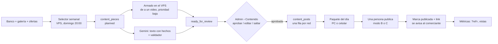

# Contenido para redes + cuidado de los suscriptores

> **Estado:** propuesta funcional para que decida el dueño. 02/11/2026. Rol: product-analyst.
> Responde a dos pedidos del dueño: (2) un plan de contenido para redes, automatizado,
> armado con las fotos de los comercios y las que sube él, y **cómo se asocia cada foto a su
> comercio**; (3) una estrategia para que los suscriptores del plan «publica» no se vayan.
> Lo que dependa de las reglas de TikTok, Meta o YouTube está marcado **a confirmar** y lo
> cierra `docs/investigacion-redes-y-busqueda-ia.md` (researcher, en paralelo).
> Los supuestos están numerados (S-01…) para confirmarlos de a uno (§6).
> **Actualizado 02/11:** los videos se arman **en el VPS**, no en las PC (decisión del dueño). La spec
> técnica del MVP está en `docs/contenido-redes-tecnico.md` y reemplaza el borrador de §3.6.

## 0. En diez líneas

1. **Las fotos se asocian al comercio en el momento en que se sacan**, no después. El camino principal es **Admin › Banco de contenido** desde el celular: elegís el comercio una vez y sacás o subís todas las fotos que quieras (§1.3).
2. Todo lo que ya está en el sistema (galería, portada, ofertas del grupo) **ya está asociado** y es el primer insumo, con costo cero.
3. La IA (Gemini leyendo el cartel) **sólo sugiere** de quién es una foto suelta; siempre confirma un humano.
4. Ninguna foto sale a redes si el comercio no dio **consentimiento para redes**, registrado en la base con fecha y por dónde llegó.
5. El suscriptor recibe un beneficio que se puede contar: **2 piezas propias por mes** (video + otra), prioridad en los compilados y **el archivo para que lo suba a su estado**.
6. La base (VPS) elige, escribe los textos, **arma los videos** (de a uno, con prioridad baja) y lleva la cola. Las PC del dueño y de su hija, o el celular, **sólo se usan para publicar**. Una pieza se publica **una sola vez** aunque publiquen dos personas.
7. Hoy se publica en **modo B o C**: el agente deja el paquete listo y abre la página de subida; **una persona aprieta «Publicar»**. Son unos 30–60 s por pieza.
8. No se automatiza el clic de «Publicar» en las redes: es el mismo riesgo que llevó a descartar WhatsApp Web.
9. Retención: los primeros 7 días con lista de tareas, un **«Tu mes en URUKU»** que llega **antes** del vencimiento, un contacto cada 15 días por `wa.me` y una alarma por señales de abandono.
10. MVP de una semana: banco de fotos, consentimiento, selección semanal, video 9:16, textos con Gemini, cola de revisión, paquete del día y lista de suscriptores con tareas (§3.8).

---

## 1. Cómo se asocia cada foto a su comercio

### 1.1 Dónde viven hoy las fotos

| Fuente | Tabla / columna | ¿Ya sabe de qué comercio es? | Pública | Nota |
|---|---|---|---|---|
| Galería | `comercio_fotos (comercio_id, url, thumb_url, orden)` (0030) | Sí | Sí (anon lee) | Tope por plan (0144). Sin `activo` |
| Portada | `comercios.portada_url / portada_thumb_url / portada_pos` | Sí | Sí | Una por comercio |
| Videos subidos | `comercio_videos` (0030) | Sí | Sí | Hasta 5, ≤60 s. Es material crudo ideal para redes |
| Ofertas por WhatsApp (grupo, código, explorador) | `publicaciones.imagen_url`, `estado='aprobado'` | Sí | Sí | Carpeta `<slug>/ofertas/`. La foto **es** la oferta: no se edita (ver `analisis-tratamiento-fotos.md`) |
| Fotos de números desconocidos | `wa_inbox.media_path` (0159), disco privado `WA_RECEIVED_DIR`, 30 días | **No** hasta «Es de…» | No | Se asignan en Admin › Recepción › «Es de…» |
| Novedades de URUKU | `novedades_uruku.fotos` (0150) | No aplica (son de la marca) | Sí | Insumo para piezas de marca |
| Disco | `settings.fotos_dir` = `/data/fotos`, servido en `/fotos` | — | **Todo lo que está ahí es público** | Una foto «sólo para redes» **no puede** ir ahí (§1.4) |

### 1.2 Los caminos, ordenados por el esfuerzo del dueño

| # | Camino | Esfuerzo para el dueño | Esfuerzo de construcción | Cuándo sirve | Riesgo |
|---|---|---|---|---|---|
| 1 | **Fotos que ya están** (galería, portada, videos, ofertas aprobadas) | **Cero** | Cero: el selector las lee directo | Siempre, primer insumo | Fotos viejas o pocas. El selector exige un mínimo (§2.4) |
| 2 | **El comerciante manda al grupo de su comercio** | Cero para el dueño (le pide fotos al comerciante, §4.5) | Cero: ya entra como oferta o novedad | Comercios con grupo atado | Sólo llega lo que el comerciante quiere mostrar |
| 3 | **Admin › Banco de contenido** desde el celular, con selector de comercio | Bajo: 1 toque para elegir el comercio + las fotos | **M** | **Siempre**, con o sin grupo. Es el de las visitas | Ninguno. Asociación explícita |
| 4 | **El dueño manda las fotos al grupo del comercio** desde el Samsung (Anfitrión) | Bajo, si el grupo existe y él está en el local | **S–M**: hoy un número propio en un grupo **no publica** (`ingest.py:513`); habría que convertirlo en «entra al banco, no publica» | Comercios con grupo atado y foto sacada con el Samsung | El comerciante ve las fotos en su grupo (puede ser bueno). Depende de WAHA. No sirve si la foto la sacó con su celular personal |
| 5 | **Carpeta en la PC** `contenido/<slug>/…` | Medio: copiar del celular o de la cámara a la PC, una carpeta por comercio | **S**: script del agente que sube al banco | Tandas grandes (una recorrida con cámara, un pendrive) | Un slug mal escrito: el script avisa y no sube (§1.5) |
| 6 | **Sugerencia por IA** (Gemini lee el cartel; ubicación GPS de la foto si la hay) | Medio: confirmar cada sugerencia | **M** | Fotos sueltas que nadie etiquetó | Equivocarse de comercio. **Nunca asigna sola** |

### 1.3 Recomendación: un camino principal

**El camino principal es el 3, Admin › Banco de contenido desde el celular.** Por qué:

- El único momento en que se sabe **con certeza** de quién es una foto es cuando estás parado adelante del local. Elegir el comercio **antes** de sacar la foto convierte la pregunta del dueño en algo que nunca hay que resolver después.
- Anda para todos los comercios, tengan grupo o no, y no depende de WAHA.
- Ahí mismo se ve si el comercio dio consentimiento para redes, y si no, se registra (§1.6).
- Ya existe la mitad: el admin sube fotos de galería por comercio (`POST /admin/comercio/{id}/fotos`, `moderacion.py:1731`) con compresión en el navegador (`lib/imagen.ts`).

Los otros quedan así: el **1** y el **2** siguen solos; el **5** es para tandas desde la PC (lo maneja el agente de VS Code); el **4** va a la segunda etapa; el **6**, a la tercera y sólo para las fotos sin dueño.

**Wireframe: Admin › Banco de contenido (celular)**

```
┌──────────────────────────────────────┐
│ Banco de contenido                   │
│ [Buscar comercio…            ] (Ic)  │
│ Recientes: Vidriería Pacheco · Kiosco│
│ Ana · Ferretería Sol                 │
├──────────────────────────────────────┤
│ Vidriería Pacheco · Vidriería        │
│ Calle Barrientos · Suscriptor        │
│ Redes: AUTORIZADO 12/10 (alta)       │   ← o «SIN AUTORIZAR» en rojo + [Registrar autorización]
│ Fotos para redes: 14 · usadas: 6     │
│                                      │
│ [ Sacar fotos ]  [ Elegir de galería]│   ← input capture / multiple
│ ☐ Mostrar también en la ficha        │   ← por defecto apagado
│ ☐ Hay personas que se reconocen      │   ← obliga a confirmar que aceptaron
│                                      │
│ Subiendo 3/8  ███████░░░  [Cancelar] │
│ [▣][▣][▣][▣][▣] …  (tocar = quitar)  │
└──────────────────────────────────────┘
Estados: sin señal → quedan en cola en el teléfono y reintenta; foto de menos de 720 px
de lado menor → «Muy chica para video: se guarda igual, no entra en videos».
Vacío: «Todavía no hay fotos para redes de este comercio. Las de la ficha ya cuentan: 6».
Error de consentimiento: se puede subir igual, pero el selector no la usa hasta que haya autorización.
```

### 1.4 Dónde se guardan las fotos nuevas

- Las del banco van a un disco **privado** (`CONTENT_ASSETS_DIR`, fuera de `/data/fotos`) y se sirven sólo autenticadas (panel y agentes). Así una foto de atrás del mostrador no queda pública en `/fotos`.
- Si se marca «Mostrar también en la ficha», **además** se copia a la galería como hoy (respeta el tope por plan).
- Se guarda el **original** (lo pide `analisis-tratamiento-fotos.md` §7) y el `sha256` para no subir dos veces la misma foto.

### 1.5 Convención de carpeta para la PC

```
contenido/
  vidrieria-pacheco/          ← slug exacto del comercio (se ve en la URL de su ficha)
    2026-11-02 vidriera.jpg
    mostrador.mp4
  _sin-comercio/              ← las que no sabés de quién son: van a la bandeja de sugerencias
  _subidas/2026-11-02/...     ← el script mueve acá lo que ya subió (nunca borra)
```

- El script `uruku-contenido importar` resuelve `slug → comercio_id` por la API. Si el slug no existe o cambió, **no sube** y lista los candidatos parecidos.
- `_sin-comercio/` alimenta la bandeja del camino 6.

### 1.6 Consentimiento: dónde queda registrado

Hoy existe `comercios.consentimiento_dueno` (0155), que dice «aceptó **aparecer en URUKU**». No alcanza para redes: aparecer en el directorio y aparecer en un video de TikTok son dos cosas distintas.

| Qué | Propuesta |
|---|---|
| Columnas nuevas en `comercios` (privadas, regla 11 → `PRIVADAS_EXTRA`) | `social_consent boolean` (null = sin dato), `social_consent_at timestamptz`, `social_consent_via text` (`agent_signup`, `admin`, `merchant_panel`, `whatsapp_reply`, `subscription`), `social_consent_by text` |
| Dónde se registra | (a) **Alta del agente**: segunda casilla «Acepta que usemos fotos de su local en las redes de URUKU». (b) **Mi comercio › Perfil**: interruptor «Autorizo a URUKU a mostrar mi comercio y mis fotos en sus redes». (c) **Admin**: «Registrar autorización» con la vía (p. ej. «me lo dijo por WhatsApp el 02/11», pegando la captura en una nota). (d) **Onboarding del suscriptor** (§4.1, día 0) |
| Suscriptores | La pieza en redes **es** parte del plan, pero igual se registra explícito el día 0. Sin registro, no sale |
| Revocar | El interruptor en Mi comercio o el admin. Las piezas planificadas o listas pasan a `skipped` con motivo `consent_revoked`. Las ya publicadas se borran **a mano** si lo pide (tarea en Admin) |
| Personas en las fotos | Clientes y chicos: **no**. Quien atiende: sólo si aceptó (la casilla «Hay personas que se reconocen» obliga a confirmar). Ante la duda, la foto no entra en video |

**S-01.** La autorización de redes es por comercio, no por foto. Una foto puntual se excluye con «No usar en redes» en el banco.

---

## 2. Plan de contenido

### 2.1 Pilares

| Pilar | Qué es | Insumo | Quién aparece | Frecuencia |
|---|---|---|---|---|
| **Comercio del día** | Video de un local: nombre, rubro, calle, 4–7 fotos, cierre con la marca | Fotos del comercio | **Sólo suscriptores** | 3–4 por semana |
| **Ofertas de la semana** | Compilado de 4–6 ofertas aprobadas y vigentes, con precio | `publicaciones` aprobadas | Suscriptores primero; no suscriptores con autorización | 1 por semana |
| **Guía útil local** | Farmacia de turno, cotización del día, horario de chalanas y del paso, transporte | `turnos_farmacia` (0154), cotización, chalanas (0122), transporte (0111) | Todos los que correspondan (es servicio, no publicidad) | Historia diaria + 1 posteo por semana |
| **«Qué conseguís en Bermejo»** | «Dónde comprar zapatillas»: 3–5 locales del rubro más buscado | Admin › Demanda + fotos | Suscriptores primero, completa con no suscriptores autorizados | 1 por semana |
| **Detrás del mostrador** | Quién atiende, cuánto hace que está, qué recomienda | Visita + video corto | Sólo suscriptores, con su OK | 1–2 por mes |
| **Dax responde** | Una pregunta real que le hicieron a Dax y la respuesta | `uruku_ayuda` (Admin › Ayuda) | La marca | 1 cada 15 días |

### 2.2 Formatos

| Formato | Medidas | Duración / largo | Dónde | Plantilla |
|---|---|---|---|---|
| **Video slideshow** | 1080×1920, 30 fps, H.264 + AAC | 15–25 s: tapa 2 s · 4–7 fotos × 2,5 s con zoom suave · cierre 3 s | TikTok, Reels, Shorts, estado de WhatsApp del comerciante | Tapa: nombre + rubro + calle. Cierre: logo + «Buscá "Vidriería Pacheco" en uruku.bo» |
| **Carrusel** | 1080×1350 (4:5), 3–8 imágenes | — | Instagram, Facebook | Primera con título; última con el cierre |
| **Historia** | 1080×1920, imagen fija | 5–15 s | Historias de IG/FB, estado de WhatsApp | Farmacia de turno, cotización, «hoy en el canal» |
| **Texto para el canal** | — | ≤ 400 caracteres | Canal de WhatsApp (a mano: WAHA sólo lee) | Mismo texto, sin hashtags |

- **Video sin música horneada.** En modo B/C la música se elige **en la app** al publicar (TikTok e IG premian el sonido de su biblioteca). Se renderiza una versión con una pista libre de derechos sólo para el estado de WhatsApp del comerciante. **A confirmar** qué biblioteca pueden usar las cuentas de empresa en TikTok.
- **Todo el texto va en pantalla**: en Bermejo se mira sin sonido (`publicidad-uruku.md`).
- Duración ≤ 30 s para que entre en un estado de WhatsApp sin cortes. **S-02.**

### 2.3 Calendario semanal

| Día | TikTok + Reels (+ Shorts en tanda semanal) | Historias IG/FB | Facebook (feed) | Canal de WhatsApp |
|---|---|---|---|---|
| Lun | «Qué conseguís en…» (rubro más buscado) | Farmacia de turno + cotización | Mismo video | Lo más buscado |
| Mar | Comercio del día (suscriptor) | Farmacia + cotización | — | Ofertas nuevas (como hoy) |
| Mié | Comercio del día (suscriptor) | Farmacia + cotización | Carrusel del comercio del lunes o martes | Ofertas |
| Jue | Ofertas de la semana | Farmacia + cotización | Mismo video | Ofertas |
| Vie | Comercio del día (suscriptor) | Farmacia + cotización | — | Ofertas |
| Sáb | Detrás del mostrador **o** Dax responde **o** comercio del día | Farmacia + cotización | Mismo video | Resumen de la semana |
| Dom | Descanso | Farmacia de turno | — | — |

- Son **6 piezas grandes por semana** y 7 historias. Cumple la regla de `publicidad-uruku.md` («constancia antes que cantidad»).
- Con ~8 suscriptores × 2 piezas propias = 16 por mes ≈ 4 por semana: entran justos en los 3–4 «comercio del día». Si pasan de 12 suscriptores, se agrega un comercio del día el lunes o el sábado (lo resuelve el selector).
- Hora: la que diga la estadística de cada cuenta. **S-03:** por defecto 19:00 (hora de Bolivia), cuando la gente sale de trabajar y cruza a comprar.

### 2.4 La prioridad del suscriptor (el beneficio que se puede tocar)

| Regla | Valor por defecto |
|---|---|
| Piezas propias por mes, plan «publica» | **2**: un video «comercio del día» + una pieza más (carrusel, detrás del mostrador u oferta destacada en video) |
| Planes superiores | 4 (configurable) |
| Dónde se configura | Columna nueva `planes.social_pieces_per_month` (Admin › Planes, sin grants a anon, como 0134) |
| Al día | Sólo cuenta si `paga_hasta >= hoy` o `plan_cortesia` |
| Compilados | El suscriptor va **siempre primero** y nunca se lo saca para poner a otro |
| Archivo para él | Cada pieza propia se le entrega para su estado y su TikTok (§4.4) |
| Mínimo para un video | 4 fotos utilizables (≥720 px de lado menor, no repetidas en los últimos 60 días). Si no llega → tarea «Pedir fotos» (§4.5), no un video pobre |
| Si una semana no hay lugar | La pieza pasa a la semana siguiente, **nunca** se pierde en el mes |

**S-04.** Los no suscriptores **no** tienen piezas propias. Aparecen sólo en compilados («qué conseguís», ofertas), como máximo un tercio de cada compilado, con autorización y nunca por delante de un suscriptor. Sirve doble: el contenido tiene volumen y el comercio gratis ve lo que se pierde («te nombramos; con el plan tenés tu propio video»).

### 2.5 Textos y hashtags

Los escribe **Gemini sólo con los hechos que le pasa la base** (JSON). El modelo no busca nada ni completa nada.

| Regla | Cómo se controla |
|---|---|
| Sólo hechos del JSON: nombre, rubro, calle, horario, monedas, precio de la oferta | El validador rechaza **cualquier número** que no esté en el JSON |
| Nunca el código del comercio (`URUKU-XXXX`) ni `CONFIRMAR-` | Regex en el validador (misma función que ya filtra textos del grupo) |
| Nunca cantidad de comercios ni precios de planes | Regex: `\d+\s+(comercios|negocios|locales)`, «Bs» que no sea el precio de la oferta |
| Nada que no se puede prometer | Lista negra: «el mejor», «el más barato», «te traemos clientes», «envío», «garantía» (de `guion-video-uruku.md` y `publicidad-uruku.md`) |
| Sin emoji | Regla de marca: el emoji lo dibuja cada teléfono distinto. **S-05** (si el dueño quiere excepción en redes, se cambia una variable) |
| Voseo, cercano, frases cortas | Instrucción + 6 ejemplos buenos en el prompt |
| Llamado a la acción | «Buscá "{nombre}" en uruku.bo» o «Escribile directo desde su ficha en uruku.bo». En TikTok el link en el texto no se puede tocar: va en la bio |
| Largos | TikTok ≤ 300 caracteres; IG ≤ 600; canal ≤ 400 |
| Hashtags | 3–5 fijos por ciudad (`#Bermejo #Tarija #URUKU`) + 1–2 del rubro, de una lista cerrada que mantiene el admin. Gemini **elige** de esa lista, no inventa |
| Si el validador rechaza 2 veces | Plantilla fija sin IA: «{nombre} · {rubro} · {calle}. Buscalo en uruku.bo» |
| Sin `GEMINI_API_KEY` | La misma plantilla fija. Nunca se frena la cola por la IA |

### 2.6 Reglas de marca

- Logo **blanco** sobre foto, **verde** si el fondo es claro; nada de sombras (manual p. 20–22). Tipografía Poppins. Paleta del kit `docs/Uruku-KIT-COMPLETO`.
- La foto de una **oferta con precio no se edita** (nada de N3/N4; `analisis-tratamiento-fotos.md`). En el video se puede aplicar el N1 suave.
- **El nombre del comercio va en la tapa y en el cierre.** Sin el nombre, la pieza parece de URUKU y el comerciante no recibe lo que pagó (`difusion-redes.md`).
- Nada «próximamente»: sólo se muestra lo que existe (`guion-video-uruku.md`).
- Contenido pagado: **a confirmar** si la regla de contenido de marca de TikTok y Meta aplica cuando el comercio paga un plan que incluye la pieza. Si aplica, se activa el interruptor que ofrezca cada red.

---

## 3. Automatización

### 3.1 La regla de fondo: quién hace qué

| Pieza | Dónde corre | Por qué |
|---|---|---|
| Banco de contenido, consentimiento, cola, estados, revisión, métricas, tareas de suscriptores | **Backend en el VPS** | Es la única fuente de verdad que ven las dos PC y el celular. Así no hay doble publicación |
| Selección de la semana y textos con Gemini | **Backend en el VPS** (loop, domingo 20:00) | Tiene la base y la key de Gemini. No depende de que una PC esté prendida |
| **Armar los videos** (ffmpeg + Pillow) | **Backend en el VPS** (loop de fondo, de a un video, prioridad baja) | **Decidido por el dueño el 2/11.** La imagen del backend ya trae ffmpeg (por faster-whisper) y Pillow; no depende de que una PC esté prendida y desaparecen los leases entre PC (`content_devices` sale del MVP) |
| **Publicar** | **Una persona en una de las dos PC** (modo B/C) o desde el celular (modo B) | Hoy ninguna red deja publicar sola a una app sin auditar (a confirmar). Las cuentas ya están abiertas en esas PC |
| Agente de VS Code | PC del dueño, **cuando él lo abre** | Arma y ajusta las plantillas, importa carpetas, prepara campañas especiales y el análisis mensual. **No es el reloj diario**: un agente de VS Code sólo corre con la sesión abierta |
| Reloj diario en la PC (sólo modo C1, etapa 2) | Programador de tareas de Windows (`uruku-contenido run` al iniciar sesión y a las 09:00) | Corre aunque nadie abra VS Code |

**S-06.** Los videos se arman en el VPS aunque ninguna PC esté prendida; lo único que depende de una persona es **publicar**. Si nadie publica un día, la pieza queda en «Atrasadas» del Paquete del día y se publica al siguiente; la cuota del suscriptor no se pierde.

### 3.2 El circuito



1. **Selector (domingo 20:00).** Arma los 6 lugares de la semana según el calendario (§2.3): primero las piezas que se les deben a los suscriptores del mes, después los compilados. Filtra: autorización de redes, suscripción al día, mínimo de fotos, que no haya salido en los últimos 14 días. Crea `content_pieces` en `planned` y, para los que no llegan al mínimo de fotos, la tarea «Pedir fotos».
2. **Texto.** Por pieza: JSON de hechos → Gemini → validador → `caption_*` + `hashtags`. Si falla, plantilla fija.
3. **Armado.** Un proceso de fondo del backend, en el VPS, toma las piezas de a una (con prioridad baja y un tiempo máximo), lee las fotos del disco del servidor, aplica N1 suave y arma el video con la plantilla y la portada. La pieza pasa a `ready_for_review`. Si falla, reintenta y, si sigue fallando, queda a la vista en Revisión con el motivo.
4. **Revisión** en Admin › Contenido (§3.5): aprobar, editar el texto, cambiar una foto, saltar con motivo. **Nada sale sin aprobar** (misma regla de `difusion-redes.md`).
5. **Publicación** por red (§3.3), con reclamo para que no se publique dos veces (§3.4).
6. **Cierre:** se marca publicada con el link; nace la tarea «Mandarle la pieza a {comercio}» (§4.4) y la fila de métricas.

### 3.3 Modos de publicación

| Modo | Qué hace la máquina | Qué hace la persona | Tiempo por pieza | Riesgo para la cuenta | Estado |
|---|---|---|---|---|---|
| **A · API oficial** | Publica sola | Nada (o revisa) | 0 | Ninguno | **Instagram/Facebook:** posible con el token de la página. Opcional, para más adelante (la hija lo puede sacar). **TikTok/YouTube:** una app sin auditar sólo publicaría en privado (**a confirmar**) |
| **A' · Borrador por API** | Deja el video en la bandeja o los borradores de TikTok | Lo publica desde la app, con sonido | 20–30 s | Ninguno | **A confirmar** que la API lo permita sin auditoría |
| **B · Paquete listo** | Arma video + portada + textos y los deja en **Paquete del día** | Descarga, abre la red, sube, pega el texto, publica. O programa toda la semana de una vez | 60–90 s (o ~15 min por semana programando en tanda) | Ninguno | **MVP** |
| **C · Asistido en la PC** (pedido del dueño) | El agente de la PC abre la página de subida en el navegador donde la cuenta ya está abierta, deja el video listo y el texto copiado, y espera | **Aprieta «Publicar»** (y si quiere, elige el sonido) | ~30 s | Variante C1: bajo. C2: **a confirmar** | Segunda etapa |
| **Clic automático en «Publicar»** | Todo, incluido el clic | Nada | 0 | **Alto**: automatizar la web de una red va contra sus términos y la red puede pedir verificación, frenar la cuenta o darla de baja (a confirmar en la investigación) | **Excluido**, por la misma razón que se descartó WhatsApp Web |

**Las dos variantes del modo C:**

| | **C1 · Abrir y preparar (recomendado)** | C2 · Completar el formulario |
|---|---|---|
| Qué hace el agente | Abre `TikTok Studio › Subir` (o la de IG/FB) **en el navegador normal** de la persona; abre la carpeta con el video ya seleccionado; copia el texto al portapapeles; muestra «Arrastrá el video y pegá el texto (Ctrl+V)» | Toma el control del navegador abierto (Playwright/CDP sobre el perfil con la sesión), carga el video y escribe el texto |
| Qué hace la persona | Arrastra, pega y aprieta «Publicar» | Sólo aprieta «Publicar» |
| Huella de automatización en la red | **Ninguna**: para la red es una persona usando su navegador | Hay un navegador controlado por un programa: es justo lo que las redes detectan |
| Si la red cambia la página | Sigue andando | Se rompe y hay que arreglarlo |
| Recomendación | **Sí**, con las dos PC | Sólo si la investigación dice que el riesgo es bajo, y **nunca** con el clic final |

**Respuesta a la pregunta del dueño («¿es riesgoso publicar desde mi PC con mis sesiones abiertas?»):** publicar a mano desde tu PC con tu sesión **no tiene ningún riesgo**: es lo que hace cualquier persona. El riesgo aparece cuando **un programa** maneja la página de la red en tu lugar. Con la variante C1 el agente prepara todo pero no toca la página de la red, y vos apretás «Publicar». **S-07.**

### 3.4 Dos PC sin publicar dos veces

| Pieza del diseño | Cómo |
|---|---|
| Fuente de verdad | La base. Ninguna PC guarda «ya publiqué» sólo en su disco |
| Una fila por pieza y red | `content_posts` con `unique (piece_id, network)` (misma idea que `difusion_cola`) |
| Reclamar antes de publicar | Al tocar «Publicar en TikTok», el panel pide `claim`: la base pone `claimed` + `claimed_by` (la persona logueada) + `claimed_at`. Si ya estaba reclamada por otra, contesta 409: «La está publicando {nombre} desde hace 3 min» |
| Vencimiento del reclamo | 20 min. Si nadie marca, vuelve a `pending` con aviso «Revisá en la red si salió antes de reintentar» |
| Marcar publicada | Pegar el link del posteo (o «Salió, no tengo el link»). Si se pega el link de otra red, se rechaza |
| Ver lo mismo en todos lados | Paquete del día en Admin, desde la PC o el celular: todos leen la misma fila |
| Identidad de quien publica | Su usuario del panel (permiso `difusion`). Sin tokens por dispositivo ni `content_devices`. **Nunca** `service_role` |
| Carpeta compartida | **No hace falta.** Cada PC baja el paquete de la API a `contenido/salida/<fecha>/`. Se descarta Drive/OneDrive para el estado (dos PC sincronizando = conflictos y doble publicación) |

**Wireframe: Admin › Contenido › Paquete del día** (celular o PC)

```
┌───────────────────────────────────────────────────────────┐
│ Paquete del día · martes 03/11      [Semana] [Revisión 2] │
├───────────────────────────────────────────────────────────┤
│ Comercio del día · Vidriería Pacheco (suscriptor)         │
│ [▶ video 18 s]  [Descargar video] [Descargar portada]     │
│ TikTok   PENDIENTE      [Copiar texto] [Publicar en TikTok]│
│ Reels    PUBLICANDO · PC de Ana · hace 2 min               │
│ Facebook PUBLICADO 19:04 · link                            │
│ Canal WA PENDIENTE      [Copiar texto]                     │
│ Comerciante: [Mandarle el video por WhatsApp]  (no enviado)│
├───────────────────────────────────────────────────────────┤
│ Historia · Farmacia de turno                               │
│ [▣] [Descargar] · Historias IG PENDIENTE · Estado WA ...   │
├───────────────────────────────────────────────────────────┤
│ [Descargar todo el día (.zip)]  [Descargar la semana]      │
└───────────────────────────────────────────────────────────┘
«Publicar en TikTok» (PC): reclama → abre la página de subida → carpeta + texto copiado
→ al volver: «¿Salió? Pegá el link» [Pegar] [No salió] [Salió sin link].
Vacío: «Hoy no hay piezas. La próxima: jueves, Ofertas de la semana».
Error: pieza sin video armado → «El video todavía se está armando en el servidor. Probá en unos minutos».
```

### 3.5 Revisión (Admin › Contenido › Revisión)

| Acción | Efecto |
|---|---|
| Aprobar | `approved`; nacen las filas `content_posts` de cada red del calendario |
| Editar texto | Guarda la versión editada y `edited=true` (sirve para medir si Gemini mejora) |
| Cambiar fotos | Vuelve a `planned` y la PC lo rearma |
| Saltar | `skipped` + motivo (`bad_photos`, `merchant_asked`, `consent`, `unpaid`, `other`). Si era de un suscriptor, **la cuota no se consume**: se reprograma |
| Aprobar todas | Sólo para piezas sin edición y con validador en verde |

### 3.6 Modelo de datos (borrador para el architect)

> **Superado** por `docs/contenido-redes-tecnico.md` §3 (migración 0181): sin `content_devices` ni leases, y la autorización de redes como bitácora aparte en vez de columnas en `comercios`. Se deja como registro.

Reglas de siempre: RLS activo, `revoke` a anon/authenticated, `grant` a `service_role`, `activo` para baja lógica, archivo idéntico en las dos carpetas de migraciones, número después de la última usada (lo asigna el architect), y ninguna migración con la palabra que nombra al código del comercio.

```sql
-- Fotos y videos del banco (los de galería/portada/ofertas NO se copian: se leen de su tabla)
create table content_assets (
  id uuid primary key default gen_random_uuid(),
  comercio_id uuid references comercios(id),          -- null = sin asignar
  kind text not null check (kind in ('photo','video')),
  source text not null check (source in ('admin_upload','folder_import','owner_group','wa_unknown')),
  path text not null,                                  -- en CONTENT_ASSETS_DIR (privado)
  original_path text, sha256 text not null unique,
  width int, height int, duration_s numeric(5,1), taken_at timestamptz,
  show_in_ficha boolean not null default false,
  usable_for_social boolean not null default true,     -- «No usar en redes»
  has_people boolean not null default false, people_ok boolean,
  assignment_status text not null default 'assigned'
    check (assignment_status in ('assigned','suggested','unassigned','discarded')),
  suggested_comercio_id uuid references comercios(id), suggestion_score numeric(3,2), suggestion_reason text,
  uploaded_by text not null, assigned_by text, assigned_at timestamptz,
  last_used_at timestamptz, use_count int not null default 0,
  activo boolean not null default true, created_at timestamptz not null default now()
);

create table content_pieces (
  id uuid primary key default gen_random_uuid(),
  comercio_id uuid references comercios(id),          -- null en guía útil / Dax
  pillar text not null check (pillar in ('comercio_del_dia','ofertas','guia_util','que_consigues','detras_mostrador','dax')),
  format text not null check (format in ('video_9x16','carousel_4x5','story','text')),
  scheduled_for date not null, ciudad_id uuid references ciudades(id),
  counts_for_quota boolean not null default false,     -- consume 1 pieza del suscriptor
  status text not null default 'planned' check (status in
    ('planned','rendering','ready_for_review','approved','published','skipped','failed')),
  sources jsonb not null default '[]',                 -- [{type:'gallery'|'cover'|'offer'|'asset', id}]
  template text not null, template_version int not null,
  facts jsonb not null,                                -- lo único que vio Gemini
  caption_tiktok text, caption_ig text, caption_channel text, hashtags text[],
  caption_engine text,                                 -- 'gemini:<modelo>' | 'template'
  edited boolean not null default false,
  render_path text, cover_path text, render_ms int, rendered_by uuid, leased_by uuid, leased_at timestamptz,
  approved_by text, approved_at timestamptz, skip_reason text,
  activo boolean not null default true, created_at timestamptz not null default now(), updated_at timestamptz not null default now()
);

create table content_posts (
  id uuid primary key default gen_random_uuid(),
  piece_id uuid not null references content_pieces(id),
  network text not null check (network in ('tiktok','instagram','facebook','youtube','wa_channel','ig_story','fb_story')),
  mode text not null check (mode in ('api','api_draft','manual','assisted')),
  status text not null default 'pending' check (status in ('pending','claimed','posted','failed','skipped')),
  claimed_by uuid, claimed_at timestamptz,
  posted_at timestamptz, posted_by text, post_url text, ref_code text,   -- ?ref= de esa pieza
  views int, likes int, shares int, metrics_at timestamptz,             -- carga manual o API
  error text, activo boolean not null default true,
  unique (piece_id, network)
);

create table content_devices (                         -- las PC
  id uuid primary key default gen_random_uuid(),
  name text not null, token_hash text not null unique, owner_email text not null,
  last_seen_at timestamptz, activo boolean not null default true
);

alter table comercios add column social_consent boolean, add column social_consent_at timestamptz,
  add column social_consent_via text, add column social_consent_by text;   -- PRIVADAS (regla 11)
alter table planes add column social_pieces_per_month int not null default 0;  -- publica=2, superiores=4

-- Retención (§4)
create table subscriber_tasks (
  id uuid primary key default gen_random_uuid(),
  comercio_id uuid not null references comercios(id),
  kind text not null check (kind in ('welcome','profile_check','first_offer','photo_session','first_piece',
    'week1_checkin','piece_delivery','photo_refresh','monthly_report','checkin','renewal_before',
    'renewal_due','renewal_overdue','churn_call','exit_question','winback')),
  due_on date not null, status text not null default 'open' check (status in ('open','done','skipped')),
  message_text text, piece_id uuid references content_pieces(id), report_id uuid,
  done_by text, done_at timestamptz, outcome text, note text,
  activo boolean not null default true, created_at timestamptz not null default now(),
  unique (comercio_id, kind, due_on)
);

create table subscriber_reports (
  id uuid primary key default gen_random_uuid(),
  comercio_id uuid not null references comercios(id), period_start date not null, period_end date not null,
  data jsonb not null, image_path text, share_token text unique,   -- página privada de descarga
  activo boolean not null default true, created_at timestamptz not null default now(),
  unique (comercio_id, period_start)
);
```

### 3.7 Esfuerzo por pieza

| Pieza | Capa | Esfuerzo |
|---|---|---|
| Migración (tablas de §3.6 + consentimiento + `planes`) | DB | S |
| Banco de contenido: subir desde el celular, selector de comercio, disco privado, `sha256` | Back + front | M |
| Consentimiento: casilla en el alta, interruptor en Mi comercio, registrar en Admin | Back + front | S |
| Selector semanal + cuota de suscriptores | Back | M |
| Textos con Gemini + validador + plantilla de respaldo | Back | S |
| Armado en el VPS: cola de a un video, N1, video con ffmpeg, portada, reintentos | Back | M |
| Plantillas de video (tapa, foto con zoom, cierre) en 9:16 | Back + diseño | S |
| Admin › Contenido: revisión + Paquete del día + reclamo/marcar publicada | Back + front | M |
| Modo C1 en la PC (abrir subida, carpeta, portapapeles, «¿salió?») | Script | S |
| Entregar la pieza al comerciante (página de descarga con token + `wa.me`) | Back + front | S |
| Admin › Suscriptores + tareas + plantillas de mensaje | Back + front | M |
| «Tu mes en URUKU» v1 (texto) / v2 (imagen) | Back | S / M |
| Historias automáticas de guía útil (farmacia, cotización) | Back + plantilla | S |
| Carrusel 4:5 | Back | S |
| Importar carpeta `contenido/<slug>/` | Script | S |
| Fotos del Anfitrión en el grupo → banco | Back (ingesta) | S–M |
| Sugerencia por IA para fotos sin dueño | Back | M |
| Modo A Instagram/Facebook (token de la página) | Back | M |
| Métricas por pieza (`?ref=` + carga de vistas) | Back + front | S |

### 3.8 Fases

| Fase | Plazo | Qué entra | Publicación |
|---|---|---|---|
| **MVP** | ~1 semana (backend-dev y frontend-dev en paralelo; detalle en `docs/contenido-redes-tecnico.md`) | Migración; banco de contenido; consentimiento; selector semanal; textos con validador; **armado del video 9:16 en el VPS**; revisión; **Paquete del día** con reclamo y «marcar publicada»; entrega al comerciante por `wa.me`; Admin › Suscriptores con tareas de bienvenida, renovación y reporte en texto | **Modo B** desde cualquiera de las dos PC o el celular |
| **Etapa 2** | Semanas 2–4 | Modo **C1** en las dos PC; «Tu mes en URUKU» en imagen; historias automáticas de farmacia y cotización; carrusel; métricas por pieza; semáforo de abandono; importar carpeta; fotos del Anfitrión al banco | B + C1 |
| **Etapa 3** | Cuando se decida | Modo A en IG/FB (token de la página, con la hija); A' en TikTok si se confirma; sugerencia por IA para fotos sin dueño; Shorts | A donde se pueda, C1 en el resto |
| **Excluido** | — | Clic automático en «Publicar»; manejar las redes con un navegador robot; mandar mensajes por WAHA | — |

---

## 4. Cómo cuidar a los suscriptores

### 4.1 Los primeros 7 días (checklist en Admin › Suscriptores)

| Día | Tarea (`subscriber_tasks.kind`) | Hecho cuando |
|---|---|---|
| 0 (pago confirmado) | `welcome`: mensaje de bienvenida (plantilla M1) | Enviado |
| 0 | `profile_check`: portada, ≥6 fotos, horario, pin en el mapa, WhatsApp verificado, rubro correcto, redes cargadas, **autorización de redes registrada**, clave de Mi comercio entregada, grupo de WhatsApp atado | Las 10 casillas en verde (las que se pueden se tildan solas desde la base) |
| 1 | `first_offer`: ayudarlo a mandar su primera oferta con precio al grupo | Hay una `publicacion` aprobada |
| 2–3 | `photo_session`: visita para sacar 10–15 fotos al banco (dueño o agente) | ≥8 fotos utilizables |
| 5 | `first_piece`: su primer video aprobado y publicado | `content_posts.posted` |
| 5 | `piece_delivery`: mandarle el video y el link (M2) | Enviado |
| 7 | `week1_checkin`: «¿te escribió alguien? ¿qué te preguntaron?» + sus números de la semana, aunque sean chicos | Respuesta anotada en `outcome` |

### 4.2 «Tu mes en URUKU»

**Cuándo llega:** **5 días antes de `paga_hasta`**, no el día 1. Así el comerciante ve lo que recibió justo antes de decidir si renueva. **S-08.**

**Qué se puede medir hoy y qué falta**

| Dato | ¿Se mide hoy? | De dónde | Qué falta |
|---|---|---|---|
| Visitas a su ficha | Sí | `leads` tipo `vista` | — |
| De dónde llegaron (volante, mesa, redes) | Sí | `leads.origen` (0114) | Que los links de redes lleven `?ref=` por pieza |
| Clics a WhatsApp | **Sí**, desde la ficha y el buscador | `leads` tipo `whatsapp` (`wa-lead-link.tsx`, `buscar-client.tsx`) | **Verificar** las tarjetas de `/ofertas` y novedades (no se encontró `registrarLead` en `app/ofertas`). Pasar el `?ref=` de la sesión también al clic de WhatsApp (hoy va `null`) |
| Llamadas, «cómo llegar», web, reservas | Sí | `leads` tipo `telefono`, `mapa`, `web`, `reserva` | — |
| Palabras con las que lo encontraron | Sí | `repo.terminos_de_comercio` | — |
| Ofertas publicadas | Sí | `publicaciones` aprobadas | — |
| «¿Te contestó?» | Sí | `comercios.contacto_ok / contacto_no` (0120) | — |
| Cuántas veces apareció en resultados de búsqueda | **No** | — | Contador por comercio al devolver resultados (M) |
| Piezas en redes y sus vistas | **No** | — | `content_posts.views` (carga manual en MVP; API de IG en etapa 3) |
| Llegadas desde sus propias publicaciones del video | **No** | — | `?ref=st-<slug>` en el link que se le entrega |

**Estructura del reporte** (imagen 1080×1350 para WhatsApp + la misma información en Mi comercio › Métricas)

1. Encabezado: logo, «Tu mes en URUKU», nombre del comercio, período.
2. Tres números grandes: **personas que vieron tu ficha**, **te escribieron por WhatsApp**, **te pidieron cómo llegar**. Con flecha contra el mes anterior.
3. «Te encontraron buscando»: las 3–5 palabras.
4. «De dónde llegaron»: buscador, mapa, volante, redes (sólo los que tienen dato).
5. «Lo que hicimos por vos»: las piezas publicadas con su red y vistas si las hay, y las ofertas publicadas.
6. «El mes que viene»: qué pieza le toca y una sola sugerencia concreta (p. ej. «Mandanos fotos de lo nuevo»).
7. Pie: «Tu plan se renueva el {fecha}». Sin precio.

**Reglas del reporte:** nunca números de otros comercios, ni rankings («estás 3.º»), ni cuántos comercios hay. Si los números son chicos se muestran igual (no se inventan visitas, `publicidad-uruku.md`), y la parte 5 pasa adelante.

### 4.3 Calendario de contacto

| Momento | Tarea | Plantilla |
|---|---|---|
| Cada pieza publicada | `piece_delivery` | M2 |
| Día 15 del ciclo | `checkin` (sólo si no hubo contacto en 10 días) | M4 o una pregunta corta |
| Cuando el selector no encuentra fotos | `photo_refresh` | M4 |
| `paga_hasta` − 5 | `monthly_report` | M3 |
| `paga_hasta` − 1 | `renewal_before` | M5 |
| `paga_hasta` + 3 | `renewal_overdue` | M6 |
| `paga_hasta` + 7 | `churn_call`: **llamada**, no mensaje | Guion de 3 preguntas |

- Todo sale por **`wa.me` asistido**: el botón abre WhatsApp con el texto escrito y una persona lo manda. **WAHA no manda nada.**
- Se manda desde el **número de personas (67671888)** o el del dueño, siempre el mismo con cada comercio. **S-09.**
- Los recordatorios de cobro siguen la spec de cobro que está pendiente (`grupos-por-comercio.md`, D7). La renovación se paga **por el QR de URUKU en `uruku.bo/pagar`** (vigente desde el 30/10; en Admin › Suscripciones está el botón «Pasar QR»). Los agentes nunca cobran.

### 4.4 Entregarle la pieza al comerciante

- `wa.me` no adjunta archivos. El mensaje lleva **dos links**: el posteo en la red y una página privada `uruku.bo/pieza/<token>` (`noindex`, `no-store`, vence en 60 días) con el video y el botón «Descargar para tu estado».
- La versión que se descarga lleva la pista de música libre y `?ref=st-<slug>` en el cierre.
- Pedirle que lo comparta es la palanca que ya está escrita en `publicidad-uruku.md`: es la prueba de que URUKU cumplió y, además, multiplica el alcance.

### 4.5 Plantillas de mensaje (voseo, cortas, sin código ni precios)

**M1 · Bienvenida (día 0)**
> Hola {persona}, soy {firmante} de URUKU. Gracias por sumarte con {comercio}. Esta semana dejamos tu ficha completa y te armamos tu primer video para las redes. ¿Qué día te queda bien que pasemos a sacar unas fotos del local? Tu ficha: uruku.bo/comercios/{slug}

**M2 · Tu pieza ya salió**
> {persona}, ya está el video de {comercio} en TikTok e Instagram: {link_post}. Acá lo podés bajar para subirlo a tu estado o a tu TikTok: {link_descarga}. Si algo no te gusta, decime y lo cambiamos.

**M3 · Tu mes en URUKU (5 días antes)**
> Hola {persona}, te paso cómo le fue a {comercio} este mes en URUKU: {visitas} personas vieron tu ficha y {wa} te escribieron por WhatsApp desde ahí. Te encontraron buscando «{t1}» y «{t2}». Va el detalle en la imagen. Tu plan se renueva el {fecha}. ¿Tenés algo nuevo que quieras mostrar el mes que viene?

*Variante con números en cero:* «…Este mes tu ficha todavía tuvo poco movimiento; publicamos {n_piezas} videos tuyos y {n_ofertas} ofertas. Para el mes que viene te proponemos {acción}. ¿Lo hacemos?»

**M4 · Pedido de fotos**
> {persona}, ¿nos mandás 3 o 4 fotos de lo nuevo que tengas, al grupo de {comercio}? Con eso armamos tu video de este mes. Si preferís, pasamos nosotros el {día}.

**M5 · Renovación (1 día antes)**
> {persona}, tu plan de URUKU vence mañana, {fecha}. ¿Seguimos? Para el pago coordinamos con {contacto_pago}. Cualquier duda, escribime acá.

**M6 · Vencido (+3 días)**
> {persona}, quedó pendiente el pago de URUKU de este mes. Tu ficha sigue igual unos días más. ¿Lo coordinamos esta semana? Y si algo no te convenció, contame qué y lo vemos.

### 4.6 Señales de que se puede ir (semáforo en Admin › Suscriptores)

| Señal | Cómo se detecta | Peso |
|---|---|---|
| Pagó tarde el mes anterior | `pagos` vs `paga_hasta` | 2 |
| Sin ofertas en 21 días | `publicaciones` | 1 |
| Salió de su grupo de WhatsApp | Tarea `merchant_left` (`grupos-por-comercio.md`) | 3 |
| No contestó los últimos 2 contactos | `subscriber_tasks.outcome` | 2 |
| Bajaron a la mitad las visitas o los WhatsApp contra el mes anterior | `leads` | 1 |
| Votos «no te contestó» de compradores | `contacto_no` (0120) | 1 |
| Preguntó «¿para qué sirve?» o se quejó | Nota del contacto | 2 |
| Pieza del mes saltada por falta de fotos | `content_pieces.skip_reason` | 1 |

Verde 0–1 · amarillo 2–3 · rojo ≥4. **Rojo crea una tarea `churn_call`** para esa semana. **S-10.**

### 4.7 Si no paga

| Momento | Qué pasa | Qué se hace |
|---|---|---|
| +0 a +7 días | Gracia. Ficha y piezas siguen | M6 el día 3; llamada el día 7 |
| +8 días | Las piezas planificadas pasan a `skipped` (`unpaid`) y la cuota no corre | Nada público. No se baja nada publicado |
| Vencido el plan | La lógica que ya existe lo pasa a gratis (tope de fotos gratis, sin prioridad). La ficha y las fotos **quedan** | Tarea `exit_question`: una sola pregunta, «¿Qué te faltó?» → `baja_motivo` (0147) |
| +30 y +60 días | — | `winback`: sus números del mes como gratuito y «si volvés, te armamos el video esa semana» |

---

## 5. Decisiones para el dueño (con recomendación)

| # | Decisión | Recomendación |
|---|---|---|
| D-01 | ¿Cuántas piezas propias por mes incluye «publica»? | **2** (un video + otra pieza); 4 los planes superiores. Se cambia en Admin › Planes |
| D-02 | ¿Los comercios gratis aparecen en redes? | **Sólo en compilados**, con autorización, hasta un tercio de cada uno y nunca antes que un suscriptor |
| D-03 | ¿Dónde se arman los videos? | **Decidido (2/11): en el VPS.** Un proceso de fondo del backend arma de a un video, con prioridad baja y un tiempo máximo. No depende de que una PC esté prendida; las PC quedan para publicar |
| D-04 | ¿Modo C1 (abre la subida y vos pegás) o C2 (completa el formulario)? | **C1.** C2 sólo si la investigación dice que el riesgo es bajo, y nunca el clic final |
| D-05 | ¿Instagram y Facebook por API (modo A) más adelante? | **Sí, en la etapa 3**, cuando tu hija saque el token de la página. Hasta entonces, B/C1 en todas las redes |
| D-06 | ¿Emojis en los textos de redes? | **No** (misma regla de marca). Si querés excepción en redes, es una variable |
| D-07 | ¿Cuándo llega «Tu mes en URUKU»? | **5 días antes del vencimiento** de cada comercio, no el 1 del mes |
| D-08 | ¿Desde qué número se escribe a los suscriptores? | **67671888** (el de personas), siempre el mismo, con la firma de quien escribe |

## 6. Supuestos a confirmar

| # | Supuesto |
|---|---|
| S-01 | La autorización de redes es por comercio; una foto puntual se excluye en el banco |
| S-02 | Videos de 15–25 s (≤30 s) para que entren en un estado de WhatsApp |
| S-03 | Publicación a las 19:00 hora de Bolivia hasta tener estadística propia |
| S-04 | Los no suscriptores no tienen piezas propias (sólo compilados) |
| S-05 | Sin emoji en los textos de redes |
| S-06 | Los videos se arman en el VPS sin depender de las PC; si nadie publica un día, la pieza pasa a «Atrasadas» y la cuota no se pierde |
| S-07 | Publicar a mano desde la PC con la sesión abierta no tiene riesgo; el riesgo es que un programa maneje la página (a confirmar en la investigación) |
| S-08 | El reporte mensual llega 5 días antes de `paga_hasta` |
| S-09 | Los mensajes a suscriptores salen del 67671888, de forma asistida |
| S-10 | Los pesos del semáforo de abandono son iniciales y se ajustan con los primeros casos |
| S-11 | En TikTok y YouTube una app sin auditar no publica en público (a confirmar en la investigación) |
| S-12 | Las piezas usan sólo fotos reales; nada de IA generativa en las imágenes de comercios |

## 7. Preguntas que no admiten un valor por defecto

1. ~~¿Cómo se cobra la renovación?~~ **Resuelto (2/11):** por el QR de `uruku.bo/pagar`. M5 y M6 mandan ese enlace.
2. **¿Tu hija acepta ser quien publica** (o reparten días) y con qué cuenta entra a Admin? Define a quién se le asigna cada pieza.
3. **¿Quién saca las fotos de la sesión del día 2–3** del suscriptor: vos, un agente o tu hija? Es el cuello de botella del plan de 2 piezas por mes.
