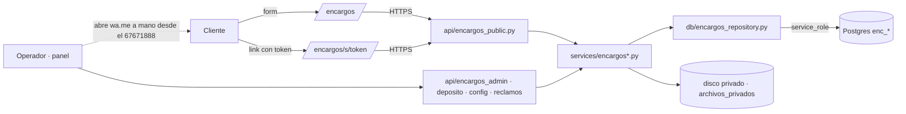

# Encargos y guardería: diseño técnico del MVP (v1, 6/11/2026)

> **Estado:** diseño para implementar. No hay código. Base: `main` en `4427de3`.
> **Fuente funcional:** `docs/servicio-encargos-guarderia.md` (spec aprobada). **§12.1 «Respuestas del dueño (6/11/2026)» manda** sobre los supuestos S-xx y sobre cualquier HU que la contradiga; los desvíos están en §1.4.
> **Para quién:** backend-dev y frontend-dev en paralelo dentro de cada entrega (§11), sin tocar los mismos archivos; qa-engineer con §12.
> **Repo público:** acá no van montos, precios, cuentas, IPs ni secretos. Los valores reales se cargan en el panel (los del dueño están en `uruku-privado/`).

## 0. En una pantalla

Módulo nuevo **dentro del monolito** (tablas `enc_*`, routers `encargos_*`). Todo pasa por **FastAPI con service_role**: anon y authenticated no tienen ningún permiso sobre las tablas. El público usa dos páginas: `/encargos` (cómo funciona + formulario) y `/encargos/s/<token>` (seguimiento privado). El panel suma un grupo de menú «Encargos». **URUKU no manda ningún WhatsApp**: el panel arma un `wa.me` que el operador abre a mano desde el 67671888 y después marca «Lo mandé».



**Reglas duras (no se negocian en la implementación):**
1. Ningún módulo `encargos*` importa `mensajeria`, `whatsapp_client`, `wa_brand` ni nada que mande mensajes (test estático, §12).
2. Cero grants a `anon`/`authenticated` en `enc_*`; RLS activo; funciones con `revoke execute … from public`.
3. Comprobantes, documentos y fotos van al **disco privado** (`archivos_privados`), nunca bajo `/fotos`.
4. Los precios del servicio **no salen** por ninguna respuesta pública sin token si `prices_public = false`.
5. Sin `DELETE` de filas. La retención **anonimiza** y borra archivos (§2.6).
6. Fechas de negocio en hora de Bolivia (`cargas.hoy_bolivia()`), nunca `date.today()`.

## 1. Decisiones

### 1.1 Del dueño (no se discuten; spec §12.1)

| # | Decisión | Dónde pega en el diseño |
|---|---|---|
| D-01 | Anticipo coordinado por WhatsApp; se paga a cuenta **BO o AR** según el comprador; datos de las dos cuentas en el panel | `enc_payment_accounts` (§4.3), T-10 |
| D-02 | Anticipo del **100 %** de los productos antes de comprar | Guarda `quoted → paid` (§6.3) |
| D-03 | **Sin días gratis**: guardado por día desde el ingreso; se cobra **ir a buscar al comercio** (retirar en la oficina no tiene cargo) | Fórmula §3.2; cargo `pickup_from_store` |
| D-04 | Abandono a 90 días con 3 avisos (sujeto a abogado) | `enc_settings`, transición `overdue → abandoned` |
| D-05 | Sin valor máximo si el comercio tiene suscripción; si no, montos por peso y volumen; precio por día y por bloque de N días; moneda ARS/BOB; **todo desde el panel**; lo cotizado no se recalcula | `enc_storage_tariffs` (§2.3), snapshot (T-05), tope por tramo (T-08) |
| D-06 | Si URUKU compra algo distinto a la foto aprobada, lo cambia a su costo | Reclamo `wrong_item` + ítem `cost_bearer='uruku'` |
| D-07 | Depósito = oficina actual, horario de oficina | Sin impacto en datos |
| D-08 | No se activa el Respaldo 2 | Sin impacto |

### 1.2 Técnicas

| # | Decisión | Elegida | Descartadas | Por qué | Qué la invalidaría |
|---|---|---|---|---|---|
| T-01 | Dónde vive | Módulo del monolito: tablas `enc_*`, `api/encargos_*.py`, `services/encargos_*.py`, repo propio | Servicio/repo aparte (como Reservalo); ERP/WMS (Odoo); planilla + Forms | Reusa auth, roles, panel, deploy y disco privado; costo cero; el equipo ya lo opera | Volumen que pida otro equipo o un depósito con sistema propio |
| T-02 | Acceso a datos | Sólo FastAPI (service_role). Cero grants públicos, más estricto que `planes` (0134, grants por columna) | Lectura del seguimiento por PostgREST con RLS por token | El token tendría que viajar en un GUC: es la válvula falsificable de `lesson-rls-sin-valvula-de-escape-escribible-por-la-app`; además la spec §11 lo pide | — |
| T-03 | Unidad | **Toda mercadería cuelga de un encargo** (`enc_orders`). La guardería de lo que trae el cliente es un encargo `kind='storage'` | Paquetes sueltos con cliente | Un link, un código de retiro, un libro de saldo y una autorización por encargo; el seguimiento de la guardería sale gratis | — |
| T-04 | Retiro de compras pagas | Ítem `item_kind='collect'` dentro de un encargo `request` (se puede mezclar con `purchase`) | Encargo de tipo `pickup` aparte | Un cliente puede pedir «comprame esto y retirame aquello» en una sola visita | — |
| T-05 | Congelar precios | Al cotizar, **copia de toda la tabla de tramos activos + cargos + cuenta de cobro** en `enc_orders.quote_snapshot`; al ingresar, el tramo elegido se copia en columnas del paquete | FK al tramo; tabla de versiones de tarifas | `lesson-cuota-snapshot-al-apostar`: un cambio de tabla no toca lo cotizado (D-05). El tramo real se elige al pesar, entre los tramos **congelados** | — |
| T-06 | Elegir tramo | Automático: el **primero por `sort_order`** cuyo rango de peso y de volumen contenga al paquete (`desde ≤ x < hasta`, null = abierto). Si no hay o el operador no está de acuerdo: manual con motivo | «El más caro que coincida» | Determinista aunque haya tramos en ARS y en BOB; el admin ordena la prioridad | — |
| T-07 | Fórmula de guardado | §3.2: bloques de N días + días sueltos (topeados al precio del bloque); el día de ingreso cuenta | Sólo por día | Pedido del dueño (precio por día y por bloque) | El dueño define otra regla → cambia una función pura |
| T-08 | Tope de valor | `max_declared_value` **por tramo** (null = sin tope); se ignora si todos los ítems del paquete son de comercios suscriptos | Tope global (S-08, reemplazado) | D-05 dice «sin máximo con suscripción; si no, por peso y volumen» | El dueño confirma que tampoco hay tope sin suscripción → se deja vacío, sin código |
| T-09 | Monedas | **Libro por moneda** (`enc_charges` − `enc_payments`). Sin conversión automática: el tipo de cambio lo escribe quien cotiza o cobra (sugerido desde `cotizaciones`) y queda guardado | Una moneda única con conversión diaria | Productos en Bs, guardado en ARS, pagos en BO o AR: convertir solo es inventar plata | — |
| T-10 | Cuentas de cobro | Editables en el panel **con permiso propio** (`encargos.cuentas`), **versionadas** (editar = fila nueva), **activación diferida** (`account_activation_hours`) con aviso en el panel y **congeladas en la cotización** | Archivo en el VPS como el QR (cobro mensual T7) | D-01 pide el panel. Las mitigaciones acotan una sesión de admin robada: lo ya cotizado no cambia, el cambio se ve y tarda en regir | Un fraude por cuenta cambiada → volver a archivo en el VPS |
| T-11 | Token de seguimiento | **Derivado**: `base64url(HMAC(ENCARGOS_TOKEN_SECRET, "track|order_id|version"))[:22]` (132 bits). En la base sólo `sha256(token)` para buscar | Aleatorio guardado en claro; cifrado (dependencia nueva) | El backend puede rearmar el link para cada `wa.me` sin guardarlo; con la base filtrada sola no se abre ningún seguimiento. «Link nuevo» = `version + 1` | El secreto se filtra → rotarlo y reenviar links (§13) |
| T-12 | Código de retiro | **Uno por encargo** (wireframe 6.3), 6 dígitos **derivados** del secreto + versión; no se guarda en ningún lado; se compara recalculando | Uno por paquete, guardado hasheado | Lo que el cliente ve es un código; rotar el link rota el código | — |
| T-13 | Documento | En el **encargo** (titular) y en cada autorizado: `pbkdf2(HMAC(ENCARGOS_DOC_PEPPER, "TIPO|NÚMERO"), sal por fila)` + `doc_last3`. Nunca se busca por documento, sólo se compara | HMAC sin sal (permite buscar); guardarlo en el cliente | 10^8 combinaciones se rompen en segundos si se filtran base y pepper; con sal y PBKDF2 no. En el cliente, un formulario con su WhatsApp podría pisarlo (`lesson-nunca-guardar-password-plano-en-storage`) | — |
| T-14 | Mostrador | Dos pasos: `verify` devuelve un **ticket firmado de 10 min** (encargo + quién retira + operador) y `deliver` lo exige | Una sola llamada | Cada intento cuenta para el bloqueo aunque no se entregue; no se puede saltear la verificación | — |
| T-15 | Estados | Máquina en Python (`encargos_estados.py`: grafo, permiso y guardas) + **trigger SQL espejo** que rechaza saltos fuera del grafo + trigger que escribe el evento | Sólo en la app | Defensa en profundidad y bitácora que no depende de que alguien se acuerde. Test de igualdad entre los dos grafos | — |
| T-16 | Atomicidad | Tres funciones SQL (`enc_register_payment`, `enc_pickup_attempt`, `enc_deliver_packages`) + `Idempotency-Key` en todo lo que mueve plata o custodia | Escrituras sueltas desde PostgREST | PostgREST no da transacciones; plata + entrega a medias es el peor estado posible | — |
| T-17 | Archivos | Tabla única `enc_files` (dueño, tipo, ref `privado:`) | Columnas `*_url` en cada tabla | Una sola regla de quién ve qué tipo y una sola tabla para la retención | — |
| T-18 | Permisos | 6 permisos nuevos y 2 roles (§6.1). Separación: por **combinación** (403) y por **registro** (quién hizo qué en ese encargo/paquete), con excepción del admin (`*`) **con motivo** | Sólo por rol | Con 1-2 operadores y el dueño, el rol solo no separa nada; el registro sí | — |
| T-19 | Avisos | Texto armado por el backend → `wa.me/<cliente>` que abre el operador → «Lo mandé» deja evento. Textos en código (funciones puras con test) | Plantillas en la base (`pattern-wa-me-link-sin-api`); API oficial | MVP; la API oficial es segunda etapa (spec §1). Cambiar un texto = deploy, aceptado | Textos que cambian seguido → tabla editable |
| T-20 | Llaves | `ENCARGOS_ENABLED` (deploy, apagado) + `accepting_orders` y `prices_public` (panel, apagados) | Una sola llave | La de deploy esconde el módulo entero; la del panel pausa pedidos sin cortar la custodia (HU-12) | — |
| T-21 | Retención | Job que **anonimiza** y borra archivos; arranca en `dry_run` | `DELETE` de filas | Regla 6 de AGENTS.md y spec §8.3. El soft-delete solo no cumple privacidad (trade-off de `pattern-soft-delete-activo-flag`) | — |
| T-22 | Repositorio | `db/encargos_repository.py` + `tests/encargos_fakes.py` (como `telefonos_repository.py`) | Sumar a `repository.py` (4300 líneas) | Menos choques de merge; se prueba solo | — |
| T-23 | Formulario | Pide **tipo y número de documento** del titular | Pedirlo recién en el mostrador | Sin documento registrado antes, cualquiera con el código registraría el suyo en el mostrador | El dueño prefiere pedirlo por el link antes de venir → mismo endpoint, otro momento |

### 1.3 Path dependence

La recomendación usa el stack de siempre (FastAPI + Postgres/PostgREST + Next). Acá no es inercia: es un módulo de un sistema que ya existe. Lo contrasté con tres alternativas reales:

| Alternativa | A favor | Por qué no | Cuándo sí |
|---|---|---|---|
| Planilla compartida + Google Forms + etiquetas de WhatsApp Business | Cero desarrollo, arranca mañana | Sin link privado, sin documento hasheado, sin separación de funciones, sin bitácora; la plata de terceros queda en una planilla editable | **Para validar la demanda 2-4 semanas** antes de construir E2-E3 (riesgo R-01) |
| Servicio aparte (repo propio, como Reservalo) | Aislamiento total | Duplica login, roles, panel, deploy y disco privado. Salir de Supabase con Reservalo mostró lo que cuesta mantener dos stacks | Un equipo propio de encargos |
| ERP/WMS (Odoo Inventory u otro) | Inventario maduro | Licencia u operación que el equipo no tiene; no resuelve link con token, documento ni WhatsApp manual | Depósito con cientos de paquetes por día |

**Consecuencia aceptada:** todo queda en `enc_*` y `*encargos*`. Sacar el módulo es borrar esos archivos y apagar la llave.

### 1.4 Desvíos respecto de la spec funcional (QA prueba contra esta tabla)

| Spec | Este diseño | Motivo |
|---|---|---|
| §11: migraciones desde 0169; nombres `service_*`, `orders`… | Desde **0195**; tablas `enc_*` | 0169-0194 ya están tomados (0194 = enmascarado de búsquedas de estadísticas v2); el prefijo marca el límite del módulo |
| §7 / HU-05: `servicios.pagos`, `servicios.reclamos`, `servicios.precios` | `encargos.pagos`, `encargos.supervisar`, `encargos.config` (+ `encargos.cuentas`) | §6.1 |
| HU-02 c1 «días de guardado gratis restantes»; HU-07 c4 «fecha de fin del gratis» | «Días guardados» y «guardado acumulado a hoy» | D-03 |
| Paquete `stored → overdue` «al vencer el gratis» | `overdue` = guardado hace ≥ `overdue_after_days` (primer aviso); no cambia el precio | D-03 dejó sin disparador el estado |
| S-08 tope global | Tope opcional por tramo, sólo sin suscripción | D-05 |
| §3(d)4 código por paquete; HU-08 bloqueo por paquete | Código y bloqueo **por encargo** | Wireframe 6.3; T-12 |
| §3(d) guardería «sin encargo» | Encargo `kind='storage'` creado en el mostrador | T-03 |
| §3(g) el paquete «pasa a `abandoned`» | El sistema lo **propone**; lo confirma `encargos.supervisar` | Es un acto con efecto legal |
| Form §6.2 sin documento | Con tipo y número de documento | T-23 |
| D-06 sin flujo | Reclamo `wrong_item` → reposición con ítem `cost_bearer='uruku'` | — |
| S-07 factura con NIT/CI | No se guarda: el operador lo lee del chat al comprar | Evita guardar un documento en claro |
| Estados del encargo | Se suman `confirmed` (sin anticipo: sólo `collect`), `closed` (cerrado sin retiro total) y `expired → quoted` (recotizar) | Huecos del grafo §4 |

## 2. Modelo de datos

### 2.1 Reglas comunes (todas las migraciones del módulo)

- Archivo **idéntico** en `supabase/migrations/` y `selfhost/postgres-init/` + test de igualdad. `begin; … commit;`, idempotente (`if not exists`, `on conflict do nothing`), `notify pgrst, 'reload schema';` al final.
- Cada tabla: `alter table … enable row level security; revoke all … from public, anon, authenticated; grant … to service_role;` sin policies (service_role saltea RLS, como 0181/0183).
- Cada función: `security invoker`, `set search_path = public`, `revoke execute … from public, anon, authenticated; grant execute … to service_role`. Postgres da `EXECUTE` a `PUBLIC` por defecto: sin el revoke queda abierta.
- Bloque `do $chk$` al final: recorre `pg_tables where tablename like 'enc\_%'` y falla si anon/authenticated tienen algún privilegio, si falta RLS o si service_role no puede escribir (patrón 0168/0183).
- **No usar la palabra `codigo` fuera de comentarios** (`test_ninguna_vista_ni_funcion_publica_expone_codigo`): los códigos se llaman `order_code`, `package_code`.
- No se tocan columnas de `comercios` (regla 11). Se lee por columnas: `id, nombre, plan, paga_hasta, plan_cortesia, suspendido, activo`.
- Baja lógica con `activo` en todo, salvo `enc_events` (bitácora inmutable) y `enc_settings` (fila única).
- Montos `numeric(12,2)`; monedas `check (currency in ('ARS','BOB'))`; documentos `check (doc_type in ('DNI','CI','PASSPORT','OTHER'))`.
- Códigos: alfabeto de `core/codigo.py` (sin 0/O/1/I/L), 4 caracteres, `unique` + reintento al chocar; el prefijo `ENC-`/`PKG-` es sólo de pantalla.

### 2.2 Mapa

| Tabla | Migración | Qué guarda | Datos personales |
|---|---|---|---|
| `enc_settings` | 0195 | Fila única: llaves y plazos | No |
| `enc_storage_tariffs` | 0195 | Tramos de guardado | No |
| `enc_fees` | 0195 | Cargos fijos (ir a buscar, servicio de compra) | No |
| `enc_payment_accounts` | 0195 | Cuentas de cobro BO/AR, versionadas | Titular de la cuenta de URUKU |
| `enc_clients` | 0195 | Nombre, WhatsApp, ciudad | Sí (L1) |
| `enc_orders` | 0195 | Encargo: estado, cotización congelada, titular, token | Sí (L2, L9) |
| `enc_order_items` | 0195 | Ítems a comprar o retirar | No |
| `enc_files` | 0195 | Referencias a archivos privados | Sí (L5) |
| `enc_charges` | 0195 | Lo que el cliente debe, por moneda | No |
| `enc_payments` | 0195 | Anticipos, saldos, devoluciones, pagos de reclamos | No |
| `enc_events` | 0195 | Bitácora append-only | **Prohibido** |
| `enc_packages` | 0196 | Paquetes en depósito, tramo congelado | No |
| `enc_authorized_pickers` | 0196 | Autorizados a retirar | Sí (L6) |
| `enc_pickups` | 0196 | Entregas en el mostrador | Nombre de quien firma (L7) |
| `enc_claims` | 0197 | Reclamos de custodia y de compra equivocada | No |
| vista `enc_order_balances` | 0195 | Saldo por encargo y moneda | No |

### 2.3 `0195_encargos_core.sql` (E1)

```sql
-- Fila única. Los números son políticas de la spec, editables desde el panel.
create table enc_settings (
  id smallint primary key default 1 check (id = 1),
  accepting_orders boolean not null default false,       -- HU-12
  prices_public boolean not null default false,          -- HU-11
  courtesy_counts_as_subscription boolean not null default true,
  quote_validity_hours int not null default 72 check (quote_validity_hours between 1 and 720),
  price_tolerance_pct numeric(5,2) not null default 10 check (price_tolerance_pct >= 0),
  overdue_after_days int not null default 7,
  notice_days int[] not null default '{7,30,75}',
  abandon_after_days int not null default 90,
  abandon_min_notices int not null default 3,
  loss_claim_days int not null default 30,
  claim_due_business_days int not null default 10,
  max_failed_pickup_attempts int not null default 3,
  picker_min_age_hours int not null default 12,          -- R-05
  account_activation_hours int not null default 24,      -- T-10
  web_orders_per_phone_hour int not null default 3,      -- HU-01 c3
  web_orders_per_ip_hour int not null default 10,
  web_orders_per_day int not null default 50,
  updated_by text, updated_at timestamptz not null default now());
insert into enc_settings (id) values (1) on conflict do nothing;

create table enc_storage_tariffs (
  id uuid primary key default gen_random_uuid(),
  label text not null check (length(label) between 1 and 60),
  sort_order int not null default 0,
  applies_to text not null default 'any' check (applies_to in ('any','subscribed','not_subscribed')),
  weight_from_kg numeric(8,3), weight_to_kg numeric(8,3),        -- null = abierto
  volume_from_l numeric(10,2), volume_to_l numeric(10,2),
  price_per_day numeric(12,2) check (price_per_day > 0),
  block_days int not null default 3 check (block_days >= 2),
  price_per_block numeric(12,2) check (price_per_block > 0),
  currency text not null,
  max_declared_value numeric(12,2) check (max_declared_value > 0),  -- null = sin tope (T-08)
  max_declared_currency text,
  check (price_per_day is not null or price_per_block is not null),
  check ((max_declared_value is null) = (max_declared_currency is null)),
  check (weight_to_kg is null or weight_from_kg is null or weight_to_kg > weight_from_kg),
  check (volume_to_l is null or volume_from_l is null or volume_to_l > volume_from_l),
  activo boolean not null default true, created_by text not null, created_at timestamptz not null default now(),
  updated_by text, updated_at timestamptz not null default now());

create table enc_fees (               -- sin fila o activo=false = no se cobra
  key text primary key check (key in ('pickup_from_store','purchase_fixed','purchase_pct')),
  amount numeric(12,2) not null check (amount > 0),   -- en purchase_pct es el porcentaje
  currency text,                                      -- null sólo en purchase_pct
  check ((key = 'purchase_pct') = (currency is null)),
  activo boolean not null default false, updated_by text not null, updated_at timestamptz not null default now());

create table enc_payment_accounts (   -- nunca se editan los datos: se crea otra fila (trigger lo impide)
  id uuid primary key default gen_random_uuid(),
  country text not null check (country in ('BO','AR')), currency text not null,
  label text not null, holder_name text not null, bank_name text not null,
  account_kind text not null check (account_kind in ('account_number','cbu_cvu','alias','other')),
  account_value text not null, extra_instructions text,
  active_from timestamptz not null,                   -- created_at + account_activation_hours
  created_by text not null, created_at timestamptz not null default now(),
  deactivated_by text, deactivated_at timestamptz, activo boolean not null default true);

create table enc_clients (
  id uuid primary key default gen_random_uuid(),
  whatsapp text check (whatsapp ~ '^[0-9]{8,15}$'),  -- E.164 sin '+'; null sólo tras la purga
  name text, city text, country text check (country in ('AR','BO','OTHER')),
  check (purged_at is not null or (whatsapp is not null and name is not null)),
  created_by text not null, created_at timestamptz not null default now(),
  purged_at timestamptz, activo boolean not null default true);
create unique index uq_enc_clients_whatsapp on enc_clients (whatsapp) where activo and whatsapp is not null;

create table enc_orders (
  id uuid primary key default gen_random_uuid(),
  order_code text not null unique,
  kind text not null check (kind in ('request','storage')),
  origin text not null check (origin in ('web','whatsapp','counter')),
  client_id uuid not null references enc_clients(id),
  holder_name text, holder_doc_type text, holder_doc_hash text, holder_doc_last3 text,
  status text not null check (status in ('requested','quoted','paid','confirmed','waiting_store',
         'purchased','delivered','closed','expired','rejected','cancelled')),
  status_before_wait text, status_changed_at timestamptz not null default now(),
  status_changed_by text not null, status_reason text,
  reject_reason text check (reject_reason in ('prohibited','commercial','outside_bermejo','other')),
  visit_date_estimate date, customer_notes text, internal_notes text,
  terms_accepted_at timestamptz, terms_channel text check (terms_channel in ('web_form','whatsapp_quote','counter')),
  quote_snapshot jsonb, quoted_at timestamptz, quoted_by text, quote_expires_at timestamptz,
  products_estimated_total numeric(12,2), products_currency text,
  advance_due numeric(12,2), advance_currency text, advance_fx_rate numeric(14,6),
  payment_account_id uuid references enc_payment_accounts(id),
  customer_approved_at timestamptz, customer_approved_noted_by text,
  pickup_trips int not null default 0 check (pickup_trips between 0 and 20),
  tracking_token_hash text unique, tracking_version int not null default 1,
  pickup_failed_attempts int not null default 0, pickup_locked_at timestamptz,
  created_ip_hash text,                               -- HMAC de la IP; se vacía a los 90 días
  created_by text not null, created_at timestamptz not null default now(), updated_at timestamptz not null default now(),
  purged_at timestamptz, activo boolean not null default true);

create table enc_order_items (
  id uuid primary key default gen_random_uuid(),
  order_id uuid not null references enc_orders(id), position int not null,
  item_kind text not null check (item_kind in ('purchase','collect')),
  description text not null check (length(description) between 2 and 300),
  comercio_id uuid references comercios(id), store_name text,
  quantity int not null default 1 check (quantity between 1 and 99),
  max_unit_price numeric(12,2), max_currency text,           -- lo que escribió el cliente
  estimated_unit_price numeric(12,2), estimated_currency text,
  actual_unit_price numeric(12,2), actual_currency text,     -- collect: valor del comprobante del cliente
  store_subscribed boolean,                                  -- foto al comprar/retirar (T-08)
  cost_bearer text not null default 'customer' check (cost_bearer in ('customer','uruku')),
  price_change_accepted_at timestamptz, price_change_noted_by text,
  status text not null default 'pending' check (status in ('pending','bought','unavailable','replaced')),
  status_changed_by text, replaces_item_id uuid references enc_order_items(id), unavailable_reason text,
  bought_at timestamptz, bought_by text,
  created_at timestamptz not null default now(), updated_at timestamptz not null default now(),
  activo boolean not null default true);

create table enc_files (
  id uuid primary key default gen_random_uuid(),
  order_id uuid not null references enc_orders(id),
  owner_kind text not null check (owner_kind in ('item','package','pickup','claim','payment')),
  owner_id uuid not null,
  kind text not null check (kind in ('product','store_receipt','client_receipt','package_content',
       'package_sealed','pickup','claim_evidence','payment_proof','replacement_proof')),
  ref text check (ref is null or ref like 'privado:%'),       -- null tras la purga
  check (purged_at is not null or ref is not null),
  uploaded_by text not null, created_at timestamptz not null default now(),
  purged_at timestamptz, activo boolean not null default true);

create table enc_charges (            -- lo que el cliente debe (libro por moneda, T-09)
  id uuid primary key default gen_random_uuid(),
  order_id uuid not null references enc_orders(id), package_id uuid, item_id uuid references enc_order_items(id),
  kind text not null check (kind in ('products','pickup_from_store','purchase_fee','storage','adjustment')),
  amount numeric(12,2) not null check (amount <> 0), currency text not null,
  check (kind = 'adjustment' or amount > 0),
  description text, detail jsonb not null default '{}',     -- storage: días, bloques, tramo
  created_by text not null, created_at timestamptz not null default now(), client_request_id uuid unique,
  voided_at timestamptz, voided_by text, void_reason text, activo boolean not null default true);

create table enc_payments (
  id uuid primary key default gen_random_uuid(),
  order_id uuid not null references enc_orders(id),
  kind text not null check (kind in ('advance','balance','refund','claim_payout','disposal_credit')),
  amount numeric(12,2) not null check (amount > 0), currency text not null,
  applies_to_currency text not null, fx_rate numeric(14,6) not null default 1 check (fx_rate > 0),
  applied_amount numeric(12,2) not null check (applied_amount > 0),
  check (currency <> applies_to_currency or fx_rate = 1),
  method text not null check (method in ('transfer','cash','in_kind')),
  account_id uuid references enc_payment_accounts(id),
  reference text, cash_handled_by text,
  check (method <> 'transfer' or reference is not null),
  check (method <> 'transfer' or kind not in ('advance','balance') or account_id is not null),
  check (method <> 'cash' or cash_handled_by is not null),
  registered_by text not null, registered_at timestamptz not null default now(), client_request_id uuid unique,
  voided_at timestamptz, voided_by text, void_reason text, activo boolean not null default true);

create table enc_events (             -- append-only; SIN nombres, documentos ni WhatsApp
  id uuid primary key default gen_random_uuid(),
  occurred_at timestamptz not null default now(),
  actor text not null,                -- email del panel | 'public' | 'system'
  order_id uuid, entity text not null, entity_id uuid,
  event_type text not null, from_status text, to_status text, reason text,
  data jsonb not null default '{}');
grant select, insert on enc_events to service_role;   -- ni update ni delete (+ trigger que los rechaza)
```

**Vista** `enc_order_balances` (`security_invoker = true`, sólo service_role): por `(order_id, currency)` → `charged` (Σ `enc_charges.amount` activos), `paid` (Σ `applied_amount` de `advance|balance|disposal_credit` activos), `refunded` (Σ `refund`), `due = charged − paid + refunded`. `due < 0` = URUKU le debe al cliente. Los `claim_payout` no entran (es deuda de URUKU por custodia, aparte).

**Triggers y funciones de 0195:**

| Nombre | Qué hace |
|---|---|
| `enc_guard_transition()` | `before insert or update of status` en `enc_orders` y `enc_order_items`. Insert: `request` nace `requested`, `storage` nace `purchased`, ítem nace `pending`. Update: si `old.status <> new.status` y `tabla:viejo>nuevo` no está en el **literal del grafo** (§6.3), `raise exception`. 0196/0197 suman sus tablas con `create or replace` |
| `enc_log_status()` | `after update of status`: inserta en `enc_events` con `new.status_changed_by` y `new.status_reason` |
| `enc_events_append_only()` | `before update or delete` en `enc_events`: `raise exception` |
| `enc_accounts_immutable()` | `before update` en `enc_payment_accounts`: sólo deja cambiar `activo`, `deactivated_by`, `deactivated_at` |
| `enc_register_payment(p_payment jsonb, p_file_ref text, p_actor text)` | En una transacción: inserta pago y su `payment_proof`; si es `advance`, el encargo está `quoted`, hay `customer_approved_at` y lo aplicado cubre `advance_due` → `paid`. Idempotente por `client_request_id` (devuelve el existente) |

**Roles** (patrón 0146: no pisa lo que el admin armó):

```sql
insert into roles (slug, nombre, descripcion, permisos, del_sistema) values
 ('encargos','Operador de encargos','Carga, cotiza y compra encargos; avisa por WhatsApp.', array['encargos.gestionar'], false),
 ('deposito','Operador de depósito','Ingresa paquetes y entrega en el mostrador.',         array['deposito.operar'], false)
on conflict (slug) do nothing;
```

### 2.4 `0196_encargos_custody.sql` (E2)

```sql
create table enc_packages (
  id uuid primary key default gen_random_uuid(),
  package_code text not null unique, order_id uuid not null references enc_orders(id),
  description text not null, seal_number text not null, location text not null,
  weight_kg numeric(8,3) not null check (weight_kg > 0),
  length_cm numeric(6,1) not null check (length_cm > 0), width_cm numeric(6,1) not null check (width_cm > 0),
  height_cm numeric(6,1) not null check (height_cm > 0), volume_l numeric(10,2) not null,
  declared_value numeric(12,2) not null check (declared_value > 0), declared_currency text not null,
  store_subscribed boolean not null default false,
  tariff_source_id uuid references enc_storage_tariffs(id),   -- informativo; manda la copia
  tariff_label text not null, tariff_match text not null check (tariff_match in ('auto','manual')), tariff_match_reason text,
  storage_price_per_day numeric(12,2), storage_block_days int not null, storage_price_per_block numeric(12,2),
  storage_currency text not null,
  status text not null default 'stored' check (status in ('stored','overdue','picked_up','abandoned','disposed','lost')),
  status_changed_at timestamptz not null default now(), status_changed_by text not null, status_reason text,
  stored_at timestamptz not null default now(), stored_by text not null,
  pickup_id uuid, disposition text check (disposition in ('donated','sold','destroyed')),
  created_at timestamptz not null default now(), updated_at timestamptz not null default now(),
  purged_at timestamptz, activo boolean not null default true);

create table enc_authorized_pickers (
  id uuid primary key default gen_random_uuid(), order_id uuid not null references enc_orders(id),
  name text, doc_type text, doc_hash text, doc_last3 text,
  added_via text not null check (added_via in ('link','operator')), added_by text not null,
  added_at timestamptz not null default now(), revoked_at timestamptz, revoked_via text,
  purged_at timestamptz, activo boolean not null default true);

create table enc_pickups (
  id uuid primary key default gen_random_uuid(), order_id uuid not null references enc_orders(id),
  picker_kind text not null check (picker_kind in ('holder','authorized')),
  authorized_picker_id uuid references enc_authorized_pickers(id),
  name_verified boolean not null check (name_verified), conforme_name text not null,
  conforme_at timestamptz not null, delivered_by text not null, delivered_at timestamptz not null default now(),
  supervisor_override_by text, client_request_id uuid not null unique, activo boolean not null default true);

alter table enc_order_items add column if not exists package_id uuid references enc_packages(id);
alter table enc_payments    add column if not exists pickup_id uuid references enc_pickups(id);
-- + FK enc_packages.pickup_id -> enc_pickups(id) y enc_charges.package_id -> enc_packages(id);
-- el grafo suma enc_packages.
```

| Función | Qué hace |
|---|---|
| `enc_pickup_attempt(p_order_id, p_ok, p_actor, p_max)` | Atómico (`for update`): si `p_ok`, pone `pickup_failed_attempts = 0`; si no, suma 1 y, al llegar a `p_max`, fija `pickup_locked_at`. Escribe evento. Devuelve `(failed_attempts, locked)` |
| `enc_deliver_packages(p_order_id, p_package_ids, p_storage_charges, p_payment, p_pickup, p_actor, p_request_id)` | En una transacción: bloquea encargo y paquetes, rechaza si está bloqueado o algún paquete no está `stored|overdue`; inserta cargos de guardado, el pago del saldo (si viene), la entrega; pasa los paquetes a `picked_up`; **re-verifica con la vista que `due ≤ 0` en todas las monedas** (si no, `raise`); si todos los paquetes del encargo quedaron en estado final, encargo → `delivered` (todos `picked_up`) o `closed`. Idempotente por `p_request_id` |

### 2.5 `0197_encargos_claims.sql` (E3)

```sql
create table enc_claims (
  id uuid primary key default gen_random_uuid(),
  order_id uuid not null references enc_orders(id),
  package_id uuid references enc_packages(id), item_id uuid references enc_order_items(id),
  kind text not null check (kind in ('lost','damaged','wrong_item')),
  check (kind = 'wrong_item' or package_id is not null),
  check (kind <> 'wrong_item' or item_id is not null),
  description text not null, channel text not null check (channel in ('counter','whatsapp','internal')),
  out_of_term boolean not null default false,              -- HU-10 c3: se avisa, no se bloquea
  status text not null default 'open' check (status in ('open','approved','rejected','paid')),
  status_changed_at timestamptz not null default now(), status_changed_by text not null, status_reason text,
  resolution text check (resolution in ('refund','replace','exchange')),
  approved_amount numeric(12,2) check (approved_amount > 0), approved_currency text,
  reject_reason text check (reject_reason in ('seal_intact_same_photo','factory_defect','excluded_item','out_of_term','other')),
  due_by date not null,                                     -- apertura + claim_due_business_days (lun-vie, sin feriados)
  opened_by text not null, opened_at timestamptz not null default now(), resolved_by text, resolved_at timestamptz,
  activo boolean not null default true);
alter table enc_payments add column if not exists claim_id uuid references enc_claims(id);
-- el grafo suma enc_claims.
```

### 2.6 Retención (spec §8.3)

Job diario (§9). Nunca borra filas: vacía columnas, borra el archivo del disco privado (`archivos_privados.borrar`, función nueva) y fija `purged_at`.

| Qué | Cuándo | Acción |
|---|---|---|
| Fotos `product`, `package_*`, `pickup`, `claim_evidence`, `client_receipt` + documentos (`holder_doc_*`, autorizados) | 12 meses después del último retiro del encargo o del cierre de su último reclamo | Borrar archivo, `ref = null`, `doc_hash/doc_last3/name = null`, `purged_at` |
| `payment_proof`, `store_receipt`, `replacement_proof` | 5 años desde la carga (contable) | Borrar archivo, `ref = null` |
| Encargos `expired`, `rejected` o `cancelled` sin pagos | 90 días | `holder_*` en null; `tracking_token_hash = null` (link inválido); el cliente se anonimiza si no tiene otro encargo vivo |
| `enc_clients` | 5 años después de su último encargo con pagos | `name/whatsapp/city = null`, `purged_at` |
| `enc_orders.created_ip_hash` | 90 días | null |

`ENCARGOS_RETENTION_MODE=dry_run|apply` (por defecto `dry_run`): en `dry_run` sólo loguea `encargos.retention_would_purge` con conteos. Nada vence antes de 90 días: hay tiempo de revisar los logs y pasar a `apply`.

## 3. Tarifas y precios

### 3.1 Qué se configura en el panel (sin código)

| Qué | Dónde | Permiso |
|---|---|---|
| Tramos: etiqueta, orden, alcance (`any`/`subscribed`/`not_subscribed`), peso desde/hasta, volumen desde/hasta, precio por día, N días del bloque, precio por bloque, moneda, tope de valor declarado opcional | `enc_storage_tariffs` | `encargos.config` |
| Ir a buscar al comercio (por viaje); servicio de compra fijo y % (opcionales, apagados) | `enc_fees` | `encargos.config` |
| Mostrar precios al público; servicio activo; plazos | `enc_settings` | `encargos.config` |
| Cuentas BO y AR | `enc_payment_accounts` | `encargos.cuentas` |

El panel avisa (no bloquea) si hay tramos que se pisan o rangos sin cubrir. Editar un tramo actualiza la fila y deja evento con antes/después; nada de lo ya cotizado o ingresado cambia (T-05).

### 3.2 Guardado: elegir tramo y calcular (`services/encargos_tarifas.py`, funciones puras)

- **Suscripción** (`store_subscribed`): `que_hay_aca.estado_plan(comercio, plan_pago)` ∈ {`al_dia`} (+ `cortesia` si `courtesy_counts_as_subscription`). Se toma **al comprar/retirar el ítem** y se guarda en el ítem. Un paquete es «suscripto» sólo si **todos** sus ítems lo son; en la guardería (`storage`), si el operador elige comercios y todos lo son.
- **Candidatos:** al ingresar un paquete de un encargo cotizado, los tramos de `quote_snapshot.tariffs`; en `storage`, los activos de ese momento (es su «cotización»). Filtro por alcance: `any` + (`subscribed` o `not_subscribed` según el paquete).
- **Coincidencia:** primero por `sort_order` con `weight_from ≤ peso < weight_to` y `volume_from ≤ volumen < volume_to` (`volume_l = largo × ancho × alto / 1000`). Sin coincidencia → elección manual con motivo.
- **Tope:** si el paquete no es suscripto y el tramo tiene `max_declared_value`, el valor declarado no puede superarlo (si las monedas difieren, se convierte con la cotización vigente y la tasa queda en el evento). Supera → 409 «Dividí el paquete o no se recibe» (HU-07 c2).
- **Monto** para `días = (fecha_retiro − fecha_ingreso) + 1` (calendario de Bolivia; retirar el mismo día = 1):

```
si hay precio por día y por bloque:  (días div N) × bloque + min((días mod N) × día, bloque)
si sólo por día:                     días × día
si sólo por bloque:                  ceil(días / N) × bloque
```

### 3.3 Qué se congela y cuándo

| Momento | Se guarda | Lo usa |
|---|---|---|
| `quoted` | `quote_snapshot = {tariffs:[…copia de cada tramo activo…], estimated_tariff_id, fees:{…activos…}, payment_account:{…}, settings:{quote_validity_hours, price_tolerance_pct}, quoted_at}` + `products_estimated_total`, `advance_due`, `advance_currency`, `advance_fx_rate`, `pickup_trips`, `quote_expires_at` | Ingreso de paquetes, cargos al completar la compra, seguimiento |
| Ingreso del paquete | Columnas `storage_*`, `tariff_label`, `tariff_match` | Cálculo del guardado al entregar |
| `purchased` | Cargos `pickup_from_store` (`pickup_trips × tarifa congelada`) y `purchase_fee` (si estaban activos al cotizar) | Saldo |
| Ítem `bought` | Cargo `products` = `quantity × actual_unit_price` (sólo `purchase` con `cost_bearer='customer'`) | Saldo |
| Entrega | Cargo `storage` con `detail = {days, blocks, loose_days, tariff_label}` | Saldo, caja |

### 3.4 Visibilidad (HU-11)

- `GET /public/encargos/info` arma la respuesta **del lado del servidor** y, con `prices_public = false`, no incluye la clave `prices` ni ningún monto (test de claves). Es la versión estricta del patrón de `planes` (0134): acá la base ni siquiera tiene grants públicos.
- El seguimiento con token muestra **los precios congelados de ese encargo** (su cotización, su tramo, su guardado a hoy) aunque `prices_public` esté apagado.
- La página nunca muestra cantidades de comercios.

## 4. Dinero

### 4.1 Libro y saldo

- **Debe** = `enc_charges`; **pagó** = `enc_payments` (`advance`, `balance`, `disposal_credit`); **devuelto** = `refund`. Saldo por moneda en la vista `enc_order_balances` (una sola definición: la lee Python y la re-verifica la función de entrega).
- Un pago en otra moneda que la deuda: `amount` + `currency` (lo que entró) y `applies_to_currency` + `fx_rate` + `applied_amount` (lo que cancela). El anticipo usa la tasa **congelada en la cotización**: el cliente paga lo que se le dijo.
- Anular un pago o un cargo: `voided_*` con motivo (`encargos.pagos`). Nunca se borra.
- Lo no gastado (ítems `unavailable`, cancelación, compra más barata) aparece como `due < 0`. En el retiro compensa guardado y cargos de la misma moneda; si el cliente no vuelve o cancela, `encargos.pagos` registra el `refund`. «Devoluciones pendientes» en Caja, más viejas primero (objetivo de la spec: 48 h).

### 4.2 Anticipo (flujo b)

1. `encargos.gestionar` cotiza: estimado por ítem `purchase`, tramo estimado, viajes de retiro, **país de la cuenta** (BO/AR) y, si la moneda del anticipo difiere de la de los productos, la tasa (sugerida desde `cotizaciones`).
2. El cliente aprueba por WhatsApp; el operador marca `customer_approved_at` (S-14: si entró por WhatsApp, también `terms_accepted_at`, canal `whatsapp_quote`).
3. `encargos.pagos` registra el pago (transferencia: cuenta + referencia + comprobante; efectivo: quién lo recibió). Con lo aplicado ≥ `advance_due` → `paid` en la misma transacción.
4. Encargos sólo `collect`: `advance_due = 0` → `confirmed` sin pago.

### 4.3 Cuentas de cobro (D-01, T-10)

- Una cuenta **vigente** por país = la fila `activo` con `active_from ≤ now()` más reciente.
- Crear una nueva: `active_from = now() + account_activation_hours`. Mientras no rige, `/admin/encargos/estado` devuelve `account_pending_activation` y el panel muestra a todo el equipo de encargos: «La cuenta de cobro de AR cambia el <fecha>, la cargó <email>» con [Cancelar] (`encargos.cuentas`).
- La cotización copia la cuenta vigente en `quote_snapshot.payment_account`; el seguimiento la muestra **sólo mientras el encargo está `quoted`**. Es la fuente oficial contra estafadores: «sólo pagás a la cuenta que figura en tu link».
- Sin cuenta vigente para el país elegido → no se puede cotizar con anticipo (409 con el motivo).

### 4.4 Comprobantes y archivos

- Subida multipart a los endpoints de acción → `imagenes.procesar_imagen` (1600 px, sin EXIF; `lesson-fotos-resize-1600px-jpeg-70-antes-de-subir`) → `archivos_privados.guardar("encargos", order_id, data)` → fila en `enc_files`.
- Quién ve cada tipo: el panel sirve `GET /admin/encargos/files/{id}`. `payment_proof` pide `encargos.pagos`; el resto, cualquier permiso del módulo. El seguimiento sólo sirve `product`, `package_content` y `package_sealed` (lista cerrada en código).
- Tope de cuerpo para `/admin/encargos/…` multipart: 35 MB (dos fotos de 15 MB) en `core/limite_cuerpo.py`.

### 4.5 Caja (HU-06, §9 de la spec)

`GET /admin/encargos/caja?from&to` (día de Bolivia × operador × moneda): anticipos, saldos, devoluciones, compras (Σ `quantity × actual_unit_price` de ítems `purchase` comprados ese día, con `cost_bearer` separado), pagos de reclamos, créditos por disposición, y las excepciones de separación de funciones (`sod_override`). `encargos.pagos` ve todo; `encargos.gestionar` ve sólo el resumen del día (sin comprobantes). El cierre firmado de caja queda para la segunda etapa.

## 5. Identidad, seguimiento y retiro

| Pieza | Cómo | Dónde vive |
|---|---|---|
| Token de seguimiento | `base64url(HMAC(ENCARGOS_TOKEN_SECRET, "track|<order_id>|<version>"))[:22]`; se valida la forma antes de ir a la base; búsqueda por `sha256(token)` | `encargos_identidad.py` |
| Código de retiro | `int(HMAC(secreto, "pickup|<order_id>|<version>")[:8]) mod 10^6`, con ceros a la izquierda. Se muestra en el seguimiento cuando hay paquetes por retirar y el encargo no está bloqueado. **El panel nunca lo devuelve** | Ídem |
| Documento | `doc_hash = pbkdf2_sha256(HMAC(ENCARGOS_DOC_PEPPER, "<TIPO>|<NÚMERO normalizado>"), sal, iteraciones)` con el formato de `core/auth.py`; `doc_last3` visible. El número nunca se loguea ni va a `enc_events` | Ídem |
| Ticket del mostrador | `firmas.firmar("enc_ticket", …, order_id, picker_kind, picker_id, operador, exp)`; 10 min | Ídem |
| Link nuevo | `POST …/reissue-link`: `version + 1` → token y código viejos dejan de servir; devuelve el `wa.me` con el link nuevo | `encargos.py` |

**Secretos** (`backend/.env`, obligatorios con el módulo prendido; generar con `python -c "import secrets; print(secrets.token_urlsafe(48))"`): `ENCARGOS_TOKEN_SECRET` y `ENCARGOS_DOC_PEPPER`. No se derivan de `JWT_SECRET`: rotar el JWT no puede invalidar documentos. Si falta alguno, el arranque loguea ERROR `encargos.secret_missing` y los routers **no se montan**. El pepper **no se rota**: perderlo obliga a re-registrar documentos con supervisor (§13).

**Mostrador (flujo f):**

```
buscar (ENC, PKG o nombre) → ve paquetes, ubicación, saldo, autorizados (nombre + 3 dígitos + «desde el link el <fecha>»)
verify {código, quién retira, tipo y número de documento, nombre verificado}
   ├─ falla código o documento → enc_pickup_attempt(ok=false); al 3.º → bloqueado (lo libera encargos.supervisar)
   └─ ok → enc_pickup_attempt(ok=true) + ticket
deliver {ticket, paquetes, cobro del saldo si due > 0, «recibí conforme» + nombre, foto opcional} + Idempotency-Key
   → enc_deliver_packages (atómico; due ≤ 0 o rechaza)
```

- **Autorizado con menos de `picker_min_age_hours`** (creado desde el link hace poco): la entrega pide `supervisor_override` de un usuario con `encargos.supervisar` (R-05).
- Sin documento del titular registrado → `verify` responde 409 «Falta registrar el documento del titular» (se carga con `holder-doc`, deja evento).
- Autorizados por link: máximo 3 activos por encargo; se pueden quitar mientras queden paquetes sin retirar (HU-03).

## 6. Permisos y máquinas de estado

### 6.1 Catálogo (`core/permisos.py`, grupo nuevo «Encargos») y roles

| Permiso | Qué permite | Rol `encargos` | Rol `deposito` | Admin (`*`) |
|---|---|---|---|---|
| `encargos.gestionar` | Ver encargos y depósito; cargar, cotizar, comprar/retirar del comercio, rechazar, avisar, abrir reclamos | Sí | — | Sí |
| `deposito.operar` | Ver depósito; ingresar, mover, avisos de guardado, mostrador (cobra el saldo **sólo al entregar**), abrir reclamos, registrar documento del titular | — | Sí | Sí |
| `encargos.pagos` | Anticipos, devoluciones, saldos fuera del mostrador, ajustes, anular, caja completa, pagar reclamos | — | — | Sí |
| `encargos.supervisar` | Resolver reclamos, liberar retiros bloqueados, abandono/restaurar/disponer/perdido, autorizar entrega a autorizado reciente | — | — | Sí |
| `encargos.config` | Tramos, cargos, llaves y plazos | — | — | Sí |
| `encargos.cuentas` | Cuentas de cobro BO/AR | — | — | Sí |

En un equipo de dos, una persona puede tener los dos roles de operador (spec S-11).

### 6.2 Separación de funciones

| Regla | Cómo se hace cumplir | Excepción |
|---|---|---|
| **R0** Nadie (salvo `*`) junta `encargos.pagos` con `encargos.gestionar` | Las rutas de `encargos.pagos` y de compra responden 403 «Tu usuario junta compras y cobros: pedile al admin que separe los roles» si el token trae los dos sin `*` | — |
| **R1** Quien registró un anticipo o devolución de un encargo no compra sus ítems, y quien compró no registra sus pagos | El servicio mira `registered_by` / `bought_by` del mismo encargo | `*` con `sod_override_reason` → evento `sod_override` visible en Caja |
| **R2** Quien ingresó o entregó un paquete no resuelve sus reclamos | El servicio mira `stored_by` / `delivered_by` | Ídem |

### 6.3 Transiciones (grafo único: `encargos_estados.TRANSITIONS` = literal del trigger, test de igualdad)

**Encargo (`enc_orders.status`)**

| De → a | Acción | Permiso | Guardas |
|---|---|---|---|
| (nuevo) → `requested` | Formulario o «Cargar encargo» | público / `encargos.gestionar` | Casilla (web), ≥1 ítem, WhatsApp E.164, `accepting_orders` (web). Documento del titular obligatorio en la web; en el panel se puede cargar después con `holder-doc` |
| (nuevo) → `purchased` | Guardería en el mostrador (`kind='storage'`) | `deposito.operar` | Crea encargo + paquete en una llamada |
| `requested`, `expired` → `quoted` (y `quoted → quoted` sin pagos = recotizar) | Cotizar | `encargos.gestionar` | Estimado en cada ítem `purchase` (HU-04 c1); ≥1 tramo activo; cuenta vigente del país si `advance_due > 0`; snapshot nuevo |
| `requested`, `quoted` → `rejected` | Rechazar | `encargos.gestionar` | Motivo del enum (se ve en el link) |
| `quoted` → `paid` | Registrar anticipo (automático al cubrir) | `encargos.pagos` | `customer_approved_at`; aplicado ≥ `advance_due`; R0, R1 |
| `quoted` → `confirmed` | Confirmar | `encargos.gestionar` | `advance_due = 0`; `customer_approved_at` |
| `quoted` → `expired` | Job | sistema | `now() > quote_expires_at` |
| `paid`, `confirmed` → `waiting_store` → (el que tenía) | Espera del comercio / retomar | `encargos.gestionar` | Motivo; `status_before_wait` |
| `paid`, `confirmed`, `waiting_store` → `purchased` | Cerrar compra | `encargos.gestionar` | Todos los ítems en estado final y ≥1 `bought`; crea cargos de servicio |
| `requested`, `quoted` → `cancelled` | Cancelar | `encargos.gestionar` | Motivo; sin pagos |
| `paid`, `confirmed`, `waiting_store` → `cancelled` | Cancelar con devolución | `encargos.pagos` | Ningún ítem `bought`; queda `due < 0` para devolver |
| `purchased` → `delivered` / `closed` | Automático | sistema | Todos los paquetes en estado final (`delivered` si todos `picked_up`) |

**Ítem (`enc_order_items.status`)**: `pending → bought` (`encargos.gestionar`; precio real + foto `product` + `store_receipt` —en `collect`, `client_receipt` y foto del paquete—; si supera el estimado en más de `price_tolerance_pct`, `price_change_accepted_at`; R0, R1) · `pending → unavailable` (motivo) · `pending → replaced` (crea ítem nuevo con `replaces_item_id`, estimado y aceptación del cliente).

**Paquete (`enc_packages.status`)**

| De → a | Acción | Permiso | Guardas |
|---|---|---|---|
| (nuevo) → `stored` | Ingresar | `deposito.operar` | Fotos `package_content` + `package_sealed`, precinto, ubicación, peso y medidas, tramo, valor declarado (encargo: Σ de los ítems; guardería: lo que declara), tope §3.2, ítems `bought` sin paquete. **No** exige el documento del titular: registrar la custodia nunca se frena; lo frena el mostrador (§5) |
| `stored` → `overdue` | Job | sistema | Días ≥ `overdue_after_days` |
| `stored`, `overdue` → `picked_up` | Entregar | `deposito.operar` | Ticket vigente, no bloqueado, `due ≤ 0`, conforme; autorizado reciente → override de supervisor |
| `overdue` → `abandoned` | Marcar abandono | `encargos.supervisar` | Días ≥ `abandon_after_days` y ≥ `abandon_min_notices` avisos `storage_reminder` |
| `abandoned` → `overdue` | El cliente apareció | `encargos.supervisar` | Motivo |
| `abandoned` → `disposed` | Disponer | `encargos.supervisar` | Destino; si `sold`, monto → `disposal_credit` |
| `stored`, `overdue` → `lost` | Marcar perdido | `encargos.supervisar` | Reclamo `lost` abierto o aprobado |

Mover de estante no es un estado: evento `package_moved`.

**Reclamo (`enc_claims.status`)**

| De → a | Acción | Permiso | Guardas |
|---|---|---|---|
| (nuevo) → `open` | Abrir | `encargos.gestionar`, `deposito.operar`, `encargos.supervisar` | `damaged` con el paquete ya `picked_up` → `out_of_term = true` y aviso «fuera de plazo»; `lost` después de `stored_at + loss_claim_days` → ídem |
| `open` → `approved` | Aprobar | `encargos.supervisar` | `refund`: monto ≤ valor declarado (HU-10 c2); `replace`/`exchange`; R2 |
| `open` → `rejected` | Rechazar | `encargos.supervisar` | Motivo del enum; R2 |
| `approved` → `paid` | Pagar o reponer | `encargos.pagos` | Pago `claim_payout` o constancia `replacement_proof` (`in_kind`); `wrong_item` crea el ítem de reposición con `cost_bearer='uruku'` |

## 7. API

Convenciones: schemas `EncXxxCreate/Update/Response` (`pattern-fastapi-pydantic-snake-case`), errores `HTTPException` en español, structlog `encargos.<evento>`. Con `ENCARGOS_ENABLED=false` los routers no se montan (404 en todo).

### 7.1 Público (`api/encargos_public.py`, sin login)

| Método · ruta | Entrada | Salida | Errores |
|---|---|---|---|
| `GET /public/encargos/info` | — | `{accepting_orders, prices_public, prices?: {storage_tariffs:[{label, weight_from_kg, weight_to_kg, volume_from_l, volume_to_l, price_per_day, block_days, price_per_block, currency}], fees:[{key, amount, currency}]}, excluded_items:[str], whatsapp}` (`prices` **ausente** si `prices_public = false`) | 404 módulo apagado |
| `POST /public/encargos/orders` | `{name, whatsapp, city, country, doc_type, doc_number, items:[{item_kind, description, store_name?, quantity, max_unit_price?, max_currency?}] (1-20), visit_date_estimate?, notes?, accept_terms: true, website: ""}` | 201 `{order_code: "ENC-XXXX", tracking_path: "/encargos/s/<token>"}` | 400 con el campo que falta; 409 «Por ahora no tomamos encargos»; 429 |
| `GET /public/encargos/s/{token}` | — | `EncTrackingResponse` (lista cerrada de abajo) | 404 «Link no válido», el mismo para token mal formado, inexistente o purgado |
| `GET /public/encargos/s/{token}/files/{file_id}` | — | `image/jpeg`, `Cache-Control: no-store, private` | 404 si no es de ese encargo o no es de un tipo público |
| `POST /public/encargos/s/{token}/pickers` | `{name, doc_type, doc_number}` | 201 `{id, name, doc_last3, added_at}` | 409 sin paquetes por retirar o 3 activos |
| `POST /public/encargos/s/{token}/pickers/{id}/revoke` | — | 200 | 409 si ya no quedan paquetes por retirar |

`EncTrackingResponse` (test de claves exactas): `order_code, kind, status, status_label, timeline[{status, at}], reject_reason?, cancel_reason?, items[{position, item_kind, description, store_name, quantity, status, estimated_unit_price?, actual_unit_price?, currency, photo_ids[]}], quote?{expires_at, advance_due, advance_currency, payment_account?{country, currency, holder_name, bank_name, account_kind, account_value, extra_instructions}, estimated_storage?{label, price_per_day, block_days, price_per_block, currency}, pickup_fee?{trips, amount, currency}}, balance[{currency, charged, paid, due}], packages[{package_code, status, stored_on, days_stored, storage_accrued, storage_currency, photo_ids[]}], pickup{code?, locked}, authorized_pickers[{id, name, doc_last3, added_at}], whatsapp`. **Nunca:** emails del equipo, ubicación en el estante, comprobantes, `doc_hash`, notas internas, número de precinto.

**Abuso:** `_RL_RULES` (por IP y minuto): `"/public/encargos/orders": 5`, `"/public/encargos/s/": 10` (POST). Además, en la base: ≤ `web_orders_per_phone_hour` por WhatsApp, ≤ `web_orders_per_ip_hour` por `created_ip_hash`, ≤ `web_orders_per_day` en total (429 «Probá más tarde»). Honeypot `website` lleno → 400 genérico + log `encargos.honeypot`. Los GET con token no llevan regla (como `/public/agents`: 132 bits y forma validada).

### 7.2 Panel (`/admin/encargos/…`, JWT del panel)

| Router | Método · ruta | Permiso | Nota |
|---|---|---|---|
| `encargos_config.py` | `GET /estado` | cualquiera del módulo | `{accepting_orders, prices_public, warnings:[no_tariffs, no_account_BO, no_account_AR, account_pending_activation, retention_dry_run]}` |
| | `GET`/`PUT /settings` | `encargos.config` | Evento con antes/después |
| | `GET`/`POST /tariffs` · `PUT /tariffs/{id}` · `POST /tariffs/{id}/deactivate` | `encargos.config` | — |
| | `GET /fees` · `PUT /fees/{key}` | `encargos.config` | — |
| | `GET /accounts` | `encargos.config`, `encargos.cuentas` o `encargos.pagos` | — |
| | `POST /accounts` · `POST /accounts/{id}/deactivate` | `encargos.cuentas` | Versión nueva, activación diferida |
| `encargos_admin.py` | `GET /orders?status&kind&q&page` · `GET /orders/{id}` | `encargos.gestionar` (`deposito.operar` y `encargos.pagos`: sólo lectura) | Detalle: ítems, archivos (metadatos), saldo, eventos |
| | `POST /orders` · `PUT /orders/{id}` | `encargos.gestionar` | Origen `whatsapp`; editar sólo en `requested`/`quoted` |
| | `POST /orders/{id}/items` · `PUT /items/{id}` · `POST /items/{id}/deactivate` | `encargos.gestionar` | Sólo en `requested`/`quoted` |
| | `POST /orders/{id}/quote` · `/customer-approval` · `/confirm` · `/reject` · `/cancel` · `/wait-store` · `/resume` · `/complete-purchase` | según §6.3 | — |
| | `POST /items/{id}/buy` · `/collect` (multipart) · `/unavailable` · `/replace` | `encargos.gestionar` | — |
| | `GET /orders/{id}/notice?kind=` → `{wa_url, text}` · `POST /orders/{id}/notices {kind, package_ids?}` | `encargos.gestionar` o `deposito.operar` | §7.3 |
| | `POST /orders/{id}/reissue-link` · `POST /orders/{id}/holder-doc` | `encargos.gestionar` o `deposito.operar` | — |
| | `GET /files/{id}` | según tipo (§4.4) | `no-store`; el front lo muestra con `ImagenPrivada` |
| | `POST /orders/{id}/payments` (multipart, `Idempotency-Key`) · `POST /payments/{id}/void` · `POST /orders/{id}/adjustments` | `encargos.pagos` | — |
| | `GET /caja?from&to` · `GET /caja/pending` | `encargos.pagos` (`encargos.gestionar`: resumen del día) | Pendientes: anticipos por registrar, devoluciones, reclamos aprobados sin pagar |
| `encargos_deposito.py` | `GET /packages?status&q&location` · `POST /packages/preview-tariff` | `deposito.operar` o `encargos.gestionar` (ver) | Preview no escribe |
| | `POST /orders/{id}/packages` (multipart) · `POST /walk-in` (multipart) · `POST /packages/{id}/move` | `deposito.operar` | `walk-in` crea cliente (o lo reusa por WhatsApp sin pisar datos) + encargo `storage` + paquete; devuelve `wa_url` con el link |
| | `GET /notices-due?filter=due_soon|overdue|abandon_soon` | `deposito.operar` | HU-09 |
| | `POST /pickups/search` · `POST /orders/{id}/pickup/verify` · `POST /orders/{id}/pickup/deliver` (multipart, `Idempotency-Key`) · `POST /orders/{id}/pickers` | `deposito.operar` | §5 |
| | `POST /orders/{id}/pickup/unlock` · `POST /packages/{id}/abandon` · `/restore` · `/dispose` · `/lost` | `encargos.supervisar` | — |
| `encargos_reclamos.py` | `POST /claims` (multipart) | gestionar, depósito o supervisar | — |
| | `GET /claims?status` · `GET /claims/{id}` · `POST /claims/{id}/approve` · `/reject` | `encargos.supervisar` | El detalle trae fotos de ingreso y del reclamo |
| | `POST /claims/{id}/settle` (multipart) | `encargos.pagos` | `claim_payout` o `replacement_proof` |

### 7.3 Avisos por `wa.me` (`services/encargos_textos.py`, funciones puras)

`wa_url = https://wa.me/<whatsapp del cliente>?text=<texto>`. Lo abre el operador en el dispositivo donde está la sesión del **67671888** (app o WhatsApp Web); el sistema no puede elegir el remitente y el manual operativo lo dice. Cada texto lleva el código ENC y el link de seguimiento; los montos salen de lo congelado.

| `kind` | Cuándo lo ofrece el panel | Lleva |
|---|---|---|
| `order_received` | Encargo cargado por el operador | Link (primera vez) |
| `quoted` | Al cotizar | Total estimado, anticipo y moneda, cuenta congelada, vencimiento, link a condiciones, aviso de franquicia (spec §8.5) |
| `purchased` | Compra cerrada | Diferencia a favor o en contra |
| `stored` | Paquete ingresado | PKG, «traé tu código (está en el link) y tu documento» |
| `storage_reminder` | Días de `notice_days` | Días guardados, guardado a hoy; cuenta para el abandono |
| `abandon_warning` | > 75 días | Fecha de abandono |
| `claim_update`, `other` | A mano | Texto libre editable |

«Lo mandé» → evento `notice_sent` con `kind` y paquetes. No se sabe si lo leyó (spec §3(e)).

## 8. Pantallas

### 8.1 Panel: grupo «Encargos» en `components/admin/secciones.ts`

`DefSeccion` suma `modulo?: "encargos"`. `app/admin/page.tsx` pide `GET /admin/encargos/estado` sólo si el usuario tiene algún permiso del módulo; con 404 (módulo apagado) esconde esas secciones. Todas `ciudad: "global"` (un solo depósito). No se reusa la sección existente `reclamos` (es otra cosa).

| `id` | Etiqueta | Permiso | Contenido | Entrega |
|---|---|---|---|---|
| `encargos` | Encargos | `encargos.gestionar` | Lista con filtros (estado, tipo, búsqueda ENC/nombre/WhatsApp) + [Cargar encargo]. Detalle: ítems editables, cotizar, aprobación del cliente, comprar (precio + 2 fotos + aceptación si supera la tolerancia), [Avisar por WhatsApp] + [Lo mandé], rechazar/cancelar, link nuevo, resumen de caja del día | E1 |
| `encargos-caja` | Caja de encargos | `encargos.pagos` | Pendientes (anticipos por registrar, devoluciones, reclamos por pagar) con formulario de pago; caja por día/operador/moneda; excepciones de separación | E1 |
| `encargos-ajustes` | Tarifas y ajustes | `encargos.config` | Tramos (tabla editable, avisos de solapes), cargos, llaves («Servicio activo», «Mostrar precios al público»), plazos; bloque Cuentas (sólo con `encargos.cuentas`) con el aviso de activación | E1 |
| `deposito` | Depósito | `deposito.operar` | [Ingresar paquete] (de un encargo o guardería) con preview del tramo y del tope; lista por ubicación; mover; para supervisor: abandonar/restaurar/disponer/perdido | E2 |
| `retiros` | Retiros | `deposito.operar` | Buscar → paquetes + saldo → código + documento → [Cobrar] → «recibí conforme» → [Entregar]. Tablet, 360 px en adelante | E2 |
| `guarda-avisos` | Avisos de guardería | `deposito.operar` | Filtros: aviso que toca, `overdue`, > 75 días; avisos registrados por fila; botón `wa.me` | E2 |
| `custodia` | Reclamos de custodia | `encargos.supervisar` | Abiertos primero, vencimiento; foto de ingreso al lado de las del reclamo; [Aprobar monto] [Rechazar] | E3 |

Íconos: sólo de `components/ic.tsx` (`encargo` ya existe); si hace falta una clave nueva, agregarla y correr `npm run iconos`. Estados vacíos con texto («No hay encargos nuevos», «El depósito está vacío»). Sin Realtime: [Actualizar] y recarga después de cada acción.

### 8.2 Público

| Ruta | Render | Notas |
|---|---|---|
| `app/encargos/page.tsx` | Server component, `dynamic = "force-dynamic"`, `fetch(info, { next: { revalidate: 60 } })`; 404 → `notFound()` | Wireframe 6.1. Sin precios si no vienen; con `accepting_orders = false`, «Por ahora no tomamos encargos» y sin formulario. Fuera del sitemap en el MVP. `/encargos` va a `PERMITIDAS` en `middleware.ts` |
| `components/encargos/encargo-form.tsx` | `'use client'` | Wireframe 6.2 + documento + casilla por renglón «Ya lo pagué, sólo retirarlo» (`collect`). Éxito: código, [Copiar link], [Escribir al 67 671 888 con mi código] con `waUruku()` de `lib/contacto.ts` |
| `app/encargos/s/[token]/page.tsx` | `force-dynamic`, `no-store`, `robots: noindex`, `<meta name="referrer" content="no-referrer">` | Wireframe 6.3 con «días guardados» en vez de «gratis hasta». Los enlaces externos con `rel="noreferrer"`: el token no puede salir en el Referer hacia WhatsApp |
| `components/encargos/seguimiento.tsx` | `'use client'` | Autorizar y quitar autorizados; fotos por `files/{id}` del token |

## 9. Jobs (`services/encargos_job.py`, loop `_encargos_loop` en `main.py`, cada `ENCARGOS_JOB_MINUTES` = 10)

Sólo con el módulo prendido. Idempotentes por la base (updates condicionales `where status = …`).

| Tarea | Frecuencia | Qué |
|---|---|---|
| `expire_quotes` | Cada vuelta | `quoted` con `quote_expires_at < now()` → `expired` (E1) |
| `mark_overdue` | Cada vuelta | `stored` con días ≥ `overdue_after_days` → `overdue` (E2) |
| `retention` | Una vez por día después de las 03:00 de Bolivia | §2.6, según `ENCARGOS_RETENTION_MODE` (E3) |

La elegibilidad de abandono no se escribe: la calcula la lista de avisos.

## 10. Rollout

| Paso | Dónde | Llaves | Quién |
|---|---|---|---|
| Merge de cada entrega | `main` | Prod: `ENCARGOS_ENABLED=false` (código dormido, migración aplicada, nada visible). QA: `true` | dev |
| Prueba de la entrega | QA (`encontralo.store`) | `accepting_orders` on/off según el caso; `prices_public` off y on; `ENCARGOS_RETENTION_MODE=dry_run` | qa-engineer con §12; tramos y cuentas **ficticios** |
| Lanzamiento | Prod (`uruku.bo`) | Lista del dueño: textos legales aprobados y publicados (términos §6 bis, privacidad §3.9, inventario L); secretos en `backend/.env`; tramos y cargos reales cargados con `prices_public` off; cuentas BO y AR cargadas y vigentes; operadores creados sin juntar pagos y compras; depósito físico listo (precintos, balanza, cinta). Después `ENCARGOS_ENABLED=true` + reinicio y `accepting_orders` on desde el panel | dueño |
| Tarjeta de la portada | Prod | Apunta a `/encargos` recién después del lanzamiento (cambio chico de frontend) | frontend-dev |
| Pausa | Prod | `accepting_orders=false`: no entran pedidos, la custodia sigue (HU-12) | admin |

**Nunca apagar `ENCARGOS_ENABLED` con paquetes guardados**: el mostrador deja de existir. Para frenar, se pausa.

**Costo cero:** sin servicios pagos, sin dependencias nuevas (HMAC/PBKDF2 de la librería estándar, Pillow ya está), sin contenedores nuevos, sin Gemini, sin API de WhatsApp. Disco: unas 5 fotos por encargo de ~250 KB tras procesar ≈ 1,2 MB por encargo; mil encargos ≈ 1,2 GB en el volumen privado, acotado por la retención.

## 11. Entregas y reparto

Front y back de una entrega van **en paralelo, en worktrees separados, con los contratos del §7**; el front maneja el 404 (módulo apagado) y puede mergear después del back. Las entregas son **secuenciales**. Archivos compartidos con otras features (`main.py`, `permisos.py`, `conftest.py`, `secciones.ts`, `admin/page.tsx`): tocarlos lo mínimo (un import, un `include_router`, un grupo, una línea de render). Las 0193 y 0194 son de `feat/estadisticas-v2`; si al mergear la 0195 ya está tomada, se renumera, como se hizo con marketing.

| Entrega | Tamaño | backend-dev | frontend-dev | Orden de merge |
|---|---|---|---|---|
| **E1 · Pedido, cotización y anticipo** | L | `0195` (dos carpetas); `core/permisos.py`; `core/config.py` (`ENCARGOS_ENABLED`, `ENCARGOS_TOKEN_SECRET`, `ENCARGOS_DOC_PEPPER`, `ENCARGOS_JOB_MINUTES`, `ENCARGOS_RETENTION_MODE`); `main.py` (routers condicionados, `_RL_RULES`, loop con `expire_quotes`); `core/limite_cuerpo.py`; `services/archivos_privados.py` (`borrar`); `services/encargos_estados.py`, `encargos_tarifas.py`, `encargos_identidad.py`, `encargos_saldos.py`, `encargos_textos.py`, `encargos.py`, `encargos_job.py`; `db/encargos_repository.py`; `api/encargos_public.py`, `encargos_admin.py`, `encargos_config.py`; `tests/encargos_fakes.py`, `tests/conftest.py` (fixture); `backend/.env.example`; env en `docker-compose.prod.yml` e `infra/docker-compose.yml`. Tests: `test_encargos_migraciones.py`, `test_encargos_estados.py`, `test_encargos_tarifas.py`, `test_encargos_identidad.py`, `test_encargos_textos.py`, `test_encargos_public_api.py`, `test_encargos_pedidos_api.py`, `test_encargos_dinero.py`, `test_encargos_sin_envios.py` | `components/admin/secciones.ts` (grupo + `modulo` + `encargos`, `encargos-caja`, `encargos-ajustes`); `app/admin/page.tsx`; `components/admin/encargos/encargos-panel.tsx`, `caja-panel.tsx`, `ajustes-panel.tsx`; `lib/encargos.ts`; `app/encargos/page.tsx`; `app/encargos/s/[token]/page.tsx`; `components/encargos/encargo-form.tsx`, `seguimiento.tsx`; `lib/encargos-public.ts`; `middleware.ts` | back → front → QA |
| **E2 · Depósito, retiro y avisos** | M-L | `0196`; `services/encargos*.py` (ingreso, tramo real, tope, ticket, intentos, entrega, `mark_overdue`); `api/encargos_deposito.py`; repo y fakes. Tests: `test_encargos_deposito_api.py`, `test_encargos_retiro.py` | `secciones.ts` (`deposito`, `retiros`, `guarda-avisos`); `app/admin/page.tsx`; `components/admin/encargos/deposito-panel.tsx`, `retiros-panel.tsx`, `avisos-panel.tsx`; `components/encargos/seguimiento.tsx` (paquetes, código, autorizados); `lib/encargos*.ts` | back → front → QA |
| **E3 · Reclamos, abandono y retención** | M | `0197`; `api/encargos_reclamos.py`; servicios (reclamos, abandono, disposición, `retention`); repo y fakes. Tests: `test_encargos_reclamos.py`, `test_encargos_retencion.py` | `secciones.ts` (`custodia`); `components/admin/encargos/custodia-panel.tsx`; acciones de supervisor en `deposito-panel.tsx`; reclamos en `caja-panel.tsx` | back → front → QA |

**Terminado (cada entrega):** criterios de §12 en verde; `cd backend && pytest -q`; `cd frontend && npm run lint && npm run build`; migración aplicada en QA con el bloque `$chk$` sin errores y el smoke SQL de §12.2 corrido; nada visible en prod.

**tech-writer** (después de E3): `manual-operativo-whatsapp.md` (avisos desde el 67671888), manual del operador de encargos y de depósito, `circuitos.md`, `inventario-datos.md` (sección L), y el estado de la spec funcional.

## 12. Plan de pruebas

### 12.1 Criterios de aceptación (spec §5, ajustados por §1.4)

| HU | Criterio | Cómo |
|---|---|---|
| HU-01 | Form completo → `ENC-XXXX`, link y botón al 67671888 | `test_encargos_public_api`: 201, forma del código, `tracking_path`; manual a 360 px |
| | Sin casilla, WhatsApp inválido, sin ítems o sin documento → 400 con el campo | Ídem, un caso por campo |
| | Más de 3 por hora por WhatsApp (o del tope por IP) → 429 «Probá más tarde» | Ídem con reloj fijo |
| | Sin precios con el flag apagado; sin conteos | Test: la respuesta de `info` no tiene `prices` ni montos; revisión de la página |
| HU-02 | Link válido: estado, ítems, precios reales, fotos, saldo, **días guardados y guardado a hoy**, código | Test de claves exactas de `EncTrackingResponse` |
| | Token inválido, mal formado o purgado → el mismo 404 «Link no válido» | Test |
| | Sin comprobantes ni datos del operador | Test de claves + `files/{id}` de un `store_receipt` o `payment_proof` → 404 |
| HU-03 | Autorizar y quitar desde el link; el operador lo ve con la fecha | `test_encargos_retiro`; quitar con todo retirado → 409 |
| HU-04 | No pasa a `quoted` sin estimado en cada ítem `purchase` | `test_encargos_pedidos_api` → 400 |
| | El aviso lleva total, anticipo y link | `test_encargos_textos` |
| | Rechazo con motivo visible en el link | Test |
| HU-05 | Transferencia sin comprobante o sin referencia → 400; efectivo pide quién recibió | `test_encargos_dinero` |
| | Sólo `encargos.pagos`; `encargos.gestionar` → 403; token con los dos sin `*` → 403 (R0) | Ídem |
| | Al cubrir el anticipo → `paid` y en «para comprar» | Ídem |
| HU-06 | `bought` exige precio real + foto del producto + comprobante | `test_encargos_pedidos_api` |
| | Supera la tolerancia → pide «el cliente aceptó» con fecha | Ídem |
| | Caja por día: anticipos vs. gastado | `test_encargos_dinero` |
| HU-07 | Sin fotos, valor declarado, ubicación o precinto → no se guarda | `test_encargos_deposito_api` |
| | Supera el tope del tramo (no suscripto) → 409; suscripto → pasa | Ídem |
| | Guardería crea cliente en el mismo formulario | Ídem |
| | Genera PKG y el código aparece en el link | Ídem + `test_encargos_identidad` |
| HU-08 | Sin código y documento correctos no hay ticket; sin ticket no hay entrega | `test_encargos_retiro` |
| | Con saldo pendiente no entrega (también la función SQL) | Ídem + smoke SQL |
| | 3 intentos mal → bloqueado hasta que `encargos.supervisar` lo libere | Ídem |
| | La entrega guarda operador, hora, titular o autorizado y conforme | Ídem |
| HU-09 | Filtros: aviso que toca, `overdue`, > 75 días; avisos contados; `wa.me` | `test_encargos_deposito_api` |
| HU-10 | Foto de ingreso al lado de las del reclamo | Manual QA |
| | `approved` con monto ≤ valor declarado; `rejected` con motivo | `test_encargos_reclamos` |
| | Daño después del conforme → `out_of_term` y aviso | Ídem |
| HU-11 | Flag apagado → `info` sin precios | `test_encargos_public_api` |
| | La cotización muestra los precios del cliente | Ídem |
| | Editar o desactivar un tramo no cambia lo cotizado ni lo ingresado | `test_encargos_tarifas` + API |
| HU-12 | Pausado → POST 409, la página explica y la custodia sigue | API + manual |

### 12.2 Técnicas

| Qué | Cómo |
|---|---|
| Migraciones idénticas en las dos carpetas; sin `codigo` fuera de comentarios; `$chk$` presente; RLS y revokes en cada tabla `enc_*`; `revoke execute` en cada función | `test_encargos_migraciones` (lectura estática del SQL) |
| El grafo del trigger es igual a `TRANSITIONS` | Ídem: parsea el literal `tabla:viejo>nuevo` |
| Ningún `encargos*` importa módulos que mandan mensajes | `test_encargos_sin_envios` (AST de los archivos) |
| Fórmula de guardado (tabla de casos: 1, N−1, N, N+1, 2N+1 días; sólo día; sólo bloque), elección de tramo, alcance y tope | `test_encargos_tarifas` |
| Token y código estables por versión; link nuevo invalida los dos; documento compara bien y no se loguea; ticket vence a los 10 min | `test_encargos_identidad` |
| R1 y R2 con y sin override del admin (y el evento) | `test_encargos_dinero`, `test_encargos_reclamos` |
| Libro por moneda, tasa congelada del anticipo, `due < 0` en devoluciones pendientes | `test_encargos_dinero` |
| Día de Bolivia a las 23:30 (vencer cotización, contar días) | Tests con reloj fijo |
| Retención: `dry_run` no toca nada; `apply` borra archivos y vacía documentos; pagos de menos de 5 años intactos | `test_encargos_retencion` |
| **Smoke SQL en QA** (pytest no tiene base): saltos de estado prohibidos rechazados; `enc_events` no acepta update/delete; `enc_payment_accounts` no deja editar datos; `enc_register_payment` y `enc_deliver_packages` idempotentes; entrega con saldo rechazada; `enc_pickup_attempt` bloquea al 3.º; anon sin acceso a tablas, vista ni funciones | Script `backend/tests/sql/encargos_smoke.sql`, corrido con `psql` contra la base de QA después de cada migración; el resultado va al reporte de QA |

## 13. Riesgos

| # | Riesgo | Mitigación | Validación humana |
|---|---|---|---|
| R-01 | Construir tres entregas antes de saber si hay demanda | E1 ya permite tomar y cobrar encargos; plan B: planilla 2-4 semanas (§1.3) | **Dueño:** ¿valida demanda antes de E2? |
| R-02 | Cuentas de cobro editables desde el panel (contra el criterio de cobro mensual T7) | Permiso propio, versión inmutable, activación diferida con aviso, cuenta congelada en cada cotización y visible en el link | **Dueño:** aceptar el riesgo residual y el plazo de activación |
| R-03 | Lógica SQL (triggers y funciones) fuera de pytest | Funciones chicas; el fake replica la semántica; smoke SQL obligatorio en QA | qa-engineer |
| R-04 | Se pierde `ENCARGOS_DOC_PEPPER` → ningún documento compara | Respaldo del `.env` fuera del VPS; procedimiento: documento nuevo cargado por supervisor con el cliente presente | Dueño (respaldo) |
| R-05 | Un operador ve el link del cliente (va en el `wa.me`), autoriza a un cómplice y lo entrega | Autorizado con menos de `picker_min_age_hours` exige supervisor; el autorizado se ve en el link del cliente; entregas a autorizados en Caja | Dueño (plazo) |
| R-06 | Se filtra `ENCARGOS_TOKEN_SECRET` | Rotarlo invalida todos los links y códigos; reenvío con «Link nuevo» desde la lista de encargos vivos | — |
| R-07 | Confusión de monedas (Bs, pesos) en saldos | Saldo siempre por moneda; tasa escrita y guardada por pago; nada se convierte solo | Operadores (manual) |
| R-08 | Custodia, abandono y aduana sin texto legal aprobado | El lanzamiento en prod depende de los textos de spec §8 | **Abogado/contador** |
| R-09 | Una HU de la spec contradice D-03/D-05 y QA la prueba literal | §1.4 manda; QA prueba contra §12 | qa-engineer |
| R-10 | Crece el disco privado | Retención + estimación del §10; revisar el volumen en el monitoreo del VPS | Dueño |

## 14. Preguntas abiertas

**Bloquean la implementación: ninguna.** Todo lo pendiente se configura desde el panel o tiene un valor por defecto que vive en una sola función.

**Bloquean el lanzamiento en prod (no el código):** textos legales aprobados (R-08), datos reales de las dos cuentas, tramos reales, secretos generados y operadores creados.

**A confirmar con el dueño (con valor por defecto; no frenan):**

| # | Pregunta | Por defecto | Dónde se cambia |
|---|---|---|---|
| Q-1 | ¿El día de ingreso cuenta como día de guardado? | Sí (retirar el mismo día = 1 día) | `encargos_tarifas.storage_days()` |
| Q-2 | ¿Los días sueltos se topean al precio del bloque? | Sí | Ídem |
| Q-3 | ¿«Ir a buscar» se cobra por viaje al comercio? | Sí; el operador fija los viajes al cotizar | Cotización |
| Q-4 | ¿Un comercio en cortesía cuenta como suscripto? | Sí | `courtesy_counts_as_subscription` (panel) |
| Q-5 | ¿Lo comprado en comercios suscriptos paga guardado igual? | Sí (tramos `any`) | Cargar tramos `subscribed`/`not_subscribed` |
| Q-6 | ¿Sin suscripción hay tope de valor declarado? | Sin tope hasta que se cargue en el tramo | `max_declared_value` |
| Q-7 | ¿Documento obligatorio en el formulario? | Sí (T-23) | Producto |
| Q-8 | Plazos de seguridad: cuenta nueva y autorizado reciente | 24 h y 12 h | `enc_settings` |

## 15. KB aplicada

| ID | Dónde |
|---|---|
| `pattern-soft-delete-activo-flag`, `lesson-nunca-delete-fisico-siempre-soft` | `activo` en todo; retención que anonimiza (§2.6) |
| `pattern-supabase-rls-policy`, `lesson-supabase-cloud-grants-explicitos-en-migration` | RLS + grants explícitos sólo a service_role + `$chk$` (§2.1) |
| `lesson-rls-sin-valvula-de-escape-escribible-por-la-app` | Seguimiento por FastAPI, no por RLS con token (T-02) |
| `lesson-supabase-service-role-key-nunca-en-frontend` | El front sólo habla con FastAPI |
| `lesson-cuota-snapshot-al-apostar` | Tarifas, cuenta y tasa congeladas (T-05, §3.3) |
| `lesson-nunca-guardar-password-plano-en-storage` | Documento con PBKDF2 + pepper + sal (T-13) |
| `lesson-fotos-resize-1600px-jpeg-70-antes-de-subir` | `procesar_imagen` antes del disco privado (§4.4) |
| `pattern-wa-me-link-sin-api` | Avisos manuales (T-19, §7.3) |
| `pattern-identidad-celular-progresiva` | Cliente por WhatsApp, sin cuenta; seguimiento por link |
| `pattern-fastapi-pydantic-snake-case` | Schemas `EncXxx*` (§7) |
| `lesson-api-health-endpoint-para-debug-remoto` | `GET /admin/encargos/estado` con avisos de configuración |
