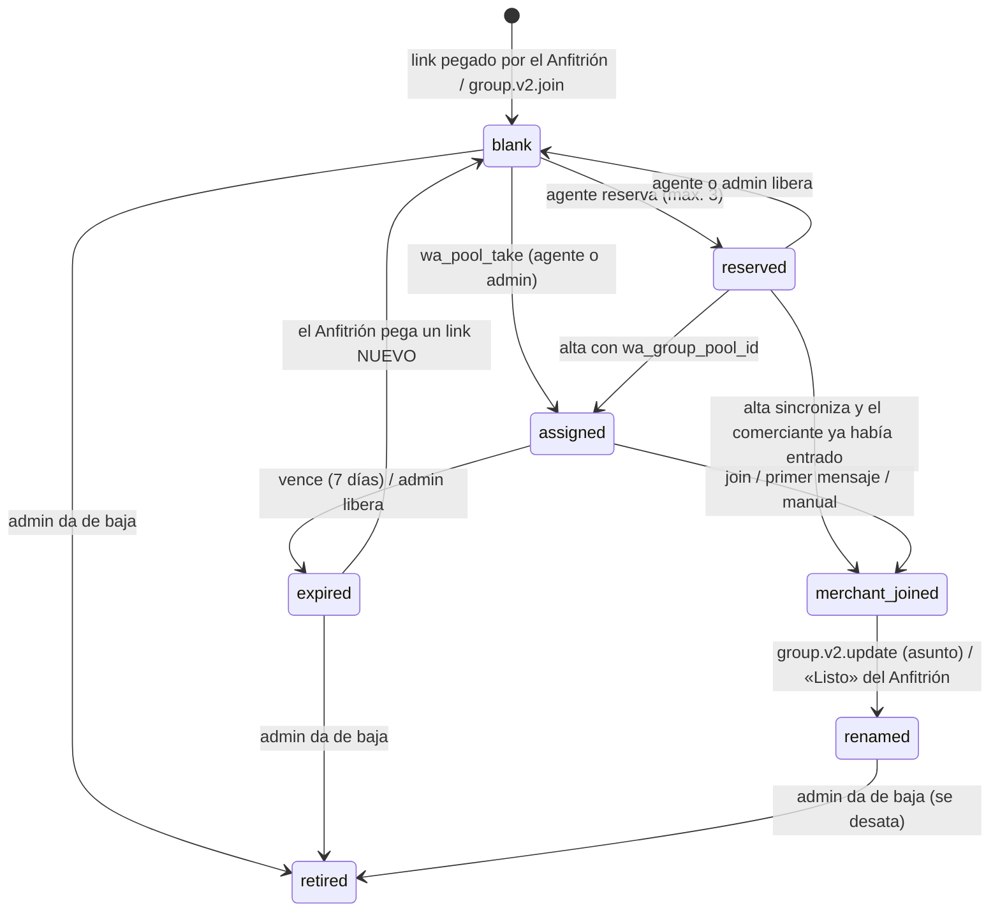

# Grupos por comercio: spec implementable (19/10/2026)

> **Estado:** spec para implementar. Reemplaza la recomendación de
> `docs/analisis-fotos-whatsapp.md` en lo que choca con las decisiones del dueño
> del 19/10 (el 67671888 **no** se conecta a WAHA; todo comercio tiene grupo).
> Base: `main` en `cc0989d`. Cada afirmación sobre el sistema actual lleva
> `archivo:línea`. Lo que depende de WAHA (producto de terceros) está marcado
> **a verificar**, con la fuente.
>
> **Para quién:** backend-dev y frontend-dev trabajan en paralelo dentro de cada
> entrega (§10) sin tocar los mismos archivos. qa-engineer verifica con los
> criterios de cada entrega.

---

## 0. En una pantalla

El Anfitrión (Samsung, 75314737) arma **a mano, por tandas**, grupos en blanco
con un solo integrante más: el Registrador (tablet, 64610187, WAHA). Adentro de
cada grupo pega **el link de invitación** con el número de la tanda
(`106 https://chat.whatsapp.com/…`). La ingesta ve ese mensaje (es de un número
propio) y registra el grupo en el **stock** (`wa_group_pool`) con su link. WAHA
no manda nada ni consulta nada.

Al terminar un alta, la app del agente **toma un grupo libre de forma atómica**,
lo ata a ESE comercio y muestra el QR del link. El comerciante escanea y entra
solo. WAHA avisa la entrada (`group.v2.participants`), el sistema ata su número
al comercio y le deja al Anfitrión una tarea: **renombrar el grupo** con un texto
ya armado para copiar (nombre, encargado, ubicación, celular, ficha; **nunca el
código**). Si el comerciante no entra en 7 días, el grupo vence y vuelve al stock
**sólo con link nuevo**.

Además: las fotos 1-a-1 de números desconocidos dejan de perderse (disco
privado, 30 días, «Es de…»), se arregla el bug del número propio con código, hay
**alertas de posible cobro en efectivo** y **revisión de altas** (consultables
por API de sólo lectura para el asistente del dueño), y cada agente tiene una
**credencial pública verificable** (`/agente/<token>`).

```mermaid
sequenceDiagram
  autonumber
  participant A as Anfitrión (Samsung)
  participant G as Grupo WhatsApp
  participant R as Registrador (WAHA, sólo lee)
  participant B as Backend (ingest + wa_pool)
  participant Ag as App del agente
  participant C as Comerciante
  A->>G: crea «URUKU · Grupo 106» + agrega al Registrador
  G-->>R: group.v2.join (asunto, participantes)
  R->>B: webhook → stock: blank, sin link
  A->>G: «106 https://chat.whatsapp.com/…»
  G-->>R: message (de un número propio)
  R->>B: webhook → stock: blank con link
  Ag->>B: alta / «darle su grupo» → wa_pool_take (atómico)
  B-->>Ag: grupo #106 + link (QR)
  C->>G: escanea el QR → «Unirme»
  G-->>R: group.v2.participants (join)
  R->>B: comerciante adentro → ata su número
  B-->>A: tarea «Renombrar #106» con texto para copiar
  A->>G: renombra + descripción + restablece link
  C->>G: foto + precio
  G-->>R: message
  R->>B: publicación (confiable → aprobada; si no → cola)
```

---

## 1. Contexto: qué hay hoy

### 1.1 Lo que ya funciona y se reusa

| Pieza | Dónde | Cómo se usa acá |
|---|---|---|
| Un grupo atado a un comercio identifica todo lo que entra por él | `ingest.py:69-108`, tabla `comercio_wa_grupos` (`0065`) | El stock ata el grupo al comercio **al asignarlo** |
| Un número propio en un grupo nunca publica; sólo ata por código | `ingest.py:513-529` | Se extiende: también registra el link de invitación |
| Remitente ajeno en un grupo → no publica directo | `ingest.py:642-646` | Defensa si el link se reenvía |
| Confiable → aprobada; no confiable → cola | `ingest.py:635-646, 681-684` | Sin cambios (decisión 7) |
| Leer participantes de un grupo por WAHA (lectura) | `wa_grupos.py:145-181` | Sólo plan B de diagnóstico; el flujo normal no lo usa |
| Crear grupo / agregar gente por WAHA | `wa_grupos.py:51-142`, `moderacion.py:1435-1486` | **No se usa** (apagado por `wa_solo_lectura`, `config.py:187`). No se toca |
| «Le interesa un plan» (agente) → `comercio_eventos.interes_plan` | `campo.py:665-689`, `0151` | Dispara la alerta de cobro |
| Pago declarado por el comercio (`pagos`, `estado='pendiente'`) | `comercio.py:1126-1158`, `0012`, `0016` | Apaga la alerta |
| Agentes = `usuarios_panel` con rol `agente` | `0126` | Base de la credencial |
| Login del panel con JWT de 7 días y permisos | `api/auth.py:57`, `core/auth.py:36-62`, `core/permisos.py:21-43` | Acceso del asistente |

### 1.2 Lo que está roto o falta

| # | Problema | Evidencia |
|---|---|---|
| P1 | **Bug:** un número propio que escribe 1-a-1 con `URUKU-XXXX` queda autorizado para ese comercio | La guarda de propios sólo mira grupos (`ingest.py:513`); `_identificar_comercio` agrega el número sin preguntar (`ingest.py:140-157`) |
| P2 | Una foto de un número desconocido se pierde: no se copia y WAHA la borra | Sólo se copia en el camino que publica (`ingest.py:662-666`) |
| P3 | Un «hola» 1-a-1 desde un número conocido crea una novedad pendiente | Sólo el código solo no publica (`ingest.py:596-600`) |
| P4 | El volante manda a un grupo que muchas veces no existe | `volante/[slug]/page.tsx:93-98` |
| P5 | Soltar un grupo hace `DELETE` físico | `repository.py:496-499` (contra `lesson-nunca-delete-fisico-siempre-soft`) |
| P6 | WAHA no manda eventos de grupo: sólo `message,message.any,session.status` | `docker-compose.prod.yml:76`, `infra/docker-compose.yml:60` |
| P7 | El webhook descarta en silencio cualquier evento que no sea mensaje o estado | `webhook.py:159` |
| P8 | El mensaje que el agente manda desde su celular invita a «responder para sumarse a un plan»: la plata termina hablándose con el agente | `lib/ficha-whatsapp.ts:28` |
| P9 | No hay QR de cobro de URUKU en el sistema: se sacó el 6/10 porque no existía | `comercio.py:1110-1113`, `docs/limpieza-circuitos.md:73-75` |
| P10 | Un agente dado de baja sigue usando la app hasta que vence su JWT (7 días): `require_agente` no mira la base | `core/auth.py:171-173`, `config.py:217` |
| P11 | Hay dos grupos llamados «URUKU-NBDA» y «URUKU-P3FC» de dueño desconocido, y la ingesta busca el código sólo en `codigo`, no en `codigo_anterior` | `repository.py:1279-1289`, `0149` |

### 1.3 Lo que dice WAHA (verificado en su documentación, 19/10)

- Eventos de grupo, soportados en NOWEB según la doc: `group.v2.join` (nos
  agregaron: trae `group.subject`, `group.invite`, `group.participants[]`),
  `group.v2.leave`, `group.v2.participants` (`type: join|leave|promote|demote`,
  `participants[]` con `id` y `role`), `group.v2.update` (cambió el asunto o la
  descripción). Fuente: <https://waha.devlike.pro/docs/how-to/events/> y
  <https://waha.devlike.pro/docs/how-to/groups/>. **A verificar** contra la
  imagen `devlikeapro/waha:latest` que corre en prod.
- Link de invitación: `GET /api/{session}/groups/{id}/invite-code`. La doc no
  dice si exige ser admin; WhatsApp sólo le da el link a un admin. El formato de
  la respuesta no está documentado. **A verificar.**
- `participants[].id` puede venir como `@lid` (sin teléfono). WAHA tiene
  `GET /api/{session}/lids/{lid}` → `{lid, pn}`, pero en NOWEB pide el *store*
  activado (<https://waha.devlike.pro/docs/how-to/contacts/>), y la sesión de
  prod se creó sin store (`manual-operativo-whatsapp.md:216-219`). Activarlo
  exige re-vincular la tablet. **No se activa**: el teléfono se completa con el
  primer mensaje, que sí trae `participantAlt` (`models/whatsapp.py:7-29`).

---

## 2. Decisiones

### 2.1 Del dueño (19/10/2026, no se discuten)

| # | Decisión |
|---|---|
| D1 | Anfitrión 75314737 (humano; crea grupos a mano, admin, habla). Registrador 64610187 (WAHA, en todos los grupos, **nunca escribe**). 67671888 = número público **para personas**; no recibe fotos ni va a WAHA |
| D2 | Todo comercio tiene un grupo: Anfitrión + comerciante + Registrador |
| D3 | Los grupos los crea el Anfitrión a mano, por tandas (p. ej. 20), en blanco; el sistema los reparte. Nada de fábrica automática ni de WAHA creando o agregando |
| D4 | Al terminar el alta, la app del agente muestra el QR de un grupo libre asignado a ese comercio; el comerciante entra solo. Se le dan los datos de pago y cómo mandar fotos. El agente puede llevar QR listos |
| D5 | Grupos identificables en admin, app y WhatsApp (nombre/descr. con datos del comercio). **Nunca el código URUKU-XXXX.** Renombrar lo hace el Anfitrión: el sistema arma el texto y la lista de pendientes |
| D6 | Identificar y renombrar «URUKU-NBDA» y «URUKU-P3FC» |
| D7 | Foto 1-a-1 al Registrador de número conocido: confiable → directo; no confiable → cola. Número desconocido → no se pierde (con retención). Textos: «mandá tus fotos a tu grupo»; el 67671888 queda como contacto humano |
| D8 | El agente nunca cobra. Interés en plan pago sin pago por QR en N días → alerta. Toda alta entra a revisión. Alertas consultables por API de sólo lectura (asistente del dueño, fase 1) |
| D9 | Credencial del agente con QR a una página pública que valida: nombre, foto, ciudad, estado + «Los agentes de URUKU nunca cobran. Pagá sólo por QR a URUKU». Revocable. Token no adivinable, no es el id; sin teléfono ni datos sensibles |

### 2.2 Técnicas (esta spec)

| # | Decisión | Elegida | Descartadas | Por qué | Qué la invalidaría |
|---|---|---|---|---|---|
| T1 | Cómo entra un grupo en blanco y su link | **El Anfitrión pega el link adentro del grupo** con el número de tanda; la ingesta lo registra (número propio + grupo + `chat.whatsapp.com`). Respaldo: pegar el link a mano en la fila del stock (admin) | (b) WAHA lee `invite-code` → queda como **plan B** apagado (`WA_READ_INVITE_CODE=false`); (c) pantalla de carga en lote de links (hay que adivinar qué link es de qué grupo); (d) sólo `group.v2.join` (el link llega vacío si el Registrador no es admin) | Usa el único camino probado en prod (evento `message`, `ingest.py:513`). Ata link ↔ JID sin margen de error. WAHA no hace **ninguna** llamada a WhatsApp. Cuesta ~10 s por grupo | El Anfitrión no lo hace de forma sistemática → encender plan B. NOWEB deja de entregar mensajes de números propios en grupos |
| T2 | ¿Leer el link por WAHA viola «nunca escribe»? | **No lo viola en sentido estricto**: no manda mensajes ni cambia nada visible. Pero es una acción de administrador ejecutada por un cliente no oficial, exige que el Registrador sea admin y puede generar un link si no había. Por eso queda como plan B, no como camino principal | Encenderlo por defecto | Con T1 no hace falta; menos superficie ante WhatsApp | Si T1 falla en la práctica |
| T3 | Cómo se sabe que el comerciante entró | **`group.v2.participants` (join)** → respaldo: **primer mensaje** de un número no propio en un grupo asignado → respaldo: **«Marcar: entró»** a mano | Consultar participantes cada N minutos (miles de lecturas por día: patrón de automatización); «Aprobar nuevos participantes» activado (obliga al Anfitrión a aprobar cada ingreso y contradice D4) | Tres caminos independientes; ninguno escribe | Si NOWEB no emite `group.v2.*` quedan el 2 y el 3, y la app del agente no ve «Entró» en vivo |
| T4 | Asignación atómica | **Función plpgsql** `wa_pool_take` con `FOR UPDATE SKIP LOCKED`, más un índice único parcial «un grupo vivo por comercio», llamada por RPC con `service_role` | Update optimista desde Python (son dos tablas y PostgREST no da transacciones entre llamadas); lock en memoria del backend (no sobrevive a un reinicio ni a dos workers) | Una sola transacción en la base; dos agentes no pueden tomar el mismo grupo | Si el backend pasa a un ORM con transacciones propias |
| T5 | Cuándo se ata el grupo al comercio | **Al asignar** (fila en `comercio_wa_grupos`, `origen='pool'`) | Al detectar la entrada | La primera foto puede llegar antes que el evento de entrada; atado desde el principio no se pierde | — |
| T6 | Grupo vencido (nadie entró) | Pasa a `expired` y se desata. **Vuelve al stock sólo cuando el Anfitrión restablece el link y pega el nuevo** | Volver directo al stock; dar de baja siempre | El link viejo quedó en el celular de alguien. Si el grupo vuelve con ese link, lo que esa persona mande va al comercio siguiente | — |
| T7 | QR listos sin señal | **Reservas por agente (máx. 3), sin vencimiento automático**: las libera el agente o el admin. El alta viaja con `wa_group_pool_id` en la cola offline | Reservas con vencimiento | Un QR ya mostrado sin señal no puede volver al stock a espaldas del agente | Si el stock queda trabado en reservas viejas → el admin las libera (la pantalla las muestra con antigüedad) |
| T8 | Stock por ciudad | `ciudad_id` **opcional** (null = sirve para cualquiera). El agente toma primero de su ciudad y después del común | Un stock obligatorio por ciudad | Un grupo de WhatsApp no tiene ciudad física y el Anfitrión es uno solo | Si cada ciudad tiene su propio Anfitrión |
| T9 | Fotos de números/grupos desconocidos | **Disco privado** (`WA_RECEIVED_DIR`, fuera de `/data/fotos`) + `wa_inbox.media_path` + **30 días** + «Es de…» que aprende el número y reprocesa | Guardarlas en `/data/fotos` (es público, `main.py:369`); no guardarlas (hoy) | No se pierde nada, no se expone nada, y el trabajo humano es una vez por número | — |
| T10 | Texto 1-a-1 sin foto ni precio | **No publica**: `ignorada`, motivo «charla 1-a-1» | Publicar como novedad pendiente (hoy) | El Registrador no contesta nunca: una charla convertida en novedad es ruido en la cola | Si aparece evidencia de comercios que publican novedades de sólo texto por 1-a-1 |
| T11 | Alertas de cobro | **Tabla** `control_alerts` + generador horario idempotente (`unique(kind, source_ref)`) que también **auto-resuelve** | Vista calculada (no guarda quién resolvió ni cuándo); trigger (la condición depende del paso del tiempo) | Hace falta estado y una condición temporal | — |
| T12 | Revisión de altas | Tabla `signup_reviews` + **trigger** al insertar un comercio con `fuente='campo'` | Reusar `verificado` (es público y quiere decir «la ficha es real», no «la visita fue correcta»); insertar desde `campo.py` (no cubre otros caminos y choca con E3) | Ningún alta se escapa, sea cual sea el código que la cree | — |
| T13 | Acceso del asistente del dueño | **Usuario dedicado** con rol `assistant` (permiso `field_control.read`) por el login existente (`POST /auth/login`, JWT de 7 días). `es_del_panel` lo excluye | API key nueva (otro mecanismo de autenticación que mantener); las credenciales del dueño (escritura total desde una PC) | Mínimo privilegio sin construir auth nueva | Si el asistente necesita correr >7 días sin volver a entrar → API key |
| T14 | Token de la credencial | Aleatorio de 128 bits (`secrets.token_urlsafe(16)`), **guardado en claro** en tabla privada; uno vivo por agente | Sólo el hash (no se puede reimprimir ni mostrar en la app del agente); token firmado sin estado (igual hay que guardar la revocación) | La credencial **no autentica nada**: muestra datos públicos. El ancla de confianza es la foto y el estado en `uruku.bo` | Si la credencial pasa a dar algún permiso |
| T15 | Página pública | Endpoint del backend `GET /public/agents/{token}` + página Next server-side `no-store` | RPC de PostgREST para anon | Permite contar escaneos y alertar si escanean una revocada, sin dar a anon ninguna tabla | — |
| T16 | Corte de acceso de un agente dado de baja | `require_agente` consulta `usuarios_panel.activo` (caché de 60 s) | Esperar que venza el JWT | Un agente echado por cobrar seguiría repartiendo QR una semana | — |
| T17 | Dónde se ve el QR de cobro | **Nunca en la pantalla del agente.** Se ve en `/pagar` (pública, en `uruku.bo`) y en Mi comercio › Pagar. La app del agente muestra un QR que **abre `uruku.bo/pagar`** en el celular del comerciante. Datos en config estática (`lib/payment.ts` + imagen en `public/pago/`) | Mostrar el QR bancario en la app del agente; tabla editable en el admin | Si el QR bancario lo muestra el agente, una captura con otro QR es indistinguible. Que el comerciante lo abra en su celular, en `uruku.bo`, sí lo es. El QR cambia casi nunca | Si el QR bancario vence seguido → pasarlo a una tabla |

### 2.3 Path dependence

Esta spec **se apoya otra vez en WAHA + grupos de WhatsApp**, que es el camino
habitual del equipo (`2026-06-04-stack-bermejo`, que ya registró que WAHA no es
oficial). La forma «grupos» la decidió el dueño (D2, D3). Igual la contrasto con
dos alternativas reales para dejar escrito qué se resigna:

1. **Chat 1-a-1 con la API oficial de Meta** en el número de marca (67991916,
   que no tiene WhatsApp común): sin riesgo de baneo, recibir es gratis y
   permite contestar. **No tiene grupos**: el modelo de hoy no migra
   (`whatsapp-arquitectura-y-escala.md:82-99`). Gana a largo plazo.
2. **Carga desde la web** (`/comercio/publicar`, Mi comercio) o un bot de
   Telegram (`2026-06-18-asistente-telegram-mentorcomercial`): sin WhatsApp no
   oficial, pero el comerciante de Bermejo no la usa; el valor es justamente
   «mandá una foto como siempre».

**Consecuencia aceptada:** todo lo específico de grupos vive en
`app/services/wa_pool.py` y en las tablas `wa_group_*`. Las reglas de
publicación siguen después de `mensajeria.normalizar_entrante`
(`webhook.py:122-124`), así que el día del cambio a la API oficial se tira el
stock de grupos, no la ingesta.

---

## 3. Los números y la configuración de cada grupo

| Número | Aparato | En el grupo | Qué hace en este flujo |
|---|---|---|---|
| 75314737 Anfitrión | Samsung | Creador y admin | Crea la tanda, pega el link, renombra, restablece el link, saca intrusos, manda el link a mano si hace falta. Abre `uruku.bo/admin?s=host-tasks` **en el mismo Samsung** para copiar los textos |
| 64610187 Registrador | Tablet | Participante (recomendado: admin, por resiliencia, `manual-operativo-whatsapp.md:287-288`) | Sólo WAHA. Nunca escribe |
| Comerciante | Su celular | Entra por el link | Manda fotos |
| 67671888 | — | **No está en los grupos nuevos** | Atención de personas. Figura como «Dudas» |

**Ajustes de cada grupo en blanco** (los dice la pantalla «Preparar tanda»):

- Nombre: `URUKU · Grupo {n}` (n = número de tanda que propone el sistema).
- *Editar info del grupo*: sólo admins (que el comerciante no lo renombre).
- *Aprobar nuevos participantes*: **desactivado** (D4: entra solo).
- *Agregar otros participantes*: sólo admins (así el comerciante no ve ni
  reenvía el link).
- Descripción en blanco (opcional): `Grupo de URUKU para mandar fotos y ofertas de tu negocio · uruku.bo`.

---

## 4. Ciclo de vida de un grupo del stock

Estados en la base en inglés; etiqueta en pantalla en español.

| `status` | Etiqueta | Significa |
|---|---|---|
| `blank` | Libre | Sólo números de URUKU adentro. Se puede asignar si tiene link |
| `reserved` | Reservado (agente) | Lo lleva un agente en el celular para usar sin señal |
| `assigned` | Asignado · esperando | Atado a un comercio; el link ya se mostró; el comerciante no entró |
| `merchant_joined` | Comerciante adentro | Entró; falta renombrar |
| `renamed` | Listo | Renombrado por el Anfitrión. Estado normal de operación |
| `expired` | Vencido | Nadie entró en `WA_GROUP_ASSIGNED_TTL_DAYS`. Desatado. Falta restablecer el link |
| `retired` | De baja | No se usa más (`activo=false`) |



**Avisos** (`flags`, no cambian el estado; generan tareas del Anfitrión):

| Flag | Cuándo | Tarea |
|---|---|---|
| `no_invite` | Registrado por evento sin link | «Pegá el link adentro del grupo» |
| `intruder` | Un número no propio entró o escribió en un grupo `blank`/`expired` | «Sacá a +591 7•••456 de #099, o decí de qué comercio es» |
| `registrar_out` | `group.v2.leave` del Registrador | «Volvé a agregar al Registrador (64610187)» |
| `merchant_left` | `participants leave` del comerciante | «El comerciante salió de #051» |
| `phone_owned_by_other` | El que entró ya es número autorizado de otro comercio activo | «Revisá: +591 7••• es también de Kiosco Ana» (no se mueve nada) |
| `reservation_conflict` | Un alta offline trajo un grupo reservado que ya era de otro | «El QR de #087 se mostró para Ferretería Sol pero era de otro comercio: avisale» |
| `extra_participant` | Entró una persona más a un grupo con comerciante | Informativo |

**Reglas que no se rompen:**

1. Un grupo del stock **sólo se ata por asignación**: nunca por un código
   mandado adentro (ni por el comerciante ni por el Anfitrión).
2. Un grupo `expired` no vuelve a `blank` con el mismo link.
3. Un comercio tiene a lo sumo un grupo vivo del stock (`assigned`,
   `merchant_joined`, `renamed`).
4. Nunca `DELETE`: baja lógica en `wa_group_pool.activo` y en
   `comercio_wa_grupos.activo`.

---

## 5. Modelo de datos (SQL borrador)

Reglas comunes a todas las migraciones (AGENTS.md §5 y §7; KB
`lesson-supabase-cloud-grants-explicitos-en-migration`,
`pattern-supabase-rls-policy`, `pattern-soft-delete-activo-flag`):

- Numeración **desde 0159** (0156–0158 reservadas para otra rama). Archivo
  **idéntico byte a byte** en `supabase/migrations/` y `selfhost/postgres-init/`,
  con un test por migración (como `test_admin_resumen_qa.py:398-409`).
- `begin; … commit;`, idempotente (`if not exists`, `on conflict`),
  comprobación `do $chk$` al final y `notify pgrst, 'reload schema';`.
- Tablas nuevas: `enable row level security`, `revoke all … from public, anon,
  authenticated`, `grant all … to service_role`. **Ninguna** es legible por anon.
- Funciones nuevas: `set search_path = public, pg_temp`, `revoke execute … from
  public, anon, authenticated`, `grant execute … to service_role`.
- Columna nueva en `comercios` → privada (regla 11) y a `PRIVADAS_EXTRA` de
  `test_comercios_columnas_publicas.py:36`.
- **No escribir la palabra del código del comercio (`c-o-d-i-g-o`) en ninguna
  migración nueva, ni en un comentario al final de una línea**:
  `test_ninguna_vista_ni_funcion_publica_expone_codigo`
  (`test_comercios_columnas_publicas.py:396-410`) la busca en todo lo que no sea
  una línea que empiece con `--`.
- Identificadores en inglés; comentarios en español. Excepción: el flag de baja
  lógica se llama `activo` en todas las tablas (convención del proyecto y de la KB).

### 0159 · `0159_wa_inbox_received_media.sql` (E1)

```sql
begin;

alter table public.wa_inbox add column if not exists media_path      text;
alter table public.wa_inbox add column if not exists media_purged_at timestamptz;
alter table public.wa_inbox add column if not exists assigned_by     text;
alter table public.wa_inbox add column if not exists assigned_at     timestamptz;

comment on column public.wa_inbox.media_path is
  'Ruta relativa dentro de WA_RECEIVED_DIR (disco PRIVADO, fuera de /fotos) de la foto que llegó sin comercio.';
comment on column public.wa_inbox.media_purged_at is
  'Cuándo se borró el archivo por retención. La fila queda.';
comment on column public.wa_inbox.assigned_by is
  'Quién dijo «es de…» en Recepción (email). Después de eso la fila se reprocesó.';

create index if not exists idx_wa_inbox_phone_sin_comercio
  on public.wa_inbox (phone, created_at desc) where resultado = 'sin_comercio';
create index if not exists idx_wa_inbox_jid_sin_comercio
  on public.wa_inbox (wa_jid, created_at desc) where resultado = 'sin_comercio';
create index if not exists idx_wa_inbox_media_vigente
  on public.wa_inbox (created_at) where media_path is not null and media_purged_at is null;

do $chk$ begin
  if has_table_privilege('anon', 'public.wa_inbox', 'select')
     or has_table_privilege('authenticated', 'public.wa_inbox', 'select') then
    raise exception '0159: wa_inbox no puede ser legible por anon/authenticated';
  end if;
end $chk$;

commit;
notify pgrst, 'reload schema';
```

### 0160 · `0160_wa_group_pool.sql` (E2)

```sql
begin;

-- 1. comercio_wa_grupos pasa a baja lógica (hoy: DELETE físico, repository.py:496-499)
alter table public.comercio_wa_grupos add column if not exists activo      boolean not null default true;
alter table public.comercio_wa_grupos add column if not exists released_at timestamptz;
alter table public.comercio_wa_grupos add column if not exists released_by text;
create index if not exists idx_wa_grupos_comercio_activo
  on public.comercio_wa_grupos (comercio_id) where activo;
-- 'origen' suma el valor 'pool' (no tiene check: 0065).

-- 2. El stock
create table if not exists public.wa_group_pool (
  id                 uuid primary key default gen_random_uuid(),
  group_jid          text not null unique check (group_jid like '%@g.us'),
  batch_number       integer unique,                 -- «URUKU · Grupo 106» → 106
  subject            text,                           -- asunto actual en WhatsApp (por evento)
  invite_url         text,                           -- https://chat.whatsapp.com/<...>. PRIVADO
  invite_set_at      timestamptz,
  invite_source      text check (invite_source in ('message','event','api','admin')),
  ciudad_id          uuid references public.ciudades(id),          -- null = cualquier ciudad
  status             text not null default 'blank' check (status in
                       ('blank','reserved','assigned','merchant_joined','renamed','expired','retired')),
  comercio_id        uuid references public.comercios(id),
  reserved_by        text,
  reserved_at        timestamptz,
  assigned_by        text,
  assigned_at        timestamptz,
  assigned_via       text check (assigned_via in ('agent','admin','adopted')),
  expires_at         timestamptz,
  merchant_phone     text,
  merchant_jid       text,
  merchant_joined_at timestamptz,
  joined_via         text check (joined_via in ('event','message','manual')),
  renamed_at         timestamptz,
  renamed_by         text,
  flags              text[] not null default '{}',
  registered_via     text not null check (registered_via in ('message','event','admin','adopted')),
  notes              text,
  activo             boolean not null default true,
  created_at         timestamptz not null default now(),
  updated_at         timestamptz not null default now(),
  constraint wa_group_pool_comercio_by_status check (case
      when status in ('assigned','merchant_joined','renamed') then comercio_id is not null
      when status in ('blank','reserved') then comercio_id is null
      else true end),
  constraint wa_group_pool_reservation check ((status = 'reserved') = (reserved_by is not null)),
  constraint wa_group_pool_flags check (flags <@ array['no_invite','intruder','registrar_out',
      'merchant_left','phone_owned_by_other','reservation_conflict','extra_participant']::text[])
);
create unique index if not exists wa_group_pool_one_live_per_comercio
  on public.wa_group_pool (comercio_id)
  where activo and status in ('assigned','merchant_joined','renamed');
create index if not exists idx_wa_group_pool_free
  on public.wa_group_pool (ciudad_id, batch_number) where activo and status = 'blank' and invite_url is not null;
create index if not exists idx_wa_group_pool_reserved on public.wa_group_pool (reserved_by) where status = 'reserved';
create index if not exists idx_wa_group_pool_expiring on public.wa_group_pool (expires_at) where status = 'assigned';
drop trigger if exists trg_wa_group_pool_updated on public.wa_group_pool;
create trigger trg_wa_group_pool_updated before update on public.wa_group_pool
  for each row execute function set_updated_at();      -- función de la 0001

-- 3. Historia de cada grupo (quién hizo qué)
create table if not exists public.wa_group_pool_events (
  id         uuid primary key default gen_random_uuid(),
  pool_id    uuid not null references public.wa_group_pool(id),
  kind       text not null,   -- registered, invite_updated, reserved, released, assigned, merchant_joined,
                              -- renamed, expired, back_to_stock, flag_added, flag_resolved, retired, adopted
  actor      text not null,   -- email, número propio o 'system'
  detail     jsonb,
  created_at timestamptz not null default now()
);
create index if not exists idx_wa_group_pool_events on public.wa_group_pool_events (pool_id, created_at desc);

-- 4. Eventos de grupo de WAHA, crudos (como wa_inbox para los mensajes)
create table if not exists public.wa_group_events (
  id           uuid primary key default gen_random_uuid(),
  dedupe_key   text not null unique,   -- sha256(evento|grupo|tipo|participantes ordenados|timestamp)
  event        text not null,          -- group.v2.join | group.v2.leave | group.v2.participants | group.v2.update
  group_jid    text,
  change_type  text,                   -- join | leave | promote | demote (participants)
  participants jsonb,
  raw          jsonb not null,
  result       text,                   -- registered | merchant_joined | intruder | foreign_group | ignored | error
  reason       text,
  created_at   timestamptz not null default now()
);
create index if not exists idx_wa_group_events_group on public.wa_group_events (group_jid, created_at desc);

-- 5. Permisos: sólo el backend
alter table public.wa_group_pool        enable row level security;
alter table public.wa_group_pool_events enable row level security;
alter table public.wa_group_events      enable row level security;
revoke all on public.wa_group_pool, public.wa_group_pool_events, public.wa_group_events
  from public, anon, authenticated;
grant all on public.wa_group_pool, public.wa_group_pool_events, public.wa_group_events to service_role;

-- 6. Registrar o actualizar el link (llamada por la ingesta y por el admin)
create or replace function public.wa_pool_register_link(
  p_group_jid text, p_invite_url text, p_batch_number int, p_actor text, p_source text)
returns jsonb language plpgsql set search_path = public, pg_temp as $fn$
-- Pseudocódigo:
--   si hay fila ACTIVA en comercio_wa_grupos para el jid y no hay fila en el stock
--        → {result:'bound_outside_pool', comercio_id}            (no se toca)
--   insert ... on conflict (group_jid) do nothing                  (si es nuevo → 'new')
--   select ... for update
--   retired / no activo           → {result:'retired'}
--   expired                       → status 'blank', link nuevo, limpiar comercio_id, merchant_*,
--                                   assigned_*, expires_at, renamed_*; flags sin no_invite ni
--                                   merchant_left; evento back_to_stock → {result:'back_to_stock'}
--   otro estado                   → actualizar invite_url/invite_set_at/invite_source, quitar
--                                   flag no_invite; evento invite_updated → {result:'invite_updated'}
--   batch_number: sólo si viene, la fila no tiene y nadie más lo usa (si choca, se ignora)
$fn$;

revoke execute on function public.wa_pool_register_link(text,text,int,text,text) from public, anon, authenticated;
grant execute on function public.wa_pool_register_link(text,text,int,text,text) to service_role;

-- 7. Comprobación: anon/authenticated sin acceso a ninguna tabla ni función nueva;
--    comercio_wa_grupos.activo existe y por defecto es true.

commit;
notify pgrst, 'reload schema';
```

### 0161 · `0161_wa_group_assignment.sql` (E3)

```sql
begin;

-- 1. Quién atiende el comercio (para la descripción del grupo). PRIVADA (regla 11).
alter table public.comercios add column if not exists contact_name text;
comment on column public.comercios.contact_name is
  'Nombre de la persona que atiende / dueño, como lo dijo en la visita. PRIVADA: va a la descripción del grupo de WhatsApp, nunca al sitio.';

-- 2. Tomar un grupo (atómico)
create or replace function public.wa_pool_take(
  p_comercio_id uuid, p_ciudad_id uuid, p_actor text, p_via text,      -- p_via: 'agent' | 'admin'
  p_pool_id uuid default null, p_ttl_days int default 7)
returns jsonb language plpgsql set search_path = public, pg_temp as $fn$
-- Pseudocódigo:
--   1) ¿ya tiene grupo vivo del stock? → {result:'existing', pool:<fila>}      (idempotente)
--   2) ¿tiene un grupo ACTIVO en comercio_wa_grupos que no es del stock?
--        → {result:'legacy_group', group_jid, nombre}
--   3) si p_pool_id: select ... where id = p_pool_id and activo and invite_url is not null
--        and (status = 'blank' or (status = 'reserved' and reserved_by = p_actor))
--        for update skip locked
--      si no se pudo: marcar flag reservation_conflict en esa fila y seguir con 4) → result
--        final 'reservation_conflict' (con el grupo nuevo)
--   4) select ... where activo and status = 'blank' and invite_url is not null
--        and (ciudad_id = p_ciudad_id or ciudad_id is null)
--      order by (ciudad_id is null), batch_number nulls last, created_at
--      limit 1 for update skip locked
--      si no hay → {result:'no_stock'} (y un comercio_eventos 'wa_group_requested_no_stock')
--   5) update: status = case when merchant_joined_at is not null then 'merchant_joined'
--                            else 'assigned' end,
--      comercio_id, assigned_by, assigned_at = now(), assigned_via = p_via,
--      expires_at = now() + p_ttl_days días, reserved_by/at = null
--   6) insert into comercio_wa_grupos (grupo_jid, comercio_id, nombre, origen, created_by, activo)
--        values (..., 'pool', p_actor, true)
--      on conflict (grupo_jid) do update set comercio_id = excluded.comercio_id, origen = 'pool',
--        created_by = excluded.created_by, activo = true, released_at = null, released_by = null
--        where comercio_wa_grupos.activo = false;
--      si no insertó ni actualizó (el jid está activo para OTRO comercio) → raise → rollback
--   7) evento 'assigned' + comercio_eventos 'wa_group_assigned' {pool_id, via}
--   8) exception when unique_violation (doble toque concurrente para el mismo comercio)
--        → devolver el grupo vivo existente ('existing')
--   → {result:'assigned'|'existing'|'reservation_conflict', pool:<fila>}
$fn$;

-- 3. Reservar para llevar (máx. p_max por agente; devuelve todas las reservas del agente)
create or replace function public.wa_pool_reserve(p_actor text, p_ciudad_id uuid, p_max int)
returns setof public.wa_group_pool language plpgsql set search_path = public, pg_temp as $fn$
-- faltan := p_max - (reservas actuales de p_actor)
-- tomar hasta 'faltan' blank con link (ciudad o común) FOR UPDATE SKIP LOCKED → status 'reserved'
-- evento 'reserved'; return query todas las de p_actor
$fn$;

-- 4. Vencer los asignados sin entrada
create or replace function public.wa_pool_expire() returns int
language plpgsql set search_path = public, pg_temp as $fn$
-- para cada fila status='assigned' and expires_at < now() FOR UPDATE SKIP LOCKED:
--   status 'expired', comercio_id null (el comercio queda en el evento), expires_at null
--   comercio_wa_grupos del jid (origen 'pool', activo) → activo=false, released_at=now(),
--     released_by='system:expired'
--   evento 'expired' {comercio_id}; comercio_eventos 'wa_group_expired'
-- return cantidad
$fn$;

-- 5. Entró alguien (evento, primer mensaje o manual)
create or replace function public.wa_pool_merchant_joined(
  p_group_jid text, p_phone text, p_jid text, p_via text, p_actor text)
returns jsonb language plpgsql set search_path = public, pg_temp as $fn$
-- select ... for update
--   assigned          → merchant_joined + merchant_phone/jid/joined_at/joined_via → 'joined'
--   reserved          → guarda merchant_* sin cambiar status (entró antes de sincronizar) → 'pre_joined'
--   blank / expired   → flag 'intruder' → 'intruder'
--   merchant_joined / renamed: si p_phone/p_jid difiere del guardado → flag 'extra_participant' → 'extra'
--   sin fila          → 'not_in_pool'
--   → {result, pool_id, comercio_id}
$fn$;

-- revoke/grant de las cuatro funciones como en 0160.
-- Comprobación: anon/authenticated no leen comercios.contact_name ni ejecutan las funciones.

commit;
notify pgrst, 'reload schema';
```

### 0162 · `0162_field_control.sql` (E4)

```sql
begin;

create table if not exists public.control_alerts (
  id           uuid primary key default gen_random_uuid(),
  kind         text not null check (kind in
                 ('unpaid_interest','cash_payment','charge_reported','revoked_credential_scanned')),
  severity     text not null default 'medium' check (severity in ('low','medium','high')),
  comercio_id  uuid references public.comercios(id),
  agent_email  text,
  source_ref   text not null,        -- id del evento interes_plan, del pago, de la revisión, cred:día
  detail       jsonb,
  status       text not null default 'open' check (status in ('open','resolved','dismissed')),
  resolved_by  text,
  resolved_at  timestamptz,
  resolution   text,
  activo       boolean not null default true,
  created_at   timestamptz not null default now(),
  unique (kind, source_ref)
);
create index if not exists idx_control_alerts_open on public.control_alerts (created_at desc) where status = 'open' and activo;

create table if not exists public.signup_reviews (
  comercio_id  uuid primary key references public.comercios(id),
  agent_email  text,
  status       text not null default 'pending' check (status in ('pending','ok','flagged','charge_reported')),
  checklist    jsonb not null default '{}'::jsonb,   -- {datos_ok, foto_ok, consentimiento_ok, llamado, cobro_preguntado}
  note         text,
  reviewed_by  text,
  reviewed_at  timestamptz,
  activo       boolean not null default true,
  created_at   timestamptz not null default now()
);
create index if not exists idx_signup_reviews_pending on public.signup_reviews (created_at) where status = 'pending' and activo;

-- Toda alta de campo entra a revisión, la cree el código que la cree
create or replace function public.signup_review_on_insert() returns trigger
language plpgsql set search_path = public, pg_temp as $fn$
begin
  if new.fuente = 'campo' then
    insert into public.signup_reviews (comercio_id, agent_email) values (new.id, new.cargado_por)
    on conflict (comercio_id) do nothing;
  end if;
  return new;
end $fn$;
drop trigger if exists trg_comercios_signup_review on public.comercios;
create trigger trg_comercios_signup_review after insert on public.comercios
  for each row execute function public.signup_review_on_insert();

-- Altas de campo de los últimos 30 días (ver pregunta abierta Q2)
insert into public.signup_reviews (comercio_id, agent_email, created_at)
select id, cargado_por, created_at from public.comercios
 where fuente = 'campo' and activo and created_at > now() - interval '30 days'
on conflict (comercio_id) do nothing;

-- Generador idempotente de alertas (lo llama un loop del backend cada hora)
create or replace function public.control_generate_alerts(p_days int) returns jsonb
language plpgsql set search_path = public, pg_temp as $fn$
-- A) unpaid_interest (severity medium): por cada comercio_eventos tipo 'interes_plan'
--    con created_at entre now()-90 días y now()-p_days, comercio activo, sin plan_cortesia,
--    y SIN pagos (estado pendiente|confirmado, metodo <> 'efectivo', created_at >= el interés)
--    → insert (kind, comercio_id, agent_email = evento.actor, source_ref = evento.id,
--              detail = {plan, interes_at, dias}) on conflict do nothing
-- B) auto-resolver: unpaid_interest abiertas cuyo comercio ya tiene ese pago
--    → status 'resolved', resolved_by 'system', resolution 'llegó el pago'
-- C) cash_payment (severity low): pagos metodo 'efectivo' de los últimos 90 días de comercios
--    con fuente 'campo' → source_ref = pago.id, detail = {monto, moneda, registrado_por}
-- → {created: n, resolved: m}
$fn$;

-- Rol del asistente (sólo lectura). No es del sistema: se puede borrar desde Equipo.
insert into public.roles (slug, nombre, descripcion, permisos, del_sistema)
values ('assistant', 'Asistente (sólo lectura)',
        'Lee alertas de cobro y revisiones de altas por API. No cambia nada.',
        array['field_control.read'], false)
on conflict (slug) do nothing;

-- RLS + revoke/grant como en 0160 para control_alerts, signup_reviews y las dos funciones.
-- Comprobación: el trigger existe; anon/authenticated sin acceso.

commit;
notify pgrst, 'reload schema';
```

### 0163 · `0163_agent_credentials.sql` (E5)

```sql
begin;

alter table public.usuarios_panel add column if not exists photo_url text;
comment on column public.usuarios_panel.photo_url is
  'Foto del agente para su credencial pública (/agente/<token>). La sube el admin.';

create table if not exists public.agent_credentials (
  id             uuid primary key default gen_random_uuid(),
  usuario_id     uuid not null references public.usuarios_panel(id),
  token          text not null unique check (length(token) >= 22),   -- aleatorio; NO es el id
  activo         boolean not null default true,                       -- false = revocada
  issued_by      text not null,
  issued_at      timestamptz not null default now(),
  revoked_by     text,
  revoked_at     timestamptz,
  revoke_reason  text,
  last_scan_at   timestamptz,
  scan_count     integer not null default 0
);
create unique index if not exists agent_credentials_one_live
  on public.agent_credentials (usuario_id) where activo;

-- RLS + revoke de anon/authenticated + grant a service_role. usuarios_panel ya es sólo
-- del backend (0126:78-80): photo_url hereda eso.

commit;
notify pgrst, 'reload schema';
```

---

## 6. Ingesta y eventos de WAHA

### 6.1 Configuración nueva (`backend/.env` y `core/config.py`)

```
WA_RECEIVED_DIR=/data/wa_received          # volumen propio, NUNCA bajo /data/fotos
WA_RECEIVED_RETENTION_DAYS=30
WA_GROUP_ASSIGNED_TTL_DAYS=7
WA_GROUP_RESERVATIONS_MAX=3
WA_GROUP_STOCK_MIN=5                       # por ciudad; debajo, tarea «Stock bajo»
WA_READ_INVITE_CODE=false                  # plan B de T1/T2
WA_GROUP_LOOP_SECONDS=3600                 # vencimientos del stock
CONTROL_UNPAID_INTEREST_DAYS=3             # la N de D8
CONTROL_LOOP_SECONDS=3600
```

`docker-compose.prod.yml` (servicio `backend`): volumen nuevo
`wa_received:/data/wa_received`. Servicio `waha` (y `infra/docker-compose.yml`):

```
WHATSAPP_HOOK_EVENTS=message,message.any,session.status,group.v2.join,group.v2.leave,group.v2.participants,group.v2.update
```

### 6.2 Cambios en `ingest.handle_message` (pseudocódigo sobre el código actual)

```
… (sin cambios hasta la bandeja: evento, fromMe, CONFIRMAR, clave filtrada, insert wa_inbox)

explorador (como hoy, ingest.py:510-511)

if es_grupo and es_numero_propio(phone):                          # ingest.py:513
    link = RE_INVITE.search(body)                                  # https?://chat\.whatsapp\.com/(?:invite/)?([A-Za-z0-9]{20,24})
    if link:
        n = RE_BATCH.match(body)                                   # ^\s*#?(\d{1,4})\b  (opcional)
        r = repo.wa_pool_register_link(grupo_jid, normalizado(link), n, phone, 'message')
        marcar ignorada, motivo según r.result:
          new / invite_updated / back_to_stock → «link de invitación registrado: grupo #n»
          bound_outside_pool                   → «link de un grupo ya atado a {comercio}: no entra al stock»
          retired                              → «link de un grupo dado de baja»
        return
    if grupo está en el stock:                                     # regla 1 de §4
        marcar ignorada «grupo del stock: se asigna desde la app o el admin, no con código»
        return
    … como hoy (_atar_grupo_por_codigo_propio / «mensaje de un número de URUKU»)

if not es_grupo and es_numero_propio(phone):                       # NUEVO · arregla P1
    marcar ignorada «1-a-1 de un número de URUKU: no identifica ni publica»
    return                                                         # nunca llega a _identificar_comercio

if es_grupo:
    pool = repo.get_pool_by_jid(grupo_jid)
    if pool and pool.status in (assigned, reserved) and pool.merchant_phone is null:
        repo.wa_pool_merchant_joined(grupo_jid, phone, remitente_jid, 'message', 'ingest')   # T3, respaldo 2
        (si 'joined' → autorizar número: ver 6.4)
    comercio = _identificar_por_grupo(...)                         # ingest.py:69-108
        └─ cambio: si el grupo está en el stock y no atado, NO ata por código (regla 1)
    if comercio is None:
        if has_media: media_path = wa_received.save(payload)       # NUEVO · no se pierde (P2)
        if pool and pool.status in (blank, expired): flag 'intruder'
        marcar sin_comercio (como hoy) + media_path
        return
else:
    comercio = _identificar_comercio(...)
    if comercio is None:
        if has_media: media_path = wa_received.save(payload)       # NUEVO (P2)
        marcar sin_comercio (como hoy) + media_path
        return
    if not has_media and not parece_oferta(body) and not _extract_tiktok(body)
       and not es ubicación:                                       # NUEVO · T10 (P3)
        marcar ignorada «charla 1-a-1: el Registrador no contesta», comercio_id
        return

… resto igual: ubicación, gate por plan, sólo-código, cuota, confiable, foto, fusión, insert
```

- `wa_received.save(payload)` (nuevo `app/services/wa_received.py`): baja la
  media con `wa_media.descargar_media` (`wa_media.py:64`), la procesa con
  `imagenes.procesar_imagen` (`imagenes.py:68`, 1600 px), la guarda en
  `WA_RECEIVED_DIR/{yyyy-mm}/{wa_message_id_sanitizado}.jpg` y devuelve la ruta
  relativa. Nunca lanza (si falla, `media_path` queda null y se loguea
  `wa_received.save_fallo`).
- `wa_media.guardar_imagen_publicacion(slug, media_url, media_path=None)`: si
  viene `media_path` y el archivo existe, copia desde el disco privado en vez de
  pedirle a WAHA. Lo usa el reproceso.
- **Reproceso** (`wa_received.reprocess(rows)`): reconstruye el evento desde
  `wa_inbox.raw` (como `moderacion.py:3254-3256`), pasa `media_path` y llama a
  `handle_message`. Antes, pone la fila sin resultado para que no la rechace
  como duplicada (`ingest.py:486-497`).
- **Retención** (loop diario `_wa_received_retention_loop` en `main.py`): borra
  el archivo de filas con `media_path` y `created_at` mayor a
  `WA_RECEIVED_RETENTION_DAYS`; pone `media_purged_at`. La fila no se borra.
- **Limpieza única del bug P1:** script `app/scripts/clean_own_numbers.py`
  (`--dry-run` por defecto): lista `comercio_numeros` activos cuyo número está
  en `WA_NUMEROS_PROPIOS`, los pasa a `activo=false` con `--apply`, y lista las
  publicaciones cuyo `wa_message_id` vino de esos números para que el admin las
  mire. No borra nada.

### 6.3 Eventos de grupo: `webhook.py` → `wa_pool.handle_group_event`

`webhook.py:132-159`: los cuatro `group.v2.*` llaman a
`wa_pool.handle_group_event(event, repo)` con `_con_reintento`. Cualquier otro
evento sigue ignorado, pero **con log** `webhook.evento_ignorado` (hoy es mudo,
P7). Cada evento se guarda crudo en `wa_group_events` (idempotente por
`dedupe_key`); si ya estaba, no se procesa de nuevo.

Formas según la documentación de WAHA (**a verificar** contra lo que llega:
para eso se guarda `raw`):

```json
{"event": "group.v2.join", "session": "default", "payload": {
  "group": {"id": "120363xxxx@g.us", "subject": "URUKU · Grupo 106", "description": "",
            "invite": "https://chat.whatsapp.com/invitecode",
            "newMembersApprovalRequired": false,
            "participants": [{"id": "59175314737@c.us", "role": "superadmin"},
                             {"id": "59164610187@c.us", "role": "participant"}]},
  "timestamp": 1760880000, "_data": {}}}

{"event": "group.v2.participants", "session": "default", "payload": {
  "group": {"id": "120363xxxx@g.us"}, "type": "join",
  "participants": [{"id": "59171234567@c.us", "role": "participant"}],
  "timestamp": 1760880600, "_data": {}}}

{"event": "group.v2.update", "session": "default", "payload": {
  "group": {"id": "120363xxxx@g.us", "subject": "URUKU · Librería Pacheco · Barrientos"},
  "timestamp": 1760881200, "_data": {}}}

{"event": "group.v2.leave", "session": "default", "payload": {
  "group": {"id": "120363xxxx@g.us"}, "timestamp": 1760890000, "_data": {}}}
```

| Evento | Condición | Acción | `result` |
|---|---|---|---|
| `group.v2.join` (nos agregaron) | Ya está en el stock | Actualiza `subject`; quita flag `registrar_out` | `ignored` |
| | Atado fuera del stock (legado) | Nada | `ignored` |
| | **≤ 2 participantes** (Anfitrión + Registrador) | Alta en el stock: `blank`, `subject`, `registered_via='event'`, `invite_url` si vino no vacío (`invite_source='event'`), si no flag `no_invite` | `registered` |
| | > 2 participantes | Nada (es un grupo de otros) | `foreign_group` |
| `group.v2.participants` `join` | Por cada participante no propio (ver nota `@lid`) | `wa_pool_merchant_joined(..., 'event')` → si `joined`, autorizar número (6.4) | según la función |
| `group.v2.participants` `leave` | El que sale es `merchant_jid`/`merchant_phone` | Flag `merchant_left` | `merchant_left` |
| | El que sale es el Registrador | Flag `registrar_out` | `registrar_out` |
| `group.v2.participants` `promote`/`demote` | Registrador promovido y `WA_READ_INVITE_CODE=true` y la fila no tiene link | Plan B: `GET /api/default/groups/{jid}/invite-code`, tolerando la forma de la respuesta como `wa_grupos.id_del_grupo` (`wa_grupos.py:88-104`) → `wa_pool_register_link(..., 'api')` | `invite_read` |
| `group.v2.update` | Cambió `subject` | Guarda `subject`. Si `status='merchant_joined'` y el asunto nuevo ≠ `URUKU · Grupo {n}` → `renamed` (`renamed_by='event'`) | `renamed` / `ignored` |
| `group.v2.leave` (nos sacaron) | Fila en el stock | Flag `registrar_out` (no se cambia el estado) | `registrar_out` |

**Nota `@lid`:** «propio» se decide con `settings.es_numero_propio`. Un
participante `@lid` sin número no se puede comparar: en un grupo `assigned` se
asume que es el comerciante (es el único que tiene el link), se guarda
`merchant_jid` y el teléfono se completa con su primer mensaje, que trae
`participantAlt` (`models/whatsapp.py:54-64`). En `blank` no se marca intruso
un `@lid` hasta que escriba.

### 6.4 Autorizar el número del comerciante

`repo.authorize_phone_if_free(comercio_id, phone, label, by) -> {"result": "ok"|"already"|"owned_by_other", "other": {...}|None}`:

- `ok`: inserta `comercio_numeros(numero, comercio_id, etiqueta='entró al grupo #n', created_by='wa-group:<pool_id>', activo=true)`. Cuenta como `identidad_origen='numero'` (no como `numero_por_codigo`: lo autorizó una visita en persona, `pattern-identidad-celular-progresiva`).
- `owned_by_other`: **no mueve nada** (hoy `agregar_numero_comercio` mueve en silencio por el upsert, `repository.py:573-576`) y pone el flag `phone_owned_by_other`.
- Además, si `comercios.wa_jid` está vacío, se completa con `merchant_jid` (`repository.py:445`).
- Nunca autoriza un número propio.
- Con `joined` se reprocesan las filas `sin_comercio` de ese grupo de los últimos 7 días (fotos que el comerciante mandó antes de que se sincronizara el alta).

---

## 7. Endpoints

Convenciones: errores con `HTTPException` en español; cuando el front necesita
decidir, `detail = {"codigo": "<code>", "mensaje": "<texto>"}` (el campo
`codigo` es el código del error, no el del comercio). Todo lo que devuelve un
link de invitación o un token lleva `Cache-Control: no-store`. Los teléfonos de
terceros salen **enmascarados** (`+591 7•••• 456`) salvo en el admin con
permiso `whatsapp`.

### 7.1 Permisos (`app/core/permisos.py`)

Se agregan al `CATALOGO` (`permisos.py:21-43`):

```python
("field_control",      "Alertas de cobro y revisión de altas de los agentes", "Plata"),
("field_control.read", "Leer alertas y revisiones sin cambiar nada (asistente)", "Sistema"),
```

`es_del_panel` (`permisos.py:112`) excluye también `field_control.read`: un token
que sólo tiene eso no entra al panel ni a `require_panel`.

| Pantalla / API | Permiso |
|---|---|
| Recepción «Es de…», miniaturas | `whatsapp` (ya existe) |
| Stock de grupos, Pendientes del Anfitrión, Buscar por código, Adoptar, Asignar desde el admin | `whatsapp` |
| Control de campo (alertas y revisión), escritura | `field_control` |
| Control de campo, lectura (asistente) | `field_control` **o** `field_control.read` (`require_alguno`) |
| Credenciales y foto de agentes | `equipo` (ya existe) |
| App del agente | `comercios.cargar` (`require_agente`) |
| Página pública de credencial | sin autenticación |

### 7.2 E1 · Recepción (`app/api/reception.py`, router nuevo)

| Método y ruta | Cuerpo | Respuesta |
|---|---|---|
| `GET /admin/whatsapp/inbox/{wa_message_id}/media` | — | `image/jpeg` desde `WA_RECEIVED_DIR`. 404 si no hay archivo o se purgó |
| `GET /admin/whatsapp/unknown?days=30` | — | `{"items": [UnknownSender]}` |
| `POST /admin/whatsapp/numbers/{phone}/assign` | `{"comercio_id": "uuid", "label": "empleado"}` | `{"numero": "59171234567", "reprocessed": 3, "published": 2, "ignored": 1}`; 409 `{"codigo": "phone_owned_by_other", "mensaje": "…", "comercio": {"id", "nombre"}}`; 400 si es un número propio |

```json
// UnknownSender
{"kind": "phone", "key": "59171234567", "phone": "59171234567",
 "count": 3, "last_at": "2026-10-19T13:02:00Z", "sample_text": "precio 120",
 "media": [{"wa_message_id": "true_591…", "created_at": "…", "has_file": true}],
 "group_jid": null, "pool": null}
// kind "group": key = group_jid; pool = {"id", "batch_number", "status"} si es del stock
```

### 7.3 E2 · Stock de grupos (`app/api/wa_groups.py`, router nuevo)

`PoolRow`:

```json
{"id": "uuid", "group_jid": "120363…@g.us", "batch_number": 106,
 "subject": "URUKU · Grupo 106", "label": "URUKU · Grupo 106",
 "status": "blank", "status_label": "Libre",
 "has_invite": true, "invite_url": "https://chat.whatsapp.com/AbC…",
 "ciudad": {"id": "uuid", "slug": "bermejo", "nombre": "Bermejo"},
 "comercio": null, "reserved_by": null, "assigned_at": null, "expires_at": null,
 "merchant_phone": null, "merchant_joined_at": null, "joined_via": null,
 "flags": [], "registered_via": "message", "created_at": "…", "updated_at": "…"}
```

`label` = `subject` si existe; si no, `URUKU · Grupo {batch_number}`; si no,
`Grupo …{últimos 4 del jid}`.

| Método y ruta | Cuerpo | Respuesta |
|---|---|---|
| `GET /admin/wa-groups?status=&ciudad=&q=` | — | `{"items": [PoolRow], "summary": {"by_status": {"blank": 12, "reserved": 3, …}, "free_by_city": [{"ciudad": "Bermejo", "free": 12, "min": 5, "low": false}, {"ciudad": null, "free": 3, …}]}}` |
| `PATCH /admin/wa-groups/{id}` | `{"ciudad_id"?: "uuid"\|null, "batch_number"?: 106, "invite_url"?: "https://chat.whatsapp.com/…", "notes"?: "…"}` | `PoolRow`. `invite_url` pasa por `wa_pool_register_link(..., 'admin')` (respaldo manual de T1). 400 si el link no tiene la forma |
| `POST /admin/wa-groups/bulk-city` | `{"ids": ["uuid"], "ciudad_id": "uuid"\|null}` | `{"updated": 10}` |
| `POST /admin/wa-groups/{id}/mark-renamed` | — | `PoolRow` (`merchant_joined` → `renamed`) |
| `POST /admin/wa-groups/{id}/resolve-flag` | `{"flag": "intruder", "note"?: "…"}` | `PoolRow` |
| `POST /admin/wa-groups/{id}/retire` | `{"reason": "…"}` | `PoolRow` (`retired`, `activo=false`; desata si estaba atado) |
| `GET /admin/wa-groups/{id}/history` | — | `{"items": [{"kind", "actor", "detail", "created_at"}]}` |
| `GET /admin/wa-groups/host-tasks` | — | `{"items": [HostTask], "summary": {"rename": 3, "paste_invite": 1, …}}` |
| `GET /admin/wa-groups/batch-plan?count=20` | — | `{"next_numbers": [107, …, 126], "blank_name_template": "URUKU · Grupo {n}", "blank_description": "…", "steps": ["…"], "settings": ["…"], "free_by_city": […]}` |
| `GET /admin/wa-groups/lookup?code=URUKU-NBDA` | — | `{"code": "NBDA", "comercios": [{"id", "nombre", "slug", "activo", "match": "current"\|"previous"}], "bound_groups": [{"group_jid", "nombre", "origen", "created_at", "comercio_id", "in_pool": false}], "inbox_groups": [{"group_jid", "messages": 3, "last_at": "…", "bound_to": null}]}` |
| `POST /admin/wa-groups/adopt` | `{"group_jid": "…@g.us", "comercio_id": "uuid"}` | `PoolRow` con `status='merchant_joined'`, `assigned_via='adopted'`, `registered_via='adopted'`. Si no estaba atado, lo ata (`origen='pool'`). 409 `{"codigo": "bound_to_other"}` si está atado a otro comercio activo. Aparece en «Renombrar» |
| `GET /admin/comercio/{id}/grupos` (existe, `moderacion.py:1265`) | — | Igual que hoy, sólo grupos `activo`, y cada item suma `"pool": PoolRow\|null`; suma `"free_in_city": 12` |

`lookup` normaliza con `core/codigo.normalizar` y busca en `codigo` **y**
`codigo_anterior`; en `wa_inbox` busca grupos (`wa_jid like '%@g.us'`) cuyo
`body` contiene el código. Nunca devuelve el código vigente de otro comercio
que no coincida.

`HostTask` (los textos los arma `app/services/wa_group_texts.py`, §8):

```json
{"type": "rename", "pool_id": "uuid", "label": "URUKU · Grupo 051",
 "comercio": {"id": "uuid", "nombre": "Librería Pacheco", "slug": "libreria-pacheco"},
 "since": "2026-10-19T13:40:00Z",
 "merchant_phone_masked": "+591 7•••• 456",
 "name_text": "URUKU · Librería Pacheco · Barrientos",
 "description_text": "Librería Pacheco en URUKU\nEncargado/a: …",
 "volante_url": "/volante/libreria-pacheco",
 "steps": ["Abrí «URUKU · Grupo 051»", "Tocá el nombre › Editar › pegá el nombre",
           "Descripción › pegá", "Invitar mediante enlace › Restablecer enlace",
           "Mandá el volante en PDF y fijalo"],
 "actions": ["mark-renamed"]}
```

Tipos de tarea, en este orden: `rename` (estado `merchant_joined`),
`paste_invite` (flag `no_invite`), `reset_invite` (estado `expired`, con
«estaba asignado a X»), `intruder`, `registrar_out`, `merchant_left`,
`phone_owned_by_other`, `reservation_conflict`, `waiting_group` (comercios con
evento `wa_group_requested_no_stock` y sin grupo vivo: trae `message_text` para
mandarle el link desde el Samsung, E3) y `stock_low` (ciudad con menos de
`WA_GROUP_STOCK_MIN` libres).

### 7.4 E3 · Asignación (`app/api/wa_groups.py` y `app/api/campo.py`)

`MerchantGroup`:

```json
{"pool_id": "uuid", "status": "assigned", "status_label": "Esperando que entre",
 "label": "URUKU · Grupo 064",
 "invite_url": "https://chat.whatsapp.com/AbC…",
 "expires_at": "2026-10-26T13:00:00Z",
 "merchant_joined_at": null, "merchant_phone_masked": null,
 "share_text": "Hola, soy de URUKU. Éste es el grupo de tu negocio para mandar fotos y ofertas: https://chat.whatsapp.com/AbC… Los agentes de URUKU nunca cobran: pagás sólo por QR a URUKU en uruku.bo/pagar",
 "legacy": false}
```

`invite_url` y `share_text` sólo vienen en `assigned` (después ya no hacen falta;
el Anfitrión restablece el link al renombrar).

| Método y ruta | Quién | Cuerpo | Respuesta |
|---|---|---|---|
| `POST /campo/mis-comercios/{comercio_id}/wa-group` | agente (regla `_propio_o_404`, `campo.py:618`) | `{"pool_id"?: "uuid"}` | `MerchantGroup` (200 también si ya lo tenía). 409 `{"codigo": "no_stock"}` (queda en espera), 409 `{"codigo": "legacy_group", "nombre": "URUKU · …"}` |
| `GET /campo/mis-comercios/{comercio_id}/wa-group` | agente | — | `MerchantGroup` o `{"group": null}`. Lo pide la app cada 5 s mientras espera (máx. 3 min) |
| `GET /campo/wa-groups/reservations` | agente | — | `{"items": [{"pool_id", "label", "invite_url", "reserved_at"}], "max": 3}` |
| `POST /campo/wa-groups/reservations` | agente | `{}` | Igual: completa hasta `max` |
| `DELETE /campo/wa-groups/reservations/{pool_id}` | agente (sólo las suyas) | — | `{"ok": true}` |
| `POST /campo/comercio` (alta, existe, `campo.py:179`) | agente | Form suma `wa_group_pool_id` (opcional) y `contact_name` (opcional) | Suma `"wa_group": MerchantGroup\|null` y `"wa_group_error": null\|"no_stock"\|"legacy_group"\|"reservation_conflict"`. **El alta nunca falla por el grupo** |
| `PATCH /campo/mis-comercios/{comercio_id}` (existe, `campo.py:742`) | agente | Suma `contact_name` | Igual que hoy |
| `POST /admin/wa-groups/assign` | `whatsapp` | `{"comercio_id": "uuid", "pool_id"?: "uuid"}` | `MerchantGroup` + `"message_text"` para mandar desde el Samsung |
| `POST /admin/wa-groups/{id}/release` | `whatsapp` | `{"reason": "…"}` | `PoolRow` (`reserved` → `blank`; `assigned` → `expired`) |
| `POST /admin/wa-groups/{id}/mark-joined` | `whatsapp` | `{"phone"?: "70000000"}` | `PoolRow` (respaldo 3 de T3) |

El agente toma el grupo con `ciudad_id` = su ciudad (`campo.py:514-517`).
`contact_name` también se edita desde la ficha del admin (allowlist de la
edición de comercio).

### 7.5 E4 · Control de campo (`app/api/field_control.py`, router nuevo)

| Método y ruta | Permiso | Cuerpo | Respuesta |
|---|---|---|---|
| `GET /admin/field-control/summary` | `field_control` o `.read` | — | Ver abajo |
| `GET /admin/field-control/alerts?status=open&kind=&agent=&ciudad=` | `field_control` o `.read` | — | `{"items": [Alert]}` |
| `POST /admin/field-control/alerts/{id}/resolve` | `field_control` | `{"status": "resolved"\|"dismissed", "resolution": "lo llamé, pagó por QR ayer"}` | `Alert` |
| `GET /admin/field-control/reviews?status=pending&agent=&ciudad=` | `field_control` o `.read` | — | `{"items": [Review]}` (más viejas primero) |
| `POST /admin/field-control/reviews/{comercio_id}` | `field_control` | `{"status": "ok"\|"flagged"\|"charge_reported", "checklist": {…}, "note": "…"}` | `Review`. `charge_reported` crea la alerta `charge_reported` (severidad `high`, `source_ref` = `review:<comercio_id>`) |
| `POST /admin/field-control/run` | `field_control` | — | `{"created": 2, "resolved": 1}` (corre el generador ya; para QA) |

```json
// Alert
{"id": "uuid", "kind": "unpaid_interest", "kind_label": "Interés en un plan sin pago",
 "severity": "medium", "status": "open", "created_at": "…",
 "comercio": {"id", "nombre", "slug", "ciudad": "Bermejo", "whatsapp": "59171234567"},
 "agent": {"email": "carlos@…", "nombre": "Carlos Pérez"},
 "detail": {"plan": "publica", "interes_at": "2026-10-14T…", "dias": 5},
 "text": "Carlos anotó el 14/10 que Ferretería Sol quiere el plan Publica. Pasaron 5 días y no hay pago por QR registrado. Puede haber un cobro en efectivo: llamalo."}

// Review
{"comercio": {"id", "nombre", "slug", "ciudad", "whatsapp", "portada_thumb_url", "created_at"},
 "agent": {"email", "nombre"}, "status": "pending",
 "facts": {"consentimiento_dueno": true, "consentimiento_dueno_en": "…",
           "interes_plan": {"plan": "publica", "at": "…"} , "pagos": [],
           "wa_group": {"status": "merchant_joined", "label": "URUKU · Grupo 064"}},
 "checklist": {}, "note": null,
 "call_script": "Hola, te escribo de URUKU. ¿Te visitó Carlos el 17/10 para cargar tu negocio? ¿Te pidió algún pago? En URUKU los agentes nunca cobran.",
 "wa_url": "https://wa.me/59171234567?text=…"}
```

`summary` (pensado para el asistente; claves estables, `text` en español):

```json
{"generated_at": "2026-10-19T15:00:00Z",
 "alerts_open": {"total": 4, "by_kind": {"unpaid_interest": 2, "charge_reported": 1, "cash_payment": 1},
                 "items": [Alert, "… hasta 20, severidad alta primero"]},
 "reviews_pending": {"total": 23, "oldest_at": "…", "items": [Review, "… hasta 10"]},
 "by_agent": [{"email": "carlos@…", "nombre": "Carlos Pérez", "signups_7d": 31,
               "alerts_open": 2, "reviews_pending": 12}],
 "text": "Hay 4 alertas abiertas (1 grave: cobro reportado en Kiosco Ana) y 23 altas sin revisar."}
```

**Cómo lo usa el asistente (fase 1, sólo lectura):** el admin crea en Equipo un
usuario `asistente@…` con el rol `assistant`. En la PC del dueño, Claude Code
guarda email y clave en variables de entorno (nunca en un repo), hace
`POST /auth/login` → `access_token` (7 días) y consulta
`GET /admin/field-control/summary` con `Authorization: Bearer …`. Cualquier
`POST` le da 403.

Loop `_field_control_loop` (`main.py`): cada `CONTROL_LOOP_SECONDS` llama a
`control_generate_alerts(CONTROL_UNPAID_INTEREST_DAYS)`.

### 7.6 E5 · Credenciales (`app/api/agent_credentials.py`, router nuevo)

| Método y ruta | Permiso | Cuerpo | Respuesta |
|---|---|---|---|
| `GET /admin/agents/{usuario_id}/credential` | `equipo` | — | `{"credential": {"id", "token", "url": "https://uruku.bo/agente/<token>", "issued_at", "scan_count", "last_scan_at"}\|null, "photo_url": "…"\|null}` |
| `POST /admin/agents/{usuario_id}/credential` | `equipo` | `{}` | Emite una nueva; si había una viva la revoca (`revoke_reason='reemitida'`). 400 si el usuario no tiene rol `agente` o no tiene foto |
| `POST /admin/agents/{usuario_id}/credential/revoke` | `equipo` | `{"reason": "…", "cut_access": true}` | `{"ok": true}`. `cut_access` además pone `usuarios_panel.activo=false` |
| `POST /admin/agents/{usuario_id}/photo` | `equipo` | multipart `foto` | `{"photo_url": "https://api.uruku.bo/fotos/agentes/<aleatorio>.jpg"}` (nombre de archivo aleatorio, no el id) |
| `GET /public/agents/{token}` | público | — | Ver abajo. `Cache-Control: no-store` |
| `GET /campo/my-credential` | agente | — | `{"url", "status", "nombre", "photo_url", "ciudad"}` o `{"credential": null}` |

```json
// GET /public/agents/{token} → 200
{"status": "valid", "nombre": "Carlos Pérez", "photo_url": "https://api.uruku.bo/fotos/agentes/k3…jpg",
 "ciudad": "Bermejo", "issued_at": "2026-10-10", "checked_at": "2026-10-19T15:02:37Z"}
// status: "valid" | "revoked" (credencial dada de baja) | "inactive" (agente desactivado)
// → 404 {"detail": "Esta credencial no es de URUKU"} para cualquier token inexistente (mismo cuerpo siempre)
```

Nunca devuelve email, teléfono, `usuario_id`, roles ni permisos. Cada consulta
suma `scan_count`. Si la credencial está revocada, crea (una por credencial y
por día) la alerta `revoked_credential_scanned` (`source_ref = cred:<id>:<fecha>`).
Se agrega `/public/agents/` a las reglas del limitador (`main.py:236-280`),
extendido para que también mire `GET` en ese prefijo (30 por minuto por IP).

**Corte de acceso (T16):** `require_agente` (`core/auth.py:171`) consulta
`repo.is_usuario_panel_activo(email)` con caché en memoria de 60 s. `False` →
401 «Tu acceso fue dado de baja». `None` (cuenta del `.env`, sin fila) → pasa y
loguea `auth.agente_sin_fila`.

---

## 8. Textos (los arma el backend en `app/services/wa_group_texts.py`)

Funciones puras, con tests. **Ninguna** puede devolver el código del comercio
ni el anterior: cada salida pasa por `_sin_codigo_del_comercio(texto, comercio)`,
que lo saca, y un test lo verifica con un comercio cuyo nombre lo contiene.

| Función | Salida (ejemplo) |
|---|---|
| `blank_name(n)` | `URUKU · Grupo 106` |
| `blank_description()` | `Grupo de URUKU para mandar fotos y ofertas de tu negocio · uruku.bo` |
| `group_name(comercio, lugar, ciudad)` | `URUKU · Librería Pacheco · Barrientos`. Referencia: `{lugar} {puesto}` si está en un mercado; si no, lo de `direccion` antes de la primera coma. Corta a **60** caracteres con «…» (WhatsApp acepta más; **a verificar** el máximo en el Samsung) |
| `group_description(comercio, lugar, ciudad)` | Ver abajo (≤ 1.000 caracteres) |
| `share_text(comercio, invite_url)` | El de `MerchantGroup.share_text` |
| `waiting_message(comercio, invite_url)` | Igual, para que el Anfitrión lo mande desde el Samsung |

```
Librería Pacheco en URUKU
Encargado/a: Rosa Pacheco
Dónde: Av. Barrientos 345 · Bermejo
Celular: +591 71 234 567
Ficha: https://uruku.bo/comercios/libreria-pacheco

Mandá acá las fotos de tus productos y ofertas, con el precio si lo tenés. Salen en tu ficha.
Tu plan se paga sólo por QR a URUKU: uruku.bo/pagar. Los agentes de URUKU nunca cobran.
Dudas: WhatsApp 67 671 888 (te atiende una persona).
```

Líneas sin dato se omiten (sin `contact_name` no va «Encargado/a»). El celular
es `comercios.whatsapp`; si falta, el número del que entró. La URL del sitio
sale de la configuración del backend (no se escribe `uruku.bo` a mano en el
código: QA usa otro dominio).

**Textos del frontend que cambian** (E3):

| Dónde | Hoy | Pasa a |
|---|---|---|
| Volante, pie (`volante/[slug]/page.tsx:93-98`) | «Mande la foto al grupo de WhatsApp URUKU · {nombre}» | «**Mande sus fotos a su grupo de WhatsApp de URUKU** (el que tiene el nombre de su negocio), con el precio si lo tiene.» + «Su plan se paga sólo por QR a URUKU: uruku.bo/pagar. **Nuestros agentes nunca cobran.**» |
| Volante, contacto (`:104-107`) | «Dudas: WhatsApp +591 67671888» | «Dudas (lo atiende una persona): WhatsApp 67 671 888 · comercios@uruku.bo». El comentario del código pasa a decir que es el número público, no el Anfitrión |
| Mensaje del agente (`lib/ficha-whatsapp.ts:28`) | «Si querés sumarte a un plan, respondé este mensaje…» | «Para sumarte a un plan: pagás sólo por QR a URUKU en uruku.bo/pagar. Los agentes no cobran.» |
| Guía de venta (`app/guia-venta/page.tsx:145`) | «manda la foto por WhatsApp al grupo» | Igual, más «el grupo se lo damos en la visita con un QR» |
| `lib/contacto.ts:1-7` (comentario) | «la cara con comerciantes y compradores» | «contacto humano; las fotos van al grupo de cada comercio» |

---

## 9. Pantallas (wireframes)

Íconos: sólo claves de `components/ic.tsx` (`whatsapp`, `aviso`, `gente`,
`listo`, `reloj`, `usuario`…). Si hace falta una nueva, se suma al catálogo y se
corre `npm run iconos` (AGENTS.md §6). Nunca un emoji.

### 9.1 Admin › Grupos (`/admin?s=wa-groups`, permiso `whatsapp`, E2)

```
┌ Grupos de WhatsApp ────────────────────────────────────────────────────────┐
│ [Stock] [Preparar tanda] [Buscar por código]       → Pendientes del Anfitrión (7) │
│ Libres con link: Bermejo 12 · Tarija 3 (bajo el mínimo: 5) · Comunes 4       │
│ Estado [todos ▾]  Ciudad [todas ▾]  Buscar [comercio, #, asunto]             │
│                                                                              │
│ #    Grupo                  Estado                   Ciudad   Comercio        Desde │
│ 106  URUKU · Grupo 106      Libre · link ✓           Bermejo  —               10:32 ⋯│
│ 107  URUKU · Grupo 107      Libre · SIN LINK         —        —               10:33 ⋯│
│ 087  URUKU · Grupo 087      Reservado (Carlos)       Bermejo  —               hace 2 d ⋯│
│ 064  URUKU · Grupo 064      Esperando que entre      Bermejo  Ferretería Sol  vence 26/10 ⋯│
│ 051  URUKU · Librería P…    Listo · +591 7•••456     Bermejo  Librería Pacheco hace 1 d ⋯│
│ 033  URUKU · Grupo 033      Vencido: restablecer link —       (era Kiosco Ana) hace 8 d ⋯│
│ ☐ seleccionados → [Ciudad: ▾] [Aplicar]                                      │
└──────────────────────────────────────────────────────────────────────────────┘
⋯ = Historial · Pegar link · Asignar a un comercio… · Liberar · Marcar «entró» ·
    Marcar renombrado · Dar de baja
```

**Preparar tanda:**

```
Tanda: [20] grupos → números 107 a 126
Desde el Samsung, para cada número:
 1. Nuevo grupo → agregá sólo a «URUKU Registrador» (64610187)
 2. Nombre: URUKU · Grupo 107                       [Copiar]
 3. Ajustes: Editar info = sólo admins · Aprobar participantes = NO ·
    Agregar participantes = sólo admins · (recomendado) Registrador admin
 4. Info del grupo › Invitar mediante enlace › Copiar enlace
 5. En el chat del grupo: escribí «107 », pegá el enlace y enviá
 ☐107 ✓  ☐108 ✓  ☐109 …        (se tilda solo cuando llega el link)
 Descripción en blanco (opcional): «Grupo de URUKU para mandar…» [Copiar]
 Aviso: crear muchos grupos seguidos es lo que WhatsApp vigila. Repartí la tanda.
```

**Buscar por código / Adoptar:**

```
Código: [URUKU-NBDA] [Buscar]
Comercio: Panadería X — coincide con su código ANTERIOR
Grupos atados: 120363…@g.us «URUKU-NBDA» (atado por código, 14/9) [Adoptar → «Renombrar»]
Grupos en Recepción con ese código: 120363…@g.us · 3 mensajes · último 2/10 [Atar y adoptar]
Ninguno: «Pedile al Anfitrión que mande el código actual adentro del grupo
          desde el Samsung, y volvé a buscar» (ver runbook §10.0)
```

### 9.2 Admin › Pendientes del Anfitrión (`/admin?s=host-tasks`, E2)

Se usa **en el Samsung**: una columna, botones de 44 px, «Copiar» con el
portapapeles.

```
┌ Para hacer en el Samsung (7) ──────────────┐
│ Renombrar (3)                              │
│ ┌────────────────────────────────────────┐ │
│ │ #051 → Librería Pacheco                  │ │
│ │ Entró +591 7•••456 hace 12 min           │ │
│ │ Nombre                                   │ │
│ │ URUKU · Librería Pacheco · Barrientos    │ │
│ │                              [Copiar]    │ │
│ │ Descripción                              │ │
│ │ Librería Pacheco en URUKU …   [Copiar]   │ │
│ │ 1 Abrí «URUKU · Grupo 051»               │ │
│ │ 2 Nombre › Editar › pegá                 │ │
│ │ 3 Descripción › pegá                     │ │
│ │ 4 Invitar mediante enlace › Restablecer  │ │
│ │ 5 Volante en PDF › mandalo y fijalo [Abrir] │
│ │                    [Listo, renombrado]   │ │
│ └────────────────────────────────────────┘ │
│ Pegar el link (1) · Restablecer link (1)   │
│ Alguien entró a un grupo libre (1):        │
│   +591 6•••123 en #099 [Lo saqué] [Es de…] │
│ Comercios esperando grupo (2):             │
│   Kiosco Ana [Darle uno y copiar mensaje]  │
│ Stock bajo: Tarija 3 libres [Preparar tanda] │
└────────────────────────────────────────────┘
```

### 9.3 Admin › ficha del comercio › Grupo de WhatsApp (E2 lectura, E3 acciones)

Reemplaza los «3 pasos manuales con el código» (`frontend/app/admin/page.tsx:3522-3600`).

```
Grupo de WhatsApp
 #064 · Esperando que entre (vence 26/10)
 Link: https://chat.whatsapp.com/Ab… [Copiar] [Ver QR]
 [Copiar mensaje para mandarlo desde el Samsung]  [Marcar «entró»]  [Liberar]
 ── si no tiene ──
 Sin grupo. [Darle un grupo del stock] (12 libres en Bermejo)
 Grupo existente: [pegá el ID …@g.us] [Atar]  (como hoy)  · [Adoptar] si está atado y no es del stock
 Encargado/a: [Rosa Pacheco]  (contact_name, privado)
```

### 9.4 Admin › Recepción › «Fotos sin dueño» (E1)

```
Fotos sin dueño (30 días)
 +591 7•••• 456 · 3 fotos · hace 2 h   [▣][▣][▣]   «precio 120»   [Es de…]
 Grupo 120363…@g.us · #099 libre · 1 foto  [▣]  → Pendientes del Anfitrión
 «Es de…» → buscador de comercios → [Confirmar]
   → «Listo: el número queda autorizado para Librería Pacheco. Se reprocesaron 3
      mensajes: 2 a la cola de publicaciones.»
```

### 9.5 Admin › Control de campo (`/admin?s=field-control`, permiso `field_control`, E4)

```
[Alertas (4)] [Revisión de altas (23)]

Alertas abiertas
 ALTA   Cobro reportado · Kiosco Ana · Carlos · hace 1 d        [Ver] [Resolver ▾]
 MEDIA  Interés sin pago · Ferretería Sol · plan Publica · 5 d   [Escribirle] [Resolver ▾]
 MEDIA  Credencial revocada escaneada · Juan R. · 3 veces hoy     [Ver]
 BAJA   Pago en efectivo · Librería P. · Bs 70 · registró admin@  [Resolver ▾]
 Resolver → [resuelta | descartada] + nota obligatoria

Revisión de altas (más viejas primero) · Agente [todos ▾] · Ciudad [▾]
 Ferretería Sol · Bermejo · Carlos · 17/10   [foto]
  Consentimiento ✓ 17/10 10:31 · Interés: Publica (17/10) · Pagos: ninguno · Grupo: adentro ✓
  ☐ datos y foto coinciden  ☐ lo llamé/escribí  ☐ pregunté si le cobraron
  [Escribirle por WhatsApp]  guion: «Hola, te escribo de URUKU…»
  Nota [            ]   [OK] [Observar] [Le cobraron → alerta + ir a Equipo]
```

### 9.6 Admin › Equipo › agente (E5)

```
Carlos Pérez · agente · Bermejo · activo
 Foto [▣] [Cambiar]
 Credencial: vigente desde 10/10 · escaneada 12 veces (última hoy 11:02)
 [Ver e imprimir tarjeta]  [Reemitir]  [Revocar…]
 Revocar → motivo + ☐ cortar también el acceso a la app
Tarjeta (A7, imprimible): logo · foto · nombre · ciudad · QR a /agente/<token> ·
 «Los agentes de URUKU nunca cobran. Pagá sólo por QR a URUKU.»
```

### 9.7 App del agente: fin del alta (E3)

Va después de la clave y del WhatsApp del local, y antes de «Completar
comercio» (`app/publicar/page.tsx:1027-1059`).

```
✓ ¡Ferretería Sol cargado!
[Clave del comercio — se ve una vez]          (como hoy)
[WhatsApp del local]                          (como hoy)
┌ Su grupo de WhatsApp ──────────────────────┐
│   ██████████     Que lo escanee con la      │
│   ██ QR ████     cámara y toque «Unirme»    │
│   ██████████     URUKU · Grupo 064          │
│ ● Esperando que entre…   →  ✓ Entró (+591 7•••456) │
│ [Mandarle el link por WhatsApp]             │
│ Ahí manda las fotos de sus productos, con el precio. │
│ ▸ Cómo paga su plan                          │
│   «Sólo por QR a URUKU, desde su celular.»   │
│   [QR → uruku.bo/pagar]  «Yo no cobro nada.» │
└──────────────────────────────────────────────┘
Sin stock: «No hay grupos libres. Queda en espera: el Anfitrión le manda el link.»
Sin señal y con reservas: muestra el QR de #087 (reservado) y «se ata cuando suba».
Sin señal y sin reservas: «Sin señal: dale el grupo desde Mis comercios cuando vuelva la señal.»
```

La misma tarjeta aparece en la ficha del agente (`components/ficha-agente.tsx`,
«Qué hay acá» / «Mis comercios»): «Grupo: Listo ✓ / Esperando / Sin grupo →
[Darle su grupo]».

Cabecera de «Qué hay acá» (prop `cabecera`, `publicar/page.tsx:112-118`):
`[Grupos listos: 3]` (toca → pide o libera reservas) y `[Mi credencial]`.

### 9.8 App del agente: Mi credencial (E5)

```
┌───────────────────────────┐
│ [foto] Carlos Pérez        │
│ Agente de URUKU · Bermejo  │
│ ███ QR → uruku.bo/agente/… │
│ «Escaneá y comprobá que soy│
│  agente. Yo no cobro nada.»│
└───────────────────────────┘
(se guarda en el celular: se ve sin señal)
```

### 9.9 Página pública `/agente/[token]` (E5)

```
URUKU
┌──────────────────────────────────────┐
│ [foto grande]                         │
│ Carlos Pérez                          │
│ Agente de URUKU · Bermejo             │
│ ✓ VIGENTE                             │
│ Comprobado hoy 19/10 · 15:02:37 (el reloj corre) │
├──────────────────────────────────────┤
│ LOS AGENTES DE URUKU NUNCA COBRAN.    │
│ PAGÁ SÓLO POR QR A URUKU: uruku.bo/pagar │
├──────────────────────────────────────┤
│ ¿Te pidieron plata? Avisanos al       │
│ WhatsApp 67 671 888.                  │
│ Fijate que arriba diga uruku.bo       │
└──────────────────────────────────────┘
Revocada:   fondo rojo · «NO ES AGENTE DE URUKU. Esta credencial se dio de baja.
             No le pagues nada.» (con foto y nombre, para reconocerlo)
Inexistente: «Esta credencial no es de URUKU.»
```

`robots: noindex`, `dynamic = "force-dynamic"`, `fetch` con `cache: "no-store"`.
El reloj vivo hace inútil una captura vieja.

### 9.10 Página pública `/pagar` (E3)

```
Cómo pagar tu plan de URUKU
 [QR de cobro de URUKU]   Titular: … · Banco: …
 1. Escaneá con la app de tu banco
 2. Subí el comprobante en Mi comercio › Pagar (con tu clave)
 Los agentes de URUKU nunca cobran. Si alguien te pide plata en mano, avisanos: 67 671 888
Sin QR configurado: «Pedí el QR de pago por WhatsApp al 67 671 888.»
```

Mi comercio › Pagar (`app/mi-comercio/page.tsx:975-1090`) muestra el mismo
bloque (`<PaymentInfo />`) y suma el método «QR de URUKU» (`qr-bolivia`, que el
backend ya acepta, `comercio.py:1113`).

---

## 10. Entregas

En serie: comparten `main.py`, `repository.py`, `tests/conftest.py`
(`FakeRepo`), `secciones.ts` y `admin/page.tsx`. **Dentro de cada entrega,
backend y frontend van en paralelo** con los archivos de cada tarea. Cada método
nuevo del `Repo` va al Protocol, a `SupabaseRepo` **y** a `FakeRepo`
(`test_repo_completo.py`). El frontend arranca con los contratos de §7 y JSON de
ejemplo; integra cuando el backend está en la rama.

### 10.0 E0 · Paso 0 (operación, horas, sin código)

1. **Versión de WAHA:**
   `docker compose -f docker-compose.prod.yml exec -T waha sh -c 'wget -qO- --header="X-Api-Key: $WAHA_API_KEY" http://localhost:3000/api/version'`.
   Pegar la salida en `docs/handoff-*.md`.
2. **Foto real** a un grupo atado y 1-a-1 al Registrador desde un número
   cargado (pendiente de `handoff-2026-10-03.md:68-71`). Si no entra, se arregla
   antes de E2.
3. **Los dos grupos misteriosos** (D6): correr en la base (sólo lectura):

```sql
-- a) ¿De qué comercio es el código? (se guarda sin «URUKU-»; vigente o anterior)
select id, nombre, slug, activo, cargado_por, created_at
  from comercios
 where upper(codigo) in ('NBDA','P3FC') or upper(codigo_anterior) in ('NBDA','P3FC');
-- b) ¿Ya hay un grupo atado a ese comercio, o uno con ese nombre?
select g.grupo_jid, g.nombre, g.origen, g.created_by, g.created_at, c.nombre as comercio
  from comercio_wa_grupos g join comercios c on c.id = g.comercio_id
 where c.id in (/* ids de a) */) or g.nombre ilike '%NBDA%' or g.nombre ilike '%P3FC%';
-- c) ¿Llegó algo desde esos grupos?
select wa_jid, resultado, motivo, count(*), min(created_at), max(created_at)
  from wa_inbox
 where wa_jid like '%@g.us' and (body ilike '%NBDA%' or body ilike '%P3FC%')
 group by 1, 2, 3 order by max(created_at) desc;
```

   - Atado (b): después de E2, «Buscar por código» → **Adoptar** → aparece en
     «Renombrar» con el texto.
   - No atado pero con mensajes (c): después de E2, «Atar y adoptar».
   - Sin rastro: el Anfitrión manda adentro del grupo, desde el Samsung, el
     código **actual** del comercio de (a) (lo ve en el admin): lo ata
     `_atar_grupo_por_codigo_propio` (`ingest.py:45-66`); después se adopta y se
     renombra. Borrar ese mensaje «para todos» al terminar.
   - Ningún comercio en (a): el grupo es de nadie conocido. El Anfitrión lo
     renombra a mano (`URUKU · sin comercio`) o sale de él.
4. Respuesta a **Q1** (QR de cobro).

### 10.1 E1 · Ingesta segura y fotos que no se pierden (M)

**Backend** (backend-dev):
- `backend/app/services/ingest.py` (6.2: P1, P2, P3), `backend/app/services/wa_received.py` (nuevo), `backend/app/services/wa_media.py` (`media_path`), `backend/app/api/reception.py` (nuevo, 7.2), `backend/app/main.py` (router + loop de retención), `backend/app/core/config.py`, `backend/app/db/repository.py`, `backend/tests/conftest.py`, `backend/app/scripts/clean_own_numbers.py` (nuevo), migración `0159` en las dos carpetas, `docker-compose.prod.yml` (volumen `wa_received`), tests nuevos `backend/tests/test_ingest_seguro.py` y `backend/tests/test_reception.py`.

**Frontend** (frontend-dev):
- `frontend/components/bandeja-whatsapp.tsx` (bloque «Fotos sin dueño», miniaturas con `fetch` autenticado → `blob:` URL, «Es de…» con buscador de comercios), `frontend/lib/reception.ts` (nuevo), `frontend/lib/api.ts` (sólo exportar `authFetch`, `lib/api.ts:28`).

**Criterios de aceptación:**
1. 1-a-1 al Registrador desde un número de `WA_NUMEROS_PROPIOS` con un `URUKU-XXXX` válido → `wa_inbox.resultado='ignorada'`, motivo «1-a-1 de un número de URUKU…»; no se crea `comercio_numeros`; no hay publicación.
2. El explorador (`WA_NUMEROS_EXPLORADOR`) sigue publicando por código (regresión, `test_ingest.py`).
3. 1-a-1 desde un número conocido con «hola, ¿cuánto sale el plan?» → `ignorada` «charla 1-a-1…», sin publicación. Con «zapatillas Bs 180», con foto, con link de TikTok o con ubicación → igual que hoy.
4. Foto 1-a-1 de un número conocido: comercio confiable → `aprobado`; no confiable → `pendiente` (regresión de D7).
5. Foto 1-a-1 de un número desconocido → `sin_comercio` con `media_path`; el archivo existe bajo `WA_RECEIVED_DIR` y no bajo `FOTOS_DIR`; `GET https://api…/fotos/<esa ruta>` da 404.
6. `GET /admin/whatsapp/inbox/{id}/media`: con `whatsapp` → 200 `image/jpeg`; sin token → 401; token de agente → 403; purgada → 404.
7. `POST /admin/whatsapp/numbers/{phone}/assign` → `comercio_numeros.created_by` = email del admin; las `sin_comercio` de ese teléfono de 30 días se reprocesan **con la foto local** (la publicación tiene `imagen_url` bajo `/fotos/{slug}/ofertas/`); el mensaje siguiente se identifica solo. Número de otro comercio activo → 409 `phone_owned_by_other` y no se mueve nada. Número propio → 400.
8. Retención: con `WA_RECEIVED_RETENTION_DAYS=0` y una corrida del loop, el archivo se borra, `media_purged_at` queda puesto y la fila sigue.
9. `python -m app.scripts.clean_own_numbers` (sin `--apply`) lista y no cambia nada; con `--apply` pone `activo=false` y no hay `DELETE`.
10. 0159 idéntica byte a byte en las dos carpetas y su número no se repite (test).
11. `cd backend && pytest -q` verde; `cd frontend && npm run lint && npm run build` sin errores.
12. Manual: en Recepción se ve la miniatura y «Es de…» funciona en el celular.

### 10.2 E2 · Stock de grupos y tareas del Anfitrión (M)

**Backend:**
- `backend/app/services/wa_pool.py` (nuevo: registro de links, `handle_group_event`, tareas), `backend/app/services/wa_group_texts.py` (nuevo, §8), `backend/app/services/ingest.py` (rama del link y regla 1 de §4), `backend/app/api/webhook.py` (eventos `group.v2.*` + log de ignorados), `backend/app/api/wa_groups.py` (nuevo: 7.3), `backend/app/api/moderacion.py` (sólo `listar_grupos` y `soltar_grupo`, `:1265-1324`: `activo` y `pool`), `backend/app/db/repository.py` (`comercio_wa_grupos` con baja lógica: `get_comercio_por_grupo`, `vincular_grupo_comercio` reactiva una fila inactiva, `desvincular_grupo` sin `DELETE`, `list_grupos_comercio`, `list_grupos_todos`), `backend/tests/conftest.py`, `backend/app/main.py` (router), migración `0160`, `docker-compose.prod.yml` e `infra/docker-compose.yml` (`WHATSAPP_HOOK_EVENTS`), tests `backend/tests/test_wa_pool.py`, `backend/tests/test_wa_group_texts.py`.

**Frontend:**
- `frontend/components/admin/secciones.ts` (secciones `wa-groups` «Grupos» y `host-tasks` «Pendientes del Anfitrión», grupo «Contenido», permiso `whatsapp`), `frontend/app/admin/page.tsx` (las dos líneas de render y la lectura del bloque de grupo de la ficha, §9.3, sin acciones de asignar), `frontend/components/wa-groups-panel.tsx` (nuevo: Stock, Preparar tanda, Buscar/Adoptar), `frontend/components/host-tasks-panel.tsx` (nuevo, mobile-first), `frontend/lib/wa-groups.ts` (nuevo).

**Operación:** desplegar el compose con los eventos; crear **un** grupo de prueba.

**Criterios de aceptación:**
1. El Anfitrión crea un grupo con sólo el Registrador y escribe `106 https://chat.whatsapp.com/XXXX` → fila `blank`, `invite_url` normalizado, `batch_number=106`, `registered_via='message'`; `wa_inbox` `ignorada` «link de invitación registrado: grupo #106». WAHA no hizo ninguna llamada saliente (log de `wa_grupos` vacío).
2. El mismo link dos veces → una fila. Un link distinto → `invite_updated`.
3. Link pegado en un grupo atado fuera del stock → no crea fila; motivo «ya atado a {comercio}».
4. El mismo mensaje desde un número **no** propio → no registra nada; sigue la ingesta normal.
5. Con los eventos suscriptos: el grupo de prueba deja en `wa_group_events` un `group.v2.join` con `subject`; si llegó antes que el link, la fila tiene `subject` y flag `no_invite` hasta que se pega. **Si no llega ningún evento, se anota en el handoff y E2 igual se aprueba** (T1 no depende de eventos).
6. `group.v2.join` con 3 o más participantes → `result='foreign_group'`, sin fila.
7. En un grupo `blank`, un número no propio manda `URUKU-XXXX` válido → no ata; `sin_comercio` + flag `intruder`; aparece en Pendientes.
8. Soltar un grupo desde el admin → `comercio_wa_grupos.activo=false` (no hay `DELETE`, test sobre el fake y revisión del SQL de `repository.py`); la ingesta deja de identificar por ese grupo; atarlo de nuevo funciona.
9. `GET /admin/wa-groups/lookup?code=URUKU-NBDA` encuentra el comercio por `codigo` o por `codigo_anterior` y lo marca (`match`). Adoptar un grupo atado → `merchant_joined` y tarea `rename` con `name_text` y `description_text`.
10. **Ningún** `name_text`, `description_text`, `share_text` ni `blank_*` contiene el código vigente ni el anterior del comercio (test con un comercio cuyo nombre incluye su código).
11. Permisos: token de agente → 403 en `/admin/wa-groups/*`; usuario con `whatsapp` → 200; sin token → 401.
12. Webhook con un evento desconocido → 200 y log `webhook.evento_ignorado`.
13. 0160 idéntica en las dos carpetas; anon no puede `select` en ninguna tabla nueva ni ejecutar `wa_pool_register_link` (test con Postgres real si `URUKU_PG_TEST_CONTAINER` está, como `test_comercios_columnas_publicas.py`).
14. Pendientes del Anfitrión se usa en 360 px de ancho y «Copiar» copia el texto exacto.
15. `pytest -q` verde; `npm run lint && npm run build` sin errores.

### 10.3 E3 · Asignación, entrada del comerciante y textos (M-L)

**Backend:**
- Migración `0161`, `backend/app/services/wa_pool.py` (asignar, reservar, vencer, entrada, autorización 6.4, reproceso del grupo), `backend/app/api/wa_groups.py` (7.4: campo y admin), `backend/app/api/campo.py` (alta: `wa_group_pool_id`, `contact_name`; `_EditarComercioBody` con `contact_name`), `backend/app/api/moderacion.py` (sólo la allowlist de edición del comercio: `contact_name`), `backend/app/main.py` (loop `_wa_pool_loop`), `backend/app/db/repository.py`, `backend/tests/conftest.py`, `backend/tests/test_comercios_columnas_publicas.py` (`contact_name` a `PRIVADAS_EXTRA`), tests `backend/tests/test_wa_pool_assign.py`.

**Frontend, tarea F3a (app del agente y pago):**
- `frontend/components/merchant-group.tsx` (nuevo: QR con `import("qrcode")` dinámico, que ya es dependencia; estado con polling; «Mandarle el link»), `frontend/lib/wa-group-reservations.ts` (nuevo: reservas en `localStorage`, marca la usada), `frontend/lib/campo.ts` (funciones de 7.4), `frontend/app/publicar/page.tsx` (bloque al final del alta, chip «Grupos listos», `wa_group_pool_id` y `contact_name` en `campos` de la cola offline), `frontend/components/ficha-agente.tsx`, `frontend/components/completar-comercio.tsx` (`contact_name`), `frontend/components/payment-info.tsx` (nuevo), `frontend/lib/payment.ts` (nuevo), `frontend/app/pagar/page.tsx` (nuevo), `frontend/app/mi-comercio/page.tsx` (sólo el bloque de pago).

**Frontend, tarea F3b (textos y admin):**
- `frontend/app/volante/[slug]/page.tsx`, `frontend/lib/ficha-whatsapp.ts`, `frontend/app/guia-venta/page.tsx`, `frontend/lib/contacto.ts` (comentario), `frontend/app/admin/page.tsx` (acciones de §9.3 y `contact_name`), `frontend/components/host-tasks-panel.tsx` («Darle uno y copiar mensaje»).

**Criterios de aceptación:**
1. Atomicidad (Postgres real): un solo grupo libre y dos `wa_pool_take` concurrentes para dos comercios → uno `assigned`, el otro `no_stock`. Dos concurrentes para el **mismo** comercio → el mismo grupo (`existing`).
2. `POST /campo/mis-comercios/{id}/wa-group` dos veces → mismo `pool_id`.
3. Comercio con grupo atado fuera del stock → 409 `legacy_group`.
4. Reservas: `POST` → hasta 3; repetir no pasa de 3; `DELETE` devuelve el grupo a `blank`; un agente no puede liberar la reserva de otro (404).
5. Alta con `wa_group_pool_id` reservado por ese agente → `wa_group.pool_id` es ese mismo. Reservado por otro y ya asignado → `wa_group_error='reservation_conflict'`, otro grupo asignado y flag en el original.
6. `group.v2.participants join` de un número en un grupo `assigned` → `merchant_joined`, `comercio_numeros.created_by='wa-group:<pool_id>'`, `wa_jid` completado si estaba vacío; la app del agente pasa a «Entró» en ≤ 10 s.
7. El número ya era de otro comercio activo → no se mueve; flag `phone_owned_by_other`; tarea visible.
8. Sin evento: el primer mensaje del comerciante en un grupo `assigned` → `merchant_joined` (`joined_via='message'`) y su foto se publica (el grupo ya estaba atado).
9. Fotos mandadas a un grupo `reserved` antes de que suba el alta → al asignarse quedan como publicaciones de ese comercio.
10. Vencimiento: `assigned` con `expires_at` pasado + una vuelta del loop → `expired`, `comercio_wa_grupos.activo=false`, tarea «Restablecer link». Pegar un link nuevo → `blank`. Pegar el **mismo** link viejo → sigue `expired`.
11. Sin stock → 409 `no_stock`, evento `wa_group_requested_no_stock` y tarea `waiting_group` con `message_text`.
12. `contact_name`: se carga en el alta y en Completar; anon no lo lee (`test_comercios_columnas_publicas.py`); aparece en la descripción.
13. Offline (modo avión): con 3 reservas, el alta muestra el QR de una reservada y la marca usada; el alta siguiente muestra otra; al volver la señal, cada comercio queda con su grupo.
14. Volante: dice «Mande sus fotos a su grupo de WhatsApp de URUKU» y «Nuestros agentes nunca cobran»; el 67 671 888 sólo aparece como «Dudas (lo atiende una persona)». Ningún texto lleva el código.
15. `mensajeFicha` ya no invita a responder para pagar.
16. `/pagar` con `PAYMENT_QR_SRC` muestra la imagen; sin él, el texto de respaldo. La app del agente **no** muestra el QR bancario en ningún lado (revisión de código).
17. `pytest -q`; `npm run lint && npm run build`.

### 10.4 E4 · Alertas de cobro, revisión de altas y API del asistente (M)

**Backend:** migración `0162`, `backend/app/core/permisos.py` (catálogo y `es_del_panel`), `backend/app/api/field_control.py` (nuevo, 7.5), `backend/app/services/field_control.py` (nuevo: textos de alertas, guion, resumen), `backend/app/main.py` (router + `_field_control_loop`), `backend/app/db/repository.py`, `backend/tests/conftest.py`, tests `backend/tests/test_field_control.py`.

**Frontend:** `frontend/components/admin/secciones.ts` (sección `field-control` «Control de campo» en el grupo «Campo», permiso `field_control`), `frontend/app/admin/page.tsx` (render), `frontend/components/field-control-panel.tsx` (nuevo), `frontend/lib/field-control.ts` (nuevo).

**Criterios de aceptación:**
1. Insertar un comercio con `fuente='campo'` crea su `signup_reviews` `pending` (trigger, Postgres real); con otra fuente, no.
2. `interes_plan` de hace 4 días sin pagos → `POST /admin/field-control/run` crea **una** `unpaid_interest`; correrlo otra vez no duplica. Con un pago `pendiente` o `confirmado` (no efectivo) posterior → no se crea, o la abierta pasa a `resolved` con `resolved_by='system'`.
3. Pago `efectivo` de un comercio de campo → `cash_payment` severidad `low`.
4. Revisión con `charge_reported` → alerta `high`.
5. Usuario con rol `assistant`: login → `GET /admin/field-control/summary` 200; `POST …/resolve` 403; `GET /admin/resumen` 403; `GET /admin/equipo` 403; `GET /moderacion/publicaciones` 403.
6. Las claves de `summary` son las de §7.5 (test de contrato).
7. Resolver sin nota → 400.
8. 0162 idéntica en las dos carpetas; anon sin acceso a las tablas ni a `control_generate_alerts`.
9. `pytest -q`; `npm run lint && npm run build`; manual: resolver una alerta y revisar un alta desde el celular.

### 10.5 E5 · Credencial del agente (S-M)

**Backend:** migración `0163`, `backend/app/api/agent_credentials.py` (nuevo, 7.6), `backend/app/core/auth.py` (`require_agente` con corte de acceso), `backend/app/main.py` (router + regla del limitador para `GET /public/agents/`), `backend/app/db/repository.py`, `backend/tests/conftest.py`, tests `backend/tests/test_agent_credentials.py`.

**Frontend:** `frontend/app/agente/[token]/page.tsx` (nuevo), `frontend/components/agent-credential-card.tsx` (nuevo: tarjeta imprimible y vista de la app), `frontend/components/equipo-panel.tsx` (foto + credencial), `frontend/app/publicar/page.tsx` (botón «Mi credencial» en la cabecera), `frontend/lib/campo.ts` (`miCredencial`), `frontend/lib/agent-credentials.ts` (nuevo, admin).

**Criterios de aceptación:**
1. Emitir → `token` de ≥ 22 caracteres URL-safe, distinto del `id` y del `usuario_id`; reemitir revoca la anterior; nunca hay dos vivas por agente (índice único, Postgres real).
2. `GET /public/agents/{token}` vigente → `status='valid'`, `nombre`, `photo_url`, `ciudad`; la respuesta **no** contiene email, teléfono, `usuario_id`, roles ni permisos (test sobre las claves). Token inexistente → 404 con el mismo cuerpo siempre.
3. Revocada → `status='revoked'`; escanearla crea `revoked_credential_scanned`, una por día.
4. `/agente/<token>` muestra «Los agentes de URUKU nunca cobran. Pagá sólo por QR a URUKU», el reloj corre y la respuesta HTML lleva `noindex`; recargar no sirve una versión cacheada.
5. Revocar con `cut_access` → el JWT de ese agente recibe 401 en `/campo/*` en ≤ 60 s.
6. «Mi credencial» se ve sin señal después de abrirla una vez con señal.
7. La tarjeta se imprime en A7 con el QR legible desde otro celular.
8. 0163 idéntica en las dos carpetas; anon sin acceso a `agent_credentials`.
9. `pytest -q`; `npm run lint && npm run build`.

### 10.6 Después (fuera de esta spec)

- Acción del moderador «Es un comprobante de pago» sobre una publicación (riesgo R5).
- Contadores en el tablero de Inicio (tareas del Anfitrión, alertas abiertas).
- Asistente con escritura (fase 2) y por Telegram (`2026-06-18-asistente-telegram-mentorcomercial`).
- tech-writer: actualizar `manual-operativo-whatsapp.md` §3.1 (el flujo con código queda sólo para grupos viejos), `numeros-whatsapp-uruku.md` (67671888 fuera de los grupos), `circuitos.md` (camino A), `manual-agente-de-campo.md` (QR del grupo, credencial, «no cobrás nunca»).

---

## 11. Riesgos

| # | Riesgo | Mitigación en la spec | Validación humana |
|---|---|---|---|
| R1 | **Baneo del Anfitrión** por crear 20 grupos seguidos: el manual lo prohíbe (`manual-operativo-whatsapp.md:167-168`) y el número es nuevo (`:129-130`) | Los grupos nacen sólo con números propios (nadie puede reportarlos); «Preparar tanda» lo avisa; el stock mínimo es 5, así que no hace falta crear muchos de golpe | **Dueño:** confirmar el ritmo real (p. ej. 20 en una semana, no en una tarde) |
| R2 | **Sin respaldo en los grupos** (D2): si banean al Registrador, el reemplazo hay que agregarlo grupo por grupo desde el Samsung, y el plan de `manual-operativo-whatsapp.md:257-278` contaba con un respaldo adentro | Que el Registrador sea admin no lo resuelve. Los grupos viejos que ya tienen al 67671888 adentro conviene dejarlos así | **Dueño:** aceptar el riesgo por escrito o sumar un respaldo callado que no sea el 67671888 |
| R3 | `group.v2.*` en NOWEB `:latest` sin verificar; participantes como `@lid` | T1 y T3 no dependen de eventos (link por mensaje, entrada por primer mensaje o a mano); todo evento se guarda crudo | QA en E2/E3 con teléfonos reales |
| R4 | El link se reenvía y entra gente ajena | «Agregar participantes: sólo admins», restablecer el link al renombrar, remitente ajeno → cola (`ingest.py:642-646`), flags `extra_participant` e `intruder` | — |
| R5 | El comerciante manda **el comprobante de pago al grupo** y entra como oferta | Los comercios de campo nacen no confiables (`campo.py:327`): va a la cola y el moderador lo rechaza | Moderadores avisados |
| R6 | **No hay QR de cobro**: «Pagá sólo por QR a URUKU» sería una promesa rota (P9) | `/pagar` tiene texto de respaldo; la credencial y el volante apuntan a `/pagar` | **Q1** |
| R7 | Con D2, el Registrador va a estar en **cientos o miles** de grupos: sesión pesada (`whatsapp-arquitectura-y-escala.md:59-69`) y los grupos no migran a la API oficial (`:82-99`) | Todo lo de grupos está aislado en `wa_pool` (§2.3) | Revisar a los 300 grupos |
| R8 | Capacidad del Anfitrión: renombrar, pegar links y atender pendientes a mano | Tareas ordenadas, textos listos para copiar, todo desde el Samsung | Medir el tiempo por grupo la primera semana |
| R9 | El código se filtra en un texto | Una sola función arma los textos y la filtra, con test (E2-10) | — |
| R10 | Una página falsa imita la credencial | «Fijate que arriba diga uruku.bo»; el reloj vivo | — |
| R11 | La foto del agente es pública | Se sube sólo con su consentimiento; el nombre del archivo es aleatorio | **Dueño:** consentimiento de cada agente |
| R12 | El token del asistente vive 7 días en la PC del dueño | Rol de sólo lectura; se revoca desactivando el usuario | — |

---

## 12. Preguntas abiertas (sólo las que bloquean)

| # | Pregunta | Qué bloquea | Si no hay respuesta |
|---|---|---|---|
| Q1 | ¿URUKU tiene hoy un **QR de cobro** (cuenta boliviana, monto abierto, sin vencimiento)? Hace falta la imagen, el titular y el banco | El contenido de `/pagar` y Mi comercio › Pagar (E3); la promesa «Pagá sólo por QR» de la credencial (E5) y del volante | Se implementa igual con `PAYMENT_QR_SRC = null` y el texto «Pedí el QR de pago por WhatsApp al 67 671 888». **No conviene imprimir volantes nuevos ni entregar credenciales hasta tener el QR** |
| Q2 | ¿Desde cuándo entran a **revisión** las altas que ya se cargaron? | El backfill de la `0162` | Últimos **30 días** (lo que trae el borrador) |

---

## 13. KB aplicada

- `pattern-soft-delete-activo-flag` y `lesson-nunca-delete-fisico-siempre-soft`: `activo` en las tablas nuevas; `comercio_wa_grupos` deja el `DELETE` (P5); revocar una credencial es `activo=false`.
- `lesson-supabase-cloud-grants-explicitos-en-migration` y `pattern-supabase-rls-policy`: RLS, `revoke` y `grant` explícitos en cada migración, con comprobación.
- `lesson-supabase-service-role-key-nunca-en-frontend`: el front nunca toca el stock ni las credenciales por PostgREST; todo pasa por el backend.
- `lesson-rls-sin-valvula-de-escape-escribible-por-la-app`: las funciones nuevas no son ejecutables por anon y no tienen ramas de escape por variables de sesión.
- `pattern-identidad-celular-progresiva`: el número que entra al grupo con el QR de la visita queda autorizado (`numero`, no `numero_por_codigo`).
- `pattern-wa-me-link-sin-api`: «Mandarle el link por WhatsApp» y «Escribirle» en la revisión salen del celular de una persona, nunca de WAHA.
- `2026-06-04-stack-bermejo`: WAHA no oficial; esta spec no le suma escrituras ni consultas (T1, T2).
- `2026-06-10-modelo-producto-bermejo`: el comerciante publica por WhatsApp con moderación; se mantiene.
- `2026-06-18-asistente-telegram-mentorcomercial`: separar captura (WhatsApp) de conversación con el asistente; acá el asistente lee por API, no por WhatsApp.
